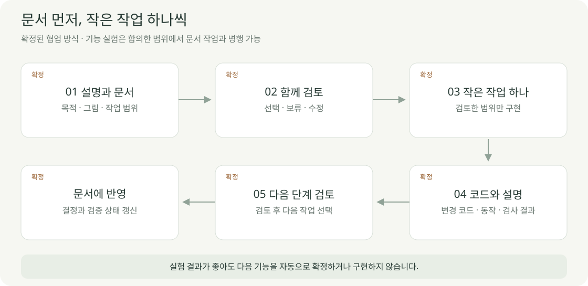
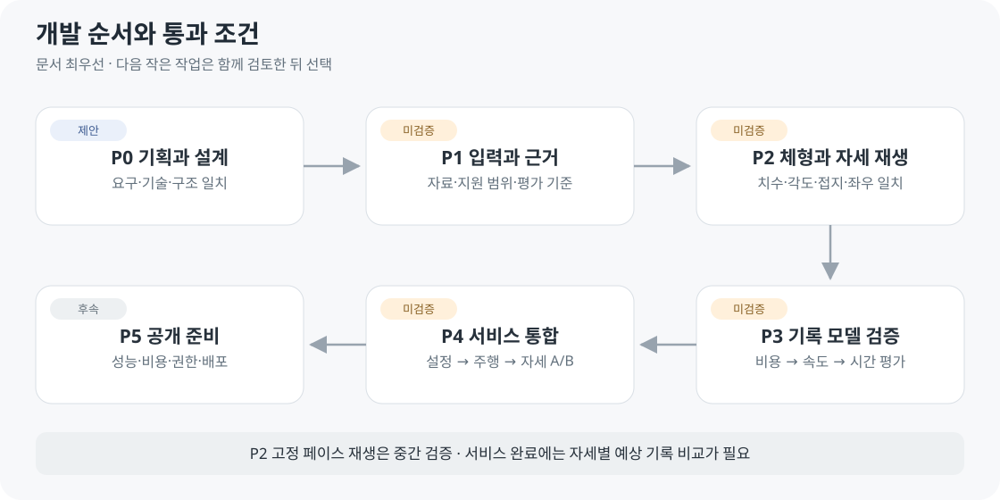

# 개발 계획과 결정 목록

2026-10-22 · v0.96 · **M88 실제 코스 주행·종료·설정 보존 구현 / 기록 계산은 후속**

M93 현재: [항공사진 대조·경로 오류 수정](../05-validation/COURSE_IMAGERY.md). 남동쪽 광장 우회를 제거한 D 경로를 사용합니다. M92 원본 검사는 유지하며 현장 도착점 차이 전체는 아직 미해결입니다.

| 확인 완료 | 미완료 |
| --- | --- |
| 화면 시안 · 기획/설계 초안 | 서비스 화면 · 자세 A/B |
| Blender 조절·리깅 사용자 확인 | 신체 치수와 외형/뼈대의 정확한 대응 |
| GLB · 부위 길이 6종 · 제한된 자세 8항목 · 복원 · M10 기본 달리기 | 사용자 자세 기반 동작 생성 · 물리 접지 · 코너 인체 역학 · 기록 계산 |
| 남성형/여성형 GLB·리깅 · 로컬 관리자·통계 | 관리자 인증 · 게시 설정 서버 검증 · 서비스 전체 통계 |

**M88 구현·검사 완료:** [선택한 코스 위 달리기](../05-validation/COURSE_RUNNING.md). 출발·방향·바퀴·기존 신체/자세를 연결하고 재생·종료를 검증했습니다.

**M87 구현 완료:** [코스 설정·화면·코드·검사](../05-validation/COURSE_SETTINGS.md). 사용자 확인을 받은 B 경로의 출발점·방향·바퀴 수를 선택하고 신체·자세를 유지합니다. M86 후보 A는 반려 이력입니다.

**M85 문서·조사 이력:** [실제 보행 좌표](../05-validation/COURSE_FEASIBILITY.md)를 확보했습니다. [화면](../03-screens/COURSE_SCREEN.md)과 [범위·순서](../04-technical/COURSE_PIPELINE.md)를 검토한 뒤 실제 한 바퀴 확정 → 코스 입력 → 기존 설정 전달 순으로 진행하는 제안입니다.

**M78 구현·검사 완료:** [네 단계 실제 화면](../05-validation/STAGE_PAGES.md). 과거 실험 화면은 이력으로 보존합니다. 코스는 M87에서 구현했고 백테스팅은 설정 요약까지 연결했습니다.

**M79 구현·검사 완료:** [신체 설정의 달리기 연결](../05-validation/BODY_RUNNING.md). 자세 입력을 유지하며 길이·전체 크기·새 발바닥 높이를 반영합니다.

**M80 구현·검사 완료:** [신체를 잡고 길이 조절](../05-validation/BODY_EDITOR.md). 신체 위 직접 조작과 화면 안 크기 손잡이를 기본 입력으로 사용합니다.

**M81 구현·검사 완료:** [다리·아래팔로 자세 조절](../05-validation/POSE_EDITOR.md). 기존 신체·기본 달리기를 유지하고 양쪽 공통 자세 값에 연결했습니다.

**M82 구현·검사 완료:** [몸통 직접 조절](../05-validation/UPPER_LEAN.md). 현재 신체·다리·팔 설정을 유지하며 상체 기울기 입력을 추가했습니다.

**M84 구현·검사 완료:** [뒤꿈치·앞꿈치 착지](../05-validation/FOOT_STRIKE.md). 기존 설정을 유지하며 착지 선택을 확장했습니다.

**M83 구현·검사 완료:** [미드풋 착지](../05-validation/MIDFOOT.md). 기존 신체·자세 설정을 유지하며 양발의 착지 직전·초반에 선택한 접촉 자세를 반영합니다.

## 결정할 항목

| ID | 결정 | 근거·완료 조건 | 시점 |
| --- | --- | --- | --- |
| D01 | 최소 자세 입력 | 상체·다리·팔 후보와 실제 자료/모델 지원 대조 | P1 |
| D02 | 치수·각도·범위 | 측정점·좌표·극단값·조합·복원 · 허용 오차 고정 | P2 전 |
| D03 | 동작 생성·참고 자료 | 사용자 주요 자세 → 자동 생성 방향 합의 · 생성 방식·관절/접지 검사 미정 | P2 전 |
| D04 | 비용 모델 | 자세/속도 실측 근거 · 입력 · 재현 코드 | P3 전 |
| D05 | 능력·노력 | 정의·단위·시간 변화 · D04와 연결 검증 | P3 전 |
| D06 | 실제 코스 | [M87](../05-validation/COURSE_SETTINGS.md) 후보 B 확인·지도 계산 거리·출발/방향/바퀴 구현 · 실측 오차·고도·현장 검증 잔여 | M88 주행 구현 / 현장 정확도·고도 잔여 검토 |
| D07 | 지원 거리·시간 | 자료 범위·누적 피로 근거 · 장거리 외삽 제한 | 기록 비교 전 |
| D08 | 계산 호스팅 | 시간·메모리·패키지 크기 · 운영 비용 | P5 |
| D09 | 저장 범위 | M01 페이지 메모리 1개·버튼 확인 · A/B·영구 저장은 별도 | 후속 범위 검토 |
| D10 | 관리자 권한·설정 게시 | 서버 역할 검사 · 초안/게시/복원 · 변경 기록 | 운영 전 필수 |
| D11 | 서비스 통계 | 이벤트 중복 제거 · 시간대·집계·보관 · 내부 시험 제외 | 운영 전 필수 |
| D12 | 모델 유형·버전 | 남성형/여성형 로컬 검증 완료 · 저장소/게시 파이프라인 | 운영 전 필수 |

D03은 기존 ‘달리기 자료 선택’에서 ‘사용자 동작 생성·참고 자료’로 검토 범위를 변경했습니다. 외부 애니메이션을 필수로 정하지 않습니다.

| 추가 ID | 결정할 것 | 상태 |
| --- | --- | --- |
| D13 | 자세 역할·자동 연결·주기·녹화 범위 | M01 보조 기능 확인 · M02/M03 이전 제안 보류 · M06/M10 기본 반복 구현 · 설정 연결/물리 접지 전 |
| D14 | 얼굴·가슴 등 웹 체형 입력·변형 순서 | 원본 기능 확인 · 조합 검증 전 |
| D15 | 다리 벌림·골반 너비·좌우 조절 | 요구 확인 · 범위/기본값 검토 전 |
| D16 | 근거 비교의 자료·지표·동기화·진입 방식 | R16 방향 확정 · SCR08 제안 · 첫 항목/시작 기준/오차/설정 연결 검토 전 |

## 먼저 검토할 작업과 후속 후보

| 후보 | 범위 | 설명 문서 |
| --- | --- | --- |
| M77 팔꿈치 굽힘·다리 들림 조합 | 양팔 ±20°·15,030조합·보존·재생 검사 완료 / 서비스는 신체→자세→코스→백테스팅 순서 | [설계·결과](../05-validation/CMU_ELBOW_BEND.md) |
| M76 기본 달리기·다리 들림 설정 | 0~10cm 양발 반영 / 11,022자세·기본값·착지·재생 검사 완료 / 저장·메인 연동 전 | [설계·결과](../05-validation/CMU_LEG_HEIGHT.md) |
| 전신 기준 후보 · M75 양발 접촉 통합 | 착지·지지·발 떼기 연결 / 공통 접지 이동 25–29% 감소·몸/방향/회수 보존·남녀 재생 검사 완료 / 기능 비교용 | [코드·검사](../05-validation/CMU_UNIFIED_STANCE.md) |
| 전신 기준 후보 · M74 왼발 합류 | 남성형 지면 근처 0.17mm 감소·보존·좌우 차이 검사 완료 / 여성형 유지·밀림 잔여 / 합류 범위 재설계는 제안 | [코드·검사](../05-validation/CMU_SUPPORT_JOIN.md) |
| 전신 기준 후보 · M73 착지 초반 지지 연결 | 양발 초기 이동 감소·골반/높이/발 방향/회수 보존 검사 완료 / 합류 이동 잔여·외형 검토 전 | [코드·검사](../05-validation/CMU_EARLY_SUPPORT.md) |
| 전신 검토 · M72 | 관찰 완료 / 착지 초반 M73 후속 구현 · 해제 타이밍·팔·손은 제안 | [관찰·우선순위](../05-validation/CMU_FULL_RUN_REVIEW.md) |
| 전신 기준 후보 · M71 손목과 손 모양 | M70 팔·다리·몸 보존 / 손목·손가락만 수정·검사 완료 / 전신 관찰 M72 | [원인·코드·검사](../05-validation/CMU_HAND_POSE.md) |
| 전신 기준 후보 · M70 팔 앞뒤 움직임 | M69 다리·몸·발 보존 / 양팔 반 주기 평균·검사 완료·외형 검토 전 | [원인·코드·검사](../05-validation/CMU_ARM_SWING.md) |
| 전신 기준 후보 · M69 무릎 옆 흔들림 | M68 굽힘·골반·발 위치/방향 보존 / 옆 우회 제거·검사 완료·외형 검토 전 | [설계·검사](../05-validation/CMU_KNEE_LATERAL.md) |
| 전신 기준 후보 · M68 해제 떨림 | 내부 굽힘 왕복 제거·방향 연결·보존 검사 완료 / 옆 움직임 잔존·외형 검토 전 | [원인·비교·검사](../05-validation/CMU_SHARED_RELEASE.md) |
| 양발 지지 후반 · M67 | 왼발 반 주기 적용 / M66 오른발 보존·반복 경계 검사 / 외형 검토 전·대칭 잔여 차이 | [정면·측면·코드·검사](../05-validation/CMU_SHARED_SUPPORT_BILATERAL.md) |
| 오른발 지지 후반 · M66 | 피부점 경로·무릎 연결 / 골반·높이·발 세계 방향 유지 / 양발 M67 후속·해제 잔여 이동 | [정면·측면·코드·검사](../05-validation/CMU_SHARED_SUPPORT.md) |
| 착지·지지·밀어내기 · M65 | 관찰 완료 / 공통 재구성 단계의 지지점 이동 증가 / 오른발 M66 후속·기본 동작 채택 보류 | [그림·계산 단계·측정](../05-validation/CMU_SHARED_STANCE_REVIEW.md) |
| 양발 착지 접근 · M64 | 접근 중 왕복 감소 / 좌우·발목·높이 보존 / 자연스러움 M65 검토 | [정면·측면·코드·검사](../05-validation/CMU_SHARED_APPROACH.md) |
| 전신 좌우 자세 · M63 | 팔·손 동작과 피부 가중치 대응 / 전신 관절·피부 검사 완료 / 공통 접근 M64 후속 | [같은 단계 비교·검사](../05-validation/CMU_BILATERAL_POSE.md) |
| 상체 중심 대응 · M62 | 중심점 검사 완료 / 사용자 전체 자세 품질 문제 제기 / M63 후속 | [비교·코드·검사](../05-validation/CMU_UPPER_CENTER.md) |
| 양발 접근 비대칭 · M61 | 기준별 관찰 완료 / 상체 중심은 M62 후속 구현 / 공통 안쪽 접근 별도 | [그림·코드·검사](../05-validation/CMU_APPROACH_SYMMETRY.md) |
| 몸 높이 연결 · M60 | 구현·관절/접지 유지·추가 상승 제거·수치/재생 검사 완료 / 좌우 외형 차이는 M61 | [비교·코드·검사](../05-validation/CMU_BODY_HEIGHT.md) |
| 전신 검토 · M59 | 관찰 완료 / 높이 연결은 M60 / 접지·상체는 후속 제안 | [그림·관찰 결과](../05-validation/CMU_WHOLE_BODY_AUDIT.md) |
| 양발 공통 기준 · M58 | 기준 공유·골반 연동·수치/재생 검사 완료 / 발목 사용자 확인 / 전신 M59 검토 | [실제 비교·코드](../05-validation/CMU_SHARED_GAIT.md) |
| 왼발목 해제 회전 · M57 | 접지·방향 보정 해제 중첩 확인 / M58 양발 공통 기준으로 후속 진행 | [그림·단계별 검사](../05-validation/CMU_ANKLE_RELEASE_AUDIT.md) |
| 비교 준비 시간 · M56 성능 후속 | 동작 유지 / 발바닥 뼈 변환 공유 · 독립/전 주기·남녀 반복 시간 검사 완료 | [구조·코드·검사](../05-validation/CMU_PREPARATION_PERFORMANCE.md) |
| 양발 후반 경로 · M56 | 착지 순간 유지 / 이후 기준점 이동 교정 허용 · 후반 거리·해제 속도 감소 / 수치 검사 완료·자연스러움 검토 전 | [비교·코드·검사](../05-validation/CMU_TOE_SLIP_PATH.md) |
| 발끝 미끄러짐 · M55 | 짧은 감소 뒤 해제 이동 증가·기준점 보존 불합격 / M54 유지 · 기준점 유지 의미 확정 → M56 | [실제 비교·반려 검사](../05-validation/CMU_LATE_TOE_SLIP.md) |
| 전신 기준 후보 · M54 지지 후반 연결 | M53 골반·착지 기준점·회수 유지 / 후반 회전·높이 차이 감소·730자세 / 종료 순간 차이·전체 접지 미검증 | [비교·코드·검사](../05-validation/CMU_LATE_STANCE_SOLE.md) |
| 전신 기준 후보 · M53 양발 착지 초기 기울기 | M52 골반·착지 지면 좌표 유지·양발 초기 피부 기준 교정·730자세 / 후반 차이·자연스러움 검토 전 | [실제 화면·코드·검사](../05-validation/CMU_LANDING_SOLE_ALIGNMENT.md) |
| 전신 기준 후보 · M52 추가 몸 이동 제거 | M50 착지 유지·원본 이동 기준 복원·730자세/독립 기준 검사 / 회전·발 들림 잔존 | [실제 비교·코드·결과](../05-validation/CMU_PELVIS_REFERENCE_RESTORE.md) |
| 전신 기준 후보 · M50 품질 반려 / M51 점검 | 왼발만 골반 이동·좌우 발 들림·보정 경로 차이 확인 / 새 교정 없음 | [M51 전체 점검](../05-validation/CMU_BILATERAL_CHAIN_AUDIT.md) · [M50 이력](../05-validation/CMU_LEFT_ANKLE_DIRECTION.md) |
| 전신 기준 후보 · M47 착지 경로 | 양발 착지 전 정렬·지지 중 좌우 위치/방향 유지 · 검증 기록 연결 / 사용자 검토 전 | [비교·검사](../05-validation/CMU_STANCE_CONTACT.md) |
| 전신 기준 후보 · M46 앞뒤 재보정 | 앞뒤 RMS 감소·좌우/높이 유지·730자세·M45 회귀 / 잔여 밀림·자연스러움 검토 전 | [비교·검사](../05-validation/CMU_FORE_AFT_RELEASE.md) |
| 전신 기준 후보 · M45 좌우·발끝 보정 | 좌우 속도·중간 발끝 높이 감소 / 앞뒤 RMS 증가 / 730자세·골반/회수 유지 | [비교·검사](../05-validation/CMU_RELEASE_REFINEMENT.md) |
| 전신 기준 후보 · M44 해제 지지점 연동 | 앞뒤 밀림 감소·730자세·M42 유지 / 좌우 밀림 잔존·자연스러움 검토 전 | [비교·검사](../05-validation/CMU_PIVOT_RELEASE.md) |
| 전신 기준 후보 · M43 고정 해제 검토 | 위치·회전 불일치 측정 / 보정 없음 / 지지점 기준 연동은 검토 제안 | [그림·측정](../05-validation/CMU_FOOT_RELEASE.md) |
| 전신 기준 후보 · M42 짧은 오른발 고정 | 730자세·골반/회수 유지·경계 연결 검사 / 고정 중 개선·해제 앞뒤 밀림 잔존 / 사용자 검토 전 | [재생·검사](../05-validation/CMU_FOOT_PLANT.md) |
| 전신 기준 후보 · M41 발 밀림 점검 | 같은 피부점 측정·좌우 악화·앞뒤 잔존 확인 / 접지 수정은 검토 제안 | [측정·원인](../05-validation/CMU_HIP_REFERENCE_SLIP.md) |
| 전신 기준 후보 · M40 오른발 고관절 기준 | 골반 기준 유지·오른발 목표 재설정·730자세와 독립 기준·M39 회귀 검사 / 자연스러움 검토 전 | [재생·검사](../05-validation/CMU_HIP_REFERENCE.md) |
| 전신 기준 후보 · M39 골반 추가 이동 축소 | 착지 유지·회수 각도·730자세·M38 회귀 검사 완료 / 자연스러움 검토 전 | [재생·검사](../05-validation/CMU_PELVIS_SWAY.md) |
| 전신 기준 후보 · M38 양발 구간 연동 | 왼발 확장·회수·주기 경계·730자세·오른발 회귀 검사 완료 / 자연스러움 검토 전 | [재생·검사](../05-validation/CMU_STANCE_CHAIN_BILATERAL.md) |
| 전신 기준 후보 · M37 오른발 구간 연동 | 골반·무릎·발 가중 연결 · 회수 복귀·730자세·경계 검사 · 자연스러움 검토 전 | [재생·검사](../05-validation/CMU_STANCE_CHAIN_MOTION.md) |
| 전신 기준 후보 · M36 한 장면 연동 | 골반–무릎–발 동시 조절 · 남녀 정지 자세 검사 · 자연스러움 검토 후 구간 연결 | [실제 화면·검사](../05-validation/CMU_STANCE_CHAIN.md) |
| 전신 기준 후보 · M35 고관절 수직선 | 표면점 정렬 검사는 통과 · 무릎 꺾임으로 채택 보류 · 골반–무릎–발 연동 재설계 | [실제 화면·검사](../05-validation/CMU_HIP_LANDING_COMPARISON.md) |
| 전신 기준 후보 · M34 양발 지지 | 각 발 착지에만 보정 · 회수 유지 · 양발 730자세 + 오른발 전용 730자세 회귀 검사 | [실제 화면·검사](../05-validation/CMU_BILATERAL_COMPARISON.md) |
| 전신 기준 후보 · M33 오른발 지지 | 현재/최대 2cm/4cm 비교 · 730자세 검사 · 자연스러움 검토 후 다음 단계 결정 | [실제 화면·검사](../05-validation/CMU_LANDING_COMPARISON.md) |
| 전신 기준 후보 · M32 고관절 중점 | 기준점의 이동 영향·안쪽 디딤 확인 · 몸 전체 이동만으로 상대 간격 불변 · 보정 없음 | [그림·검사](../05-validation/CMU_HIP_CENTER_VALIDATION.md) |
| 전신 기준 후보 · M31 모델 전달 | 추가 회전 오류 근거 없음 · 몸/발 위치 차이 분리 · 직접 원인 미확정 · 보정 변경 없음 | [단계 비교·검사](../05-validation/CMU_TRANSFER_VALIDATION.md) |
| 전신 기준 후보 · M30 원본 검증 | 골반·다리 외부 변환 일치 · 축/좌우/순서 오류 근거 없음 · 추가 보정 미실시 | [독립 검사·그림](../05-validation/CMU_SOURCE_VALIDATION.md) |
| 전신 기준 후보 · M29 전체 주기 | 732자세 비교·교정 설계 작성 · 독립 원본 검산은 M30 수행 | [한 주기 비교·설계](../04-technical/RUNNING_CYCLE_REVIEW.md) |
| 전신 기준 후보 · M28 디딤 위치 | 상시 바깥 회전 실패 · 기본 꺼짐 · 착지/회수 구간 분리 설계 필요 | [정면 비교·검사](../05-validation/FULL_BODY_REFERENCE.md) |
| 전신 기준 후보 · M26 오른발 | 같은 피부 점 이동 속도 감소·664표본 · 전환 구간/왼발 및 자연스러움 검토 전 | [오른발 전후·검사 한계](../05-validation/FULL_BODY_REFERENCE.md) |
| 전신 기준 후보 · M25 몸 이동 | 동일 자세/높이 668표본 · 원본 수평 이동 비교 구현 · 자연스러움 검토 전 | [실제 비교·한계](../05-validation/FULL_BODY_REFERENCE.md) |
| 전신 기준 후보 · M24 피부/골반 | 가중치 보정으로 네 조합 압축 개선 · 골반/다리 기울기 원본과 일치 · 전체 자세/외형 승인 전 | [피부 전후·골반 연쇄 비교](../05-validation/FULL_BODY_REFERENCE.md) |
| M17 사용자 검토 미통과 | 높이·접지 부분 검사만 통과 · 달리기 느낌 미충족 | [현재 화면·검사](../05-validation/BASIC_RUN.md) |
| M16 문워크 보정 확인 | 지지 기준점 고정·몸 전진·공중·카메라 검사 | [현재 화면·검사](../05-validation/BASIC_RUN.md) |
| M15 팔·발·떨림 수정 확인 | 남녀 두 주기 연속성·12건·M13 회귀 7건 통과 | [실제 화면·검사](../05-validation/BASIC_RUN.md) |
| M14 기본 달리기 수정 확인 | 허벅지·무릎 자료 반영 · 12건·M13 회귀 7건·빌드 통과 | [실제 화면·검사](../05-validation/BASIC_RUN.md) |
| SCR08 정식 근거 비교 설계 검토 | M14와 AB01은 같은 원자료 · 설정 연결/독립 비교 첫 항목 재검토 | [그림·상태·단계](../03-screens/EVIDENCE_COMPARISON.md) |
| M13 실측 왼다리 대응 결과 확인 | 별도 화면 두 각도만 구현 · 새 검사 7건·기존 달리기 11건 통과 | [실제 화면·코드·검증](../05-validation/REFERENCE_LEG.md) |
| M11 부위 선택·가림 결과 확인 | 오른쪽 아래팔/점 비교 · 새 검사 15건·회귀 92건 통과 | [실제 화면·코드·검증](../05-validation/BODY_PICKING.md) |
| M10 기본 달리기 결과 확인 | 달리기 11건·기존 기능 120건 통과 · 자연스러움 검토 | [실제 화면·코드·검증](../05-validation/BASIC_RUN.md) |
| M07 단계 분리 결과 확인 | 체형↔자세 9건 확인 · 코스 미구현 | [실제 화면·검증](../05-validation/SETUP_STEPS.md) |
| M09 오른쪽 팔꿈치 결과 확인 | 오른쪽 18건·왼쪽 회귀 18건·좌우 연동 4건 확인 | [실제 화면·코드·결과](../05-validation/ELBOW_DRAG.md) |
| 다리 올림에 따른 반복 동작 · M06 결과 확인 | 남녀 GLB 15건 통과 · 재생/정지 · 최대 각도 측정 | [실제 화면·결과](../05-validation/LEG_LIFT.md) |
| 얼굴 크기 하나 연결 | 원본→GLB→웹의 전달 확인 | [체형 자산](../04-technical/BODY_ASSETS.md) |
| 다리 벌림 하나 조절 | M12 고정 벌림 제거 이후 사용자 입력 범위 검토 | [다리 간격](../04-technical/BODY_ASSETS.md) |

2026-10-14 M01-b 구현·브라우저 검사 후 사용자 ‘확인했습니다’. 이후 ‘주요 자세를 잡고 설정대로 애니메이션 재생’ 방향에 합의했으며, M01은 보조 기능으로 유지합니다. M06은 후속 ‘테스트 진행하고 싶네요’ 요청으로 구현·검사했습니다. [협업 방식](WORKFLOW.md)에 따라 사용자 확인 후 다음 작은 작업을 정합니다.

## 단계별 증거

| 단계 | 통과 증거 | 요구 |
| --- | --- | --- |
| P0 | 확정/제안/미검증 구분 · 문서 충돌 제거 | 전체 |
| P1 | 이용 가능한 자료·지원 변수 · 실험 전 오차 기준 | R01·R02·R07·R08 |
| P2 | 입력/측정 치수·각도 · 접지 · 주기/속도 · 고정 페이스 시간 | R01–R05 |
| P3 | 참가자별 독립 평가 · 기준 모델 대비 오차 · 지원 범위 | R06–R08 |
| P4 | 같은 조건 A/B · A 보존 · 좌우 동기화 · 실패 처리 | R03–R08 |
| P5 | PC/브라우저 성능 · 비용 · 자료 권리 · 복구 절차 | R07·R08 |

P3가 성립하지 않으면 기록을 임의로 채우지 않고 원인·대안을 정리합니다. 개인 기록 저장은 후속으로 둘 수 있지만, R09–R11 관리자 권한·통계·모델 게시 연결은 P4–P5의 필수 완료 조건입니다.

[요구사항](../02-requirements/REQUIREMENTS.md) · [구조](../04-technical/ARCHITECTURE.md) · [검증 기록](../05-validation/CHARACTER_VALIDATION.md)
