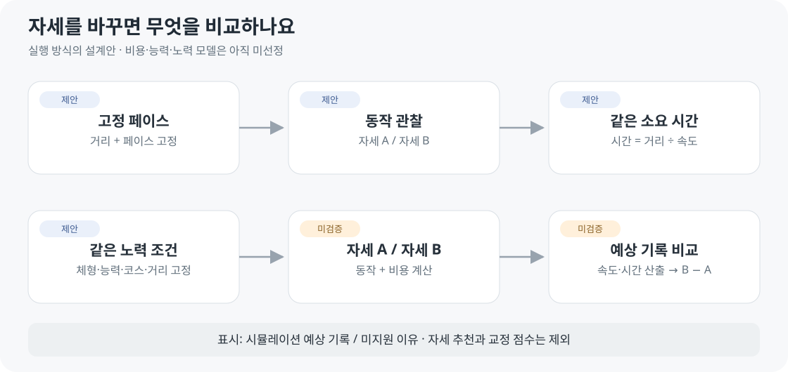

# 서비스 기획서

2026-10-22 · v0.21 · **M93 항공사진 대조·국소 수정 / 현장 도착점 전체 일치 미해결**

서비스 순서는 **신체 세팅 → 자세 세팅 → 코스 세팅 → 백테스팅**입니다. 신체 세팅은 기존 체형 설정을 뜻하며, 백테스팅은 주행·결과 비교 단계로 연결합니다. 자세 단계는 관절 직접 조작과 수치 입력을 함께 제공하며, [단계·조작 기준](../02-requirements/REQUIREMENTS.md#r15-설정-단계와-r02-직접-조작)은 확정 요구로 관리합니다.

## 코스 항공사진 대조 · M93 구현

광장으로 우회하던 구간을 수정하고 같은 설정의 전후 도착점을 비교합니다. [항공사진 근거·실제 구현·남은 차이](../05-validation/COURSE_IMAGERY.md).

## 페이스와 소요 시간 · M90 구현

지정한 속도로 코스를 달리고 예상 소요 시간을 확인합니다. [검사·사용자 3km B/4km C 거리 대조](../05-validation/COURSE_PACE.md) · [기준 요구사항](../02-requirements/REQUIREMENTS.md#m90--목표-페이스와-소요-시간).

## 거리와 도착점 · M89 구현

바퀴 수 또는 km로 목표를 정하고 지도에서 도착점을 확인합니다. 오른쪽 위는 짧은 연결길을 사용합니다. [현재 화면·코드·검사](../05-validation/COURSE_GOAL.md).

## 실제 코스 주행 · M88 구현

선택한 출발점·방향·바퀴 수로 달리고 목표에서 종료합니다. [기능 시험·검증 한계](../05-validation/COURSE_RUNNING.md): 실제 좌표 기반의 화면 재생이며 기록 예측은 별도입니다.

## 실제 코스 설정 · M87 구현

사용자가 확인한 B 경로의 출발점·방향·바퀴 수를 설정하고 기존 신체·자세로 재생합니다. [화면 정의](../03-screens/COURSE_SCREEN.md) · [코드·검증](../05-validation/COURSE_SETTINGS.md) · [구현 구조](../04-technical/COURSE_PIPELINE.md).

## 사용자가 자세를 잡고 달리기 재생 · 방향 합의

사용자가 주요 자세를 조절하고 그 설정을 반영한 달리기를 재생하며 수정합니다. [R12 기준](../02-requirements/REQUIREMENTS.md#r12-주요-자세와-달리기)과 [화면 제안](../03-screens/MOTION_EDITOR.md)을 연결하며, [M76 다리 들림](../05-validation/CMU_LEG_HEIGHT.md)과 [M77 팔꿈치 조절](../05-validation/CMU_ELBOW_BEND.md)을 기본 달리기 위에서 시험합니다. [M78 네 단계 화면](../05-validation/STAGE_PAGES.md)에 통합했습니다. [M79](../05-validation/BODY_RUNNING.md)에서 변경한 신체의 달리기를 연결했습니다. [M81](../05-validation/POSE_EDITOR.md)에서 다리·아래팔 직접 조절을 연결했습니다. [M82](../05-validation/UPPER_LEAN.md)에서 몸통 직접 조절을 추가했습니다. [M83](../05-validation/MIDFOOT.md)에서 미드풋 착지 선택을 연결했습니다. [M84](../05-validation/FOOT_STRIKE.md)에서 뒤꿈치·앞꿈치를 추가했습니다. M87에서 코스 설정을 연결했습니다. M88에서 설정한 코스 위 주행을 연결했습니다. 다른 자세 항목·백테스팅 계산은 구현 전입니다.

## 근거 기반 자세 비교 · 정식 기능 방향 확정

설정한 동작을 근거 자료와 함께 보고, 어떤 부위·시점이 달라지는지 확인하는 기능입니다. 사용자에게 ‘최적 자세’를 추천하는 대신 차이와 출처를 보여주며, 세부 동작은 [R16](../02-requirements/REQUIREMENTS.md#r16-근거-기반-자세-비교)과 [SCR08 화면 검토안](../03-screens/EVIDENCE_COMPARISON.md)에서 관리합니다.

**설계 제안:** 움직임의 차이와 근거를 먼저 보여주고, 예상 기록은 별도의 계산 모델 검증 후 연결합니다. 현재 [M13](../05-validation/REFERENCE_LEG.md)은 고정 모델의 두 각도 대응만 검증했으며, 정식 비교 기능은 구현 전입니다.

## 실행 방식

능력·노력의 정의와 비용 모델은 미선정입니다. NRC 기록만으로 자동 추정하지 않습니다.

## 서비스 범위

| 확정 | 제안 | 미정·후속 |
| --- | --- | --- |
| MakeHuman 전신 러너 | 외형 / 길이 / 자세 / 동작 분리 | 실제 치수 대응·확장 범위 |
| 김해 롯데가든파크 주변 실제 트랙 | 최초 한 러너·한 코스 | 후보 B 사용자 확인 · 지도상 약 1.21km · 조건 설정 구현 / 실측 길이·현장 검증 별도 |
| 왼쪽 트랙 / 오른쪽 같은 순간 자세 | 세션 A/B 보관 | 계정·장기 저장 |
| 주요 자세 설정에 따른 달리기 재생 · 주변 풍경 제외 | 의미별 자세 편집 화면 | 생성·접지·계산 모델 |
| 자세 추천·교정 점수 제외 | 검증된 범위부터 제공 | 심박·피로·장거리 확장 |
| 근거 기반 자세 비교의 정식 기능화 | 내 러너/자료·공통 그래프·출처 표시 | 동작 연결·자료 확장·변경 전/후 비교 |

얼굴 크기·가슴 크기 등의 체형 편집은 최신 요청에 따라 검토 범위에 포함합니다. 눈·코 등 세부 얼굴 편집, 손가락·머리카락 편집, 다수 러너 경기는 초기 범위 밖입니다.

## 요구사항과 완료 기준

R01–R16의 기능·검수 기준·구현 상태는 [요구사항 명세서](../02-requirements/REQUIREMENTS.md)에서 관리합니다. R12 동작 제작, R13 외형 조절, R14 다리 간격, R16 비교 상세 방식은 검토 중입니다.

## 비교 규칙

| 고정 | 변경 | 표시 |
| --- | --- | --- |
| 체형·능력·노력·코스·거리·환경·자산·모델 버전 | 자세만 | A / B 예상 기록 · B − A |
| 지원 범위·검증 오차 정보 | 범위 밖은 계산 불가 | 미완주·실패는 별도 상태 |

음수 차이는 B의 시간이 짧다는 뜻입니다. 임의 시간 가감·신뢰 구간을 만들지 않습니다.

[입력 후보](../03-screens/CUSTOMIZATION_SCREEN.md) · [기술](../04-technical/TECH_SPEC.md) · [구조](../04-technical/ARCHITECTURE.md) · [개발 순서](DEVELOPMENT_PLAN.md)

**현재:** GLB·부위 길이 6종·제한된 자세·남성형/여성형·로컬 관리자 시험 확인. 기록 계산과 운영 연결은 미완료. 고정 페이스 데모만으로 서비스 완료를 판정하지 않습니다.
