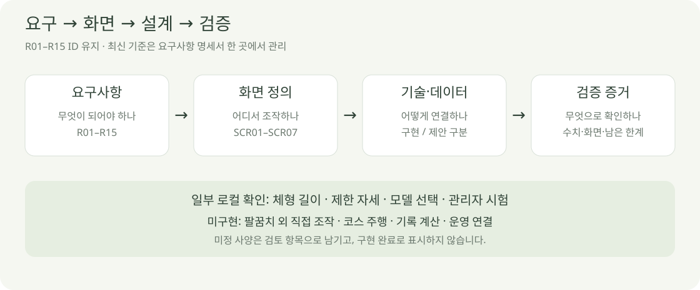
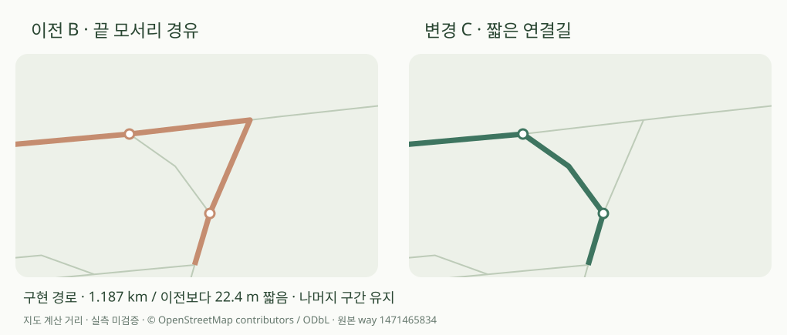
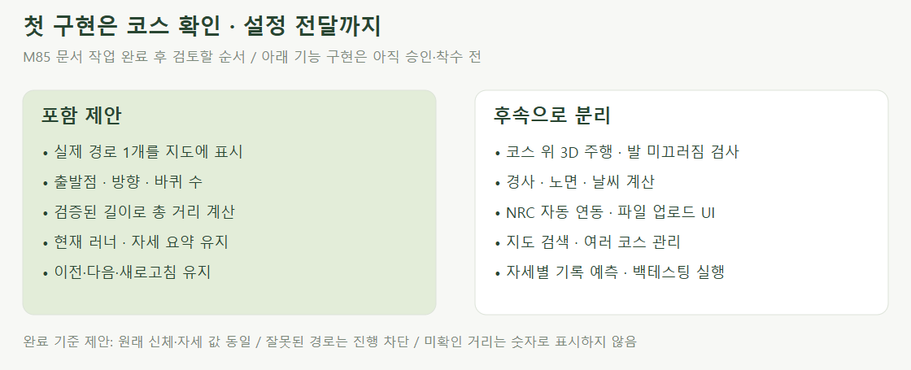
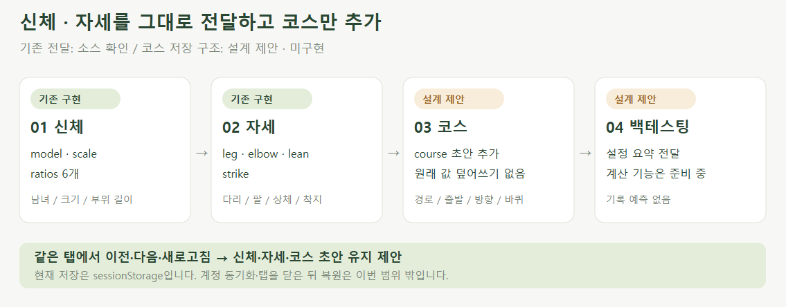
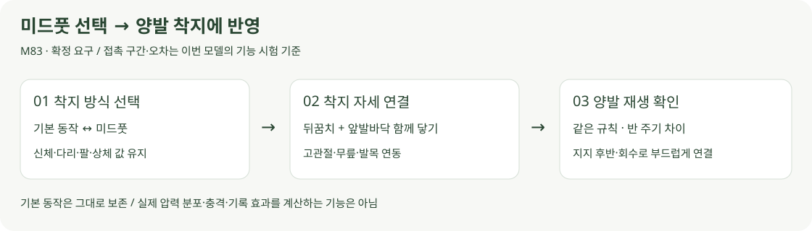
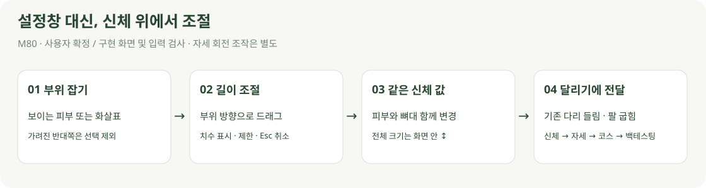
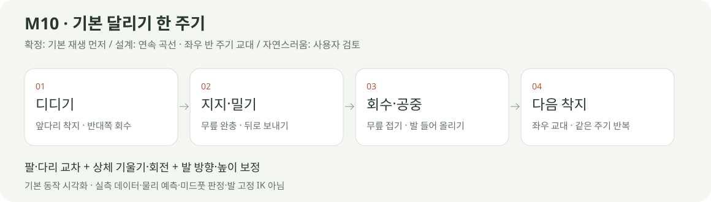

# 요구사항 명세서

2026-10-22 · v0.97 · **M93 항공사진 대조·국소 경로 수정 / 현장 도착점 전체 일치 미해결**

기존 R01–R15를 유지하고 R16을 추가하며 요구·검수 기준을 이 문서에서 관리합니다. ‘부분 확인’은 해당 로컬 시험만 통과했다는 뜻입니다.

## M93 · 항공사진 대조와 경로 오류 수정

**사용자 확정 / 부분 구현·검증:** 재주행을 요청하지 않고 독립 지도·항공사진에서 원인을 찾아 수정합니다. [확인한 오류·실제 화면·검사·남은 차이](../05-validation/COURSE_IMAGERY.md).

| 항목 | 현재 계약 |
| --- | --- |
| 근거 | Esri/Vantor 지리 좌표 영상과 별도 카카오 항공사진 대조 · OSM 원본 재조회만으로 정확성을 주장하지 않음 |
| 수정 | C 남동쪽 광장 연결점 13502643119 제거 · 같은 양끝 연결 · 다른 좌표 유지 · D `d-ebb99e9a6425`, 1182.140968m/바퀴 |
| 계산 | 사용자 경험·카카오 참고 길이에 배율 맞추지 않음 · 수정 좌표의 길이로 지도·주행·바퀴 목표 시간 함께 계산 |
| 기존 설정 | 신체·자세·방향·바퀴 수·km 목표·페이스 유지 · 출발점은 물리적 위치로 이전; 제거된 우회 위만 최근접 트랙으로 이전하고 안내 |
| 자료 계약 | `source.verification`은 원본 C 검사 · `source.correction`은 C/D 해시·수정 구간·출처·길이·미측량 표시 · `previous`로 B/C 이력 유지 |
| 자동 검사 | 수집 명령: C 조회·검증 후 D 재생성 · 빌드: 저장 원본 검사와 D 재현 일치 검사 · 확인한 C 해시 변경 시 수정 적용 중단 |
| 비교 | 같은 물리적 출발점·방향·목표에서 수정 전 도착점을 점선으로 표시 · 출발점이 제거된 우회에서 이동한 경우 전후 도착점 직접 비교 생략 |
| 한계 | 국소 오류 수정·설정 이전·화면 계산 검증 완료 · 사용자 3km B 이후/4km C 다음 중간 일치는 미해결 · 측량 정확도·고도 미검증 |

출처: 사용자 ‘다른 지도 자료나 항공사진과 비교해서 경로 오차의 원인을 찾아 수정…다시 뛰어서 맞추는 방식 말고…기존 설정 유지’. **R03·R04·R08·R15 / D06 / SCR04·SCR05 / M90·M92→M93**.

## M92 · 코스 자동 계산과 원본 검증

M93부터 아래 원본 검사는 C 기반 검증으로 유지하고, 실제 서비스 경로는 항공사진에서 확인한 국소 오류를 수정한 D를 사용합니다.

**사용자 확정 / 구현:** 직접 뛰어본 위치 설명에 맞춘 M91 배율을 철회하고, 원본 경로 수집·검증과 거리·도착점 계산을 자동화합니다. [화면·코드·검사](../05-validation/COURSE_AUTOMATION.md).

| 항목 | 구현 계약 |
| --- | --- |
| 수집 | 확인한 C 경로의 8개 OSM way 조회 · Overpass 실패 시 공식 OSM API 읽기 전용 조회 |
| 검사 | 79개 연결·노드 좌표·해시·보행 조건·버전·닫힌 경로·거리 독립 검산 |
| 계산 | 원본 경로 길이 1187.295902m · 사용자 관측 배율 없음 · 지도·주행 동일 거리 |
| 자동 실행 | 수집 명령 하나로 조회→검사→출처 갱신 · 빌드마다 저장 원본 검사 · 사용자 화면은 검증 자산만 읽음 |
| 오류 | 통신/데이터 오류는 기존 자산 보존 · 원본 경로/좌표 변경 시 자동 덮어쓰기 중단, 실패 보고 · 출발점 이전 검토 별도 |
| 유지 | 신체·자세·출발·방향·바퀴 수·km 목표·페이스 저장값 유지 · km 목표 시간 불변 · 바퀴 목표는 지도 거리로 재계산 |
| 한계 | 지도 좌표의 신뢰성 자체는 미검증 · 최신 원본과 같다는 사실은 실측 정확도의 증거가 아님 · 위성사진 선형 추출/GPS 매칭 미구현 |

출처: 사용자 ‘내가 뛰어보고 보정하면…너가 자동화를 해줘야지’. **R03·R04·R08·R15 / D06 / SCR04·SCR05 / M90→M91 철회→M92**.

## M91 · 사용자 설명 기준 거리 보정

**철회 이력 / 현재 미적용:** 사용자 설명에 배율을 맞추는 해법은 M92에서 철회했습니다. 아래는 이전 구현 계약입니다. 3km는 B 이후 조금, 4km는 C 다음 직선 중간에 맞추고 기존 설정을 유지하며 지도에서 전후를 비교합니다. [실제 화면·코드·검증](../05-validation/COURSE_CALIBRATION.md).

| 항목 | 이번 구현 계약 |
| --- | --- |
| 기준 관측 | M90에 확인한 출발점(원본 경로 누적 1121.8640021884382m)·반시계 · 사용자 3km B 이후 / 4km C 이후 |
| 적용 방식 | 4km는 C→B 경로의 중간 · 전체 거리 비율 한 개로 보정 · 3km는 그 결과 B 약 38m 이후인지 대조 |
| 수치 | 지도상 4km 대응 경로 4140.148923m → 4000m · 배율 약 0.966149 · 한 바퀴 약 1147.105m |
| 유지 | 원본 경로 좌표·출발 좌표 체계·신체·자세·방향·바퀴 수·목표 km·목표 페이스 저장값 보존 |
| 공통 계산 | km 도착점·주행 현재 위치·완료 바퀴·바퀴 목표 총거리 모두 같은 보정 사용 · km 목표 시간 유지 / 바퀴 목표 시간 재계산 |
| 재생 | 3D 코스의 가로 좌표에 같은 거리 배율 적용 · 러너 크기·관절·동작 주기는 보존 · 지도 좌표는 그대로 |
| 비교 | 현재 출발점·방향의 3/4km 보정 전/후 지도 표시 · 비교 표시 전환은 설정을 변경하지 않음 |
| 검증 한계 | 사용자 위치 설명에 맞춘 추정 · C→B의 경로상 중간을 직선 중간으로 해석 · GPS/측량 검증 아님 · 다른 거리·출발점·방향의 현장 일치 미검증 |

출처: 사용자 ‘실제 주행 거리와 도착점이 맞도록 보정…3km B…4km C…기존 설정 유지…지도 비교’. **R03·R04·R08·R15 / D06 / SCR04·SCR05 / M90→M91**. 기존 M90의 보정 미적용 상태는 이전 이력입니다.

## M90 · 목표 페이스와 소요 시간

**사용자 확정 / 구현·검사 완료:** 목표 페이스를 코스 속도·소요 시간에 반영하며 기존 신체·자세·출발점·방향·거리를 유지합니다. [실제 화면·코드·검사](../05-validation/COURSE_PACE.md).

| 항목 | 이번 구현 계약 |
| --- | --- |
| 입력 | 기존 동작 속도 / 목표 페이스 선택 · 목표 1:00–30:00 분/km · 1초 단위 · 목표 활성화 초기값 6:00 |
| 보관 | 선택 필드 course.paceSecondsPerKm · 없는 기존 저장값은 기존 동작 속도 유지 · 다른 설정 보존 |
| 시간 | 속도 m/s = 1000 / 페이스 초 · 소요 초 = 총 m × 페이스 초 / 1000 · 경과 시간과 총 소요 시간 표시 |
| 동작 | 한 주기 전진 거리 유지 · 주기 시간만 목표 속도에 맞춤 · 같은 위상의 관절·발 방향·몸 높이·신체 비율 보존 |
| 배속 | 1/2/4×는 관찰용 재생 배속 · 설정 페이스·총 소요·도착 위치는 불변 |
| 도착 | 페이스 변경으로 지도 거리·도착 좌표를 바꾸지 않음 · 목표 거리에서 정지 |
| 오류 | 빈 입력·초 60 이상·범위 밖·소수 입력은 저장하지 않고 다음 차단 · 오류 종류별 복구 |
| 현장 차이 | 1–5km 제보 보존 · 사용자 3km B 이후/4km C 이후 확인 · 계산식 독립 검산 · 정확한 현장 대응점 확인 전 경로 길이 배율 변경 없음 |
| 해석 | 지정한 페이스를 계속 유지한다는 산술 결과 · 자세에 따른 실제 기록 예측 아님 · 속도별 자연스러운 보폭/케이던스 모델 미검증 |

출처: 사용자 ‘목표 페이스…주행 속도와 소요 시간…기존 설정 유지’, ‘실제로 뛰었을 때 거리와 도착점 차이’, 1–5km 구간별 설명, ‘3키로는 B / 4키로는 C’. **R03·R04·R08·R15 / D06 / SCR04·SCR05 / M89→M90**.

## M89 · 목표 거리와 도착점

**사용자 확정 / 구현·검증 완료:** 바퀴 또는 km 목표, 도착 표시, 오른쪽 위 끝 모서리를 생략하는 짧은 길을 적용합니다.

| 항목 | 이번 구현 계약 |
| --- | --- |
| 목표 | 바퀴 1–100 또는 거리 0.01–100 km · 거리 입력 0.01 km 단위 · 내부 저장은 정수 m |
| 완료 | 총 거리 = 바퀴 × 코스 길이 또는 입력 m · 해당 누적 거리에서 재생 정지 |
| 도착 | 출발 + 방향 부호 × 총 거리 · 설정 지도/주행 위치도/3D 도착선에 같은 위치 표시 · 출발과 겹치면 ‘출발·도착’ |
| 경로 | B의 북동 모서리 대신 실제 연결길 OSM way 1471465834 사용 · 다른 구간 유지 · C revision |
| 보관 | 기존 바퀴 저장값 호환 · 거리 모드는 course.goal = {type:'distance', distanceM} 추가 · 기존 laps는 전환 복귀용으로 보존 |
| 경로 갱신 | B의 출발 좌표가 C 위에 있으면 같은 위치로 이전 · 제외된 구간이면 출발 재선택 안내 · 방향·목표·신체·자세 유지 |
| 오류 | 잘못된 거리 입력은 저장하지 않고 도착 표시·다음 단계 차단 · 수정 또는 목표 방식 전환으로 복구 |
| 유지 | 기존 달리기·신체 비율·다리 들림·팔꿈치·상체·착지 설정 및 재생 시계 유지 |

출처: 사용자 ‘바퀴수 뿐만 아니라 원하는 키로수…도착 지점…오른쪽 상단…짧은 길’. **R03·R04·R08·R15 / D06 / SCR04·SCR05 / M87–M89**. 아래 M87–M88은 당시 구현 이력이며 목표·경로의 현재 계약은 M89입니다. 지도 계산 거리이며 현장 실측은 미검증입니다.

## M88 · 설정한 실제 코스 주행

**사용자 확정 / 구현·검증 완료:** 선택한 출발점·방향·바퀴 수로 코스를 주행하며 기존 신체·자세를 유지합니다.

| 항목 | 이번 구현 계약 |
| --- | --- |
| 화면 | `/backtest` 왼쪽 실제 경로 위 3D 러너·전체 위치도 / 오른쪽 동일 시점 자세의 정면·측면 |
| 경로 | M87 B 좌표·원본 누적 거리 사용 · 동/북 → Three.js X/−Z · 위치는 원본 선분 위 유지 |
| 방향 | 선택한 출발점 + 방향 부호 × 이동 거리 · 방향은 경로 접선으로 표시 · 회전 표시만 완화 |
| 속도 | 기존 동작의 한 주기 전진 거리 × 체형 배율 / 주기 시간 · 화면 재생 기준이며 기록·능력 예측 아님 |
| 동작 유지 | 같은 실행기로 신체·자세 계산 1회 → 별도 표시 복제본에 전달 · 관절·피부·몸 높이 보존 · 코스 배치는 상위 좌표변환만 사용 |
| 반복 | 누적 거리로 목표 바퀴 수에 정확히 종료 · 마지막 위치는 선택한 출발점 · 동작 위상은 바퀴 경계에서 초기화하지 않음 |
| 조작 | 준비 후 재생 시작 · 일시정지·처음부터·진행 위치·1/2/4배 재생 · 완료 후 다시 재생 |
| 이동·보관 | 신체/자세/코스 설정 유지 · 이전 단계 수정 후 새 주행 준비 · 새로고침은 출발점에서 정지 상태로 재준비 · 진행 시간은 저장하지 않음 |
| 오류 | 유효한 코스와 모델·동작 준비 전 재생 차단 · 기존 코스/모델 재시도 사용 · 숨긴 탭은 일시정지 |
| 범위 | 실제 좌표 기반 평면 코스 · 표시용 폭·배경 · 고도/주변 풍경·곡선 구간 인체 역학·기록 계산은 제외 |
| 검사 | 출발·양방향·1/100바퀴·경계/종료·재생/정지/재시작·새로고침·오류 / 남녀·변형 체형·4착지 설정·기존 동작 회귀 |

출처: 사용자 ‘설정한 출발점·방향·바퀴 수대로 러너가 실제 코스를 달리는 화면…기존 신체·자세 설정 유지’. **R03·R04·R05·R08·R15 / D06 / SCR05 / M87→M88**. [화면·구현·검사](../05-validation/COURSE_RUNNING.md).

## M87 · 확인한 코스 설정

**사용자 확정 / 구현 완료:** 후보 B를 실제 사용 코스로 확인했습니다. 출발점·방향·바퀴 수와 기존 신체·자세 유지가 이번 구현 범위입니다.

| 항목 | 구현 계약 |
| --- | --- |
| 코스 | 김해 롯데가든파크 B · ⑤ 제외 / ①–④ 굽은 길 · 출처·geometry revision 고정 |
| 출발 | 최초 선택 없음 · 지도 선 위 클릭/터치 또는 위치 목록 4곳 선택 · 선분에 투영 · 코스 밖 클릭은 기존 값 유지 |
| 방향 | 시계/반시계 버튼·지도 화살표 · 원본 순서 forward가 시계 방향 · 출발 위치/총 거리 보존 |
| 바퀴 | 정수 1–100 · 기본 입력 1 · 출발 선택 후 활성화 · 잘못된 입력은 설명·다음 차단 · 총 거리 = 원본 구면 길이 × 바퀴 |
| 저장 | M85의 version 1 + course 계약 채택 · 같은 탭 sessionStorage · 이전 저장값에 course가 없으면 null |
| 유지 | 모델·전체 크기·6개 부위 비율·다리·팔꿈치·상체·착지 선택 · course 변경은 신체/자세 변경 없음 |
| 미리보기 | 코스 화면에서 기존 달리기 재사용 · 정면/측면·재생 지원 · 코스 위 이동은 후속 |
| 차단 | 자료 누락·손상·버전 불일치·미선택·잘못된 입력은 다음 차단 · 자료 재시도 / 출발 재선택으로 복구 |
| 다음 | 백테스팅에 설정 요약 전달 · 실제 주행/계산은 준비 중 표시 |

출처: 2026-10-22 사용자 ‘맞습니다. 이 코스로 진행…출발점·방향·바퀴 수…기존 신체·자세 유지’. **R03·R08·R15 / D06 / SCR04 / M85–M87**. M85의 세부 계약을 아래 구현 범위에 채택했습니다. [화면·코드·검증](../05-validation/COURSE_SETTINGS.md).

## M86 · 러닝 한 바퀴 후보 확인

**사용자 확정:** 먼저 후보를 지도에 표시하고, 평소 뛰는 길과 일치하는지 사용자 확인 후 출발점·방향·바퀴 수를 구현합니다.

| 항목 | 이번 범위·상태 |
| --- | --- |
| 후보 | 원본 보행로로 닫힌 경로 1개 · 사용자 정정: ①–⑤ 대신 굽은 길로 ①–④ 연결 · ⑤ 제외 · M87에서 사용자 코스 일치 확인 |
| 설명 | 위치 번호·주변 보행로·지도상 계산 거리 · 번호는 출발점/방향 선택 아님 |
| 확인 완료 | 원본 선분 연결·닫힘·중복/교차 검사 · 수정 후보 B 계산 길이 약 1.21km · 기존 ①–②–③–④ 보존 |
| 미확인 | 전용 트랙 표식·실측 길이·현장 통행 |
| 후속 상태 | M87 사용자 경로 확인 완료 → 출발점·방향·바퀴 수 구현 |

출처: 2026-10-22 사용자 ‘한 바퀴 후보를 지도에 표시…확인한 뒤…구현’, 이어 ‘1 → 5가 아니고 구불구불한 길을 따라 4번’ 정정. 후보 A는 반려 이력으로 보존합니다. 연결: **R03·R08·R15 / D06 / SCR04 / M85→M86**. [지도·증거](../05-validation/COURSE_CANDIDATE.md).

## M85 · 실제 코스 확인과 설정 전달

**사용자 확정:** 롯데아울렛 옆 공원의 실제 트랙 확보 가능성을 확인하고, 기존 신체·자세를 이어받는 코스 화면과 구현 범위를 먼저 문서화합니다. 아래 세부 입력·저장 계약은 **M87에 채택**했습니다. 현장 측량·고도·코스 주행·기록 계산은 별도입니다.

| 항목 | 첫 구현 계약 · M87 채택 |
| --- | --- |
| 대상 | 김해 롯데가든파크에서 현장/사용자 확인을 거친 닫힌 러닝 경로 1개 · 공원 경계·임의 타원으로 대체하지 않음 |
| 자료 | 출처·원본 ID/버전·확인일·라이선스·코스 revision 보관 · 현재 조사 JSON은 서비스용 코스가 아님 |
| 좌표 | GeoJSON `LineString` · WGS84 `[경도, 위도]` · 3개 이상 서로 다른 점 + 첫/끝 점 동일 · 실제 연결 순서 확인 · 열린 끝점을 임의 연결하지 않음 |
| 거리 | 원본 선분의 지표 거리 합 `lengthM > 0` · 지역 미터 좌표 길이와 상대 오차 0.5% 이하 · GPS/측량 정확도와 별개 · 공식 측량값과 구분 |
| 출발 | 확인된 경로 선분에만 지정 · 기준 경로 시작에서 `startDistanceM` m · `0 ≤ 값 < lengthM` |
| 방향·목표 | `forward` / `reverse`는 원본 점 순서 기준 · 화살표로 표시 · `laps` 정수 1–100 · `totalM = lengthM × laps` · 출발/방향 변경으로 총 거리 불변 |
| 고도 | 미확보 · 첫 표시의 평면 높이 0은 화면 가정 · 실제 평지·경사 검증으로 표시하지 않음 |
| 보존 | `model`, `scale`, `ratios` 6개, `leg`, `elbow`, `lean`, `strike`를 그대로 전달 · 원래 달리기 계산 변경 없음 |
| 상태 확장 | 기존 `version:1` 상태에 `course: null 또는 {id, revision, startDistanceM, direction, laps}` 추가 · 길이는 코스 자산에서 계산 · 기존 저장값에 course가 없으면 null |
| 저장 | 같은 탭의 `sessionStorage / running-sim.stages.v1` 유지 · 이전/다음/새로고침 후 유효한 초안 복원 · 계정·탭 종료 후 복원 제외 |
| 오류 | 미확인 루프·누락 자산·revision 불일치·비정상 좌표·0길이·연결 불량·잘못된 입력은 다음 차단 · 신체·자세 보존 · 추측한 거리 표시 금지 |
| 전달 | `/backtest`에 설정 요약 전달 · 계산 미구현 표시 · 예상 기록/자세 효과 생성 없음 |

| 검수 ID | 검수 내용 · M87 결과는 [검증 문서](../05-validation/COURSE_SETTINGS.md) |
| --- | --- |
| M85-T01 | 실제 한 바퀴와 지도 선형 대조 · 경로 닫힘·순서·출처 확인 · 계산 거리와 현장 거리 구분 |
| M85-T02 | 단순 사각형 독립 길이 검산·정/역방향·출발 이동·1/100바퀴 · 경로 위치/거리 불변 |
| M85-T03 | 남녀·변경 크기·6개 비율·다리/팔/상체/4착지 선택 → 코스 왕복·새로고침 후 값 동일 |
| M85-T04 | 이전 저장값·자산 누락·잘못된 입력·버전 불일치 → 이유·차단·신체/자세 보존 |
| M85-T05 | 넓은/좁은 화면 · 미리보기의 모델·자세 일치 · 코스 전용 화면 조작과 달리기 설정 분리 |

**조사 완료:** OSM 공원·보행 경로 확보 → M87 사용자 코스 확인·설정 구현. **미검증:** 실측 거리·현장 통행 조건·고도. 출처: 2026-10-22 사용자 요청. 연결: **R03·R08·R15 / SCR04 / D06 / M85**. [조사 증거](../05-validation/COURSE_FEASIBILITY.md) · [화면](../03-screens/COURSE_SCREEN.md) · [구현 순서](../04-technical/COURSE_PIPELINE.md).

## M84 · 뒤꿈치·앞꿈치 착지

**사용자 확정 / 구현·접촉·보존·재생 검사 완료:** 기존 미드풋에 뒤꿈치·앞꿈치 선택을 추가합니다.

| 범위 | 입력·검수 계약 |
| --- | --- |
| 선택 | `/pose` 모델 위 기본 동작 / 뒤꿈치 / 미드풋 / 앞꿈치 · 기존 저장값 호환 |
| 착지 | 뒤꿈치: 발끝 들림 / 앞꿈치: 뒤꿈치 들림·발가락 관절 연동 / 양발 반 주기 차이 |
| 설계값 | 지면 대비 뒤꿈치 +10°·앞꿈치 −10° / 화면용 초기값이며 인체 권장 각도 아님 |
| 적용 구간 | M83과 같은 오른발 16~42%·26~34% 완전 반영 / 왼발 +50% / 접촉 전 준비 후 기존 지지로 연결 |
| 보존 | 신체·다리·팔·상체 설정값 / 골반 이동·몸 높이·상체 / 구간 밖 회수·기존 기본 및 미드풋 |
| 접촉 | 발 회전 후 고관절·무릎 연동 / 기존 최저 높이·기준점 X/Z 보존 / 바닥 관통 증가 없음 / 착지 초반 선택 영역은 최저점 2mm 이내 |
| 검수 | 양발 착지 영역 높이·좌우 대응·연속성 / 남녀·체형 끝값 / 전환·새로고침·단계 이동 |

**R02·R05·R12·R15 / D03·D13 / M83→M84.** [구현·검증](../05-validation/FOOT_STRIKE.md). 압력·충격·기록 효과는 계산하지 않습니다.

## M83 · 미드풋 착지

**사용자 확정 / 구현·접촉·보존·입력 검사 완료:** 미드풋을 선택하면 착지 방향·접촉 부위가 달리기에 반영됩니다. 신체 설정·다리 들림·팔꿈치 굽힘·상체 기울기를 유지합니다.

| 범위 | 입력·검수 계약 |
| --- | --- |
| 선택 | `/pose` 안 기본 동작 / 미드풋 · 기존 저장값 기본 동작으로 호환 |
| 접촉 | 뒤꿈치와 앞쪽 발바닥이 거의 함께 닿도록 착지 직전·초반 발 방향 조절 |
| 연동 | 발 회전 + 고관절·무릎으로 지면 높이 맞춤 / 양발 같은 규칙·반 주기 차 |
| 유지 | 신체·다리·팔·상체 설정값 / 골반 이동·몸 높이·상체 회전 / 다리 들림 최대 시점·지지 후반·회수 |
| 이번 구현 기준 | 오른발 위상 16~42%·26~34% 완전 반영 / 왼발 +50% / 중립 발길이 뒤 0~25%·앞 55~80% 피부점 |
| 접촉 검사 | 착지 대표 시점 28%·78%에서 두 영역은 최저면 1mm 이내 / 28~34% 높이 차이 1mm 이내·최저면 2mm 이내 / 압력·피부 압축 없음 |
| 전환 | 재생 중 부드러운 반영 / 기본 선택 시 이전 동작 복원 / 단계 이동·새로고침 유지 |
| 검사 | 남녀·변형 체형 / 양발 피부 접촉·바닥 관통·양쪽 대응·경계 연속성 / 기존 기본값 회귀 |

**R02·R05·R12·R15 / D03·D13 / M82→M83.** [화면·코드·검증](../05-validation/MIDFOOT.md). 접촉 변경에 필요한 착지 구간의 무릎·발목 자세는 달라지며 압력·충격·최적 착지·기록 효과는 계산하지 않습니다.

## M82 · 몸통 직접 조절

**사용자 확정 / 구현·입력·보존·재생 검사 완료:** 자세 화면에서 몸통을 잡아 상체 기울기를 바꾸고 재생합니다. 신체 설정·기본 달리기·다리 들림·팔꿈치 굽힘을 유지합니다.

| 범위 | 조작·검수 계약 |
| --- | --- |
| 직접 조작 | 보이는 몸통 피부·손잡이 / 위로 앞으로·아래로 뒤로 / 현재 시점에서 일시정지 |
| 시험 범위 | 기본 대비 −10~+15°·1° 간격·3px/° / 기본 0° / 인체 허용 범위라는 뜻 아님 |
| 적용 | 허리 위 뼈대를 중심으로 몸통·머리·양팔 함께 회전 / 재생은 버튼으로 재개 |
| 보존 | 골반 이동·몸 높이·다리·발 방향 / 신체 값·다리 들림·팔꿈치 굽힘 |
| 입력·저장 | 첫 피부 표면만 선택 / Esc·입력 취소 복원 / 방향키·Home·End·슬라이더 / 기존 저장값에 없으면 0° |
| 검수 | 남녀·기본/변형 체형·정면/측면·터치 / 기본값 회귀·상체 연동·하체 보존 |

**R01·R02·R12·R15 / D03·D13 / M81→M82.** [구현·검증](../05-validation/UPPER_LEAN.md). 한 상체 회전 입력이며 척추 개별 편집·물리 시뮬레이션은 범위 밖입니다.

## M81 · 자세 화면에서 다리·아래팔 직접 조절

**사용자 확정 / 구현·입력·신체 보존·기본 동작 회귀 검사 완료:** 자세 화면의 다리·아래팔을 잡아 기존 다리 들림·팔꿈치 입력을 바꿉니다. M79 신체 전달·기본 달리기와 M80 신체 조작은 유지합니다.

| 범위 | 조작 계약 |
| --- | --- |
| 다리 | 보이는 허벅지·종아리 또는 손잡이를 위아래 드래그 / 기존 0~10cm·1cm 간격 / 양발 공통 |
| 아래팔 | 보이는 아래팔 또는 손잡이를 위아래 드래그 / 기존 기본 대비 −20~+20°·1° 간격 / 양팔 공통 |
| 편집 시점 | 잡으면 일시정지 / 다리는 선택한 쪽 들림 최대 확인 시점 / 아래팔은 현재 시점 |
| 재생 | 조절 후 일시정지 유지 / 재생 버튼으로 변경한 전체 주기 확인 |
| 가림·취소 | 첫 피부 표면만 선택 / 뒤에 가려진 손잡이 숨김 / Esc·터치 취소 시 시작 값·시점 복원 |
| 피드백·대체 | 모델 옆 cm·° 표시 / 손잡이 방향키·Home·End / 기존 슬라이더와 같은 상태 |
| 유지·검수 | 신체 값·기본 동작 보존 / 남녀·변형 체형·양쪽 입력·정면/측면·터치·단계 왕복·재생 검사 |

**R01·R02·R12·R15 / D03·D13 / M80→M81.** [화면·코드·검증](../05-validation/POSE_EDITOR.md). 편집 시점을 옮기는 것은 설정 확인용이며, 기본 동작 파일·좌우 위상·회전 계산을 변경하지 않습니다.

## M80 · 신체 화면에서 직접 조절

**사용자 확정 / 구현·입력·재생 회귀 검사 완료:** 설정창으로 스크롤하지 않고 신체를 잡아 조절합니다. 기존 M79 길이·배율·자세 전달 계약을 사용합니다.

| 범위 | 조작 계약 |
| --- | --- |
| 직접 조작 | 위팔·아래팔·허벅지·종아리·몸통·어깨 / 양쪽 동일 값 적용 |
| 길이 방향 | 팔·다리는 관절 연결 방향 / 몸통 위아래 / 어깨 좌우 |
| 전체 크기 | 모델 화면 안 크기 손잡이 위아래 / 기존 90~110% |
| 피드백 | 선택 부위·cm 또는 %·방향 표시 / 시작 좌표 기준 계산·범위 제한 |
| 보조 입력 | 선택 부위 방향키·Home/End / 숫자 미세 조절은 접힌 보조 영역 |
| 취소·가림 | Escape·입력 취소·이동 중단 시 시작값 복원 / 뒤에 가려진 부위 선택 방지 |
| 유지 | 새 페이지 없이 `/body` 수정 / M79 신체→자세 전달·다리 들림·팔꿈치 유지 |

**R01·R02·R15 / D03·D13 / M79→M80.** [실제 화면·코드·검사](../05-validation/BODY_EDITOR.md). 신체 길이 조절이며 자세 관절 회전의 직접 조절과 구분합니다.

## M79 · 신체 설정을 달리기에 반영

**사용자 확정 / 구현·기하·화면·재생 검사 완료:** 신체 단계의 부위 길이와 전체 크기를 자세 단계 달리기에 반영하고 다리 들림·팔꿈치 입력을 유지합니다.

| 범위 | 계약 |
| --- | --- |
| 신체 | 남녀 / 위팔·아래팔·허벅지·종아리·몸통·어깨너비 ±15% / 전체 크기 90~110% |
| 자세 | 다리 들림 0~10cm와 팔꿈치 기본 대비 ±20° 유지 / 같은 값 양쪽 적용 |
| 단위 | 전체 크기와 무관하게 다리 입력 cm는 화면 세계 거리 / 팔 입력은 굽힘 각도 차이 |
| 전달 | 피부와 뼈대를 함께 재구성 / 이전 체형의 준비 결과를 재사용하지 않음 |
| 기본값 | 모든 신체 값 기본일 때 M78 동작 유지 / 단계 왕복·새로고침 시 값 유지 |
| 검수 | 정면·측면 재생 / 부위별·복합 변경·반복 경계·착지 높이·원본 오염·입력 단위 검사 |
| 한계 | 기능·기하 시험 / 인체 부하·기록 예측·모든 체형의 자기 충돌 검증 제외 |

**R01·R02·R12·R15 / D03·D13 / M78→M79.** [실제 화면·코드·검사 결과](../05-validation/BODY_RUNNING.md).

## M78 · 단계별 페이지만 남기기

**사용자 확정 / 구현·검사 완료:** 불필요한 독립 실험 페이지를 제거하고 신체 → 자세 → 코스 → 백테스팅으로 이동합니다.

| 범위 | 계약·상태 |
| --- | --- |
| 확정 요청 | 단계별 페이지만 유지 / 기존 최신 달리기와 설정 보존 |
| 구현 주소 | `/body` → `/pose` → `/course` → `/backtest` / 첫 진입은 신체 |
| 신체·자세 | 남녀·6종 길이·전체 크기 / M77 양발 다리 들림·양팔 굽힘·정면/측면·재생 |
| 임시 설정 | 이 탭의 단계 이동·새로고침에 유지 / 계정·서버 저장 미구현 |
| 미검증 신체 | 변경 비율의 정지 외형을 유지 / 기본 비율 복원 후 달리기 / 변형 체형의 달리기 연결 전 |
| 뒤의 두 단계 | 준비 상태 안내만 구현 / 코스 입력·기록 계산·백테스팅 실행 전 |
| 이전 화면 | 비교·관리자·관절 개별 시험 진입 제거 / 동작 소스·이력·기존 저장 데이터 보존 |
| 잔여 요구 | 직접 관절 조작의 최신 화면 연결·관리자·근거 비교는 추후 통합 / 요구 취소 아님 |

**R01·R02·R15 / D03·D13 / M77→M78.** [실제 화면·검사·이전 주소 안내](../05-validation/STAGE_PAGES.md).

## M77 · 팔꿈치 굽힘과 다리 들림 함께 조절

**사용자 승인 / 구현·기하·재생 검사 완료:** 기본 달리기와 다리 들림을 보존하고 같은 팔꿈치 조절값을 양팔에 적용합니다.

| 범위 | 계약 |
| --- | --- |
| 확정 요구 | 기본 동작·다리 들림 유지 / 설정값 양팔 반영 / 중간 검토 없이 재생·코드·검사 보고 |
| 선택한 입력 설계 | 기본 대비 −20~+20°·1° 간격 / 0° 기본 / 기본 팔 굽힘의 주기 변화는 유지 |
| 각도 의미 | 위팔 방향과 아래팔 방향 사이 굽힘 / 편 팔 0° / 조절값과 양팔 실제 굽힘 각도를 별도 표시 |
| 적용 | 양팔의 기존 굽힘 평면을 각각 계산 / 아래팔 회전 / 손목·손가락의 상대 자세 유지 |
| 보존 | M75 기본·M76 다리 설정 / 골반·몸 높이·양다리·착지·어깨와 위팔 흔들림·뼈 길이 |
| 화면 | 양쪽 칸 동일한 다리 높이 / 왼쪽 기본 팔·오른쪽 설정 팔 / 정면·측면·재생 중 변경 / 팔만 복원 가능 |
| 검증 | 남녀·양팔·범위 끝값·다리 높이 조합 / M76 기본 대조·팔 방향·손목·반복·재탐색·브라우저 검사 |
| 한계 | 이 비교 화면의 기능 시험 / 인체 정상 범위·모든 체형의 충돌 검증 아님 / 저장·메인 서비스 연결 전 |

**R02·R12·R15 / D03·D13 / M76→M77.** [설계·결과](../05-validation/CMU_ELBOW_BEND.md).

## M76 · 기본 달리기 다리 들림 높이

**사용자 승인 / 구현·기하·재생 검사 완료:** M75를 기본값으로 유지하고 한 가지 설정을 양쪽 달리기에 반영합니다.

| 범위 | 계약 |
| --- | --- |
| 확정 요구 | 현재 동작을 기본으로 보존 / 양쪽 다리에 같은 설정 / 중간 검토 없이 재생·코드·테스트 보고 |
| 선택한 입력 설계 | 무릎 추가 높이 0~10cm·1cm 간격 / 0cm 기본·기본값 복원 / 이번에는 기본보다 높이는 방향만 |
| 높이 의미 | 앞으로 드는 구간의 무릎 관절 중심 Y 추가량 / 최대 가중치에서 입력 cm만큼 / 발바닥 높이·지면으로부터 절대 높이 아님 |
| 적용 | 오른다리 84~128%, 최대 104% / 왼다리 반 주기 뒤 / 끝에서 기존 착지와 연결 / 수치는 해당 동작 시험 설계 |
| 보존 | M75 원본 계산·0cm 결과 / 골반·몸 높이·상체·뼈 길이·무릎 굽힘·발 세계 방향 / 구간 밖 착지·지지 |
| 화면 | 고정 기본값 ↔ 사용자 설정 / 정면·측면 / 남녀 모델 / 재생 중 변경·일시정지·반복 |
| 검사 | 기본값 전 주기 일치·양발 높이·극단값·재탐색·반복 경계·지면 침투·기존 비교 주소 |
| 한계 | 현재 남녀 모델·CMU 35_17 기능 시험 / 주기·속도·다른 자세 조합·체형 변경 미검증 / 실제 기록 효과 계산 제외 |

**R02·R15 / D03·D13 / M75→M76.** [설계·결과](../05-validation/CMU_LEG_HEIGHT.md).

## M75 · 양발 착지·지지·해제 통합

**사용자 승인 / 구현·기하·재생 검사 완료:** 중간 검토 요청 없이 양발의 접촉 구간을 하나의 경로로 연결합니다.

| 범위 | 검수 계약 |
| --- | --- |
| 변경 | 양발 착지→지지→발 떼기 경로 / 고관절·무릎·발 연동 / 왼발 반 주기 뒤 동일 처리 |
| 선택한 실험 설계 | 오른발 28–68%·왼발 78–118% / 55%부터 발 떼기 높이·굽힘 연결 / 이후 기존 회수 보존 |
| 보존 | 기존 골반 이동·몸 높이·상체·발 세계 방향·뼈 길이 / 구간 밖 회수 동작 |
| 지면 검사 | 같은 피부점의 접촉 중 이동·발바닥 최저 높이 / 공통 접지 구간 별도 검사 / 바닥 침투·무릎 왕복·좌우 차이 확인 |
| 연결 | 기존 중간 지지점으로 되돌리는 재합류 제거 / 회수 시작 경계 위치·속도 연결 |
| 결과 | 정면·측면 재생·핵심 코드·테스트를 한 번에 보고 / 수치 통과와 자연스러움 구분 |
| 한계 | 이 모델·CMU 35_17 대상 기하 기능 시험 / 실제 접촉력·마찰·기록 예측 아님 |

**R02·R16 / D03 / M74→M75.** [설계·검사](../05-validation/CMU_UNIFIED_STANCE.md).

## M74 · 왼발 합류 우회 축소

**사용자 승인 / 구현·수치·재생 검사 완료 / 개선 폭 작음·밀림 잔여:** 왼발의 기존 지지 합류 중 남은 이동만 작은 비교로 수정합니다.

| 범위 | 검수 계약 |
| --- | --- |
| 변경 | 왼발 88–93% / 같은 피부점 수평 경로·고관절–무릎–발 연동 |
| 방법 | 오른발의 같은 단계로 좌우 차이를 줄이고, 앞뒤 우회 일부를 짧은 경로로 연결 / 양 끝 보정의 위치·속도·가속도 0 |
| 보존 | M73 착지 초반 78–88%·오른발 전체 / 골반 이동·몸 높이·상체·발 세계 방향·피부 높이·뼈 길이 / 이후 지지·회수 |
| 좌우 검사 | 같은 쪽 고관절 기준 반 주기 대응 / 무릎 굽힘·무릎·발목·발가락 위치의 최대·RMS 차이 증가 없음 |
| 적용 판단 | 우회가 0.05mm 이하인 경로는 기존 유지 / 해부학적 기준이 아닌 불필요한 수정 방지 기준 |
| 화면 | M73 ↔ M74 정면·측면 / 적용 여부·작은 개선량·잔여 이동 명시 |
| 한계 | 첫 위치·합류 끝 위치를 유지한 작은 우회 축소 / 완전 고정·물리 접촉 검증 아님 |

**R02·R16 / D03 / M73→M74.** [설계·검사](../05-validation/CMU_SUPPORT_JOIN.md).

## M73 · 착지 초반 지지 연결

**사용자 승인 / 구현·수치·재생 검사 완료 / 외형 검토 전:** 착지 초반 미끄러짐 한 항목만 수정했습니다.

| 범위 | 검수 계약 |
| --- | --- |
| 변경 | 오른발 주기 28–43% / 왼발 반 주기 뒤 / 같은 피부점의 지면 경로와 고관절–무릎–발 연동 |
| 위치 기준 | 30%에서 선정한 피부점을 고정 추적 / 목표는 기존 28%의 해당 점 위치 / 첫 착지 위치 유지 |
| 연결 설계 | 28–30% 감속 연결 → 30–36% 수평 유지 → 36–43% 기존 지지에 연결 / 구간 값은 이 동작의 실험값 |
| 보존 | 골반 이동·몸 높이·상체·팔·손 / 발 세계 방향·피부 높이 / 뼈 길이·가중치 / 범위 밖 지지·회수 |
| 검사 | 남녀 양발 동일 재질점·주변 피부점 / 전체 초기 구간과 연결 구간 이동 / 경계 연속성·반복·재탐색·기존 M71 대조 |
| 화면 | M71 ↔ M73 정면·측면 재생 / 코드·수치·그림 |
| 제외 | 디딤 폭 재설정·회수 타이밍·팔 모양 / 종아리 대비 발목 상대각은 무릎 변경에 따라 달라질 수 있음 |

**R02·R16 / D03 / M72→M73.** [설계·검사](../05-validation/CMU_EARLY_SUPPORT.md).

## M72 · 손 수정 후 전신 검토

**사용자 요청 / 관찰 완료 / 보정 없음:** 현재 M71을 정면·측면에서 검토하고 남은 어색함과 수정 우선순위를 설명합니다.

| 범위 | 검수 계약 |
| --- | --- |
| 관찰 | 남녀 한 주기 / 팔·손·몸통·다리 연결 / 착지 초반·해제·회수 |
| 보존 | 실행 동작·모델·자료 변경 없음 / 해시와 기존 저장 동작 대조 |
| 결과 | 실제 화면·측정 그림 / 관찰 사실·시각적 인상·후속 제안을 구분 |
| 후속 상태 | 착지 초반 → 해제 타이밍 → 팔·손 세부 순서는 검토 제안 / 구현 미승인 |
| 한계 | 기하 관찰과 실제 접촉력·마찰·정상 러닝·기록 개선을 구분 |

**R02·R16 / D03 / M71→M72.** [관찰·우선순위](../05-validation/CMU_FULL_RUN_REVIEW.md).

## M71 · 손목과 손 모양

**사용자 승인 / 구현·수치·재생 검사 완료 / 외형 검토 전:** 펼쳐진 손과 손목의 어색한 각도만 수정했습니다.

| 범위 | 검수 계약 |
| --- | --- |
| 변경 | 손목은 GLB 기본 상대 회전 / 네 손가락 기본 회전에 35°·45°·20°, 엄지 15°·20°·15° 추가 굽힘 / 시각 비교용 제안값 |
| 방향 | 각 손의 뼈 방향·손바닥 면으로 굽힘 축 계산 / 좌우에 같은 모양 / 아래팔을 따라 움직임 |
| 보존 | M70 위팔·아래팔 회전 및 어깨·팔꿈치·손목 위치 / 다리 전체·발 방향·골반 이동·몸 높이 / 뼈 길이·피부 가중치 |
| 검사 | 남녀 전 주기·M70 저장 팔 동작 대조 / 발바닥·손목 각도·손가락 방향·반 주기 대응·반복·재탐색 / 손 근접 캡처 |
| 화면 | M70 ↔ M71 정면·측면 / 코드·수치·그림 |
| 한계 | 손가락은 실측 애니메이션이 아닌 모양 시안 / 충돌·힘·권장 러닝 자세 검증과 구분 |

**R02·R16 / D03 / M70→M71.** [설계·검사](../05-validation/CMU_HAND_POSE.md).

## M70 · 팔 앞뒤 움직임

**사용자 승인 / 구현·수치·재생 검사 완료 / 외형 검토 전:** 팔의 앞뒤 움직임과 몸통 연결부터 확인하고 한 단위로 수정했습니다.

| 범위 | 검수 계약 |
| --- | --- |
| 변경 | 35_17의 양팔 앞뒤 각도를 반 주기 맞춰 평균 / 어깨에서 팔 전체 회전 / 양팔 공통 적용 |
| 보존 | M69 다리 전체·발 방향·골반 이동·몸 높이 / 몸통·쇄골·어깨 위치 / 팔꿈치·손목·손가락 상대 회전 / 팔의 옆 벌림 |
| 연결 | 매 순간 몸통의 좌표축 사용 / M56 전달 캐시의 양팔 신호를 반 주기 맞춰 결합 / 반복·재탐색 결정성 |
| 검사 | 남녀 전 주기 보존 검사 / 원본과 처리 단계별 각도 / 양팔 반 주기 대응 / 발 피부·바닥 / 정면·측면 재생 |
| 한계 | 단일 촬영의 두 팔을 합성한 시각 비교 / 손 모양·접촉력·정상 러닝 판단 별도 |
| 화면 | M69 ↔ M70 비교 / 코드·수치·그림 |

**R02·R16 / D03 / M69→M70.** [설계·검사](../05-validation/CMU_ARM_SWING.md).

## M69 · 무릎 옆 흔들림 축소

**사용자 승인 / 구현·수치·재생 검사 완료 / 외형 검토 전:** M68의 굽힘과 몸·발 동작을 유지하며 해제 구간에 남은 무릎 좌우 우회를 줄입니다.

| 범위 | 검수 계약 |
| --- | --- |
| 변경 | 무릎 굽힘 방향만 조절 / 오른발 53–68%, 왼발 다음 3–18% / 안쪽 전환 직전부터 연결 |
| 보존 | M68 무릎 굽힘 / 골반 이동·회전·몸 높이·상체·뼈 길이 / 양발·발가락 위치와 세계 방향 / 범위 밖 회수 |
| 연결 | 고관절 기준 무릎 X 위치·속도·가속도를 양 끝에서 연결 / 도달 가능한 무릎 원 위에서 해 선택 |
| 검사 | 남녀·양발 고관절 기준 옆 우회·내부 속도 / M68 저장곡선·굽힘 회귀 / 발 위치·피부 높이·바닥·반복·경계·재탐색 |
| 한계 | 무릎 Y/Z와 종아리 대비 발목 상대각은 방향 조절에 따라 변경 / 정상 러닝·접촉력 검증과 구분 |
| 화면 | M68 ↔ M69 정면·측면 재생 / 코드·수치·그림 |

**R02·R16 / D03 / M68→M69.** [설계·검사 기록](../05-validation/CMU_KNEE_LATERAL.md).

## M68 · 해제 구간 무릎 왕복 축소

**사용자 떨림 제보 / 구현·수치·재생 검사 완료 / 외형 검토 전:** M67 발 고정 이후의 짧은 무릎 굽힘 왕복과 옆 흔들림을 확인하고 같은 구간만 연결합니다.

| 범위 | 검수 계약 |
| --- | --- |
| 변경 | 오른발 55~68% / 왼발 다음 5~18% / 무릎 굽힘·굽힘 방향·수평 발목 경로 연결 |
| 기간 | M67의 60% 회수 합류를 68%로 늦춤 / 기존 끝점의 무릎이 시작보다 펴져 있으므로 같은 끝점을 유지한 단조 굽힘은 불가능 |
| 보존 | 골반 이동·회전·몸 높이·상체·뼈 길이 / 발 세계 방향·발목 높이 / 착지·고정 구간 / 새 범위 밖 회수 |
| 검사 | 남녀 양발의 구간 내부 굽힘 역행·무릎 좌우 왕복·속도·가속도 / 피부 높이·접지·경계·반복·재탐색 / M67 저장값 회귀 |
| 화면 | M67 ↔ M68 정면·측면 비교 / 정상 러닝·추진력 검증과 구분 |

**R02·R16 / D03 / M67→M68.** [원인·코드·검사](../05-validation/CMU_SHARED_RELEASE.md). 종아리 대비 발목 상대각은 무릎 변경에 따라 달라집니다.

## M67 · 양발 지지 후반 연결

**수치·재생 검사 완료 / 사용자 해제 떨림 제보 / M68 후속:** M66 오른발 계산을 왼발에도 반 주기 차로 적용하고 양발을 비교합니다.

| 범위 | 검수 계약 |
| --- | --- |
| 변경 | 왼발 88%~다음 10% / 오른발과 같은 고정점 선택·경로 연결·고관절/무릎 계산 |
| 보존 | M66 오른발 결과 / 골반 이동·회전·몸 높이·상체·뼈 길이 / 양발·발가락 세계 방향 / 각 다리의 범위 밖 회수 |
| 연결 | 왼발 88~93% 진입 / 93~다음 5% 유지 / 다음 5~10% 해제 / 반복 경계를 가로지르는 위치·속도 검사 |
| 각도 | 종아리 대비 발목 상대각은 무릎 변경에 따라 달라지며 양발 수치 공개 |
| 검사 | 남녀·양발 피부점·바닥·반 주기 대응·M66 회귀 / 반복·재탐색·정면/측면 전환 |
| 화면 | M66 오른발만 적용 ↔ M67 양발 적용 / 정면·측면 재생 / 코드·검사·그림 |

**R02·R16 / D03 / M66→M67.** 접촉력·마찰·전체 자연스러움의 검증과 구분합니다. [실제 장면·코드·검사·대칭의 잔여 차이](../05-validation/CMU_SHARED_SUPPORT_BILATERAL.md).

## M66 · 오른발 지지 후반 연결

**사용자 조정 승인 / 구현·수치·재생 검사 완료 / 외형 검토 전:** M65에서 확인한 발끝 이동을 공통 동작 계산 이후 줄이는 작은 비교입니다.

| 범위 | 검수 계약 |
| --- | --- |
| 변경 | 오른발 38~60% / 고정 피부점의 수평 경로 / 고관절·무릎 연결 / 60%부터 기존 회수 |
| 보존 | 골반 이동·회전·몸 높이·상체·왼다리·관절 길이 / 발·발가락의 세계 방향 / 첫 착지 위치 |
| 각도 구분 | 무릎 연결에 필요한 종아리 대비 발목 상대각 변화는 측정·공개 / 발 방향과 상대각 동시 고정으로 다리 길이를 늘리지 않음 |
| 연결 | 진입 38~43% / 유지 43~55% / 해제 55~60% / 위치·속도·가속도 연결 |
| 검사 | 남녀 고정 피부점·이웃 피부점·바닥 높이 / 무릎·상대 발목 변화 / 범위 밖 보존·반복·재탐색·정면·측면 |
| 한계 | 오른발만 비교하므로 수정 구간의 좌우 완전 대칭은 미적용 / 양발 확대와 기본 동작 채택은 후속 검토 |

**R02·R16 / D03 / M65→M66.** 지면 힘·마찰을 계산하는 물리 시뮬레이션은 아닙니다. [실제 장면·코드·검사·남은 해제 이동](../05-validation/CMU_SHARED_SUPPORT.md).

## M65 · 착지·지지·밀어내기 관찰

**사용자 검토 요청 / 관찰 완료 / 동작 수정 없음:** M64의 자연스러움을 정면·측면의 연속 단계로 검토합니다.

| 구분 | 범위 |
| --- | --- |
| 관찰 | 기본 남녀·양발 / 기존 착지·지지·이탈 구간 / 고관절·무릎·발 연동과 골반 이동 |
| 측정 | 같은 쪽 고관절 대비 발 위치 / 무릎 굽힘·유효 다리 길이 / 고정 발 피부점의 지면 이동·높이 |
| 보존 | 실행 코드·GLB·기준 동작 변경 없음 / 해시와 재탐색 검사 |
| 한계 | 골반을 실제 무게중심으로 취급하지 않음 / 접촉력·체중 지지·추진력·정상 자세 판정은 별도 |
| 다음 단계 | 관찰 결과와 작은 수정 제안을 그림으로 검토 / 이번 요청에서 추가 교정하지 않음 |

**R02·R16 / D03 / M64→M65.** [그림·측정·계산 단계 검토](../05-validation/CMU_SHARED_STANCE_REVIEW.md). M58 공통 골반·다리 단계의 지지 후반 발끝 이동 증가를 확인했으며 개별 이동·회전 기여와 교정 방법은 후속 검토입니다.

## M64 · 양발 착지 접근 경로

**사용자 승인 / 구현·수치·재생 검사 완료 / 외형 검토 전:** M63 다음으로 양발이 안쪽에 들어왔다가 착지하는 경로를 수정합니다.

| 범위 | 검수 계약 |
| --- | --- |
| 수정 | 착지 전 공통 접근 경로 / 고관절·무릎·발 연동 / 양발 반 주기 차로 동일 적용 |
| 보존 | M63 전신 좌우 대응·발목 회전·몸 높이 / 기존 골반 이동·상체 / 착지·지지 구간 |
| 연결 | 진입·착지 연결의 위치·속도 확인 / 범위 밖 동작 유지 |
| 설계 | 오른발 기존 접근 전환점 약 87% → 다음 25~28%를 단조 곡선으로 연결 / 왼발 반 주기 대응 / 허벅지 길이·무릎 높이 유지 / 앞뒤 위치의 작은 변화 허용 |
| 검사 | 남녀 양발의 같은 쪽 고관절 기준 접근 궤적 / 전신 관절·피부 대응 / 발 세계 회전과 종아리 대비 회전 구분 / 바닥 침투·반복·재탐색 |
| 화면 | M63 ↔ 수정 비교 / 정면·측면 재생 / 코드·수치·그림 |

**R02·R16 / D03 / M63→M64.** 실제 정상 러닝의 수치 기준을 새로 확정하는 작업은 아닙니다. [비교·코드·검사](../05-validation/CMU_SHARED_APPROACH.md).

## M63 · 전신 좌우 자세 대응

**사용자 M62 품질 문제 제기 / 수정·전신 관절/피부 검사 완료 / 외형 검토 전:** 중심점만 맞춘 것으로 전체 자세 일치를 판정하지 않습니다.

| 범위 | 검수 계약 |
| --- | --- |
| 수정 | 오른팔 기준 동작을 왼쪽 쇄골·팔·손·손가락까지 반 주기 차로 적용 / 좌우 뼈의 중립 축 차이 반영 |
| 피부 | 팔·무릎·종아리–발목의 원본 가중치 비대칭 교정 / 중립 위치가 대응하는 왼쪽 정점에 오른쪽 가중치 반사 / 원본 GLB 유지 / 수정 전 보기에서 복원 / 발바닥 위치·최저 높이 보존 별도 검사 |
| 중앙 피부 | 중앙선 정점은 좌우 가중치 평균 / 4개 영향 뼈 제한을 넘으면 가장 작은 좌우 쌍의 비중을 공통 중앙 부모에 합침 / 실제 피부 대응·최대 변경량 기록 |
| 보존 | 오른팔 기준·M62 중심 뼈·M60 몸 전체 높이·골반·양다리·발목 동작·착지 위치 |
| 검사 | 전신 모든 대응 관절의 위치와 중립 대비 회전 / 실제 피부 대응 표본 / 골반·다리·발 피부 보존 / 경계·재생 |
| 화면 | 수정된 같은 모델의 현재 자세 ↔ 반 주기 뒤 좌우 반전 / 골반 정렬 / 정면·측면 / 수정 전 보기 |
| 판정 구분 | 같은 시각의 왼팔·오른팔을 동일하게 만드는 것이 아님 / 반 주기 차로 같은 동작 / 지면 이동 경로 일치와 분리 |

기존 M62의 팔 관절값 보존은 이번 왼팔 공통 기준 적용으로 대체합니다. **R02·R16 / D03 / M62→M63** · [실제 비교·코드·검사](../05-validation/CMU_BILATERAL_POSE.md).

## M62 · 상체 중심의 좌우 대응

**중심점 수치 검사 완료 / 사용자 전체 자세 품질 문제 제기 / M63 후속:** M60 몸 높이 연결 결과 위에 상체 중심의 반 주기 대응만 적용한 이력입니다.

| 범위 | 검수 계약 |
| --- | --- |
| 변경 | `spine_01/02/03`, `neck_01`, `head`의 회전 / 현재·반 주기 뒤 반사 회전의 중간값 |
| 좌표 | 각 중심 뼈의 중립 세계 회전 대비 변화량 반사 / 부모부터 순서대로 적용 |
| 보존 | 모델 전체 위치·골반 이동/회전·다리 전체 위치/회전·발목 회전·양발 공통 곡선·M60 몸 높이 곡선 |
| 팔 | 쇄골·팔·손의 부모 기준 회전 유지 / 위치·세계 방향은 상체 변경을 따름 / 팔 동작의 완전 대칭은 이번 범위 밖 |
| 검사 | 남녀 전 주기·반 주기 어깨 중점/머리 위치·관절/피부 보존·접지·연속성·반복·재탐색 |
| 비교 | 왼쪽 M60 / 오른쪽 M62 · 정면·측면 재생 / 코드·수치·그림 |

상체 자세가 바뀌면서 어깨·머리 높이는 미세하게 바뀔 수 있습니다. 보존하는 ‘몸 높이’는 모델 전체 Y와 골반 높이 곡선이며, 지면 X 이동과 양발 공통 안쪽 접근 경로는 변경하지 않습니다. **R02·R16 / D03 / M61→M62** · [그림·코드·검사](../05-validation/CMU_UPPER_CENTER.md).

## M61 · 양발 착지 접근의 비대칭 관찰

**사용자 문제 제기 / 관찰 완료 / 추가 보정 없음:** M60 화면에서 왼발이 중앙으로 들어온 뒤 디디는 동작과 오른발의 차이를 확인합니다.

| 범위·상태 | 내용 |
| --- | --- |
| 관찰 범위 | 기본 남녀 모델 / 본인 오른발 10~28% ↔ 왼발 60~78% / 지면 X·골반·상체 중점·실제 화면 좌표 분리 |
| 확인 | 골반 기준 다리·발 피부는 대응 / 기존 상체는 비대칭 / 보존한 한 주기 X 이동이 지면 접근량 차이를 설명 |
| 해석 제한 | 골반 추적 카메라가 공통 이동을 상쇄하므로 지면 X 차이를 화면상 비대칭의 직접 원인으로 확정하지 않음 |
| 후속 | 상체 중심의 반 주기 대응은 M62 사용자 승인·구현 / 공통 안쪽 접근은 별도 |
| 유지 | 이번 관찰에서 실행 동작·카메라·모델을 수정하지 않음 |

M58의 ‘같은 동작’ 검증은 골반 기준 하체로 한정하며 전신 외형 일치를 뜻하지 않습니다. **R02·R16 / D03 / M58·M60→M61** · [그림·코드·수치](../05-validation/CMU_APPROACH_SYMMETRY.md).

## M60 · 짧은 몸 높이 연결

**사용자 승인 / 구현·수치·재생 검사 완료 / 좌우 외형 차이는 M61에서 관찰:** M59에서 확인한 짧은 추가 상승을 공중 구간 안에서 연결하고 기존 M58과 비교합니다.

| 범위 | 검수 계약 |
| --- | --- |
| 변경 허용 | 문제 구간과 반 주기 뒤 대응 구간의 몸 전체 수직 이동만 |
| 적용 구간 | 주기 10~24% / 60~74% · 각 구간 약 106ms · 진입/종료 각 1.4% · 끝점 수치 미분 간격 `1e-5` 주기 |
| 보존 | 모든 뼈 회전·길이·골반 기준 상대 자세·양발 공통 곡선·수평 이동 / 범위 밖 자세 |
| 접지 | 실제 발 피부 최저 높이로 바닥 침투 확인 / 기존 착지·지지 구간 높이 유지 / 공중 상태와 구분 |
| 연결 | 진입·종료의 높이·속도·가속도 연결 / 반 주기 대칭 / 반복 경계·재탐색 |
| 비교 | 남녀 모델 / 수정 전후 정면·측면 재생 / 코드·수치·그림 문서 |

수평 미끄러짐·팔·상체 회전은 별도 검토입니다. **R02·R16 / D03 / M58·M59→M60** · [그림·코드·검사 결과](../05-validation/CMU_BODY_HEIGHT.md).

## M59 · 전신 달리기 검토

**사용자 요청 확정:** M58 발목 수정 확인 후 전체 달리기 자세를 검토합니다. 현재 동작을 유지한 관찰이며 새 보정은 확정하지 않습니다.

| 범위·상태 | 내용 |
| --- | --- |
| 관찰 완료 | 남녀 정면·측면 / 상체·팔 박자 / 골반 높이·좌우 이동 / 다리 회수 / 고정 발 표면 구역 이동 |
| 확인 | 지면 높이 보정에 따른 짧은 추가 상승 / 상체 좌우 차이 / 지면 가까운 피부 구역 이동 |
| 다음 제안·미구현 | 몸 높이 연결 → 접지점 이동 분리 → 팔·상체·손 모양 / 항목별 사용자 검토 후 진행 |
| 한계 | 정상·최적 자세 판정과 물리적 접촉·힘·기록 효과 검증은 아님 |

**R02·R16 / D03 / M58→M59** · [그림·관찰 코드·검사 결과](../05-validation/CMU_WHOLE_BODY_AUDIT.md).

## M58 · 양발 공통 기준 동작

**사용자 확정:** 양발에 같은 기준 동작을 반 주기 차로 적용합니다. 이 비교에서는 M56의 기존 착지·회수 경로 보존 조건을 대체합니다.

| 항목 | 작은 작업·검수 계약 |
| --- | --- |
| 기준 | 35_17의 기존 M56 오른다리 한 주기 공유 / 오른발 `t`, 왼발 `t+0.5` |
| 연동 | 각 뼈 기본 축으로 고관절·무릎·발·발끝 회전 반사 / 골반 움직임도 반 주기 대응 |
| 변경 허용 | 좌우 착지·회수 경로·방향·시점·골반의 주기 내 움직임 / 원본 한 주기 전진량 유지 |
| 지면 | 양쪽 피부 최저 높이를 함께 확인하고 동일한 단계에 같은 몸 높이 보정 / 공중 높이 기준 공유 |
| 보존 | 뼈 길이·기본 모델 / 상체 관절 방향은 기존 동작, 위치는 골반을 따름 / 기존 M56 비교칸 재현 |
| 검사 | 남녀 전 주기·표본 사이 시점·반 주기 대응·경계·회전 속도·바닥·재탐색·정면/측면·반복 |
| 상태 | 비교 구현·수치·반복 재생 검사 완료 · 발목 사용자 확인 완료 / 전신은 M59에서 검토 |

동일한 기준 동작은 실제 사람의 완전한 좌우 대칭이나 최적 러닝 자세를 뜻하지 않습니다. **R02·R16 / D03 / M57→M58** · [구현·코드·검사](../05-validation/CMU_SHARED_GAIT.md).

## M57 · 왼발목 해제 구간 점검

**사용자 지적 확인 / 원인 관찰 완료 / 교정안 검토 전.** M56 화면에서 왼발목이 오른발목보다 크게 흔들리는 원인을 같은 동작 단계로 비교합니다.

| 구분 | 범위·상태 |
| --- | --- |
| 관찰 완료 | 남녀 · 종아리 대비 발 회전 · 단계별 보정 · 피부/뼈대 정면·측면 · 기존 M56 재현 검사 |
| 확인 | 왼발 접지 회전 제약 해제 뒤 착지 방향 보정도 동시에 해제되어 회전 속도 증가 · M56 경로 보정은 해당 구간에서 비활성 |
| 다음 검토안 · 미구현 | 왼발 해제 회전을 종아리 기준으로 함께 연결 / 골반·무릎·발목 위치 경로 보존 / 왼발 회수 중 발 회전은 수정 대상으로 분리 |

M57 관찰 시점에는 M56의 회수 보존 계약을 유지했습니다. 이후 사용자가 **양발 공통 기준**을 선택해 M58에서 하체 전체의 기준을 다시 연결합니다. **R02·R16 / D03 / M56→M57** · [그림·관찰 코드·검증 한계](../05-validation/CMU_ANKLE_RELEASE_AUDIT.md).

## M56 · 착지 순간 유지와 후반 발끝 경로

**사용자 확정:** 착지 순간의 위치는 유지하며 이후 지지점의 이동은 교정합니다. M55의 매 프레임 기준점 좌표 보존 해석을 대체합니다.

| 항목 | 작은 실험·검수 계약 |
| --- | --- |
| 범위 | 양발 지지 후반 50~100% · 그 밖의 접근·착지·회수 자세 유지 |
| 경로 | M54의 동일 피부점 지면 X/Z 궤적 → 인접 시점의 가중 평균 → 위치·속도·가속도가 연결되는 보간 · 시작/종료 보정 0 |
| 설계값 | 지지율 간격 0.005 / 평균 반경 0.12 / 진입·해제 폭 0.1 · 실측 정상값이라는 뜻은 아님 |
| 보존 | 골반·초기 착지·회수·범위 밖 관절·발끝/뒤꿈치 평균 높이·최저 높이·뼈 길이 <0.01mm / 발 세계 회전·발바닥 앞뒤/옆 기울기 <0.001° |
| 다리 연동 | 고관절·무릎·발 함께 계산 / 무릎 X 유지 / 종아리 대비 발 총 회전 변화 별도 기록 |
| 감소 검사 | 남녀 양발 모두 후반 전체 지면 이동 거리 감소 · 해제 구간 이동 거리·최고 속도 증가 없음 · 착지 기준점의 이후 이동은 보존 대상에서 제외 |
| 검증 | M54 보관 기록·독립 피부점·같은 지지율·경계·주기·재탐색·정면/측면 · 그림/영상/코드/수치 기록 |
| 성능 후속 · 사용자 확정 | 기존 달리기 동작·표본 수·보정 공식 유지 / 준비 시간 감소 · 같은 장치의 기존/수정 반복 시간과 남녀 전 주기 좌표·회전 비교 · [검증 기록](../05-validation/CMU_PREPARATION_PERFORMANCE.md) |

완전 지면 고정·마찰 계산·회수 시작 자세 변경은 이번 범위가 아닙니다. **비교 구현·수치 검사 완료 / 사용자 외형 검토 전** · R02·R16 / D03 / M54·M55→M56. [실제 화면·검사·코드](../05-validation/CMU_TOE_SLIP_PATH.md).

## M55 · 지지 후반 발끝 미끄러짐

**사용자 요청 확정 / 교정 미채택.** 양발 지지 후반의 발끝 미끄러짐을 줄이되 M54 발 기울기·발 들림·골반 이동·착지 기준점·회수 동작을 유지하는 작은 비교입니다.

| 항목 | 범위·검수 상태 |
| --- | --- |
| 관찰 | M51의 고정된 발끝 피부 구역을 추적 · 앞뒤/좌우 지면 이동 · 유한 주기의 원본 몸 이동을 복원해 경계 위치 단절 제외 |
| 보존 기준 | M54 위치 <0.01mm / 보존 회전 <0.001° · 발의 세계 회전과 종아리 대비 회전을 따로 관찰 |
| 진단 시험 | 지지 50~65% 진입 → 65~85% 기준 위치를 향해 이동량 25% 완화 → 100%에 원래 회수로 복귀 · 기본 M54는 변경하지 않음 |
| 반려 조건 | 기존 착지 기준점 이동·종아리 대비 회전 변경·해제 구간 이동 증가 → 짧은 구간의 감소만으로 교정 완료 처리 금지 |
| 비교 | 남녀·정면/측면·M54 보관 기록·동일 피부점·경계·시점 변경·재탐색 · 진단 후보임을 화면에 표시 |
| 후속 확정 | 사용자: **착지 순간 위치 유지, 이후 이동은 교정** · M56에 적용 · M55의 해제 이동 증가 판정은 유지 |

연결: **R02·R16 / D03 / M54→M55**. [원인·미채택 비교·코드·검사](../05-validation/CMU_LATE_TOE_SLIP.md). 현재 제약 아래의 단순 발끝 고정 후보를 반려하며, 다른 리깅 방법 전체의 불가능성을 주장하지 않습니다.

## M54 · 양발 지지 후반의 발목과 발끝

**사용자 요청 확정 / 로컬 비교 실험.** 지지 후반의 양발 기울기와 발끝 들림 차이를 확인하고 교정하며, 골반 이동·착지 위치·회수 동작을 유지합니다.

| 항목 | 구현 범위·검수 계약 |
| --- | --- |
| 기준 곡선 | 같은 지지 진행률의 M53 양발 앞뒤 회전 평균 · 96구간의 위치/기울기/곡률이 연결되는 보간 · 원본이나 정상 인체 기준이라는 뜻은 아님 |
| 회전 | 발 길이축의 옆 기울기 완화 + 뒤꿈치를 드는 회전 유지 · 각 발의 정면 방향 유지 |
| 적용 | 지지 0~25% M53 유지 · 25~65% 초기 정렬에서 공통 밀어내기 기준으로 연결 · 65~100% 기존 자세로 부드럽게 복귀 · 회수 유지 |
| 주기 위치 | 오른발 35.5~58% / 왼발 83.5~다음 9% · 지지 종료 순간의 기존 차이는 남음 |
| 보존 | M53 골반 위치/회전·초기 착지·범위 밖 관절·회수 / 기존 피부점 X/Z·발 최저 높이 / 무릎 X · 위치 <0.01mm, 보존 회전 <0.001° |
| 연동 | 발·발끝 회전과 고관절/무릎 IK · 뼈 길이 유지 · 도달 실패/무릎 제약 잘림 없음 |
| 감소 검사 | 지지 75%의 좌우 앞뒤/길이축 기울기 차이 ≥80% 감소 · 발끝−뒤꿈치 높이 차이 ≥75% 감소 · 발끝/뒤꿈치 평균 높이 차이 각각 감소 |
| 비교 검사 | 기본 남녀·730자세·독립 피부 구역·M53 보관 기록·같은 지지 단계·경계·주기 양끝의 추가 보정·시점 변경·재탐색 |

보존은 착지 기준점의 **지면 X/Z와 발 최저 높이**입니다. 회전하는 다른 피부점 전체의 고정·완전 접지·물리적 균형은 보장하지 않습니다. 연결: **R02·R16 / D03 / M53→M54**. [원인·실제 화면·코드·검사](../05-validation/CMU_LATE_STANCE_SOLE.md).

## M53 · 양발 착지 초기의 발바닥 기울기

**사용자 요청 확정 / 로컬 비교 실험.** 양발의 발목 기울기와 착지 시 발끝 들림 차이를 확인하고 작은 범위로 교정합니다. M52 골반 이동과 기존 착지 위치를 유지합니다.

| 항목 | 구현 범위·검수 계약 |
| --- | --- |
| 기준 | 중립 자세에서 고정 선택한 피부 구역의 발끝/뒤꿈치·좌우 평균으로 발바닥 기준축 생성 · 뼈 로컬 XYZ 각도 복사 없음 |
| 초기 목표 | 양발 같은 수평 기준 · 발바닥 옆/앞뒤 기울기 <0.05° / 발끝−뒤꿈치 평균 높이 차이 <0.1mm |
| 구간 | 기존 접근부터 부드럽게 적용 · 착지~지지 25% 목표 유지 · 25~50% 기존 자세로 연결 · 이후 밀어내기/회수 유지 |
| 주기 위치 | 오른발 16~28% 진입 / 28~35.5% 목표 / 35.5~43% 복귀 · 왼발 63~75% 진입 / 75~83.5% 목표 / 83.5~92% 복귀 |
| 보존 | M52 골반 위치·회전 / 범위 밖 관절 / 같은 피부점 X/Z·발 최저 높이 / 무릎 X · 위치 <0.01mm, 보존 관절 회전 <0.001° |
| 방향·연동 | 발 정면 방향 차이 <0.01° · 발·발끝 함께 회전 + 다리 IK · 뼈 길이 유지·도달 실패/무릎 제약 잘림 없음 |
| 검사 | 기본 남녀·35_17·기존 M52 보관 기록·독립 피부 구역·경계·시점 변경·재탐색 |

수평 목표는 이 비교의 기하학적 기준입니다. 선택한 피부점 자체의 Y와 모든 발바닥 점의 완전 접지를 고정하는 계약은 아니며, 의학적 정상 각도·최적 착지 방식·전체 동작 품질을 뜻하지 않습니다. 연결: **R02·R16 / D03 / M52→M53**. [원인·실제 화면·코드·검사](../05-validation/CMU_LANDING_SOLE_ALIGNMENT.md).

## M52 · 왼발 지지의 추가 몸 이동 제거

**사용자 요청 확정 / 로컬 비교 실험.** M51에서 확인한 왼발 지지의 추가 골반 X/Y 이동을 제거하고 기존 착지점과 회수 자세를 보존합니다. 원본 수평 이동과 기존 접지 높이를 적용한 뒤, 연동 보정 직전의 골반 위치를 기준으로 합니다.

| 검수 항목 | 계약 |
| --- | --- |
| 골반 위치 | 연동 직전 위치와 일치 · 위치 <0.01mm · M51 보관 기록과 독립 대조 |
| 왼발 지지 | 기존 M50 피부 지점의 지면 X/Z·최저 높이 <0.01mm / 발·발끝 세계 회전 차이 <0.001° |
| 다리 연동 | 발 위치를 보존하도록 고관절·무릎 재계산 · 뼈 길이 유지 · 도달 불가능 목표 없음 |
| 동작 유지 | 오른발 지지·왼발 지지 밖의 전체 동작 유지 · 공중 다리는 골반을 따라 이동하되 골반 기준 상대 자세 유지 |
| 구간·비교 | 왼발 75~다음 9%의 기존 연결 가중치 활용 · 남녀·정면/측면·경계·재탐색 검사 |
| 범위 밖 | 골반 회전 변경·좌우 발목 기울기/발끝 들림 통합·접지 시점 재정의 |

연결: **R02·R16 / D03 / M51→M52**. [실제 비교·코드·결과](../05-validation/CMU_PELVIS_REFERENCE_RESTORE.md). 전체 동작 품질 통과나 기본 동작 채택을 뜻하지 않습니다.

## M50 · 왼발 종아리 대비 회전과 착지 기준 방향

후속 검토: **사용자 좌우 전체 동작 품질 반려**. [M51 단계별 분석](../05-validation/CMU_BILATERAL_CHAIN_AUDIT.md)에서 왼발 추가 골반 이동·발 들림·좌우 보정 경로 차이를 확인했습니다. 아래 보존 계약의 수치 통과와 전체 동작 품질은 구분합니다.

**사용자 요청 확정 / 로컬 비교 실험.** M48 기준으로 왼발 방향만 작은 단위로 교정하고 착지 위치·골반 이동·회수 동작을 유지합니다. 남녀·양발 정면/측면 비교로 확인합니다.

| 검수 항목 | 계약 |
| --- | --- |
| 기준 방향 | 왼발 자체의 기본 발 축 사용 · 착지 방향을 재구성 · 앞뒤 발 굽힘 유지 |
| 위치 보존 | 같은 피부 지점의 지면 X/Z, 낮은 발 표면 높이 · 위치 오차 <0.01mm |
| 동작 보존 | 골반·상체·오른발 · 연결 구간 밖 회수 · 위치 <0.01mm / 회전 <0.001° |
| 적용 구간 | M47 왼발 연결 구간 재사용: 63~75% 진입 / 75~다음 9% 지지 / 9~21% 해제 · 21~63% 기존 회수 |
| 연결·비교 | 경계 연속성·재탐색·시점 변경·모델 교체 · M48 기준 재현 검사 |

연결: **R02·R16 / D03 / M49→M50**. [코드·실제 화면·검증 결과](../05-validation/CMU_LEFT_ANKLE_DIRECTION.md). 실험의 기하학적 방향 목표이며 정상 인체 관절각이나 모든 체형의 자연스러움을 보장하지 않습니다.

## M48 · 양발 회수 후반부터 착지까지 경로

후속 상태: 사용자 왼발 방향 문제 지적 → [M49 양발 적용·방향·피부 점검](../05-validation/CMU_LEFT_ANKLE_AUDIT.md) → M50 교정 비교. 경로 검사 통과와 발목 방향 품질은 별도입니다.

**사용자 요청 확정 / 구현·검증은 연결 문서 / 자연스러움 검토 전.** 양쪽 다리가 안쪽으로 들어갔다가 밖으로 되돌아와 착지하는 경로를 수정합니다. M47 지지 중 고정과 골반 궤적은 유지합니다.

구현 설계: 모델별 회수 후반의 바깥쪽 전환점을 찾아 착지점까지 단조 경로로 연결합니다. 움직이는 원래 발 위치에 보정 비율을 곱하는 방식은 이 구간에서 사용하지 않습니다. 고관절·무릎·발을 함께 풀고, 발목 앞뒤 위치와 낮은 발 표면 높이는 유지합니다. 바깥쪽 전환점 이전 회수는 유지합니다.

| 로컬 검사 | 기준 |
| --- | --- |
| 양발 접근 경로 | 착지점 안쪽 초과·바깥으로 되돌아오는 누적 이동 각각 <0.1mm |
| 무릎 | 같은 구간의 바깥 복귀량 감소 · 남녀 모두 |
| 보존 | 지지/범위 밖 다리·골반·상체·발목 Z <0.01mm · 바닥 높이 차이 <0.1mm |
| 연결 | 시작/착지 경계·시간 탐색·정면/측면·남녀 전환 검사 |

연결: **R02·R16 / D03 / M47→M48**. [실제 화면·코드·검사](../05-validation/CMU_SWING_APPROACH.md). 기본 남녀·35_17의 유한 한 주기 비교이며, 실제 인체·모든 체형·자연스러움·물리적 접지를 보장하지 않습니다.

## M47 · 착지 전 정렬과 지지 중 좌우 경로

**사용자 요청 확정 / 구현·검증은 연결 문서 / 자연스러움 검토 전.** 중앙에 착지한 뒤 바깥으로 미끄러지는 동작을 바로잡습니다. CMU 35_17만 사용하고 양쪽 고관절·무릎·발을 함께 조절합니다.

구현 설계: 기존 M46 골반 궤적을 유지하고, 착지 시 같은 쪽 고관절 X를 한 번 기록해 지지점의 지면 X로 고정합니다. 발의 앞뒤 회전은 살리고 지지 중 좌우 기울기·비틀림을 착지 방향에 맞춥니다. 접지 중에 목표를 바꾸지 않고 앞뒤 공중 전환에서 연결하며, 전환 밖 회수는 유지합니다.

| 설계 구간 · 한 주기 % | 접근 | 지지 | 회수 연결 종료 |
| --- | --- | --- | --- |
| 오른발 | 16→28 | 28→58 | 70 |
| 왼발 | 63→75 | 75→다음 9 | 다음 21 |

고정 재료 지점의 지지 중 X 범위·착지 고관절 X 오차 <0.1mm, 골반/상체·발목 Z·전환 밖 회수 <0.01mm, 바닥 높이 변화 <0.1mm를 로컬 검사합니다. 별도로 지면 4mm 근접 피부점 좌우 속도 감소를 검사하고 남은 밀림을 공개합니다. 구간은 기하학적 추정이며 완전 접지·의학적 표준 자세를 뜻하지 않습니다. 연결: **R02·R16 / D03 / M46→M47**. [실제 화면·결과](../05-validation/CMU_STANCE_CONTACT.md).

## M46 · 오른발 해제 앞뒤 밀림 재보정

**구현·부분 수치 검사 완료 / 후속 사용자 품질 검토 반려: 안쪽 착지·착지 후 좌우 밀림 잔존.** M45에서 증가한 오른발 해제(46～58%) 앞뒤 피부점 속도를 줄입니다. 좌우 경로·발끝 회전·골반·상체·왼다리·구간 밖 회수는 유지하고, 발목 앞뒤 위치만 다리 연동으로 조절합니다.

설계 제한: 모델별 M45 지면 근접 피부점 속도로 작은 앞뒤 보정 곡선 계산 · 추가 이동 최대 3mm · 양끝 위치·속도·가속도 변화 0. M45 및 보정 전 M44와 비교하여 앞뒤 개선과 좌우·높이 유지 여부를 분리 검수합니다. 연결: **R02·R16 / D03 / M45→M46**. [비교·검사·한계](../05-validation/CMU_FORE_AFT_RELEASE.md).

## M45 · 오른발 해제 좌우 경로·발끝 보정

**사용자 승인 / 구현·수치 검사 완료 / 자연스러움 검토 전.** M44의 오른발 해제(46～58%)만 좌우 경로를 완만하게 하고, 발끝 관절의 작은 회전으로 선택 지점의 바닥 간격을 줄입니다. 골반·왼다리·상체·구간 밖 회수·뼈 길이를 유지하며 양끝 연결과 실제 피부점 속도로 검수합니다.

설계 제한: 좌우 목표 변경 최대 8mm, 발끝 추가 회전 최대 8°; 경계 동작 보존을 위해 양끝에서 보정 0. 지지점을 완전히 고정했다고 표시하지 않습니다. 연결: **R02·R16 / D03 / M44→M45**. [비교·수치·한계](../05-validation/CMU_RELEASE_REFINEMENT.md).

## M44 · 오른발 해제 지지점 연동

**사용자 승인 / 구현·수치 검사 완료 / 자연스러움 검토 전.** M42 오른발 해제만 발바닥 지점 기준으로 연동합니다.

| 항목 | 계약 |
| --- | --- |
| 비교 | 35_17 남녀 · 기존 M42 / M44 · 정면/측면 |
| 범위 | 주기 46～58%만 변경 · 양끝 위치·속도·가속도 연결 |
| 지지점 | 해제 끝의 낮은 피부 정점 ID 유지 · 양끝을 잇는 경로 · 고정점/압력 중심 아님 |
| 연동 | 기존 발 방향을 반영해 발목 위치 재계산 · 고관절·무릎 두 뼈 계산 · 낮은 표면 높이 유지 |
| 유지 | 골반·왼다리·상체·구간 밖 회수·뼈 길이 · 왼발 추가 없음 |
| 검사 | 같은 피부점 속도·지지점 경로 오차·바닥 간격·무릎·도달 여유·경계·모델/시점 변경·탐색 재현·M42 회귀 |
| 한계 | 지지점 초기 높이·좌우 이동 및 잔여 미끄러짐 공개 · 완전 접지로 표시하지 않음 |

연결: **R02·R16 / D03 / M43→M44**. [구현·검사·한계](../05-validation/CMU_PIVOT_RELEASE.md).

## M43 · 오른발 고정 해제 검토

**사용자 요청: 후속 검토 / 측정 완료 / 실행 동작 변경 없음.** M42 해제 구간의 지면 속도를 발목 이동·발 회전·나머지 변형 성분으로 나누고 같은 시점의 M40과 비교합니다. 지지점 기준 연동은 다음 수정 제안이며 확정 요구가 아닙니다.

연결: **R02·R16 / D03 / M42→M43**. [그림·검토 결과·한계](../05-validation/CMU_FOOT_RELEASE.md).

## M42 · 오른발 짧은 지지 구간 지면 고정

**사용자 승인 / 구현·수치 검사 완료 / 자연스러움 검토 전.** M40을 기준으로 오른발의 짧은 지지 구간만 고정합니다.

| 항목 | 계약 |
| --- | --- |
| 비교 | 35_17 기본 남녀 · 기존 M40 / 오른발 고정 · 정면/측면 |
| 작은 범위 | 주기 32～40% 연결 → 40～46% 고정 → 46～58% 해제 · 검토용 추정 구간 |
| 기준 | 40%의 M40 발목 위치·발 방향·발가락 자세를 저장 · 같은 지면 좌표 유지 · 모델/시점 변경·임의 탐색과 독립 |
| 연결 | 끝점 위치·속도·가속도에 맞춘 5차 X/Z 경로 · Y는 발 표면 높이 연결 · 발/발가락 방향은 5차 가중치 · 고관절/무릎 두 뼈 계산 · 골반 위치·회전·다리 길이 유지 |
| 유지 | 왼다리·상체와 골반은 M40 유지 · 구간 밖 모든 관절은 M40 복귀 · 왼발 고정 추가 없음 |
| 검사 | 발목/같은 피부점의 지면 위치·속도 · 도달 가능성·무릎 굽힘·뼈 길이 · 경계 위치/속도 · 회수·모델 변경·탐색·M40 회귀 |
| 한계 | 약 46ms 고정의 국소 실험 · 접촉력/발 구름 해석 아님 · 고정 밖 미끄러짐까지 해결했다고 표시하지 않음 |

연결: **R02·R16 / D03 / M41→M42**. [재생·검사](../05-validation/CMU_FOOT_PLANT.md).

## M41 · 오른발 밀림 점검

**요청 범위: 측정·원인 확인 / 측정 완료 / 보정 미구현.** M40과 M39의 같은 피부점 속도를 지면 기준으로 비교합니다. 당시 접지 유지 제안은 후속 M42에서 오른발 한정으로 승인·실험했습니다.

[측정 방법·결과·한계](../05-validation/CMU_HIP_REFERENCE_SLIP.md). 연결: **R02·R16 / D03 / M40→M41**.

## M40 · 골반 기준 오른발 착지 재설정

**사용자 승인 / 구현·수치 검사 완료 / 자연스러움 검토 전:** M39의 안쪽 착지 목표 유지 방식을 바꾸고 오른발부터 확인합니다.

| 항목 | 계약 |
| --- | --- |
| 비교 | 35_17 기본 남녀 · 기존 M39 / 오른발 고관절 기준 · 별도 정면/측면 재생 |
| 기준 | 오른발 구간은 연동 추가 보정 전 골반 위치 XYZ·회전 유지 · 복원된 몸 이동·기존 접지 높이를 기준으로 사용 |
| 목표 | 오른발 지지 추정 28～58% · 양끝 12%p 연결 · 낮은 발 표면의 좌우 목표를 같은 쪽 기준 고관절로 연결 · 전후/높이/방향 유지 |
| 연동 | 고관절·무릎·발을 함께 계산 · 뼈 길이 유지 · 고정된 골반/발목 목표에 맞게 무릎 굽힘 크기는 변경 허용 |
| 유지 | 오른발 구간 밖은 M39와 동일 · 왼다리 관절 상대 회전 유지, 오른발 구간의 공간상 위치는 기준 골반을 따름 · 왼발 지지 보정은 M39 유지 |
| 검사 | 730자세 · 독립 원래 화면의 골반 위치 <0.01mm/회전 <0.01° · 완전 적용 발 표면-고관절 <0.1mm · 무릎 평면 <1mm · 회수/왼발 구간 회귀 · 경계 연결 |
| 한계 | 고관절 수직선은 검토용 목표 · 임상적 최적 자세 아님 · 회수 구간 자체를 바꾸지 않음 · 물리 균형/수평 발 고정 제외 |

연결: **R02·R16 / D03 / M39→M40**. [검사·비교](../05-validation/CMU_HIP_REFERENCE.md).

## M39 · 골반 좌우 추가 이동 축소

**사용자 승인 / 구현·수치 검사 완료 / 자연스러움 검토 전:** M38의 착지 위치를 유지하며 추가 골반 좌우 이동만 줄이는 비교 실험입니다.

| 항목 | 계약 |
| --- | --- |
| 범위 | 35_17 기본 남녀 · M38 양발 연동 / 추가 좌우 이동 50% 비교 · 정면/측면 |
| 작은 변경 | 검토용 계수 0.5 · M38 착지 목표를 먼저 고정한 뒤 골반 좌우 이동 축소 · 무릎 굽힘 크기와 뼈 길이를 유지하도록 지지 다리·골반 높이 재계산 |
| 유지 | M38 지지 발목 위치·발 방향·착지 표면 <0.1mm/<0.01° 차이 · 회수 다리 상대 관절 각도 <0.01° · 지지 구간·가중치·골반 회전·상체 방향 유지 |
| 검사 | 남녀 730자세 · 추가 좌우 폭/속도 감소 · 지지 발 표면·무릎 굽힘/길이 · 비적용 구간 복귀 · 네 경계와 주기 연결 · M38 회귀 |
| 해석 | 회수 다리의 공간상 위치는 축소된 골반 이동을 따름 · 고관절과 발의 정면 수직 정렬은 달라질 수 있으나 무릎 굽힘 평면은 연동 유지 |
| 한계 | 50%는 실험값 · 정상 보행 기준/물리 균형 판정 아님 · 수평 발 고정 추가 안 함 · 기본 화면 채택 전 |

연결: **R02·R16 / D03 / M38→M39**. [측정·비교](../05-validation/CMU_PELVIS_SWAY.md).

## M38 · 양발 착지 구간 연동 재생

**사용자 승인 / 구현·수치 검사 완료 / 자연스러움 검토 전:** M37의 연동 방식을 왼발에도 적용합니다.

| 항목 | 계약 |
| --- | --- |
| 범위 | 35_17 · 기본 남녀 · 현재/양발 연동 · 정면/측면 · 별도 비교 화면 |
| 구간 | 오른발 28～58% / 왼발 75～109% 지지 추정 · 양끝 12%p 5차 완화 · 왼발은 주기 경계를 이어 계산 |
| 유지 | M37 연동 계산·검사 허용치 유지 · 회수 다리의 관절 상대 회전 유지, 공간상 위치는 골반을 따름 · 양쪽 모두 비적용 시 원래 자세 |
| 추가 검사 | 왼발 목표·굽힘·길이·표면·방향 · 네 구간 경계 · 주기 끝/시작 보정량 연결 · 기존 오른발 회귀 |
| 한계 | 지지 구간은 추정 · 수평 발 고정·동적 균형·자연스러움 미검증 · 기존 비교 주소 유지 · 기본 동작 채택 제외 |

연결: **R02·R16 / D03 / M37→M38**. [검사 결과](../05-validation/CMU_STANCE_CHAIN_BILATERAL.md).

## M37 · 오른발 착지 구간 연동 재생

**사용자 승인 / 재생 구현·수치 검사 완료 / 자연스러움 검토 전:** M36 연동 자세를 오른발 지지 추정 구간 전체로 확장하고 회수 동작으로 부드럽게 복귀합니다.

| 항목 | 계약 |
| --- | --- |
| 범위 | 35_17 · 기본 남녀 · 현재/오른발 연동 · 정면/측면 · 별도 비교 재생 |
| 구간 | 오른발 지지 추정 28～58% · 시작/끝 12%p씩 5차 완화 · 구간 밖 원래 자세와 동일 |
| 연결 | 골반 회전·좌우 이동·발 목표·무릎 굽힘 평면을 같은 가중치로 연결 · 높이는 원래 무릎 굽힘 크기/뼈 길이를 유지하도록 계산 |
| 유지 | 발목 높이·전후 위치·발 방향 · 왼다리 관절 상대 회전·상체 방향 유지 · 골반 변화에 따라 왼다리/상체의 공간상 위치는 달라짐 |
| 검사 | 남녀 0.25프레임 간격 · 회수 위치 <0.01mm/회전 <0.01° · 완전 적용 시 무릎 정면 이탈 <1mm · 굽힘 차이 <0.1° · 뼈 길이 <0.01mm · 표면 목표 <0.1mm · 발 표면 침범 <1mm |
| 경계 | 위치·회전 보정량의 구간 양끝 연속성 · 경계 접근 시 추가 속도가 0으로 수렴하는지 측정 · 반복 탐색 독립성 |
| 한계 | 수평 발 고정·물리 균형 미검증 · 왼발 연동/기본 동작 채택 제외 · M36 정지 비교 유지 |

[실제 재생·검사](../05-validation/CMU_STANCE_CHAIN_MOTION.md). 연결: **R02·R16 / D03 / M36→M37**.

## M36 · 오른발 착지 한 장면 연동 비교

**사용자 승인 / 한 장면 구현·검사 완료 / 자연스러움 검토 전:** M35의 무릎 꺾임 피드백에 따라 골반–고관절–무릎–발을 함께 조절한 정지 자세를 먼저 비교합니다.

| 항목 | 계약 |
| --- | --- |
| 범위 | 35_17 반복 주기 39프레임(약 43%) · 기본 남녀 · 현재/연동 자세 · 정면/측면 · 재생 없음 |
| 설계 선택 | 골반 좌우 기울기를 수평으로 조절 · 고관절-발 표면의 좌우 간격을 골반 이동과 발 이동에 절반씩 분배 · 최적 비율 주장 아님 |
| 다리 | 무릎 굽힘 평면을 진행 방향에 맞춤 · 원래 무릎 굽힘 크기·뼈 길이에 맞춰 골반 높이를 함께 계산 · 옆 꺾임과 과신전 방지 확인 |
| 발 | 낮은 표면 기준점이 같은 쪽 고관절의 정면 수직선에 오도록 조절 · 발목 높이/전후 위치·발 방향 유지 |
| 회수·상체 | 왼다리 관절의 상대 회전 유지 · 골반 이동/회전에 따라 공간상 위치는 변함 · 상체 방향 유지, 위치는 골반을 따라 이동 |
| 검사 | 정면 무릎의 고관절–발목 선 이탈 <1mm · 원래 굽힘 차이 <0.1° · 뼈 길이 오차 <0.01mm · 지지 표면 침범 <1mm · 발 방향 <0.01° · 표면-고관절 X 오차 <0.1mm |
| 한계 | 한 장면 기하 비교 · 동적 균형/착지 전환/반대발 연동 미검증 · 기본 동작 미채택 |

[실제 비교·검사](../05-validation/CMU_STANCE_CHAIN.md). 연결: **R02·R16 / D03 / M35→M36**. 전체 구간 연결은 사용자 검토 후 진행합니다.

## M35 · 고관절 수직선 착지 비교

**기존 승인 범위 / 수치 검사 통과 / 사용자 자세 검토 실패:** 현재 동작과 양발 착지의 정면 좌우 위치를 같은 쪽 고관절 수직선에 맞춘 동작을 비교합니다.

| 항목 | 계약 |
| --- | --- |
| 비교 | 35_17 · 기본 남녀 · 현재 / 고관절 수직선 목표 · 정면·측면 · 별도 검토 화면 |
| 목표 | 정면 좌우 X만 정렬 · 발목 높이/전후 위치·발 방향·골반·상체 유지 · 고관절 아래의 전후 위치까지 옮기지 않음 |
| 발 기준점 | 발/발가락 가중치 합 >0.15인 표면 정점 · 최저 높이 기준 지수 가중 중심(높이 척도 1mm) · 압력 중심 아님 |
| 구간 | M34 지지 추정 구간·양 끝 6%p 연결 유지 · 완전 적용 구간은 선에 정렬 · 전환 구간은 원래 위치↔선 사이 보간 · 각 다리 회수는 원래 동작 |
| 구현 | 현재 표면점→고관절 선 사이 거리 계산 · 기존 두 선분 IK · 발 표면 잔차 최대 2회 보완 · 매 프레임 원래 자세에서 계산 |
| 검사 | 완전 적용 시 표면점-선 X 오차 <0.1mm · 보정 외/회수 위치 차이 <0.01mm · 발 방향 <0.001° · 높이/전후 차이 <0.1mm · 발 표면 침범 <1mm · 경계/반복 탐색/기존 비교 회귀 |
| 한계 | 지지 추정·기하 비교 · 최적 착지/물리 안정성 미검증 · 수평 발 고정 아님 · 기본 동작 미채택 |

[실제 화면·검사 결과](../05-validation/CMU_HIP_LANDING_COMPARISON.md). 연결: **R02·R16 / D03 / M34→M35**.

**사용자 검토 반영:** 발 정렬 후 무릎 꺾임으로 채택 보류. 후속 요구는 골반·무릎·발의 연동이며, 위의 골반 고정 조건은 M35 실패 실험의 이력으로 보존합니다. 새 계산 방식·회수 유지 기준·검수 조건은 다음 설계에서 검토합니다.

## M34 · 양발 지지 구간 안쪽 디딤 비교

**사용자 승인 / 로컬 구현·검사 완료 / 자연스러움 검토 전:** M33을 왼발에 확장해 양발을 비교합니다. 각 다리의 회수 동작을 유지합니다.

| 항목 | 계약 |
| --- | --- |
| 비교 | 35_17 · 기본 남녀 · 현재 / 양발 각각 바깥 최대 2cm / 최대 4cm · 정면·측면 · 검토용 값 |
| 구간 | 기존 지지 추정: 오른발 28～58%, 왼발 75～109%(다음 주기 9%) · 양 끝 6%p 증가/감소 · 각 발 구간 밖 0 |
| 조절 | M33 두 선분 IK를 좌우 대칭 적용 · 왼발 바깥 방향은 오른발 반대 · 발 월드 방향·높이·전후 위치 유지 |
| 유지 | 골반·몸 이동·상체 유지 · 각 다리 회수 구간 유지 · M28 꺼짐 · 기존 오른발 비교 주소 유지 |
| 검사 | M33 허용치를 양발에 적용 · 왼발 주기 경계 보정량 연속성 · 좌우 독립성 · 기존 오른발 결과 회귀 검사 |
| 한계 | 접촉 구간 추정 · 수평 발 고정/물리 검증 아님 · 자연스러움 사용자 검토 전 · 기본 동작 미채택 |

[실제 화면·검사 결과](../05-validation/CMU_BILATERAL_COMPARISON.md). 연결: **R02·R16 / D03 / M33→M34**.

## M33 · 오른발 지지 구간 안쪽 디딤 비교

**사용자 승인 / 로컬 구현·검사 완료 / 자연스러움 검토 전:** 현재 동작과 오른발 안쪽 디딤을 줄인 작은 실험을 정면·측면에서 비교합니다. 이전처럼 다리 전체 주기에 일정한 벌림을 적용하지 않습니다.

| 항목 | 계약 |
| --- | --- |
| 비교 | 35_17 · 기본 남녀 · 현재 / 오른발 바깥 최대 2cm / 최대 4cm · 실험값이며 권장 폭 아님 |
| 구간 | 기존 오른발 지지 추정 28～58% 안에서만 적용 · 양 끝 6%p씩 부드러운 증가/감소 · 구간 밖 0 |
| 조절 | 오른발 목표 위치에 맞춘 두 선분 IK · 오른쪽 고관절·무릎 조절 · 발 월드 방향 유지 |
| 유지 | 골반 회전·몸 이동·왼다리·상체 동일 · 원본 수평 이동 복원 기준 · M28 꺼짐 · 기존 비교 화면 유지 |
| 검사 | 오른발 목표 오차 <0.1mm · 보정 외 부위/회수 구간 위치 차이 <0.01mm · 발 방향 차이 <0.001° · 지지 발 표면 침범 <1mm · 구간 경계 연속성·탐색 순서 독립성 확인 |
| 한계 | 접촉 구간은 추정 · 물리 지지력·기록 효과 검증 아님 · 자연스러움은 사용자 비교 검토 |

[실제 비교 화면·검사 결과](../05-validation/CMU_LANDING_COMPARISON.md). 연결: **R02·R16 / D03 / M32→M33**. 기본 달리기에는 자동 채택하지 않습니다.

## M32 · 고관절 중점과 안쪽 디딤 검증

**확정 범위 / 분석 완료:** 사용자 요청에 따라 원본·모델의 고관절 중점 이동과 같은 쪽 고관절 수직선에 대한 발 위치를 비교합니다. 원인 확인 전에는 보정하지 않습니다.

| 항목 | 계약·상태 |
| --- | --- |
| 범위 | 35_17·기본 남녀 · M31 입력 및 실행 코드/모델 해시 일치 확인 후 원본 167프레임·반복 91프레임씩 재분석 |
| 기준 | 고관절 중점 = 양 고관절 위치 평균 · 같은 진행축 · 첫 프레임의 상수 위치 차이 제거 · 발목과 발 표면 대용점 구분 |
| 사용자 가설 | 같은 쪽 고관절 수직선보다 안쪽인지 비교 · 수직선 위 착지를 정상·최적·확정 목표로 취급하지 않음 |
| 검사 | 회전 좌표의 기준점 차이 벡터 불변 잔차 <0.001mm · 복원 화면의 수평 중점 차이 분해 잔차 <0.001mm · 몸 전체 평행이동 전후 발-고관절 상대 거리 차이 <0.000001mm |
| 판정 | 기준점 차이가 중점 이동에 기여 · 원본/모델의 안쪽 디딤 확인 · 몸 전체 이동만으로 상대 간격은 불변 · 체감 기우뚱함의 직접 원인 미확정 |
| 유지 | 보정·재생 코드·모델 변경 없음 · M28 꺼짐 · 127_06 제외 |

[그림·측정·한계](../05-validation/CMU_HIP_CENTER_VALIDATION.md). 연결: **R02·R16 / D03 / M31→M32**. 다음 보정 범위·목표는 별도 검토합니다.

## M31 · 35_17 모델 전달 과정 검증

**확정 범위 / 단계별 측정 완료:** 사용자 요청에 따라 같은 프레임의 원본·우리 모델 골반·다리·착지 위치를 그림으로 비교합니다. 직접 원인 확인 전에는 보정하지 않습니다.

| 항목 | 계약·상태 |
| --- | --- |
| 범위 | 35_17·기본 남녀 GLB · 원본 전달 / 반복 전달 / 기존 발목·피부·높이 처리 분리 · 기존 몸 이동 복원 화면 대조 |
| 비교 | 골반 회전·고관절 축·다리 방향 · 발목/앞발 관절 및 모델 발 표면의 기하학적 대용점 · 프레임/배율/정렬 기준 명시 |
| 검사 기준 | 회전·방향 오차 <0.001° · 길이 차이에 의한 발목 위치 분해 잔차 <0.001mm · 피부 처리 전후 관절 위치 차이 <0.001mm · 높이 처리는 Y만 변경하며 solver 값과 차이 <0.00001mm · 지지 추정 시 발 표면 높이 오차 <1mm |
| 유지 | 실행 코드·동작·모델·보정 기본값 변경 없음 · M28 꺼짐 · 127_06 제외 |
| 판정 | 추가 골반/다리 회전 오류 근거 없음 · 기준점/길이/발 방향/몸 이동/높이 차이 측정 · 기우뚱함의 직접 원인은 미확정 |

[동일 프레임 그림·코드·검사·한계](../05-validation/CMU_TRANSFER_VALIDATION.md). 연결: **R02·R16 / D03 / M30→M31**. 후속 원인 분리·수정은 별도 검토합니다.

## M30 · 35_17 원본 독립 검증

**확정 범위 / 수치 검증 완료:** 2026-10-15 사용자 요청에 따라 35_17의 좌표축·좌우·회전 순서를 독립 기준과 비교합니다. 원인을 확인하기 전에는 보정하지 않으며 결과를 그림으로 남깁니다.

| 항목 | 계약·상태 |
| --- | --- |
| 독립 기준 | 외부 amc2bvh 변환본 + 별도 BVHLoader · NumPy 행렬 계산은 보조 검산 |
| 검증 | 준비 자세 1프레임 제외 후 원본 전체 골반·다리 비교 · 축/부호 48종 및 좌우·순서 오류 대조 |
| 유지 | 실행 코드·동작·보정 변경 없음 · 반려한 M28 기본 해제 유지 · 127_06 미사용 |
| 판정 | 골반·다리의 축·좌우·순서 오류 근거 없음 · 외부 상체 오프셋 차이는 위치 판정 제외 · 기우뚱함 원인은 미확정 |

[그림·허용치·검사 결과·출처](../05-validation/CMU_SOURCE_VALIDATION.md). 연결: **R02·R16 / D03 / M29→M30**. 추가 보정은 별도 검토 후 진행합니다.

## M29 · 35_17 한 주기 비교와 교정 설계

**확정 범위:** 사용자 승인 · R02/R16·D03 연결. M28 반려 후 전체 궤적을 비교하고 설계를 작성합니다. **비교 완료 / 새 교정 미구현.**

| 항목 | 계약 · 검토 상태 |
| --- | --- |
| 비교 | 35_17만 · 가공 전 재구성/반복 재구성/현재 모델/반려 M28 · 같은 위상·진행축·골반 중점 |
| 표시 | 착지·지지·회수 여섯 시점 · 정면/측면 · 좌우 발목/무릎 궤적 · 골반 이동/회전 별도 |
| 완료 기준 | 남녀 전체 주기 측정 · 원본/가공/반려 이력 구분 · 출처·좌표·지지 추정 한계 명시 |
| 다음 작업 제안 | 원본 재구성을 독립 기준으로 대조 → 지지 시점 대조 → 필요 시 오른발 한 구간 목표점 설계 → 전체 재생 사용자 검토 |
| 보정 후보 · 미확정 | 목표점에 맞춘 다리 계산·무릎 진행 방향 유지·회수 경로 보존·구간 연결 연속성 검토 · 폭/각도 수치 미정 |
| 적용 조건 제안 | 단일 프레임·중앙선 교차 수치만으로 통과 판정 금지 · 정면/측면 1배속·0.5배속 한 주기 검토 후 적용 |
| 유지 | 새 교정 적용 전까지 M28 기본 꺼짐 · 127_06 사용 제외 |

## M28 · 35_17 디딤 폭 교정

**확정 범위:** 사용자 승인 · R02/R16·D03 연결. 골반→다리→착지 위치 원인을 확인하고 한 가지 보정만 비교합니다. **사용자 검토 반려 / 기본 적용 해제.** 아래는 실패한 실험의 계약 이력입니다. 착지뿐 아니라 다리 회수 구간까지 벌어지는 문제가 있어 사용을 보류합니다.

| 항목 | 계약 · 한계 |
| --- | --- |
| 현재 상태 | 35_17 유지 · 세 검토 화면에서 기본 꺼짐 · 실패 결과 재현용 수동 비교만 유지 |
| 방법 | 추정 지지 구간의 발목·앞발이 자기 쪽에 남도록 고관절에서 다리 전체에 일정한 바깥 회전 · 좌우 각각 한 주기 보정각 산정 |
| 시각 실험값 | 최소 여유 = 중립 고관절 반폭의 25% · 표본 여유 0.5mm · 최대 회전 12° · 임상/최적값 아님 |
| 유지 | 골반 회전·수평 이동, 무릎 상대 회전, 뼈 길이, 발의 세계 방향 · 바뀐 발 높이로 기존 접지 계획 재계산 |
| 검수 | 별도 시각 표본의 중앙선 교차·뼈 길이·발 방향·접지 높이·루프 연결·토글/탐색·세 화면 회귀 |
| 한계 | 원본 재구성·지지 시점 독립 검증 전 · 발목 상대 회전은 달라짐 · 양발 수평 고정/물리 안정성/최적 자세 보장 안 함 |

## M27 · 중앙선 교차 점검과 기본 후보 교체

**사용자 확정:** 2026-10-15 `35_17`만 사용합니다. `127_06` 기본 후보 교체는 사용자 검토에서 취소됐습니다 · R02/R16·D03 연결.

| 항목 | 계약 · 한계 |
| --- | --- |
| 사용 동작 | 전신 검토·몸 이동·미끄러짐 비교 모두 35_17만 선택·재생 · 127_06은 사용 대상에서 제외 |
| 검사 이력 | 두 자료의 중앙선 교차 측정은 과거 기록으로 보존 · 현재 선택/재생 검수는 남녀 35_17만 수행 |
| 범위 | 새 각도·디딤 폭 보정 추가 없음 · 기존 보정식 유지 |
| 한계 | 중앙선 교차 부재는 임상 정상 범위나 전체 자연스러움의 증명이 아님 · 원본 재구성/지지 구간의 독립 검증은 미완료 |

## M26 · 오른발 지지 구간의 잔여 미끄러짐

**확정 범위:** 2026-10-15 사용자 요청 · R02/R16 및 D03 연결. M25 복원 결과를 기준으로 오른발 한 구간만 작게 보정합니다.

| 항목 | 계약 · 검수 |
| --- | --- |
| 비교 | 양쪽 원본 수평 이동 복원 · 왼쪽 보정 전 / 오른쪽 보정 후 · 켜기/끄기 |
| 측정 | 오른발 가중치 >0.5인 같은 피부 정점의 시간 차분 · 지면 4mm 이내에 부드러운 가중치 · 바뀌는 최저점 자체의 이동과 구분 |
| 보정 | 기존 추정 오른발 지지 구간만 활성 · 양 끝 4%p 전환 · 피부 수평 평균 속도의 보정량을 25ms 폭으로 평활화 후 몸 X/Z 변위 적분 · 최대 5cm를 넘으면 전체 세기 축소 |
| 유지 | 관절 회전·길이·피부 가중치·Y 동일 · 구간 밖에서는 추가 보정 속도 0, 누적 위치 차이는 유지 · 한 주기 끝 정지 |
| 검수 | 남녀 × 두 동작 · 같은 피부 점의 수평 속도 감소 · 높이/자세 유지 · 임의 시각 탐색·전환 연속성 · M25 회귀 |
| 한계 | 4mm·4%p·25ms·5cm는 로컬 시각 실험값 · 접촉/힘 실측 아님 · 발 굴림을 잠그지 않음 · 왼발/양발 전체 접지 및 자연스러움 미검증 |

## M25 · 원본 몸 이동 비교 실험

**확정 범위:** 2026-10-15 사용자 승인 · R02/R16 및 D03 연결. 같은 자세·높이 보정에서 수평 이동 유무만 비교합니다.

| 항목 | 계약 · 검수 |
| --- | --- |
| 비교 | 왼쪽 현재 제자리 / 오른쪽 원본 수평 이동 복원 · 동일 모델·위상·관절각 |
| 복원 | 선택한 원본 한 주기의 골반 X/Z 변위 · 시작점 기준 · 기존 방향 정렬·다리 길이 배율 적용 · Y는 기존 처리 유지 |
| 표시 | 골반·좌우 발 기준점 궤적, 추정 지지발 강조, 진행률·변위 m · 같은 카메라·축척 |
| 재생 | 한 주기 끝에서 정지 · 재생으로 처음부터 다시 시작 · 되감기는 동작 보정으로 숨기지 않음 |
| 검수 | 원본 프레임 변위 일치, 좌우 관절/높이 동일, 궤적/현재 점 일치, 남녀 × 두 동작 · 기존 화면 회귀 |
| 한계 | 원본의 수평 이동만 복원 · 이미 가공한 자세/높이는 실측 그대로가 아님 · 발 기준점은 발바닥 접촉점이 아님 · 물리 접지/자연스러움 미검증 |

## 사용자 기능

| ID · 요구 | 입력 → 동작 → 결과 | 검수 기준 | 상태 |
| --- | --- | --- | --- |
| R01 · 체형 설정 | 길이 입력 → 외형·관절 동시 변경 | 정의한 측정 길이 일치 · 다른 길이 유지 · 복원 | 6개 길이 로컬 확인 · 실제 신체 재현 미검증 |
| R02 · 자세 설정 | 숫자 또는 관절 직접 잡기 → 허용 방향·각도로 조절 | 두 입력 방식의 각도/표시 동기화 · 범위 제한 · 한 주기 동작 | 숫자 8항목·M06·M08/M09·M10·M11 확인 · 전체 관절/설정 연결 전 |
| R03 · 실제 트랙 | 출발·방향·목표 → 실제 좌표 위 이동 | 출처·거리 확인 · 목표 지점 도착 | M85 보행 좌표 확보 · 러닝 한 바퀴/거리 미확정 · 구현 전 |
| R04 · 좌우 동기화 | 공통 시각 → 트랙/자세 두 시점 표시 | 같은 실행·같은 시각·같은 자세 | 시안만 존재 |
| R05 · 재생 조작 | 정지·재개·배속 → 보기 시간 조절 | 좌우 함께 제어 · 계산 결과 불변 | M10 기본 미리보기 일시정지/재개 · 코스/배속 전 |
| R06 · 자세 A/B | 같은 조건·다른 자세 → 예상 기록 비교 | A 보존 · 조건 일치 검사 · 계산 근거·지원 범위 | 계산 모델 미선정 |
| R11 · 남성형/여성형 | 모델 선택 → 해당 외형·뼈대 불러오기 | 두 모델의 길이·관절 조절 검증 | 로컬 확인 · 운영 게시 전 |
| R16 · 근거 기반 자세 비교 | 내 설정 동작 ↔ 참고 자료 → 차이·출처 확인 | 아래 R16 검토안 | 정식 기능 방향 확정 · 상세 검토/구현 전 |

## R16 근거 기반 자세 비교

**확정 요구:** 근거 데이터를 눈으로 확인하는 비교 화면을 정식 기능으로 기획합니다. 아래 세부 계약은 검토 제안이며, 사용자 검토 후 작은 단위로 구현합니다.

| ID | 상세 계약 · 제안 | 검수할 결과 · 미검증 |
| --- | --- | --- |
| R16-01 | 내 설정으로 생성한 동작과 선택한 자료를 비교 · 현재 M10을 내 설정 결과로 표시하지 않음 | 입력/모델/생성 버전과 표시 결과 일치 · 변경 후 이전 결과 갱신 필요 표시 |
| R16-02 | 같은 쪽 한 주기 진행률 0~100%로 모델·커서·수치 동기화 · 각 주기 길이/시작 기준 표시 | 보기 배속은 결과 불변 · 같은 진행률을 동일 시간/접촉 사건으로 오인시키지 않음 · 정렬·허용 오차는 구현 전 결정 |
| R16-03 | 대응된 각도만 비교 · 각도 ° / 주기 초 / 속도 m/s / 진행률 % · 차이 = 내 러너 − 자료 | 부위·축·중립·부호·단위 대응 확인 · 정의 미대응/누락은 차이 `—`와 이유 표시 |
| R16-04 | 사용자 설정 / 실측 유래 자료 / 계산 결과 구분 · 원자료/계산 관절각 구분 | 참가자·좌우·조건·명령/실측 속도 구분·주기 수·요약 방식·출처/라이선스/자료 버전/처리 방식 확인 가능 |
| R16-05 | 제한된 표본의 차이를 탐색하는 화면 · 조건 불일치 표시 | 동일성/정상 범위/교정 점수/기록 향상으로 환산 안 함 · 예상 기록은 R06 별도 검증 후 |
| R16-06 | 비교 진입/자료 변경/실패가 내 설정을 덮어쓰지 않음 | 로딩·실패·미지원 구분 · 재생 차단/재시도 · 빈 값 0 대체 금지 · 입력/저장본 보존 |

현재 증거는 [M13 두 각도 대응](../05-validation/REFERENCE_LEG.md)뿐이며 R16 전체 검증이 아닙니다. 변경 전/후 동작 비교·자료/부위 확대·접지·기록 연결은 후속 검토입니다.

출처: 2026-10-14 사용자 ‘근거 기반 자세 비교 화면을 정식 기능으로…검토 후 구현’. 연결: **R02·R05·R07·R08·R12·R16 / D02·D03·D13·D16 / SCR03·SCR08**. [화면 검토안](../03-screens/EVIDENCE_COMPARISON.md).

## R15 설정 단계와 R02 직접 조작

**확정 요구:** 신체 세팅 → 자세 세팅 → 코스 세팅 → 백테스팅 순서로 진행합니다. 신체 세팅은 기존 SCR02 체형 설정을 뜻합니다. 자세 설정에서 사용자가 러닝용 관절을 직접 잡아 조절할 수 있어야 합니다.

| 기준 | 요구·검수 | 상태 |
| --- | --- | --- |
| R15 · 단계 순서 | SCR02 신체 → SCR03 자세 → SCR04 코스 → SCR05·06 백테스팅 · 단계 생략 없음 | 신체↔자세 부분 구현 · 코스·백테스팅 연결 전 |
| R02 · 관절 직접 조작 | 노출한 러닝 관절을 선택·잡아 조절 · 선택 부위와 현재 각도 표시 | M08/M09 팔꿈치·M11 오른쪽 아래팔 선택 확인 · 나머지 관절 전 |
| R02 · 입력 일치 | 드래그 결과 ↔ 숫자/슬라이더 ↔ 모델 각도 일치 · 기존 관리자 방향·범위·노출 제한 준수 | M08/M09 좌우 팔꿈치 로컬 확인 · 전체 조합 미검증 |
| R02 · 길이 유지 | 자세 조절로 체형의 부위 길이를 바꾸지 않음 | M08/M09 좌우 팔꿈치 로컬 확인 · 전체 조합 미검증 |

출처: 2026-10-14 사용자 ‘체형설정 → 자세설정(각 관절을 잡고도 설정 가능) → 코스설정’, 2026-10-21 ‘신체 세팅 → 자세 세팅 → 코스 세팅 → 백테스팅’. 백테스팅 단계는 기존 주행·결과 비교 SCR05·06을 연결하며, 입력 데이터·계산 모델·검증 기준은 미확정입니다. 연결: **R01·R02·R03·R12·R15 / SCR02–SCR04 / D01–D03**. 드래그 축·카메라 조작 구분·코스 이동의 상태 보존은 [화면 설계](../03-screens/SCREEN_SPEC.md)에서 검토합니다.

### M07 · 이번 단계 분리의 구현 계약

| 항목 | 범위·검수 |
| --- | --- |
| 이동 | 첫 진입은 체형 · 다음/이전 버튼으로 체형↔자세 · 같은 `/` 페이지 · URL/브라우저 이력 이동 없음 |
| 보존 | 단계 이동만으로 모델·체형·관절값·시점·임시 저장본을 바꾸지 않음 · 모델 재로드/사용 이벤트 추가 없음 |
| 재생 | 자세에서 체형으로 돌아가기 전 재생 정지·편집 자세 복원 · 재진입 시 수동 재생 |
| 진입 제한 | 모델 로딩/실패·자세 미지원·설정 버전 변경/읽기 실패 시 자세 단계 진입 차단 |
| 관리자 | 관리자 모델 시험은 기존 통합 조작 유지 · 설정한 항목 숨김 유지 |
| 다음 단계 | 코스 버튼 비활성·준비 중 표시 · M07 당시 직접 관절 드래그 미구현 안내(현재 M08/M09 좌우 팔꿈치 지원) |
| 수명 | 현재 페이지에서 유지 · 새로고침/종료 후 복구 미지원 · 모델 교체는 기존 초기화 규칙 유지 |

2026-10-14 사용자 ‘분리해주세요’ 요청으로 구현했습니다. [단계 검사 9건·기존 화면 검사 32건·실제 캡처](../05-validation/SETUP_STEPS.md)를 확인했으며, 코스까지의 전체 R15 완료는 아닙니다.

### M08 · 왼쪽 팔꿈치 직접 조작 실험

2026-10-14 사용자 ‘한 관절부터 테스트하고 코드랑 결과 설명’ 요청으로 진행합니다. 화면 위아래 드래그를 한 방향의 팔꿈치 굽힘에 대응시키며, 자유 이동·여러 관절 자동 조절은 이번 범위가 아닙니다.

| 항목 | 이번 실험 계약 |
| --- | --- |
| 대상 | 자세 단계·관리자 시험의 왼쪽 팔꿈치 `lowerarm_l` · 뼈 위치를 따라가는 화면 핸들 |
| 입력 | 위로 2 CSS px당 +1° / 아래로 −1° · 정수 · 기본 45~120° 안의 현재 관리자 범위 |
| 동기화 | 핸들 조작 시 왼쪽 팔꿈치 선택 · 모델/숫자/슬라이더/핸들 각도 일치 |
| 유지 | 어깨 등 나머지 7개 관절값·부위 길이·모델·임시 저장본 유지 · 사용 이벤트 추가 없음 |
| 재생·시점 | 조작 시작 시 재생 정지 · 드래그 중 카메라 회전/관성 갱신 중단 · 놓으면 원래 카메라 조작 상태 복원 |
| 종료·취소 | 포인터 놓기 확정 · Escape/포인터 취소/캡처 유실/초점 이탈/단계·모델·설정 변경 시 드래그 시작 각도로 취소 · 다른 모델에는 취소값 적용 안 함 |
| 키보드 | 핸들 초점에서 방향키 ±1° · Home/End 현재 하한/상한 · 숫자 입력도 계속 제공 |
| 차단 | 체형 단계·로딩/실패·미지원 모델·팔꿈치 숨김·설정 변경/읽기 실패 시 핸들 숨김/조작 차단 |
| 확인 기준 | 남녀 GLB에서 실제 팔꿈치 굽힘과 표시 오차 <0.0001° · 다른 관절/길이·시점 보존 · 관리 범위·취소·저장/복원 검사 |

직접 조작 18건과 기존 화면 41건을 로컬 확인했습니다. 연결: **R02·R12·R15 / SCR03 / M08**. 결과와 실제 화면은 [M08 검증](../05-validation/ELBOW_DRAG.md)에 기록합니다.

### M09 · 오른쪽 팔꿈치 확장

2026-10-14 사용자 ‘오른쪽 팔꿈치에도 같은 방식’ 요청. M08 입력·범위·취소 계약을 `lowerarm_r`에 동일 적용하고 좌우 공통 처리로 관리합니다.

| 추가 검수 | 기준 |
| --- | --- |
| 좌우 독립 | 선택한 쪽만 변경 · 반대쪽 관절값·길이·저장본 유지 · 오른쪽 조작 시 오른쪽 숫자 선택 |
| 동시 입력 | 한 번에 핸들 하나만 드래그 · 카메라 잠금/복원 충돌 방지 |
| 겹침 · M09 당시 | 화면상 핸들 간격 <44 CSS px이면 두 점의 가로 중간값에서 좌우 26px씩 분리 · **현재 M11 가림 처리로 대체** |
| 검증 | 남녀 × 정면/측면/후면에서 오른쪽 각도 오차 <0.0001° · 기존 왼쪽 조작 회귀 확인 |

오른쪽 18건·왼쪽 회귀 18건·좌우 연동 4건을 로컬 확인했습니다. 결과는 [팔꿈치 검증 기록](../05-validation/ELBOW_DRAG.md)에 M08과 구분해 기록합니다. 연결: **R02 / SCR03 / M09**.

### M10 · 기본 제자리 달리기

아래는 최초 구현 이력입니다. 다리 곡선·주기는 현재 [M14](#m14--기본-달리기-자료-반영)로 대체했으며 재생·복원 원칙은 유지합니다.

2026-10-14 사용자 ‘기본 달리기 재생부터 적용해주세요 (실감나는 달리기)’ 요청. **확정 범위:** 기본 달리기 한 주기·재생/일시정지/처음으로. 아래 수치는 이번 시각적 실험의 설계값이며 인체 측정 기준이 아닙니다.

| 항목 | 이번 구현·검수 계약 |
| --- | --- |
| 동작 | 좌우 반 주기 차이 · 고관절/무릎 회수 · 반대쪽 팔 흔들기 · 팔꿈치 굽힘 · 상체 기울기/회전 · 발 방향/높이 보정 |
| 시간 | 한 주기 720ms · 고정 리듬 · 연속 곡선 보간 · 반복 경계 위치/회전 연속 |
| 조작 | 수동 재생 · 일시정지 시 현재 프레임 유지 · 재개 시 이어서 · 처음으로는 0 프레임에서 정지 · 자세 편집은 기존 입력 자세 복원 |
| 보존 | 편집 관절값·체형·저장본·카메라·통계 유지 · 재생 중 뼈 길이 변경 없음 |
| 전환 | 체형/모델/자세 편집·저장/불러오기·M06 시작 시 기본 달리기 종료·원래 자세 복원 · 정책 변경은 중단 · 숨긴 탭은 일시정지 |
| 제한 | 지원 남녀 GLB와 관리자 허용 범위에서만 재생 · 기본 곡선이 범위를 벗어나면 재생 차단하고 이유 표시 |
| 검수 | 남녀 실제 GLB · 한 주기/경계/좌우 교대 · 발 표면 높이·부위 길이·정지/복원·기존 기능 회귀 · 실제 화면 확인 |
| 한계 | 기본 동작 시각적 실험 · 사용자 자세값 연결/미드풋 선택/발 고정 IK/전신 충돌/코스 이동/기록 계산 미구현 · 자연스러움은 사용자 검토 필요 |

로컬 달리기 11건·기존 기능 120건·빌드 통과. 자연스러움은 사용자 검토 전입니다. 연결: **R02·R05·R12 / SCR03 / M10**. [구현·검증 기록](../05-validation/BASIC_RUN.md).

### M11 · 오른쪽 아래팔 선택·가림 처리

2026-10-14 사용자 승인: ‘오른쪽 아래팔을 클릭해서 팔꿈치를 굽히는 방식’ 비교 실험과 ‘몸 뒤에 가려진 점 숨김’을 함께 적용합니다. **M09의 겹친 점 분리 표시는 이번 계약으로 대체**합니다.

| 기준 | 이번 범위·검수 |
| --- | --- |
| 부위 입력 | 화면에 보이는 오른쪽 아래팔 표면 클릭·위아래 드래그 → 오른쪽 팔꿈치 굽힘 · 점 입력도 유지 |
| 판정 | 가장 앞의 모델 표면만 선택 · 스킨 가중치로 아래팔 구분 · 몸/다른 팔을 뚫고 선택하지 않음 |
| 표시 | 마우스를 올리거나 선택한 아래팔 강조 · 강조도 깊이 검사 · 점은 실제 관절 위치 유지 |
| 가림 | 양쪽 팔꿈치 점에 적용 · 관절은 피부 내부이므로 같은 쪽 팔꿈치 주변 표면은 허용 · 몸통/반대 팔 등에 가리면 점 숨김 |
| 공통 계약 | M08/M09 각도 범위·2px/1°·숫자 동기화·Escape/포인터 취소·길이/반대쪽/저장본 보존 · 한 번에 하나만 드래그 |
| 시점 | 아래팔을 잡을 때만 카메라 회전 중지 · 빈 공간/다른 부위는 기존 회전 · 점 드래그는 가려지면 취소 · 부위 드래그는 놓기까지 캡처 유지 · 단계/모델/정책 변경 시 취소 |
| 재생 | M10 기본 달리기 재생/일시정지 중에는 부위 조작 차단 · ‘자세 편집’에서 조절 · M06은 기존처럼 조작 시작 시 정지 |
| 한계 | 오른쪽 아래팔만 부위 선택 실험 · 왼쪽 아래팔/다른 부위·자동 시점 전환·물리 충돌은 이번 범위 아님 |

진행 상태: **새 검사 15건·기존 기능 92건·빌드 통과 · 사용감 사용자 검토**. 결과는 [부위 선택·가림 검증](../05-validation/BODY_PICKING.md)에 기록합니다. 연결: **R02·R15 / SCR03 / M11**.

## 운영·추가 기능

| ID · 요구 | 입력 → 동작 → 결과 | 검수 기준 | 상태 |
| --- | --- | --- | --- |
| R07 · 재현·검증 | 입력·버전 고정 → 동일 결과 재생성 | 자산·설정·계산 버전 보관 · 독립 자료 평가 | 로컬 검사 기록만 존재 |
| R08 · 지원 범위 | 입력·계산 검사 → 지원/실패 상태 표시 | 미지원·미완주·실패 구분 · 임의 기록 금지 | 파일/입력 일부 확인 · 실행 상태 미구현 |
| R09 · 관리자 | 모델·제한 설정 → 검증·게시·변경 기록 | 관리자 인증·서버 권한 · 사용자 제한 적용 | 로컬 작업실만 구현 |
| R10 · 이용 통계 | 확정 이벤트 → 방문·자세·체형 집계 | 중복·기간·시험 제외 · CSV · 정의 공개 | 같은 브라우저 로컬 기록만 확인 |
| R12 · 동작 제작 | 주요 자세 조절 → 설정을 반영한 달리기 생성·재생 → 수정 | 설정과 재생 자세 일치 · 관절/접지/반복 경계 검사 | M06·M10 기본 반복 확인 · 사용자 설정 연결/물리 접지 전 |
| R13 · 외형 조절 | 얼굴·가슴 등 입력 → 외형 변경 | 원본→웹 전달 · 길이/뼈대/자세와 조합·복원 | 요청 확인 · 범위·단위 미정 |
| R14 · 다리 간격 | 벌림 각도/골반 너비 → 간격 변경 | 정의된 방향 · 기존 자세 유지 · 겹침 검사 | 요청 확인 · 좌우·범위 미정 |

R13·R14의 개별 조절 범위와 영상 녹화는 별도 검토합니다.

## R12 주요 자세와 달리기

**확정 방향:** 사용자가 러닝에 필요한 자세를 잡고, 그 설정을 반영한 애니메이션을 재생하며 수정합니다. 수동 프레임·시각 입력은 필수 흐름이 아닙니다. M10은 기본 곡선 보간이며 사용자 설정과 연결하는 방식은 후속 검토합니다.

| 항목 | 요구·검수 기준 | 상태 |
| --- | --- | --- |
| 다리 올림 | 설정한 올림 정도와 재생 중 최대 들림 대응 · 기준축/단위/오차 먼저 정의 | M06 측면 투영 각도로 로컬 확인 · 전체 달리기 전 |
| 착지 유형 | 미드풋 등 선택을 접촉 순간의 발 방향·지면 접촉 부위에 반영 | M83 미드풋·M84 뒤꿈치/앞꿈치 선택·양발 피부 접촉 시험 완료 / 압력 접지 미검증 |
| 자동 연결·반복 | 주요 자세 사이 이동·좌우 교대·반복을 시스템이 생성 · 중간 각도/관통/경계 검사 | M06·M10 기본 교대 반복 확인 · 설정 기반 생성/접지 후속 |
| 확인·수정 | 설정한 자세 확인 → 재생 → 수정 후 새 설정 반영 확인 | 방향 합의 · 상세 화면 제안 |
| 지원하지 않는 조합 | 제한/접지 조건을 만족하지 못하면 사유 표시 · 성공으로 표시하지 않음 | 설계·구현 전 |

입력 항목·단위·좌우 제어·주기는 검토 후 고정합니다. 애니메이션이 설정을 재현하는 것과 실제 달리기 측정·기록 예측의 정확성은 별도 검증입니다.

출처: 2026-10-14 사용자 ‘다리를 어느 정도 올리는지’, ‘미드풋 착지’, ‘이런 자세들을 사용자가 잡아보고 애니메이션 재생’ 및 방향 동의. 연결: **R02·R05·R12 / D03·D13**. [화면·작은 실험 제안](../03-screens/MOTION_EDITOR.md).

## R12 실험 M06 · 다리 올림 재생

2026-10-14 사용자 ‘테스트 진행하고 싶네요’ 요청으로 M06을 진행합니다. 아래 수치는 이번 기능 실험의 기준이며 실제 러닝의 권장 각도·주기를 뜻하지 않습니다.

| 항목 | M06 계약 |
| --- | --- |
| 입력 | 최대 다리 올림 0°~현재 관리자 고관절 상한 · 정수 · 초기 표시 30° · 좌우 같은 목표 |
| 측정 | 모델 +Y 위 / +Z 앞 · 고관절→무릎 벡터의 측면 투영 각도 `atan2(z, -y)` · 수직 아래 0° |
| 생성 | 1.2초 주기 · 왼쪽 0~0.6초 / 오른쪽 0.6~1.2초 상승·하강 · 각 구간 중앙에서 목표 도달 · 나머지 다리 0° |
| 유지 | 팔·무릎은 편집 각도 유지 · 당시 고관절 바깥 벌림 5° 유지(현재 M12로 대체) · 체형·저장한 자세·통계 유지 |
| 재생 상태 | 정지하면 편집 자세 복원 · 재생 버튼은 처음부터 시작 · 일시정지/이어재생은 이번 범위 밖 |
| 편집·전환 | 자세/체형/저장/적용/모델 교체 전 정지 · 탭 숨김 시 정지 · 자동 재개 없음 |
| 제한 | 고관절 숨김·0° 미허용·모델 미지원/로딩/실패·관리자 설정 변경/읽기 실패 시 재생 차단 |
| 검사 | 남녀 GLB에서 목표 0/20/50/65° · 생성 표본과 측정 각도 오차 <0.0001° · 0~목표 유지 · 경계 양쪽 1ms의 각도 차이 <0.01° |
| 제외 | 뒤로 차기·무릎/팔 자동 교대·지면 접지·착지 유형·코스·기록 계산 · 전체 달리기 완성 아님 |

검증 상태와 증거는 [M06 검사 기록](../05-validation/LEG_LIFT.md)에 기록합니다. 연결: **R02·R05·R12 / D03·D13 / M06**.

### M12 · 기본 다리 벌림 보정

2026-10-14 사용자 ‘지금 다리가 너무 벌어져있어요’ 요청. **확정 범위:** 고정된 바깥 벌림 제거 · [남녀 GLB 로컬 검증 완료](../05-validation/BASIC_RUN.md#m12--기본-다리-간격-보정).

| 항목 | 이번 보정 계약 |
| --- | --- |
| 방향 | 편집·M06의 바깥 5°와 M10의 1°를 0°로 통일 · 각 고관절 아래의 앞뒤 평면에서 움직임 |
| 보존 | 골반 너비·뼈 길이·입력 각도·저장/복원 동작 유지 |
| 확인 | 남녀 기본 자세의 무릎/발목 중심 간격 = 고관절 중심 간격(오차 <0.001cm) · 기본 달리기 한 주기의 좌우 무릎/발목 역전 없음 |
| 한계 | R14 사용자가 간격을 조절하는 기능은 별도 검토 · 전신 외형 충돌 방지/전체 체형 조합 보장 아님 |

연결: **R02·R14 / SCR02·SCR03 / M12**. 기존 M06의 5° 유지 조건은 이 보정으로 대체합니다.

### M13 · 실측 왼다리 한 주기 대응

2026-10-14 사용자 ‘범위만 진행해주세요’. [비교 설계서](../04-technical/RUNNING_COMPARISON.md)의 첫 후보만 구현하며 **실측 좌표계의 완전한 재현·전신 달리기 완성은 포함하지 않습니다.**

| 항목 | 이번 구현 계약 |
| --- | --- |
| 별도 화면 | 로컬 `/gait-compare` · 기본 남성형 고정 · 왼쪽 허벅지 앞뒤/무릎 굽힘만 대응 · 기존 편집/기본 달리기 유지 |
| 자료 | AB01 `Run/s2x0/i0` 왼발 35주기 평균 · 150점 · 주기 중앙값 0.78초 · `Hip − Pelvis`와 무릎 굽힘 |
| 반복 | 처음·끝 값의 평균으로 경계 일치 · 허벅지 최대 보정 0.023408° / 무릎 0.005246° · 구간 선형 보간 |
| 조작 | 수동 재생/일시정지/이어 재생 · 진행률 이동 · 정지 시 재생 전 기준 자세로 복원 · 숨긴 탭은 일시정지 |
| 분리 | 자료 표시 전용 · 사용자 각도 편집 없음 · 기존 관리자 범위를 바꾸거나 표본을 그 범위로 잘라내지 않음 · 체형/저장/사용 통계 변경 없음 |
| 수치 검사 | 입력↔실제 뼈 좌표 각도 오차 <0.0001° · 다리 길이 오차 <0.000001m · 경계 양쪽 0.01ms 위치 차이 <0.001m |
| 유지·실패 | 다른 뼈의 로컬 회전·전체 위치/배율 보존 · 정지/실패 시 기존 회전 복원 · 로드 실패/해시 불일치/필수 뼈 누락 시 재생 차단 |
| 한계 | 발목·접지·오른다리·팔·몸통·사용자 설정 연결·다른 체형·기록 예측은 후속 검토 |

연결: **R02·R05·R12 / D02·D03·D13 / SCR03 / M13**. [새 검사 7건·기존 달리기 11건·빌드 통과](../05-validation/REFERENCE_LEG.md). 사용자 검토 전이며 전신 실측 재현을 뜻하지 않습니다.

### M14 · 기본 달리기 자료 반영

2026-10-15 사용자 ‘기본 달리기 자세 수정 부탁해요’. M10 기본 재생을 수정하며 R16 정식 비교 UI·사용자 설정 연결은 이번 구현에 포함하지 않습니다.

| 항목 | 구현·검수 계약 |
| --- | --- |
| 다리 | M13의 경계 보정된 AB01 왼발 허벅지·무릎 150점 곡선 재사용 · 선형 보간 · 780ms · 오른쪽은 반 주기 뒤에 재생하는 가정 |
| 좌표 | 수직 기준 허벅지 앞뒤 각도를 상체 기울기 6°/회전 ±3° 적용 전 방향으로 역변환 · 무릎은 두 뼈 사이 굽힘 |
| 정책 | 기존 제한 확대 없음 · 보상 후 허벅지 −9.3~32.3° / 무릎 6.5~70.7°를 포함하는 정책에서만 재생 · 어깨/팔꿈치는 M10 범위 유지 |
| 보조 동작 | 팔 앞뒤는 반대 다리와 교차하도록 위상 조정 · 발 방향의 회수 시점 이동 · 공중 높이 추가는 한 주기의 42~50%/92~100%에 최대 2cm(다리 길이 0.8m 기준 비례) · 실측 접촉 사건 아님 |
| 유지 | M10 정지/일시정지/복원·편집값·길이·저장본·통계 보존 · M12 고정 벌림 제거 유지 |
| 수치 검사 | 남녀 각 131시점 · 실제 다리 각도↔참고 곡선 <0.0001° · 길이 차이 <0.000001m · 경계 ±0.01ms 위치 차이 <0.001m |
| 바닥·회귀 | 남녀 각 11시점 외형 바닥 침범 <0.001m · 정책/체형 조합·복원·기존 M13 검사 · 자연스러움 사용자 검토 |

왼쪽 자료를 오른쪽 및 남녀 모델에 적용하는 것은 시각적 가정이며 실제 양측·성별 동작을 검증한 것이 아닙니다. 팔·발·골반·접지·사용자 설정·기록 예측은 실측 재현 완료로 표시하지 않습니다. [현재 화면·12건 검사·M13 회귀 7건](../05-validation/BASIC_RUN.md). 연결: **R02·R05·R12 / D02·D03·D13 / SCR03 / M14**.

### M15 · 팔·발목과 높이 전환 보정

2026-10-15 사용자 ‘팔 발목 너무 이상…덜덜 떨리고’. M14 보조 동작을 수정하며 다리 자료·주기·사용자 설정 연결 범위는 유지합니다.

| 항목 | 구현·검수 계약 |
| --- | --- |
| 발 방향 | GLB 중립 발 회전을 기준으로 발 전체 회전 · 중립 대비 pitch −24~5° 곡선 · 기존 발목→발가락 수평 정렬 제거 |
| 팔·손목 | 어깨 −20~24° / 팔꿈치 84~92° · 현재 관리자 정책이 포함해야 재생 가능 · 손목→중지 뿌리를 아래팔과 정렬 · 소지→검지 축은 위쪽으로 투영 |
| 높이 | M14의 공중 높이 펄스 제거 · 하한 = (왼발 높이 + 오른발 높이 − hypot(높이 차이, ε))/2 · ε=0.025m×다리 길이/0.8m · 최대 추가 여유 ε/2 |
| 수치 검사 | 남녀 각 두 주기 1ms 간격 · 높이 이동 <0.4mm/표본 · 인접 이동량 차이 <0.2mm · 뼈 회전 <0.6°/표본 · 손목/발 방향 오차 <0.0001° |
| 보존 | 같은 시각에서 계산 빈도 30/144Hz 결과 일치 · 길이·다리 각도·저장·정지 복원 유지 · M13 회귀 |
| 한계 | 부드러운 바닥 여유 보정이며 접지 고정 아님 · 손/몸 관통 전체 검사·전신 실측·실제 기기 FPS·자연스러움 완료 주장 안 함 |

[실제 화면·수치·회귀 검사](../05-validation/BASIC_RUN.md). M14의 팔·발·공중 보정 계약만 이 절로 대체합니다. 연결: **R02·R05·R12 / D02·D03 / SCR03 / M15**.

### M24 · 발목 피부와 골반–다리 연쇄 점검

2026-10-15 사용자 요청: 가중치·관절 위치를 비교하여 피부 접힘을 작게 교정하고, 골반부터의 다리 기울기도 확인. **피부 압축·보존·착지 검사 완료 / 원본과 기울기 일치 확인 / 전체 자세·외형 승인 전**.

| 항목 | 구현·검수 계약 |
| --- | --- |
| 원인 비교 | 골반 좌우 기울기·허벅지/종아리 방향을 원본과 대조 · 발목 중심 앞뒤/위아래 ±1cm 이동 대조군과 가중치만 변경한 대조군 분리 |
| 작은 수정 | 발목 주변의 종아리/발 영향 비율을 이웃 정점으로 평활화 · 원본 GLB·골반/관절 중심·뼈 길이·각도 미변경 |
| 범위 | 기본 남녀 GLB의 종아리+발 가중치 합 >0.999인 정점 · 중립 발목 높이 -3cm~+15cm 구간 · 같은 위치의 분리 정점 연결 · 10회, 이웃 평균 50% 혼합 · 시각 실험값 |
| 검사 | 같은 원본 삼각형 집합의 면적비 전후 · 최솟값 >0.35 및 네 조합 모두 개선 · 중립 표면/관절/영역 밖 정점 유지 · 가중치 합 1 · 반복·착지 회귀 |
| 화면 | `발목 피부 보정` 기본 켜짐 · 꺼짐 원래 가중치 정확 복원 · 원본 구간 제외 · 전환 시 재생 위치 유지·착지 계획 갱신 |
| 판정 한계 | 원본과 기울기 일치 ≠ 이상적인 달리기 입증 · 면적비 개선 ≠ 전체 관통/해부학 검증 · 다른 체형/정식 앱 적용 전 |

[실제 비교·검증](../05-validation/FULL_BODY_REFERENCE.md). 연결: **R02·R05·R12 / D02·D03·D13 / SCR03 / M24**.

### M23 · 종아리 기준 발목 전달

2026-10-15 사용자 요청: 종아리–발 상대 회전과 피부 변형을 함께 비교하고 확인된 원인 하나부터 교정. **회전 전달·착지 검사 완료 / 피부 국소 악화 표본 남음·외형 승인 전**.

| 항목 | 구현·검수 계약 |
| --- | --- |
| 작은 수정 | 따로 정렬한 발의 절대 회전 대신 종아리 기준 상대 회전 전달 · 원본 상대 회전 0이면 모델 중립 발목 유지 |
| 보존 | 원본 상대 회전의 크기·시간 변화 · 종아리/상체 회전·뼈 길이·팔 보정 · 발/발가락 방향과 착지 재계산에 따른 몸 높이는 변경 가능 |
| 비교 | 기본 남녀 × 두 동작 · 상대 회전 3축 곡선과 동일 시점 피부/뼈대 확대 · 중립 발목 대조군으로 피부 압축 분리 |
| 검사 | 중립 및 상대 회전 전달 오차 <0.0001° · 발 외 관절 회전 불변 · 혼합 가중치 발목 표면의 삼각형 면적비 기록 · 착지 1mm 이내·반복 연속성 회귀 |
| 화면 | 검토 페이지에 전후 체크 제공 · 반복 모드 기본 켜짐 · 원본 구간 제외 · 전환 시 현재 시점 유지하고 착지 계획 재계산 |
| 착지 연동 | 보정 켜짐의 127_06에서 왼발 추정 지지 종료 8% → 6% · 실제 측정 시각 아님 · 꺼짐에서는 기존 구간 보존 |
| 한계 | 해부학적 정상 범위/임의 각도 제한 추가 없음 · 가중치·모델 파일 미변경 · 피부 표본 검사는 전체 관통/자연스러움 보장 아님 |

[변경·검증](../05-validation/FULL_BODY_REFERENCE.md). 연결: **R02·R05·R12 / D02·D03·D13 / SCR03 / M23**.

### M22 · 팔과 몸통 간격

**구현·수치 검사 완료 / 시각 검토 중:** 어깨 위치/높이와 팔의 앞뒤 흔들림을 유지하면서 옆 간격을 확보했습니다. 발목 휨은 사용자 지적대로 미해결 상태로 다시 점검했으며, M20의 축 정렬 검사와 외형 교정 완료를 구분합니다.

| 항목 | 계약 |
| --- | --- |
| 보정 | 반복 모드에서 위팔의 옆 방향 여유만 추가 · 최소 벌림 14°는 기본 모델용 실험 설정이며 인체 권장각 아님 |
| 유지 | 좌우 어깨의 위치/높이 · 몸통 기준 옆면에서 본 위팔 흔들림 방향 · 아래팔/손의 공간상 회전 · 다리·발·착지 높이 |
| 비교 | 팔 간격 보정 켜기/끄기 · 원본 구간에는 미적용 · 저장 안 함 |
| 검증 | 남녀·두 후보의 어깨/흔들림/발 유지·반복 경계·팔 표면 근접 검사 · 외형 시각 검토 |
| 한계 | 전체 충돌 해결/모든 체형 보장 아님 · 발목은 종아리 연결·피부 변형까지 재점검 필요 |

[변경·검증](../05-validation/FULL_BODY_REFERENCE.md). 연결: **R02·R05·R12 / D02·D03·D13 / SCR03 / M22**.

### M21 · 착지와 몸 높이 연동

**구현·1,332표본 검사 완료 / 시각 검토 중:** 반복 검토 화면의 발 표면과 몸 전체 수직 높이를 함께 보정했습니다. 좌우 다리 각도·팔 자세·수평 발 고정 IK는 이번 범위 밖입니다.

| 항목 | 계약 |
| --- | --- |
| 기준 | 실제 변형된 발/발볼 영향 정점의 최저 높이 · 지지 발의 바닥 오차 1mm 이내 · 검사 표면의 침범 없음 |
| 지지 구간 | 35_17 L 75%→9%, R 28%→58% · 127_06 L 70%→8%, R 13%→53% · 원본/모델 높이를 본 실험용 추정, 실측 접지 판정 아님 |
| 공중 구간 | 접지 구간 사이의 보정량을 값·기울기까지 연결 · 원본 동작에 수직 보정량을 더하고 바닥 침범 방지 · 양발을 항상 바닥에 붙이지 않음 |
| 유지 | 관절 회전·뼈 길이·골반 기준 관절 위치·반복 주기 · 원본 모드는 M20 높이 그대로 |
| 비교 | 반복 모드의 착지 높이 보정 켜기/끄기 · 저장하지 않음 |
| 검증 | 남녀·두 후보의 지지 오차·침범·공중 여유·전환/주기 경계 위치 및 속도·조작 검사 |
| 한계 | 순수 수직 높이 보정 · X/Z 미끄러짐·발가락 굽힘·경사면·다른 체형·전체 충돌·정확한 접지 타이밍은 미검증 |

[실제 화면·검증](../05-validation/FULL_BODY_REFERENCE.md). 연결: **R02·R05·R12 / D02·D03·D13 / SCR03 / M21**.

### M20 · 전신 점검과 발 방향 기준 교정

**좌표 기준 검사 완료 / 사용자 외형 검토 미통과:** 발의 중립 방향 기준만 교정했으며 사용자가 지적한 발목 휨은 남아 있습니다. 신체에 권장할 달리기 자세나 의학적 정상 각도를 정하는 기능이 아닙니다.

| 항목 | 계약 |
| --- | --- |
| 발 교정 | 발목→발볼 방향과 보조 위 방향을 함께 대응 · 원본 발/발가락 중립 평면과 목표 모델 중립 위 방향 사용 |
| 유지 | 발이 향하는 축·뼈 길이·주기 · 골반 기준 관절 위치 · M18 쇄골 방향 |
| 높이 | 기존 방식대로 첫 원본 프레임의 발 표면을 기준으로 상수 높이 재계산 · 접지 IK 아님 |
| 검증 | 남녀·두 후보 · 두 축 정렬·반복 경계·보정 전후 관절 위치·실제 발 화면 |
| 후속 검토 | 발목 확인 → 착지/지지·발가락 → 팔과 몸통 간격 → 무릎/다리 회전축 → 전신 재생 · 한 항목씩 검토 |
| 한계 | 목표 위 방향은 중립 자세의 월드 위쪽을 이용한 기하 기준 · 실측 발바닥 법선/인체 각도/관통 해결 보장 아님 |

[점검·교정 기록](../05-validation/FULL_BODY_REFERENCE.md). 연결: **R02·R05·R12 / D02·D03·D13 / SCR03 / M20**.

### M19 · 전신 후보의 반복 연결

**구현·수치 검사 완료 / 시각 검토 중:** CMU 검토 화면에서 한 주기를 부드럽게 반복하고 팔·몸통 간격을 확인했습니다. 기본 앱 교체·접지 IK·팔 자세 변경은 이번 범위 밖입니다.

| 항목 | 계약 |
| --- | --- |
| 반복 | 같은 좌우 동작 위상의 구간 선정 · 경계 회전/골반 높이 연결 · 프레임 사이 보간 · 1배/0.5배 재생 |
| 비교 | 가공한 반복 동작을 명시 · 원본 구간 선택 유지 · 원본 자료 변경 없음 |
| 보존 | M18 중립 쇄골·뼈 길이 유지 · 사용자 설정/저장 미변경 |
| 검증 | 남녀·두 후보의 경계 위치/속도 연속성·중간 프레임·화면 조작 검사 · 팔 간격은 시각/표면 표본 검사 |
| 한계 | 접지·전신 충돌 해결/모든 체형 조합 보장 아님 · 자연스러움은 사용자 검토 |

[실제 화면·검증](../05-validation/FULL_BODY_REFERENCE.md). 연결: **R02·R05·R12 / D02·D03·D13 / SCR03 / M19**.

### M18 · 전신 후보의 어깨 전달 보정

**구현·수치 검사 완료 / 시각 검토 중:** 사용자 승인한 어깨 원인 확인·수정만 수행했습니다. CMU 검토 화면에서 모델의 중립 쇄골 방향을 유지하고, 원본 쇄골의 부모 대비 회전 변화만 전달합니다.

| 항목 | 계약 |
| --- | --- |
| 원인 | 원본 뼈의 기본 기울기를 목표 모델에 복사하여 어깨가 올라감 · 동작 변화와 뼈대 구조를 분리 |
| 유지 | 원본 팔 선분 방향·재생 시점 · 모델의 뼈 길이·골반·몸통·머리·다리 위치 |
| 검증 | 남녀 × 두 CMU 후보 · 원본 쇄골 변화가 없는 구간에서 목표 쇄골의 부모 기준 중립 회전 유지 · 보정 전후 동일 프레임 비교 |
| 한계 | 체형 변경·다른 동작·쇄골의 비영 회전·어깨 피부 변형 전체 검증 전 · 접지/반복 연결은 별도 |

[검토 화면·검증 기록](../05-validation/FULL_BODY_REFERENCE.md). 연결: **R02·R05·R12 / D02·D03·D13 / SCR03 / M18**.

### M17 · 과도한 공중 높이 보정 축소

**구현·부분 수치 검증 완료 / 사용자 검토 미통과:** M16의 짧고 높은 공중 보정은 줄였으나 사용자가 요구한 달리기 느낌은 충족하지 못했습니다. 다음 전신 기준 재구성은 검토안이며 확정 요구가 아닙니다. 연결: **R02·R05·R12 / D02·D03·D13 / SCR03 / M17**.

| 항목 | 계약 |
| --- | --- |
| 변경 | 공중 높이 추가량의 기준값 5.5cm → 1.2cm · 다리 길이/0.8m 비례 유지 · 시각적 설계값 |
| 유지 | 지지점 X/Z 고정 · 몸 전진 · 다리 각도 · 접지 시점 · 카메라 추적 |
| 검사 | 기본 남녀 모델의 골반 높이 범위 <3cm · 최대 하강 속도 <0.5m/s · 바닥 침범/공중 여유/전환/복원 회귀 |
| 한계 | 수치 기준은 이번 과도한 하강의 회귀 방지용 · 정상 달리기의 생체역학 기준이나 자연스러움 검증이 아님 |

M16의 공중 높이 추가량만 이 계약으로 대체합니다. [수정 전후 그래프·검사](../05-validation/BASIC_RUN.md).

### M16 · 지지 기준점과 전진 연결

2026-10-15 사용자 ‘뛰는 게 아니고 그냥 문워크’. M15의 제자리 높이 보정을 지지점 기반 전진으로 대체합니다.

| 항목 | 구현·검수 계약 |
| --- | --- |
| 접지 구간 | 왼발 0~32% / 오른발 50~82% · 나머지는 공중 · 실측 접촉 사건이 아닌 시각적 설계값 |
| 지지 | 해당 발 `ball` 기준점의 월드 X/Z를 고정하도록 몸 위치 계산 · 지지 발 표면 높이는 바닥 +0.1mm · 발바닥 전체 고정/접촉력 검증은 아님 |
| 전진 | 모델별 지지 시작/끝 발 위치와 속도로 한 발 이동량 결정 · 매 반 주기 다음 고정점 배치 · 추정 기록/실측 속도와 구분 |
| 공중 | 지지 종료와 다음 착지의 위치/속도를 Hermite 연결 · 높이 여유 5.5cm×다리 길이/0.8m의 부드러운 곡선 · 물리 탄도 계산 아님 |
| 보기 | 카메라·회전 중심이 수평 이동을 따라감 · 바닥은 격자 간격의 정수배로 재배치하여 선의 월드 위치 유지 · 정지/실패 시 이동량 제거 |
| 검사 | 남녀 두 주기 1ms 간격 · 지지 X/Z 오차 <0.000001m · 전진량 양수 · 1ms 이동 <3mm/높이 이동 <2mm/인접 높이 이동량 차이 <0.3mm |
| 공중·회귀 | 한 주기의 34~48% 및 84~98% 구간에서 양발 높이 >1mm · 전체 발 표면 침범 <1mm · 30/144Hz 계산 일치 · 복원/카메라/바닥/체형/정책 검사 |

다리 각도·길이·재생/저장 계약은 유지합니다. M15의 높이 공식·높이 이동 허용치는 이 계약으로 대체하며 접지 시점·전신 자연스러움은 사용자 검토 중입니다. [실제 화면·검사](../05-validation/BASIC_RUN.md). 연결: **R02·R05·R12 / D02·D03·D13 / SCR03 / M16**.

## R12의 첫 실험 M01

**보조 기능 검증:** 단일 자세의 임시 저장·복원과 화면 연결. 사용자 화면 확인 완료이며, 달리기 생성 검증을 대신하지 않습니다. **로직 39건·실제 GLB 화면 17건 통과**, 정적 관절 오차 <0.0001°를 확인했습니다. 환경과 표본 범위는 [검사 증거](../05-validation/POSE_SNAPSHOT.md)에 기록합니다.

| 항목 | M01 범위 |
| --- | --- |
| 목적 | 현재 관절값을 독립 보관하고, 편집 후 정확히 복원할 수 있는지 확인 |
| 저장 값 | 좌우 어깨·팔꿈치·고관절·무릎 8개 정수 각도(°) · 숨긴 항목도 정책 기본값 포함 |
| 보관 | 현재 페이지 메모리에 슬롯 1개 · 새로고침·페이지 종료 시 사라짐 · 자동 저장 없음 |
| 교체 | 첫 저장 후 버튼을 ‘저장한 자세 바꾸기’로 표시 · 누르면 현재 8개 값으로 교체 |
| 복원 | 전체 입력을 먼저 검사 → 한 번에 적용 → 입력 UI 갱신 · 성공해도 저장본 유지 |
| 호환 | 같은 모델 해시·관절 정의 버전·유효한 현재 설정 revision일 때만 허용 · 모델 변경 시 저장본 유지하되 다른 모델로 복원 차단 |
| 실패 | 누락·알 수 없는 관절·비정수/비유한 값·범위 위반·숨긴 항목 기본값 불일치는 전체 거부 · 임의 보정·부분 적용 없음 |
| 유지 | 불러와도 현재 모델·키·부위 길이·카메라는 그대로 · 체형이 바뀌었다면 같은 각도여도 외형은 달라질 수 있음 |
| 구분 | ‘자세 저장/불러오기’는 기존 ‘이 설정 적용’ 및 사용 통계와 별개 · 저장/복원으로 사용 횟수를 늘리지 않음 |
| 후속 | 영구 보관·파일 내보내기·체형 복원·여러 슬롯·시각·보간·영상 녹화는 별도 검토 |

| 검수 ID | 조작 → 기대 결과 | 상태 |
| --- | --- | --- |
| M01-T01 | 서로 다른 좌우 값 A 저장 → B로 수정 → A 불러오기: 8개 값 정확히 일치, 저장본 불변 | 로직·실제 모델 UI 확인 |
| M01-T02 | 같은 체형에서 A 복원 전후 비교: 기하학적 관절 방향 차이 <0.0001° · 정면/측면 확인 | 남녀 GLB 수치 확인 · 측면 캡처 확인 |
| M01-T03 | A 저장 → B로 저장본 교체 → 편집 → 불러오기: B 복원 | 로직·UI 확인 |
| M01-T04 | 키·길이·카메라 변경 후 복원: 각도만 A로 돌아가며 변경한 체형·시점 유지 | 남녀 GLB 허벅지·배율·측면 시점 확인 |
| M01-T05 | 빈 슬롯·로딩·로드 실패·미지원 모델: 복원 불가 사유 표시, 현재 자세/저장본 보존 | 상태·문구·버튼 확인 |
| M01-T06 | 모델 해시·관절 정의·설정 버전 불일치: 전체 복원 차단 · 원래 모델로 돌아오면 나머지 조건 재검사 | 로직·모델 복귀·다른 탭 설정 변경 확인 |
| M01-T07 | 누락/추가 키·NaN·Infinity·소수·범위 밖·숨긴 항목 값 변조: 전부 거부, 부분 변경 없음 | 로직 확인 |
| M01-T08 | 새로고침: 슬롯 비움 · 저장/복원: 적용 통계 증가 없음 · 남성형·여성형 각각 시험 | 로컬 Edge 확인 |
| M01-T09 | 적용 도중 예외: 기존 관절값·회전·행렬 복구 · 저장본 보존 | 오류 주입 로직·화면 문구·재시도 확인 |

출처: 2026-10-14 사용자 ‘자세 저장·불러오기부터 문서에 정리하고 설명…검토 후 하나씩 구현’ 요청. 연결: **R02·R07·R08·R12 / D09·D13 / M01**. 수치 검사는 정적 복원에 한정하며 달리기·접지·실제 인체 정확도를 보장하지 않습니다.

[M01 화면·검토 순서](../03-screens/POSE_SNAPSHOT.md) · [저장 계약](../04-technical/DATA_DESIGN.md#m01-자세-복사본) · [M01 검사 증거](../05-validation/POSE_SNAPSHOT.md)

## 품질·제약

| ID | 기준 | 상태·판정 |
| --- | --- | --- |
| N01 · 권한 | 운영 관리자 설정·원시 통계는 서버에서 권한 확인 | 운영 전 필수 · 로컬 개발 제한은 인증을 대신하지 않음 |
| N02 · 응답 성능 | 데스크톱 두 시점 60fps 목표 | 제안 · 기준 PC·허용 저하·측정법 미정 |
| N03 · 호환 | Windows Chromium 우선 · Mac/Safari/모바일 구분 | Windows Edge 로컬 확인 · 나머지 미검증 |
| N04 · 재현성 | 단위·관절 기준·측정 정의·자산/변형 버전 고정 | 기능별 허용 오차는 실험 전에 결정 |
| N05 · 데이터 | 개인 자료 소유 권한·통계 보관/삭제·중복 처리 | 서버 저장 도입 전 정책 검토 |
| N06 · 상태 전달 | 로딩·오류·미지원·미완료를 구분하고 이유 표시 | 입력 오류 일부 구현 · 서비스 전체 검사 전 |

주변 풍경·자세 추천·교정 점수는 제공 범위에서 제외합니다. NRC 기록 연동은 선행 조건이 아닙니다.

## 화면·증거 연결

| 화면 ID | 요구 | 설계·현재 증거 |
| --- | --- | --- |
| SCR01 · 메인 | 진입·상태 안내 | [메인 시안](../03-screens/SCREEN_SPEC.md) |
| SCR02 · 체형 설정 | R01·R11·R13·R14·R15 | [캐릭터 화면](../03-screens/CUSTOMIZATION_SCREEN.md) · [길이 검사](../05-validation/BODY_DIMENSIONS.md) |
| SCR03 · 자세 설정 | R02·R12·R14·R15 | [전체 화면 제안](../03-screens/MOTION_EDITOR.md) · [M06 부분 구현 증거](../05-validation/LEG_LIFT.md) |
| SCR04 · 코스 | R03·R08·R15 | [코스 화면](../03-screens/COURSE_SCREEN.md) · M85 실제 지도 시안 / [자료 확인](../05-validation/COURSE_FEASIBILITY.md) |
| SCR05·06 · 주행/비교 | R04–R08 | [주행·결과 설계](../03-screens/SCREEN_SPEC.md) · 구현 증거 없음 |
| SCR07 · 관리자 | R09–R11 | [관리자](../03-screens/ADMIN_SCREEN.md) · [로컬 검사](../05-validation/reports/admin-lab-verification.json) |
| SCR08 · 근거 비교 | R02·R05·R07·R08·R12·R16 | [화면 제안](../03-screens/EVIDENCE_COMPARISON.md) · 정식 기능 미구현 |

미정 사항은 [D01–D16 결정 목록](../01-planning/DEVELOPMENT_PLAN.md)에서 추적합니다. 로컬 검사 수치의 허용 오차를 서비스 전체 정확도로 확대하지 않습니다.

[기획서](../01-planning/SERVICE_PLAN.md) · [기술내역서](../04-technical/TECH_SPEC.md) · [문서 목록](../README.md)
