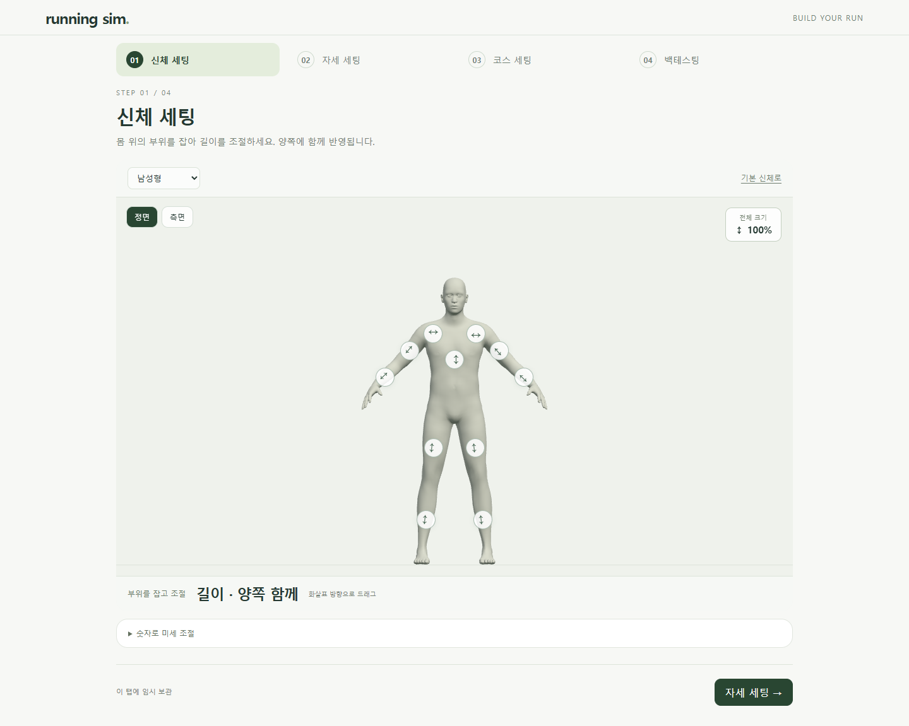
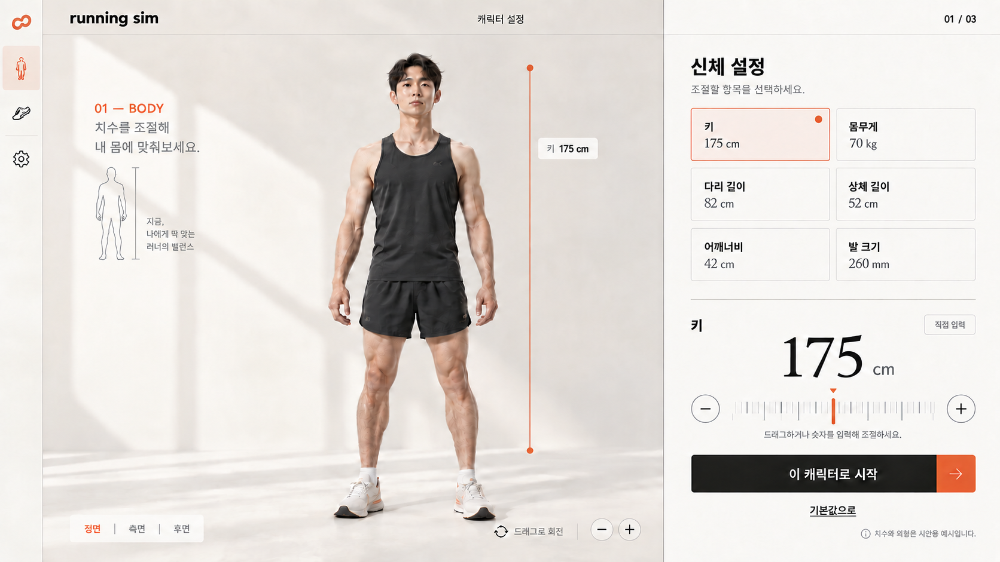

# 신체 세팅 화면 · SCR02

2026-10-26 · **M79–M80 구현 / 신체 설정을 이후 달리기에 전달**

몸 위의 부위를 잡아 길이를 바꾸고 화면 안 전체 크기 손잡이로 배율을 조절합니다. 남성형·여성형은 캐릭터 모델 선택이며 사용자 능력 추정값이 아닙니다.

| 영역·조작 | 현재 동작 |
| --- | --- |
| 전신 미리보기 | 정면·측면 · 선택 부위 강조 · 외형과 뼈대 함께 변경 |
| 몸 위 직접 조절 | 길이 항목 선택·드래그 · 좌우 함께 반영 · 취소·보조 수치 입력 |
| 모델·전체 크기 | 모델 유형 선택 · 전체 배율 · 기본 신체 복원 |
| 다음 단계 | `/pose`에서 변경한 신체로 달리기 · 기존 자세 입력 유지 |
| 상태 저장 | 같은 탭 sessionStorage · 단계 이동·새로고침 복원 |

[R01·R11·R13–R15와 입력 계약](../02-requirements/REQUIREMENTS.md) · [M80 직접 조작 검사](../05-validation/BODY_EDITOR.md) · [M79 달리기 전달 검사](../05-validation/BODY_RUNNING.md).

## 연결과 남은 범위

얼굴·가슴·근육/살집·골반 너비·다리 벌림·발 크기·몸무게는 현재 입력에 없습니다. [D01–D03·D14–D15](../01-planning/DEVELOPMENT_PLAN.md)에서 범위·단위·조합 검증을 계속 관리합니다.

| 현재 확인 | 미구현·미검증 |
| --- | --- |
| 길이 6종·전체 크기·달리기 연결 | 실제 신체 치수와 정확한 대응 |
| 로딩·오류·복원·드래그 취소 | 별도 확정본/초안·취소·A/B 관리 |
| 모델 해시·현재 입력 제한 | 운영 관리자 게시 설정 연결 |
| 외형·뼈대 동시 변형 | 모든 극단 조합의 피부·관통·물리 접지 |

## 디자인과 초기 시험 이력

위는 실제 구현이 아닌 v7 시안입니다. ‘나의 러너’ 문구 제거·BODY 아래 안내/사람 도식 배치 결정은 보존하며, [초기 cm 편집 검사](../05-validation/BODY_DIMENSIONS.md)·[초기 단계 분리 M07](../05-validation/SETUP_STEPS.md)와 현재 화면을 구분합니다.

이전 시안: [v1](../assets/images/archive/character-customization-v1.png) · [v2](../assets/images/archive/character-customization-v2.png) · [v3](../assets/images/archive/character-customization-v3.png) · [v4](../assets/images/archive/character-customization-v4.png) · [v5](../assets/images/archive/character-customization-v5.png) · [v6](../assets/images/archive/character-customization-v6.png).

[자세 화면](MOTION_EDITOR.md) · [코스](COURSE_SCREEN.md) · [체형 처리 설계](../04-technical/BODY_ASSETS.md) · [전체 화면](SCREEN_SPEC.md)
