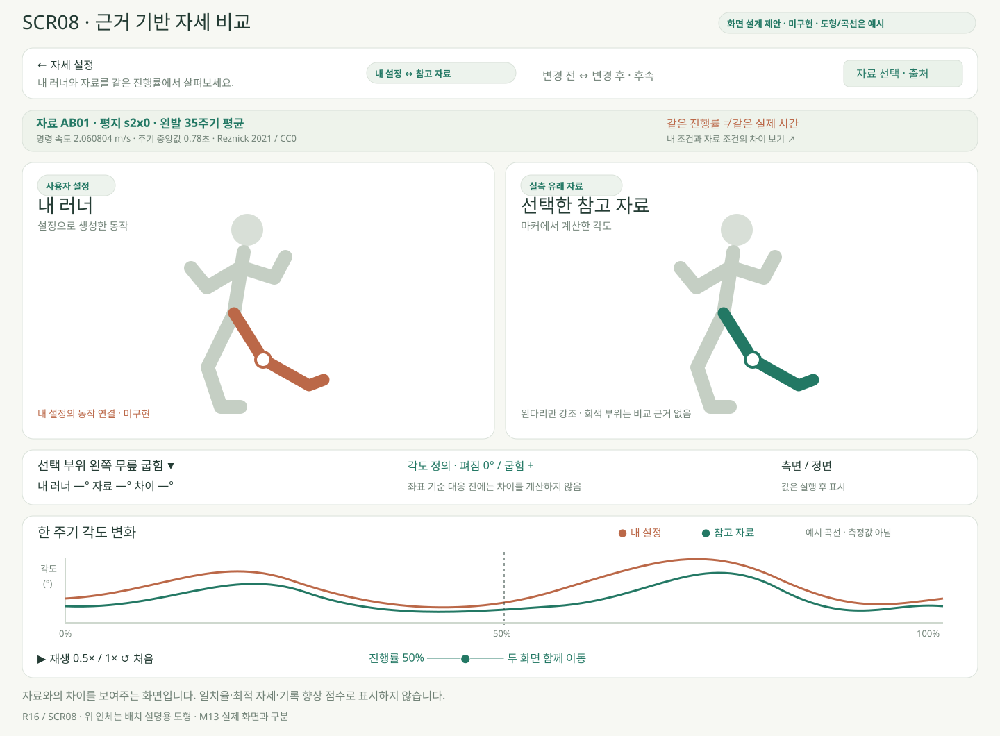
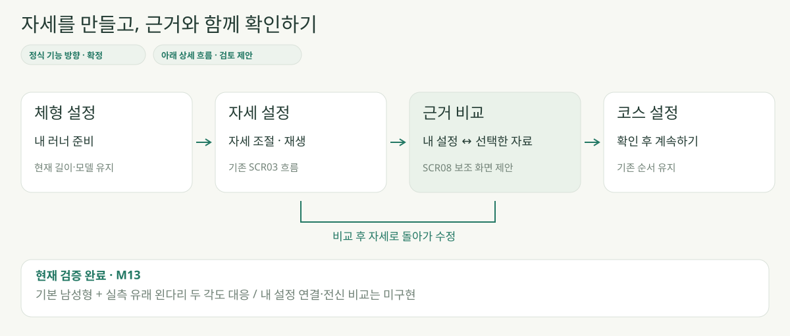
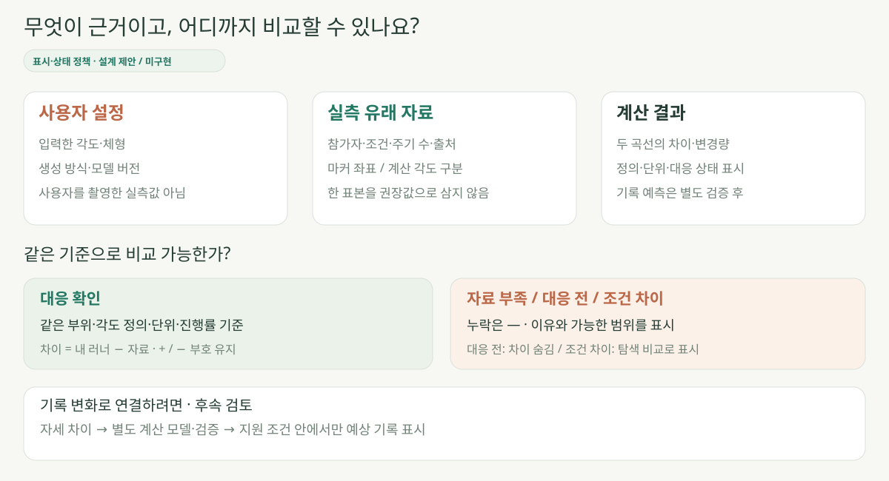
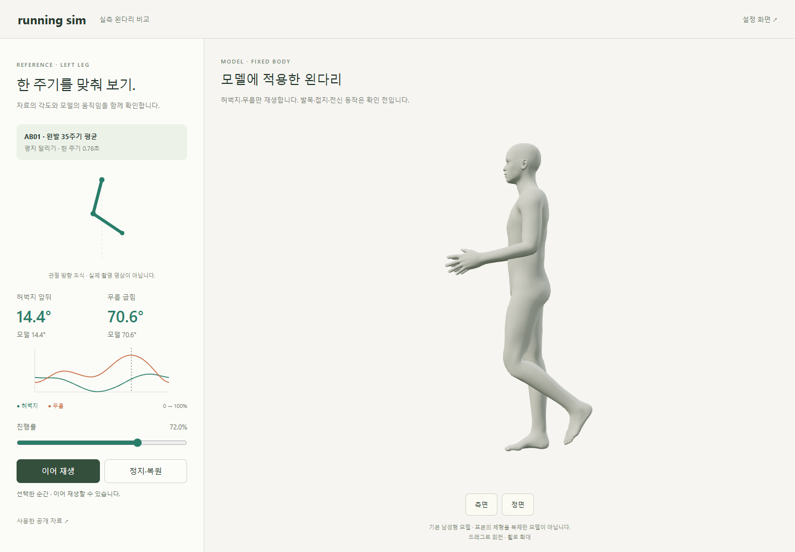

# 근거 기반 자세 비교 · SCR08

> **2026-10-26 상태 확인:** R16 정식 비교 화면은 미구현입니다. 이 문서의 M13 화면은 이전 제한 실험이며 현재 단계의 메뉴와 구분합니다.

2026-10-14 · v0.1 · **정식 기능 방향 확정 · 상세 화면 검토안 · 이번 작업은 문서만**

**설계 제안:** 왼쪽은 설정으로 생성한 내 러너, 오른쪽은 선택한 자료의 동작입니다. 그림의 인체·곡선은 배치 설명용 예시이며 실제 구현 화면이나 측정 결과가 아닙니다.

| 화면 영역 | 역할 · 제안 |
| --- | --- |
| 상단 조건 | 참가자·속도 조건·평지/경사·좌우·주기 수 · 출처 열기 |
| 좌우 모델 | 같은 시점 확인 · 지원 부위 강조 · 정면/측면 전환 |
| 선택 부위 | 내 각도 / 자료 각도 / 차이 · 정의가 대응한 항목만 계산 |
| 공통 그래프 | 같은 부위의 두 곡선 · 커서와 모델 동기화 · 색과 이름 함께 표시 |
| 하단 재생 | 재생/일시정지·처음·보기 배속 · 타임라인 클릭/드래그/키보드 |

## 서비스 안에서의 위치

**설계 제안:** SCR03에서 선택적으로 여는 보조 화면이며 체형 → 자세 → 코스 순서를 유지합니다. 돌아올 때 내 설정을 유지하고, 참고 자료의 자세를 자동으로 내 설정에 덮어쓰지 않습니다.

| 조작 | 화면 반응 · 제안 |
| --- | --- |
| 비교 열기 | 현재 체형·설정 버전과 지원 범위 확인 → 일시정지 상태로 진입 |
| 진행률 이동 | 왼쪽 한 주기 0~100% 기준으로 두 모델·수치·그래프 이동 |
| 자료 변경 | 재생 정지 → 조건/각도 기준 재확인 → 새 자료 준비 후 처음으로 |
| 자세 수정 | SCR03으로 복귀 → 수정 → 재생성 후 다시 비교 · 이전 결과는 갱신 전으로 표시 |
| 탭 숨김 | 일시정지 · 돌아온 뒤 수동 재개 |
| 좁은 화면 | 내 러너/참고 자료 보기 탭 + 공통 타임라인 · 나란히 보기는 넓은 화면 우선 |

같은 진행률은 같은 실제 시간이나 착지 순간을 보장하지 않습니다. 각 주기 길이·시작 기준을 표시하고, 시간/접촉 사건의 정렬 방식은 D16에서 검토합니다.

## 근거와 상태를 읽는 방법

**설계 제안:** 실측 유래 자료·사용자 설정·계산 결과를 구분합니다. 표시·검수 기준은 [R16](../02-requirements/REQUIREMENTS.md#r16-근거-기반-자세-비교)에만 관리하며, 자료와의 일치를 기록 향상 점수로 표시하지 않습니다.

| 상태 | 표시 · 제안 |
| --- | --- |
| 로딩 | 준비 중 · 재생/비교 수치 비활성 |
| 비교 가능 | 선택 부위·진행률·각도 및 대응 상태 표시 |
| 정의 대응 전 / 일부 누락 | 해당 차이는 `—` · 이유·확인 가능한 항목 유지 |
| 조건 다름 | 속도·체형·시작 기준 차이 표시 · 탐색 비교로 한정 |
| 설정 변경 / 모델 미지원 | 이전 결과는 갱신 전 표시 · 재생성 또는 지원 설정 안내 |
| 자료 실패 | 오류·재시도 · 내 설정 유지 · 실패를 0°로 대체하지 않음 |

## 이미 확인한 것과 정식 기능의 차이

**검증 완료 · M13:** 기본 남성형 모델에서 왼다리 두 각도를 자료에 맞춰 재생한 실제 화면입니다. 위 정식 기능 시안의 내 설정 연결·좌우 비교·공통 그래프 동기화가 완료되었다는 뜻은 아닙니다.

| 단계 | 검토 범위 |
| --- | --- |
| 현재 근거 | [M13 코드·검사 7건](../05-validation/REFERENCE_LEG.md) · [자료 해석·출처](../04-technical/RUNNING_COMPARISON.md) |
| 첫 구현 후보 · 미승인 | 읽기 전용 비교 한 항목: 기본 동작 ↔ AB01 왼쪽 무릎 · 공통 진행률·두 곡선·조건 표시 |
| 다음 검토 | 사용자 설정 한 항목의 동작 연결 → 실제 내 러너 비교 · 체형 변경 시 재검사 |
| 별도 후속 | 변경 전/후 동작 비교·다른 자료/부위·전신/접지·기록 계산·영구 저장 |

2026-10-15 M14로 기본 다리 동작에도 AB01 자료를 반영했습니다. 같은 자료와의 비교는 전달 확인에 한정하며, 사용자 설정 연결 또는 독립 자료 비교는 별도 검토합니다. 기본 동작을 ‘내 설정’으로 표시하지 않습니다.

출처: 2026-10-14 사용자 ‘근거 기반 자세 비교 화면을 정식 기능으로 기획서와 화면 정의서에 정리…검토 후 구현’. 연결: **R02·R05·R07·R08·R12·R16 / D02·D03·D13·D16 / SCR03·SCR08**.

[서비스 기획](../01-planning/SERVICE_PLAN.md) · [전체 화면](SCREEN_SPEC.md) · [개발 계획](../01-planning/DEVELOPMENT_PLAN.md) · [그림 원본](../assets/diagrams/evidence-comparison.cjs)
