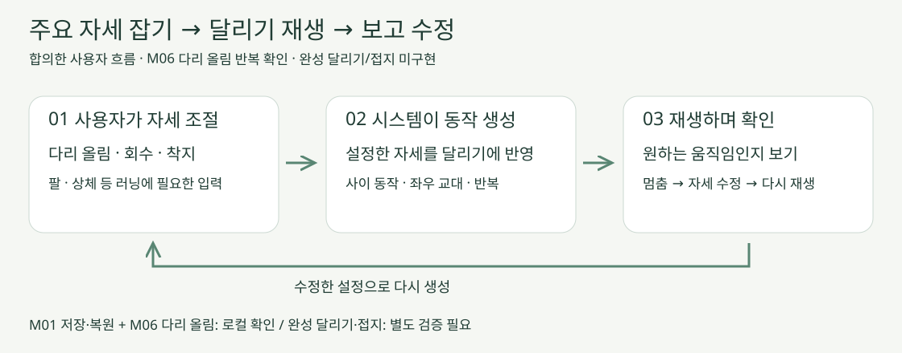
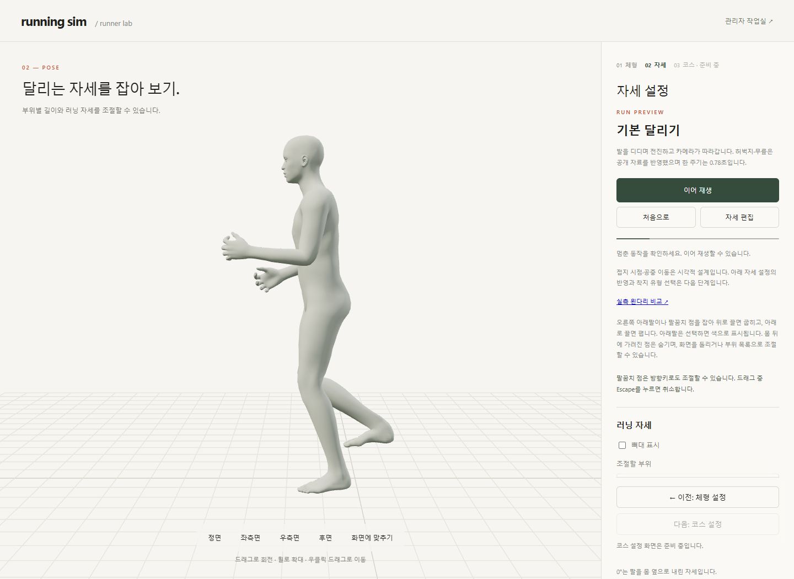

# 자세 설정·동작 미리보기 · SCR03

2026-10-15 · **M17 기본 달리기 품질 미달 · 전신 기준 재구성 검토안 · 사용자 설정 연결은 후속**

사용자가 원하는 러닝 자세를 잡으면 시스템이 그 설정을 반영한 달리기를 생성합니다. 요구·검수 기준은 [R12](../02-requirements/REQUIREMENTS.md#r12-주요-자세와-달리기)에만 기록합니다.

## 현재 기본 달리기 · M17

기본 동작의 허벅지·무릎에 AB01 자료를 반영하고 기존 재생·복원을 유지했습니다. [코드·검증 결과](../05-validation/BASIC_RUN.md)를 확인하며, 사용자 설정의 달리기 반영과 착지 유형은 후속입니다.

2026-10-14 [실측 자료와 현재 동작 비교 설계](../04-technical/RUNNING_COMPARISON.md)의 첫 실험으로 [M13 별도 비교 화면](../05-validation/REFERENCE_LEG.md)을 구현했습니다. 자세 설정의 ‘실측 왼다리 비교 ↗’에서 열며, 기존 기본 달리기는 유지합니다.

정식 기능은 [SCR08 근거 기반 자세 비교](EVIDENCE_COMPARISON.md)로 별도 기획했습니다. 자세 설정에서 진입하는 보조 화면·내 설정 연결 방식은 검토안이며 아직 구현하지 않았습니다.

## 현재 직접 조작 · M08 / M09 / M11

좌우 팔꿈치 점과 오른쪽 아래팔 표면으로 조절합니다. 가려진 점은 숨기며 [M11 실제 화면·코드·검사](../05-validation/BODY_PICKING.md)를 확인하세요. 아래 전체 관절 설계는 후속입니다.

## 단계 위치와 관절 조작

체형 설정에서 전달받은 러너의 자세를 잡고 동작을 확인한 뒤 코스 설정으로 이동하는 흐름입니다. 현재 체형↔자세는 구현했고 코스 버튼은 준비 중으로 비활성화했습니다. 확정 요구는 [R15·R02](../02-requirements/REQUIREMENTS.md#r15-설정-단계와-r02-직접-조작)를 따릅니다.

| 전체 관절 조작 설계 · 팔꿈치/오른쪽 아래팔만 구현 | 화면 반응 |
| --- | --- |
| 관절 선택 | 노출한 러닝 관절에 핸들 표시 · 선택 부위 강조 |
| 핸들을 잡고 드래그 | 허용된 회전 방향의 가이드 표시 · 범위 안에서 각도 변경 |
| 숫자·슬라이더 변경 | 같은 관절과 핸들 표시 갱신 |
| 관절을 드래그하는 동안 | 카메라 회전 잠시 중단 · 빈 공간 드래그는 시점 조절 |
| 재생 중 자세 수정 | 재생 정지 후 선택 자세 조절 · 다시 재생하여 확인 |
| 이전 / 다음 | 체형 설정 / 코스 설정 |

관절을 화면의 임의 위치로 옮기는 방식과 여러 관절을 자동으로 풀어내는 방식은 확정하지 않았습니다. 현재 M08/M09 좌우 팔꿈치 한 방향 직접 조작을 검증했습니다. M07 단계 전환·숫자 입력·M06 반복도 유지합니다. M10 재생/일시정지 중에는 팔꿈치 핸들을 숨기며 ‘자세 편집’으로 복원한 뒤 조절합니다. [실제 단계 화면](../05-validation/SETUP_STEPS.md)을 확인하세요.

## 화면 제안 · 미구현

캐릭터를 보며 주요 자세를 조절하고 재생 결과를 확인하는 배치입니다. 관절 핸들과 단계 이동 버튼은 그림 반영 전이며, 자세 종류·좌우 연결·편집 중 재생 정책은 검토 대상입니다.

| 조작 제안 | 화면 반응 |
| --- | --- |
| 다리 올림·회수·착지 등 선택 | 해당 순간의 자세를 캐릭터로 확인 |
| 허용된 자세 입력 조절 | 선택한 자세에 반영 · 의미·단위 표시 |
| 달리기 재생 / 정지 | 설정을 반영한 한 주기를 반복해서 확인 |
| 정지 후 수정 → 재생 | 변경한 설정으로 다시 생성 · 이전 결과와 혼동 방지 |

수동 프레임 배치·시각 입력은 기본 사용자 흐름의 필수 조건이 아닙니다. 미드풋 선택은 발목 회전만 바꾸는 것으로 완료 처리하지 않습니다.

## 첫 반복 실험 · M06 로컬 구현

| ID | 구현 범위 | 확인한 증거 |
| --- | --- | --- |
| M06 | 다리 올림 목표 하나 → 제자리 반복 동작 · 재생/정지 | [남녀 GLB 15건·실제 화면](../05-validation/LEG_LIFT.md) |

2026-10-14 사용자 테스트 요청에 따라 구현했습니다. [실험 계약](../02-requirements/REQUIREMENTS.md#r12-실험-m06--다리-올림-재생)에 따라 다리 올림만 확인했으며, 착지·접지·코스는 후속 검토합니다.

## 기존 작업 추적

| ID | 기존 내용 | 현재 위치 |
| --- | --- | --- |
| [M01](POSE_SNAPSHOT.md) | 단일 자세 저장·복원 | 보조 기능 · [로직 39건·화면 17건](../05-validation/POSE_SNAPSHOT.md) 확인 · 사용자 화면 확인 |
| M02 | 프레임 2개와 시각 관리 | 이전 제안 보류 · 수동 프레임 편집을 선행 조건으로 두지 않음 |
| M03 | 두 자세 사이 재생 | 이전 독립 작업 제안 보류 · 연결 방식은 생성 설계에서 재검토 |
| M04 | 한 주기 반복 | M10 기본 달리기 반복 확인 · 완성된 접지 주기는 별도 검증 |
| M05 | 코스 주행 연결 | 후속 · 경로 이동과 자세 시점 동기화 미구현 |

이전 [프레임 편집 시안](../assets/diagrams/motion-editor-wireframe.svg)과 [흐름](../assets/diagrams/motion-authoring.svg)은 이력이며 현재 기본 흐름이 아닙니다. 영상 내보내기·조작 과정 녹화·영구 저장은 별도 검토합니다.

| 남은 검토 | 이유 |
| --- | --- |
| 접지·착지 유형 | 골반·무릎·발목과 지면 접촉 시점·부위를 함께 검사해야 함 |
| 자세 사이 연결 | 양 끝뿐 아니라 중간 각도·관통·반복 경계 검사 필요 |
| 모델·체형 변경 | 같은 각도라도 발 위치가 달라짐 · 재생성·호환 검사 필요 |
| 기록 계산 | 애니메이션 생성과 별도 설계·검증 필요 |

출처: 2026-10-14 사용자 ‘다리를 어느 정도 올리는지…미드풋 착지…세팅에 따라 다른 애니메이션’, ‘이런 자세들을 사용자가 잡아보고 애니메이션 재생’ 및 ‘좋습니다’. 연결: **R02·R12 / D03·D13 / M01–M06**.

[데이터 초안](../04-technical/DATA_DESIGN.md) · [화면정의](SCREEN_SPEC.md) · [협업 방식](../01-planning/WORKFLOW.md)
