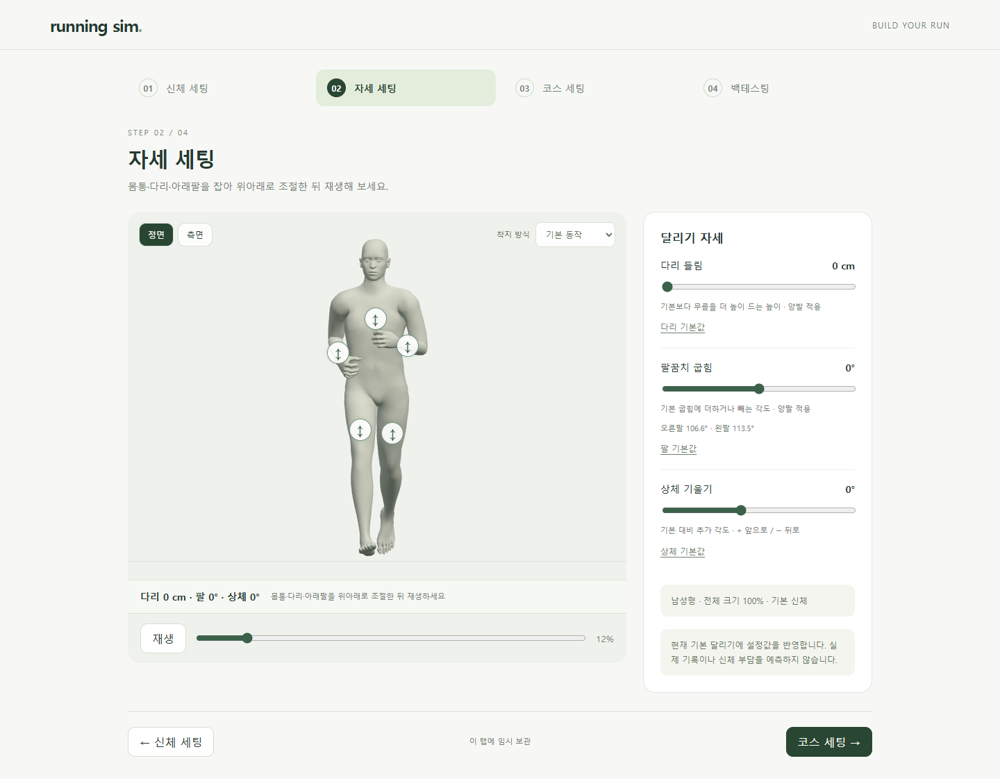
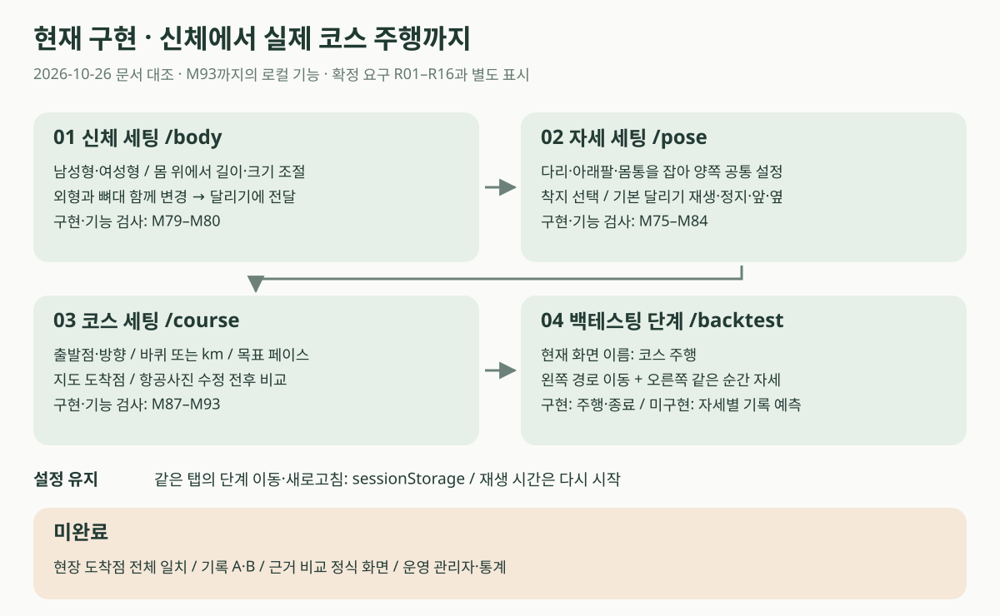

# 자세 설정·동작 미리보기 · SCR03

2026-10-26 · **M75–M84 기본 달리기와 사용자 설정 연결**

신체 단계에서 만든 러너를 유지한 채 몸통·다리·아래팔을 잡아 설정하고 재생합니다. 값은 양쪽에 반영하며 정확한 기준·단위·범위는 [R02·R12·R15 / M76–M84](../02-requirements/REQUIREMENTS.md)에서 관리합니다.

| 조작 | 현재 반응·검사 |
| --- | --- |
| 다리 직접 조절 | 다리 들림 · [M81](../05-validation/POSE_EDITOR.md) |
| 아래팔 직접 조절 | 기본 동작 대비 팔꿈치 굽힘 · [M77](../05-validation/CMU_ELBOW_BEND.md)·[M81](../05-validation/POSE_EDITOR.md) |
| 몸통 직접 조절 | 허리 위 상체 기울기 · [M82](../05-validation/UPPER_LEAN.md) |
| 착지 방식 | 기본·뒤꿈치·미드풋·앞꿈치 · [M83](../05-validation/MIDFOOT.md)·[M84](../05-validation/FOOT_STRIKE.md) |
| 재생·정지·시점·정면/측면 | 같은 설정의 한 주기 확인 · 드래그 시작 시 정지 |
| 이전/다음 | 신체 재편집 / 코스 설정 · 같은 탭 설정 유지 |

## 기본 동작과 검증 경계

현재 기준은 **35_17 유래 공통 동작**이며 127_06은 사용하지 않습니다. [M75 착지·지지·해제 통합](../05-validation/CMU_UNIFIED_STANCE.md)을 기본으로 신체와 자세 입력을 연결했으며, 실측 전신 재현·물리 접지·기록 효과 검증은 별도입니다.

[R16·SCR08 근거 비교](EVIDENCE_COMPARISON.md)는 정식 기능 방향만 확정한 설계안입니다. 이전 M13 비교 화면은 현재 메뉴에서 열 수 없으며 데이터·검사 기록만 보존합니다.

## 기존 작업 추적 · 현재 기능과 구분

| ID | 위치·상태 |
| --- | --- |
| M01 | [정적 자세 저장·복원](POSE_SNAPSHOT.md) · 초기 보조 실험 / 현재 단계 버튼 미연결 |
| M02·M03 | 수동 프레임·연결 제안 보류 · [이전 시안](../assets/diagrams/motion-editor-wireframe.svg)·[흐름](../assets/diagrams/motion-authoring.svg) 보존 |
| M04 | 한 주기 반복 목표 → M75 이후 공통 달리기로 진행 |
| M05 | 코스 이동·같은 시점 자세 목표 → [M88](../05-validation/COURSE_RUNNING.md) 구현 |
| M06 | [다리 올림 첫 실험](../05-validation/LEG_LIFT.md) · 현재 전체 달리기와 구분 |
| M08·M09·M11 | [초기 팔꿈치 점](../05-validation/ELBOW_DRAG.md)·[아래팔 선택/가림](../05-validation/BODY_PICKING.md) 이력 → 현재 M81 |
| M13–M17 | [실측 비교](../04-technical/RUNNING_COMPARISON.md)·[초기 기본 달리기](../05-validation/BASIC_RUN.md) 이력 · 현재 기준 아님 |

영상 내보내기·녹화·영구 저장·모든 관절 직접 조작·운영 관리자 제한 연결은 미구현입니다. 방향의 출처는 2026-10-14 사용자 ‘다리 들림·미드풋 등 설정에 따라 재생’이며 **R02·R12 / D03·D13 / M01–M06** 연결을 보존합니다.

[데이터 설계](../04-technical/DATA_DESIGN.md) · [현재 결과물](../01-planning/CURRENT_STATE.md) · [전체 화면](SCREEN_SPEC.md)
