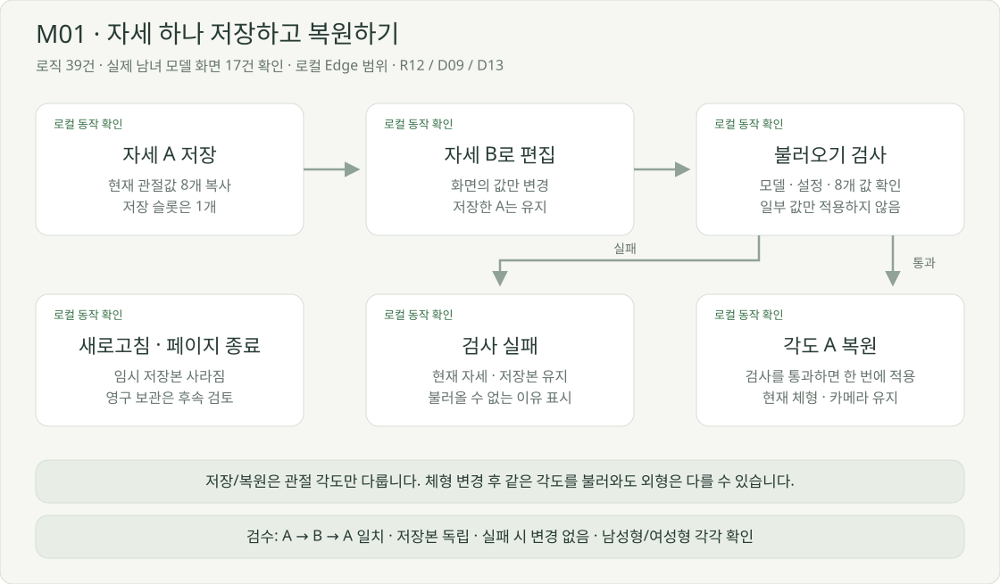
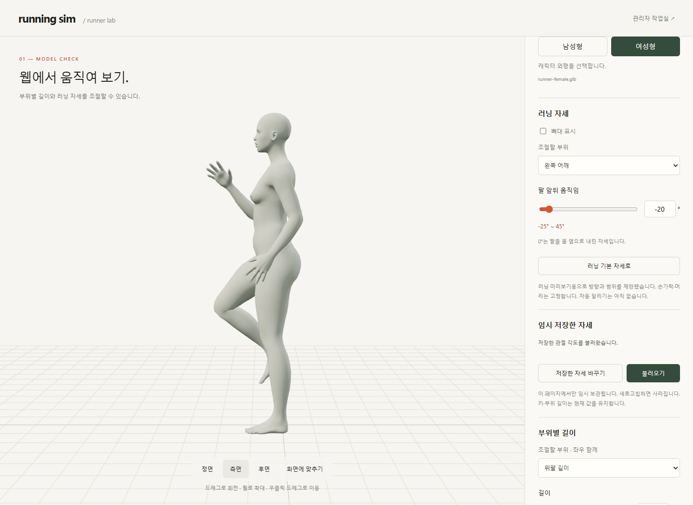

# 자세 하나 저장하고 불러오기

2026-10-14 · **M01-b 버튼 연결 완료 · 실제 모델 화면 검사 17건 통과**

자세를 바꿔도 이전 관절값이 독립적으로 남는지 확인합니다. 동작 제작 R12의 첫 실험이며, 기준 동작·검수 조건은 [요구사항 M01](../02-requirements/REQUIREMENTS.md#r12의-첫-실험-m01)에서 관리합니다.

## 현재 화면

관절 입력 아래에 임시 저장 영역을 추가했습니다. [이전 배치 시안](../assets/diagrams/pose-snapshot-screen.svg)은 참고 자료이며, 위 그림은 실제 구현 캡처입니다.

| 상태 | 현재 화면 문구·조작 |
| --- | --- |
| 빈 슬롯 | ‘아직 저장한 자세가 없습니다.’ · [현재 자세 저장] · 불러오기 비활성 |
| 저장 완료 | ‘자세 1개를 저장했습니다.’ · [저장한 자세 바꾸기] [불러오기] |
| 편집 중 | ‘현재 자세를 바꿔도 저장한 자세는 유지됩니다.’ |
| 복원 완료 | ‘저장한 관절 각도를 불러왔습니다.’ · 선택한 관절의 숫자·슬라이더 갱신 |
| 모델 변경 | ‘저장할 때의 모델에서 불러올 수 있습니다.’ · 다른 모델에서 저장하면 기존 슬롯 교체 |
| 설정 변경·오류 | ‘설정이 바뀌어 저장·불러오기를 멈췄습니다.’ · 새로고침 시 슬롯 소멸 안내 · 설정 읽기 실패도 차단 |
| 로딩·미지원 | 저장/복원 모두 비활성 · 모델 준비 또는 지원 여부 안내 |

저장 영역에는 항상 ‘**이 페이지에서만 임시 보관됩니다. 새로고침하면 사라집니다.**’를 표시합니다. 모델 해시·내부 뼈 이름은 사용자 화면 대신 검사 정보에 둡니다.

## 합의한 범위

| 선택 | 현재 범위 | 연결 |
| --- | --- | --- |
| 저장 수명 | 새로고침 전까지 1개 임시 보관 | D09 |
| 저장 범위 | 체형은 유지하고 관절 각도만 복원 | R12 / M01 |
| 교체 방식 | 명시적인 ‘저장한 자세 바꾸기’ 버튼 | M01-T03 |
| 모델·정책 변경 | 조건 불일치 시 복원을 막고 이유 표시 | R08 / D13 |

## 검토 후 작업 순서

| 작은 작업 | 변경 대상 제안 | 검토할 결과 |
| --- | --- | --- |
| M01-a · 완료 | 자세 복사본 생성·검사, 관절값 일괄 적용 | 로직 39건 통과 |
| M01-b · 완료 | 저장 영역·상태 문구·버튼 | 실제 모델·오류·키보드 화면 검사 17건 통과 |
| M01-c · 기본 검증 반영 | M01-b와 함께 실제 GLB·캡처·결과 기록 | [범위·한계](../05-validation/POSE_SNAPSHOT.md) · 다른 플랫폼/전체 조합은 별도 검토 |

사용자의 버튼 연결·검사 요청에 따라 M01-b를 구현했습니다. 결과를 함께 검토한 뒤 다음 기능을 선택하며, 여러 프레임·보간·영구 저장은 추가하지 않았습니다.

[데이터·적용 방식](../04-technical/DATA_DESIGN.md#m01-자세-복사본) · [전체 동작 편집](MOTION_EDITOR.md) · [개발 계획](../01-planning/DEVELOPMENT_PLAN.md) · [문서 목록](../README.md)
