# 화면정의서

2026-10-22 · v0.61 · **M93 항공사진 대조·국소 수정 / 현장 도착점 전체 일치 미해결**

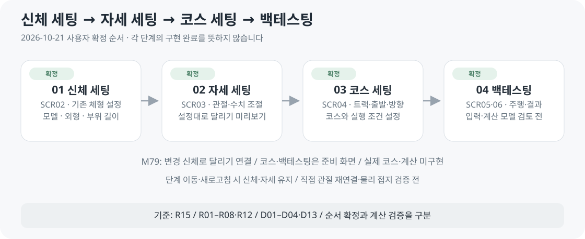

## 코스 항공사진 대조 · M93 구현

광장으로 우회하던 구간을 수정하고 같은 설정의 전후 도착점을 비교합니다. [항공사진 근거·실제 구현·남은 차이](../05-validation/COURSE_IMAGERY.md).

## 페이스와 소요 시간 · M90 구현

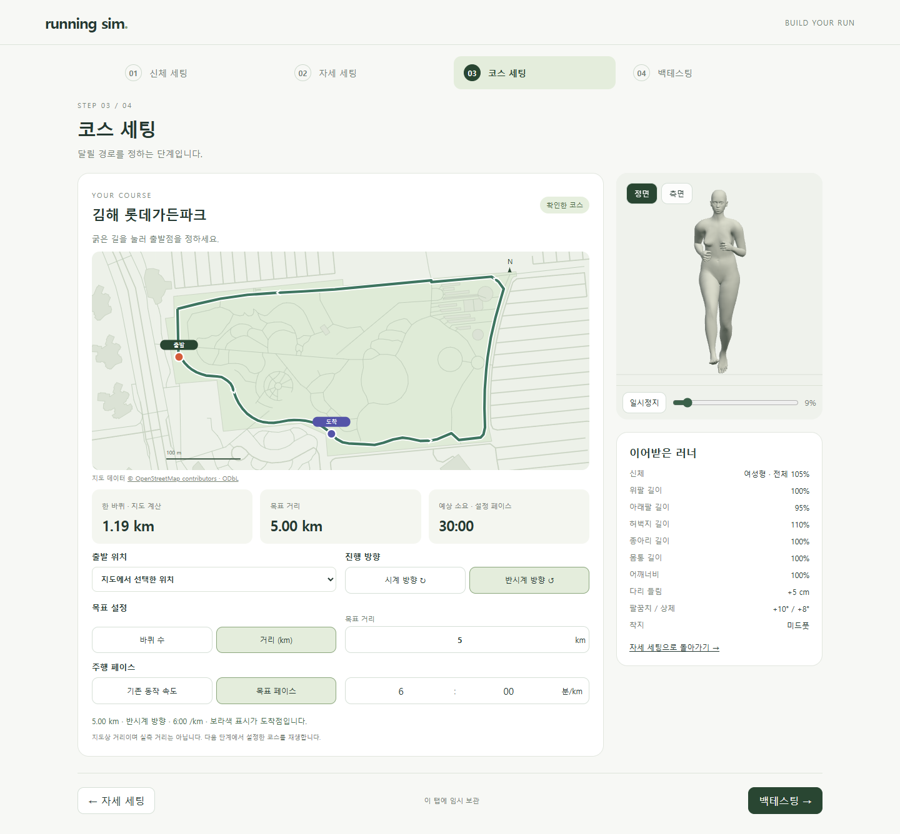

SCR04에서 페이스를 설정하고 SCR05에서 같은 속도의 코스·자세를 재생합니다. [화면 정의](COURSE_SCREEN.md) · [검사](../05-validation/COURSE_PACE.md).

## 거리와 도착점 · M89 구현

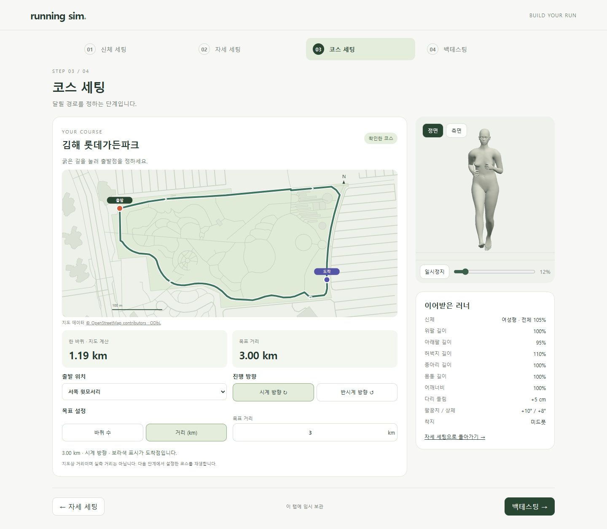

바퀴 수 또는 km로 목표를 정하고 지도에서 도착점을 확인합니다. 오른쪽 위는 짧은 연결길을 사용합니다. [현재 화면·코드·검사](../05-validation/COURSE_GOAL.md).

## 코스 주행 · M88 실제 구현

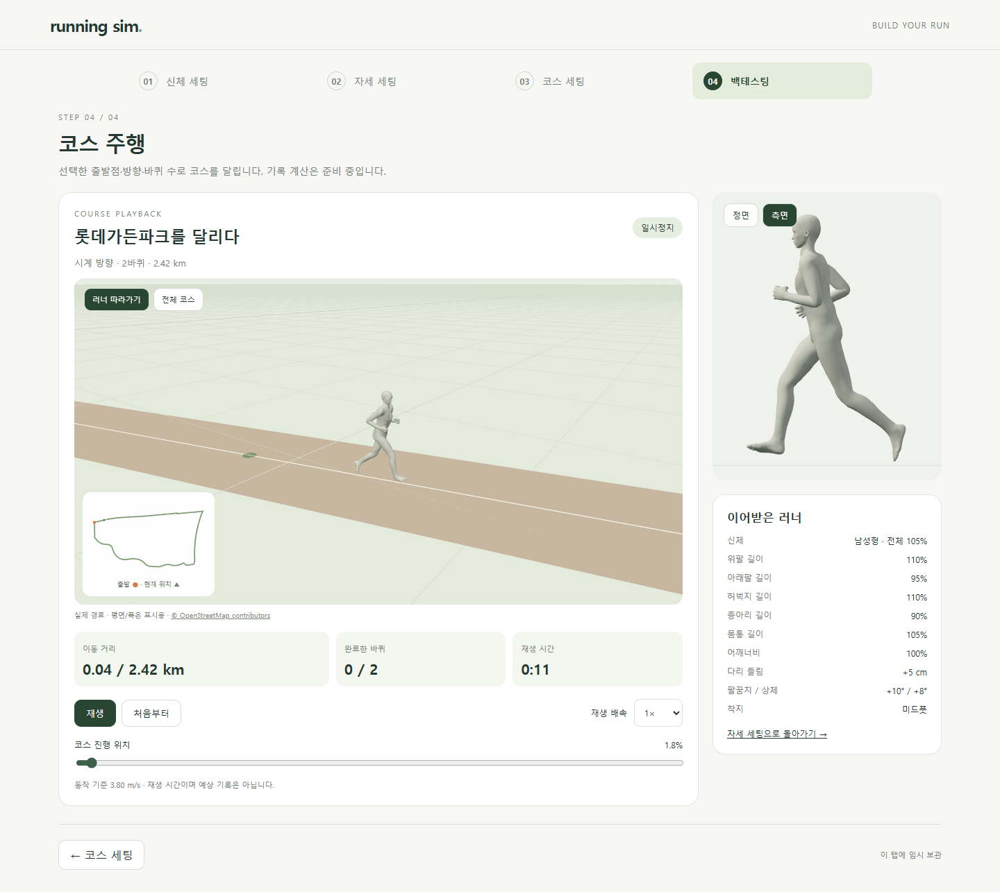

설정한 출발·방향·바퀴 수를 기존 러너로 재생합니다. [화면 정의](COURSE_SCREEN.md) · [재생 영상·코드·검사](../05-validation/COURSE_RUNNING.md).

## 코스 세팅 · M87 실제 구현

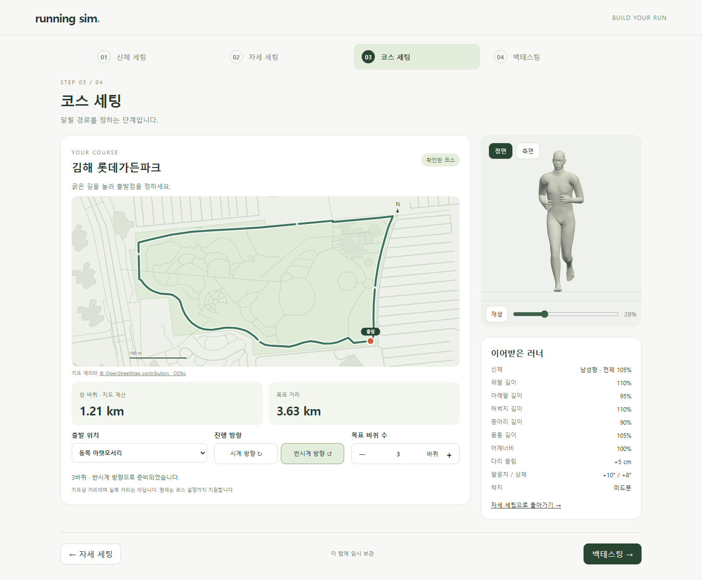

신체·자세를 이어받고 확인된 경로의 출발점·방향·바퀴를 정합니다. [상세 화면](COURSE_SCREEN.md) · [실제 자료 확인](../05-validation/COURSE_FEASIBILITY.md) · [구현 범위](../04-technical/COURSE_PIPELINE.md).

## 뒤꿈치·앞꿈치 착지 · M84

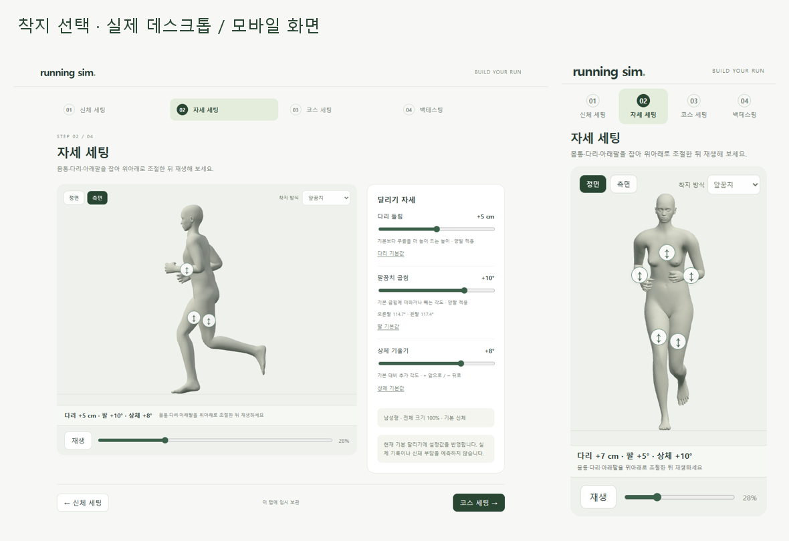

모델 위 착지 선택에서 뒤꿈치·앞꿈치를 추가합니다. [정면·측면 비교·검사](../05-validation/FOOT_STRIKE.md) · [입력 계약](../02-requirements/REQUIREMENTS.md#m84--뒤꿈치앞꿈치-착지).

## 미드풋 착지 · M83

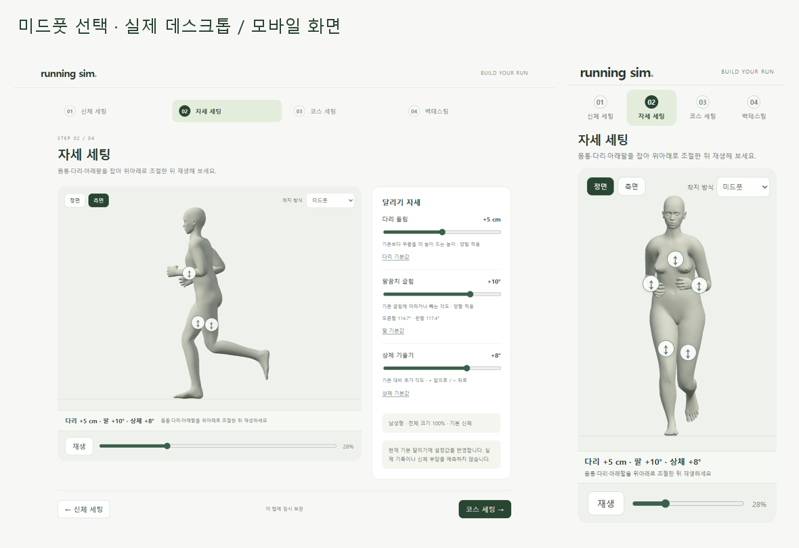

모델 화면 위에서 착지 방식을 고르면 기존 설정과 함께 재생합니다. [접촉 비교·코드·검사](../05-validation/MIDFOOT.md) · [입력 계약](../02-requirements/REQUIREMENTS.md#m83--미드풋-착지).

## 몸통 직접 조절 · M82

몸통을 위아래로 잡아 기울이고 현재 다리·팔 설정과 함께 재생합니다. [구현·검사](../05-validation/UPPER_LEAN.md) · [입력 계약](../02-requirements/REQUIREMENTS.md#m82--몸통-직접-조절).

## 자세 직접 조절 · M81

다리·아래팔을 잡으면 일시정지하고 모델 위에서 들림·굽힘을 조절합니다. [구현·검증](../05-validation/POSE_EDITOR.md) · [입력 기준](../02-requirements/REQUIREMENTS.md#m81--자세-화면에서-다리아래팔-직접-조절).

## 신체 직접 조절 · M80

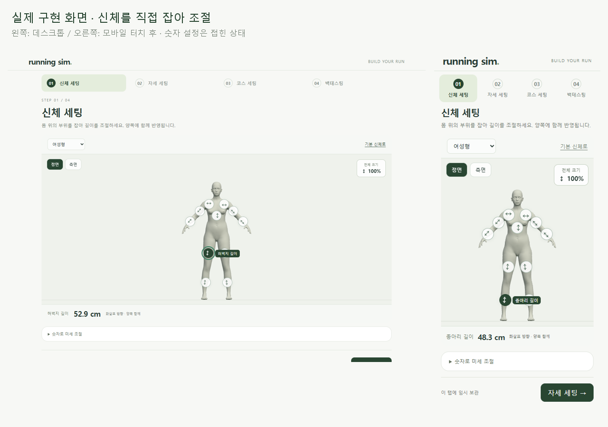

신체 모델 위에서 길이·크기를 조절하며 숫자 설정은 접힌 보조 영역입니다. [화면·검증](../05-validation/BODY_EDITOR.md) · [입력 기준](../02-requirements/REQUIREMENTS.md#m80--신체-화면에서-직접-조절).

## 신체 설정 전달 · M79

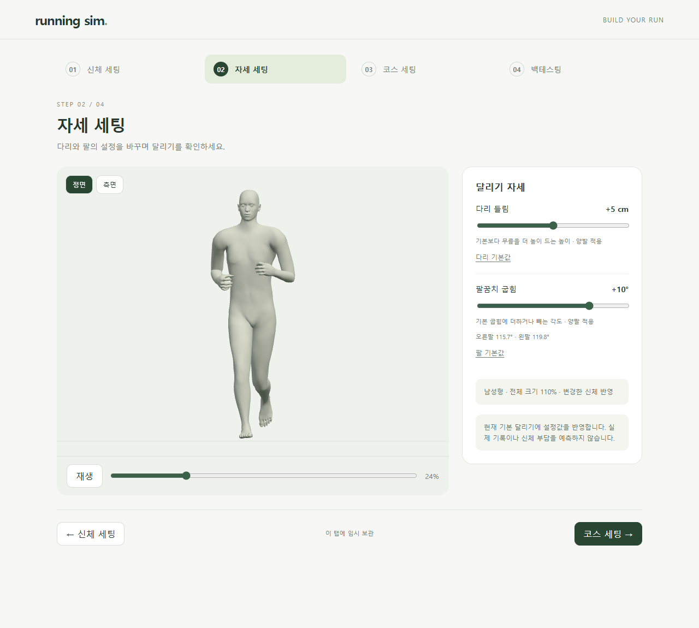

신체 단계의 부위 길이·전체 크기를 반영해 재생합니다. [현재 구현·검증](../05-validation/BODY_RUNNING.md) · [M79 기준](../02-requirements/REQUIREMENTS.md#m79--신체-설정을-달리기에-반영).

## 현재 단계 화면 · M78

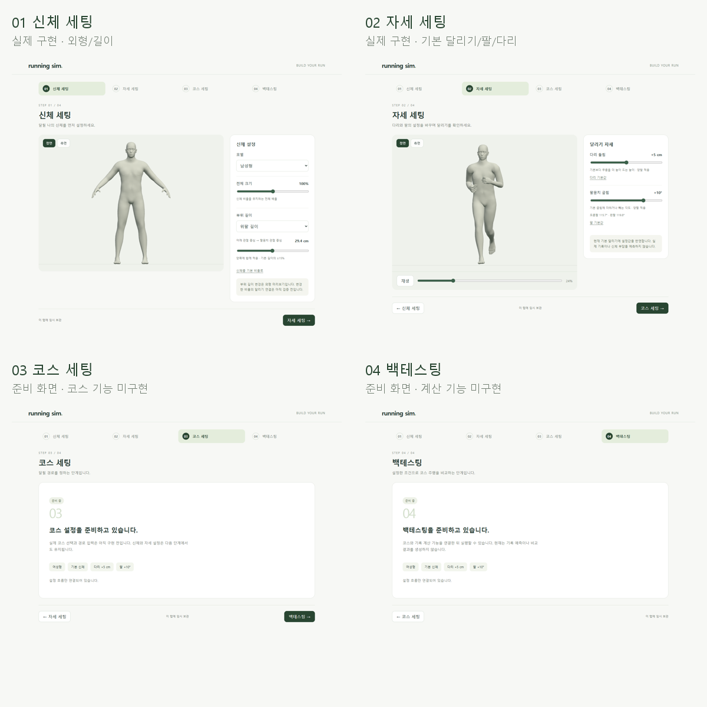

[현재 주소와 검증](../05-validation/STAGE_PAGES.md) · [범위 기준](../02-requirements/REQUIREMENTS.md#m78--단계별-페이지만-남기기). M78 촬영 당시 코스·백테스팅은 준비 화면입니다. 현재 코스는 M87에서 구현했으며 아래 이전 시안·비교는 이력입니다.

## 화면 목록과 요구사항 연결

| ID | 화면 | 요구 | 상태 |
| --- | --- | --- | --- |
| SCR01 | 메인 | 진입·안내 | 정적 시안 |
| SCR02 | 체형 설정 | R01·R11·R13·R14·R15 | M80 `/body` · 신체 직접 드래그·배율 손잡이 / M79 달리기 전달 |
| SCR03 | 자세 설정·동작 미리보기 | R02·R12·R14·R15 | M84 `/pose` · 착지 3종 선택·몸통/다리/팔 직접 조절 / 변경 신체·기존 입력 유지 |
| SCR04 | 코스 설정 | R03·R08·R15 | M87 `/course` · B 경로·출발점·방향·바퀴·기존 러너 미리보기 |
| SCR05 | 좌우 주행 | R04·R05·R08 | M88 `/backtest` 코스 위 이동·동일 시점 자세·재생/완료 · 기록 계산 미구현 |
| SCR06 | A/B 결과 영역 | R06·R07·R08 | `/backtest` 통합 방향 · 결과 미구현 |
| SCR07 | 관리자 | R09–R11 | 이전 로컬 시험 보존 · 현재 진입 제거 · 운영 인증 전 |
| SCR08 | [근거 기반 자세 비교](EVIDENCE_COMPARISON.md) | R02·R05·R07·R08·R12·R16 | 정식 기능 방향 확정 · 상세 배치 제안 · M13은 별도 제한 실험 |

[요구사항별 검수 기준](../02-requirements/REQUIREMENTS.md). 신체(SCR02) → 자세(SCR03) → 코스(SCR04) → 백테스팅(SCR05·06) 순서가 확정됐습니다. M78에서 네 URL을 분리했으며 SCR05·06은 `/backtest` 준비 화면으로 묶었습니다.

전신 검토와 M25/M26 비교는 [M27 확정 계약](../02-requirements/REQUIREMENTS.md#m27--중앙선-교차-점검과-기본-후보-교체)에 따라 동작 선택 항목을 하나만 표시합니다. [사용자 검토 반영·검증](../05-validation/FULL_BODY_REFERENCE.md#m27--중앙선-교차를-확인하고-기본-후보-교체).

## M77 팔꿈치·다리 함께 조절 · 실제 로컬 시험

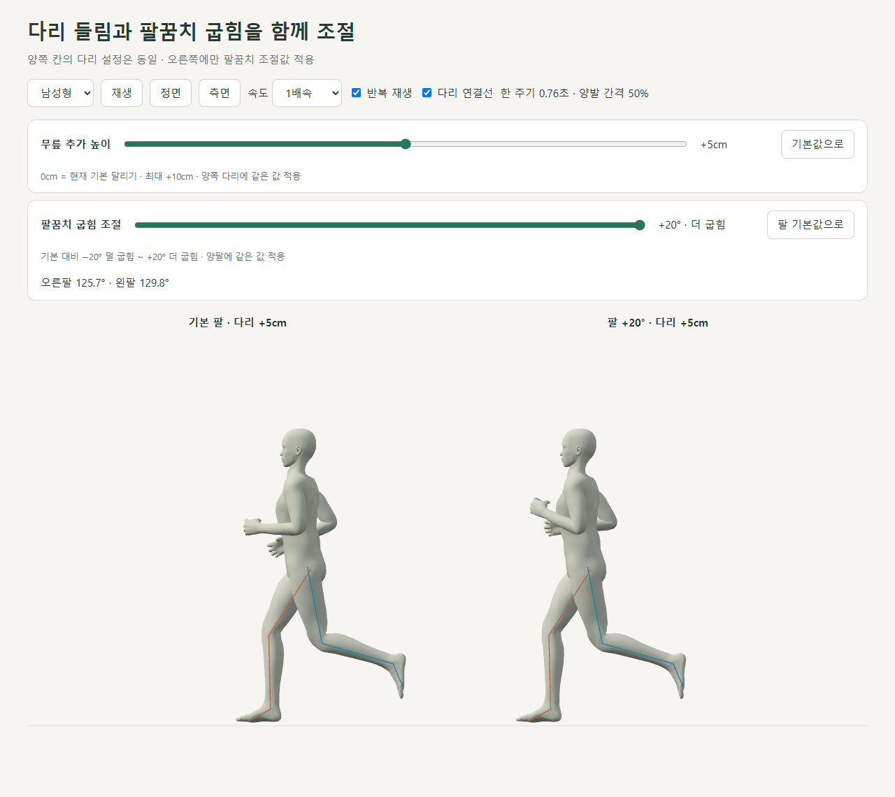

두 칸 모두 같은 다리 높이를 적용하고, 오른쪽만 팔꿈치 각도를 바꿉니다. [이전 주소 → 현재 자세 화면](http://127.0.0.1:5173/review/shared-gait.html?compare=elbow-bend)에서 양팔 실제 각도와 독립 복원을 확인했으며, [입력 계약](../02-requirements/REQUIREMENTS.md#m77--팔꿈치-굽힘과-다리-들림-함께-조절)과 [검사 결과](../05-validation/CMU_ELBOW_BEND.md)를 연결합니다.

SCR03 자세 세팅의 기능 시험이며, 코스·백테스팅 단계는 아직 연결하지 않았습니다.

## M76 다리 들림 높이 · 실제 로컬 시험

왼쪽은 보존한 M75 기본값, 오른쪽은 입력을 양쪽 다리에 적용한 결과입니다. [이전 주소 → 현재 자세 화면](http://127.0.0.1:5173/review/shared-gait.html?compare=leg-height)의 슬라이더·기본값 복원·남녀·정면/측면·반복을 확인했으며, [입력 계약](../02-requirements/REQUIREMENTS.md#m76--기본-달리기-다리-들림-높이)과 [코드·검사](../05-validation/CMU_LEG_HEIGHT.md)를 연결합니다.

SCR03의 입력 기능을 시험하는 별도 화면이며, 메인 설정 화면·저장 기능과의 연결은 아직 진행하지 않았습니다.

## M64 착지 접근 경로 · 실제 로컬 비교

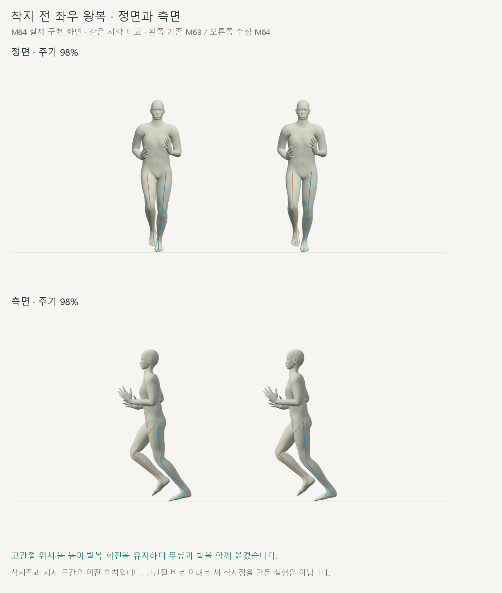

왼쪽 M63 / 오른쪽 M64를 같은 시각에 재생합니다. [이전 주소 → 현재 자세 화면](http://127.0.0.1:5173/review/shared-gait.html?compare=shared-approach)에서 남녀·정면·측면·반복·배속·시점 이동으로 검토하며 [범위](../02-requirements/REQUIREMENTS.md#m64--양발-착지-접근-경로)와 [검사 결과](../05-validation/CMU_SHARED_APPROACH.md)를 연결합니다.

## M63 전신 좌우 자세 · 실제 로컬 비교

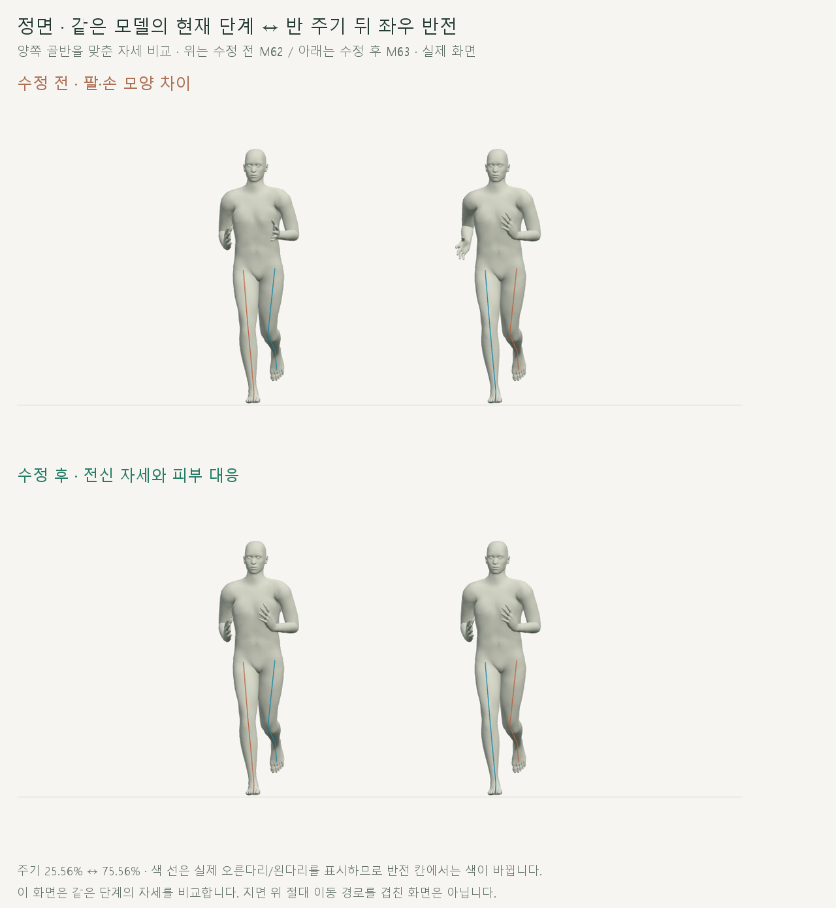

두 칸 모두 수정된 같은 모델이며 오른쪽 칸을 반 주기 뒤 좌우 반전하여 골반을 정렬합니다. 정면·측면·남녀·반복·시점 이동·수정 전 보기로 확인하며 [이전 주소 → 현재 자세 화면](http://127.0.0.1:5173/review/shared-gait.html?compare=bilateral-pose) · [검수 계약](../02-requirements/REQUIREMENTS.md#m63--전신-좌우-자세-대응) · [코드·검사·영상](../05-validation/CMU_BILATERAL_POSE.md)을 연결합니다.

## M62 상체 중심 대응 · 이전 비교

**사용자 전체 자세 품질 문제 제기 → M63 후속 교정.** 아래는 당시 중심점만 맞춘 비교입니다.

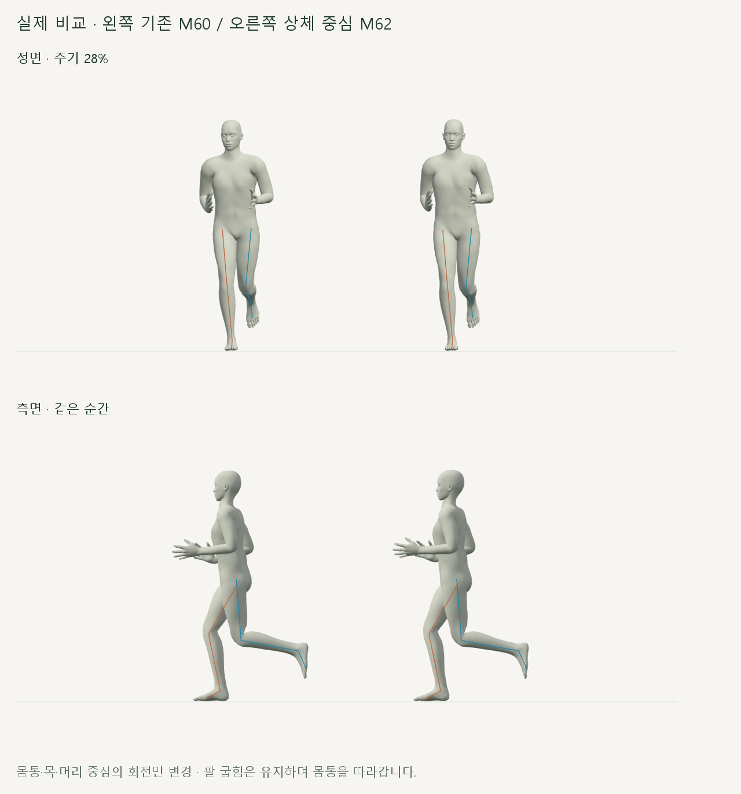

왼쪽 M60 / 오른쪽 M62를 같은 시점에 재생합니다. 남녀·정면/측면·배속·반복·시점 이동을 제공하며 [이전 주소 → 현재 자세 화면](http://127.0.0.1:5173/review/shared-gait.html?compare=upper-center) · [범위·검수 계약](../02-requirements/REQUIREMENTS.md#m62--상체-중심의-좌우-대응) · [코드·검사·영상](../05-validation/CMU_UPPER_CENTER.md)을 연결합니다.

## M60 몸 높이 연결 · 실제 로컬 비교

왼쪽 M58 / 오른쪽 M60을 같은 시점에 재생합니다. 남녀·정면/측면·배속·반복·시점 이동을 사용하며 [이전 주소 → 현재 자세 화면](http://127.0.0.1:5173/review/shared-gait.html?compare=body-height) · [범위·검수 계약](../02-requirements/REQUIREMENTS.md#m60--짧은-몸-높이-연결) · [코드·검사·영상](../05-validation/CMU_BODY_HEIGHT.md)으로 연결합니다.

## M58 양발 공통 기준 · 실제 로컬 비교

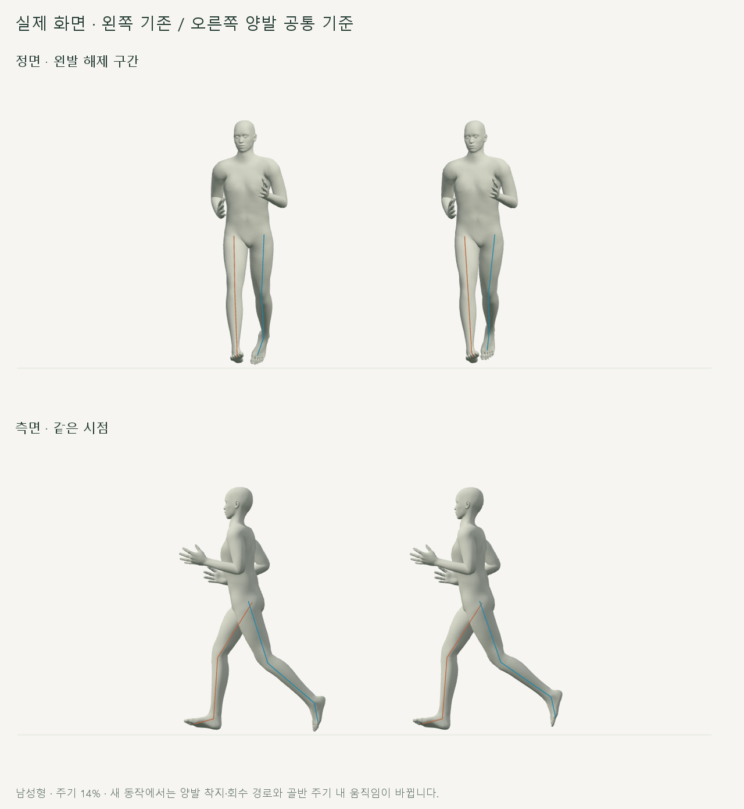

왼쪽 기존 M56 / 오른쪽 양발 공통 기준입니다. 남녀·정면/측면·0.5배/1배·반복 또는 한 주기·시점 이동을 제공하며 [확정 범위](../02-requirements/REQUIREMENTS.md#m58--양발-공통-기준-동작)와 [코드·검사·영상](../05-validation/CMU_SHARED_GAIT.md)을 연결합니다.

## M56 착지 순간 유지·양발 후반 경로

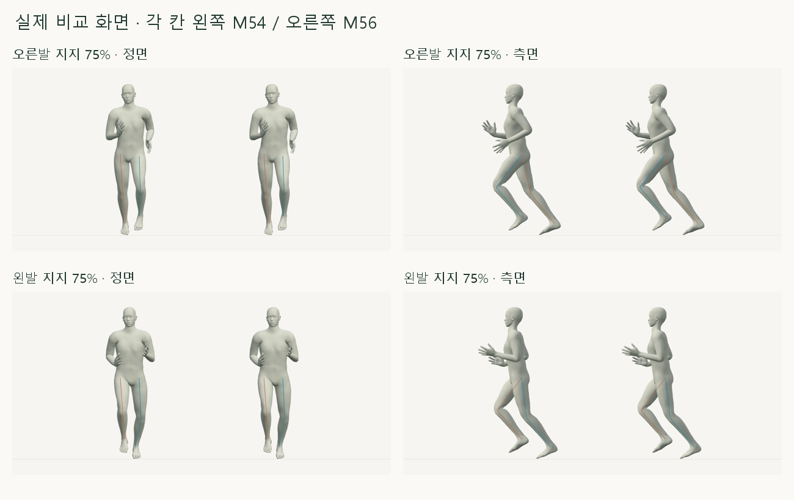

왼쪽 M54 / 오른쪽 M56를 같은 시점에 재생합니다. 남녀·정면/측면·배속·시점 이동을 제공하며 [확정 범위](../02-requirements/REQUIREMENTS.md#m56--착지-순간-유지와-후반-발끝-경로)와 [코드·검사·영상](../05-validation/CMU_TOE_SLIP_PATH.md)을 연결합니다. 작은 경로 교정의 비교이며 완전 접지 화면은 아닙니다.

## M55 발끝 미끄러짐 · 미채택 시험

왼쪽 유지 M54 / 오른쪽 미채택 25% 완화 시험이며, 남녀·정면/측면·배속·시점 이동을 제공합니다. [당시 범위·후속 사용자 확정](../02-requirements/REQUIREMENTS.md#m55--지지-후반-발끝-미끄러짐) · [궤적·코드·반려 검사](../05-validation/CMU_LATE_TOE_SLIP.md); 개선 완료 화면이 아닙니다.

## M54 양발 지지 후반 · 로컬 실험

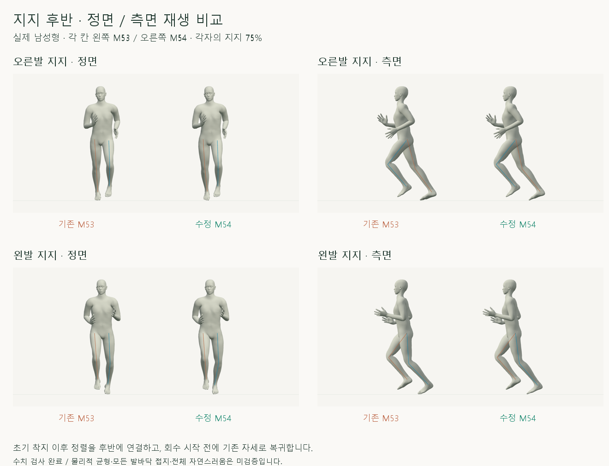

왼쪽 M53 / 오른쪽 M54를 같은 시점에 재생합니다. 남녀·정면/측면·배속·시점 이동을 선택하며 한 주기 끝에서 정지합니다. [확정 계약](../02-requirements/REQUIREMENTS.md#m54--양발-지지-후반의-발목과-발끝) · [확대 화면·코드·검사·영상](../05-validation/CMU_LATE_STANCE_SOLE.md); 수치 검사 완료 / 자연스러움 사용자 검토 전입니다.

## M53 양발 착지 초기 기울기 · 로컬 실험

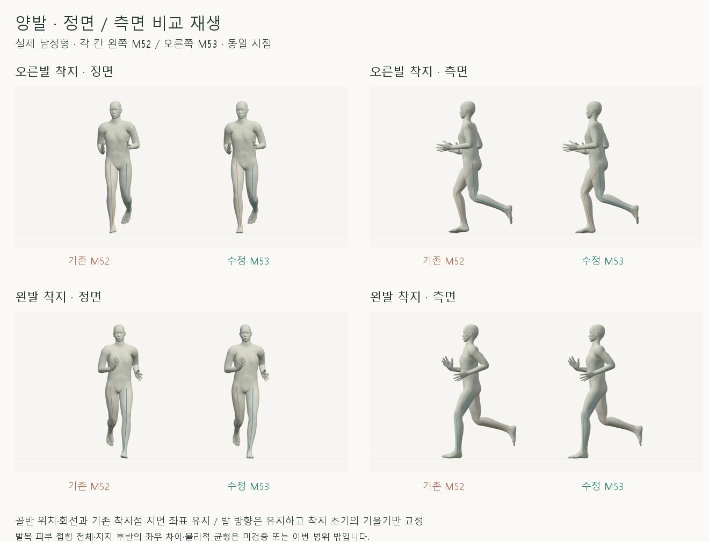

왼쪽 M52 / 오른쪽 M53을 같은 순간 재생합니다. 남녀·정면/측면·시점 이동을 선택하며 한 주기 끝에서 정지합니다. [확정 계약](../02-requirements/REQUIREMENTS.md#m53--양발-착지-초기의-발바닥-기울기) · [확대 화면·코드·검사·영상](../05-validation/CMU_LANDING_SOLE_ALIGNMENT.md); 수치 검사 완료 / 자연스러움 사용자 검토 전입니다.

## M52 왼발 지지의 추가 몸 이동 제거 · 로컬 실험

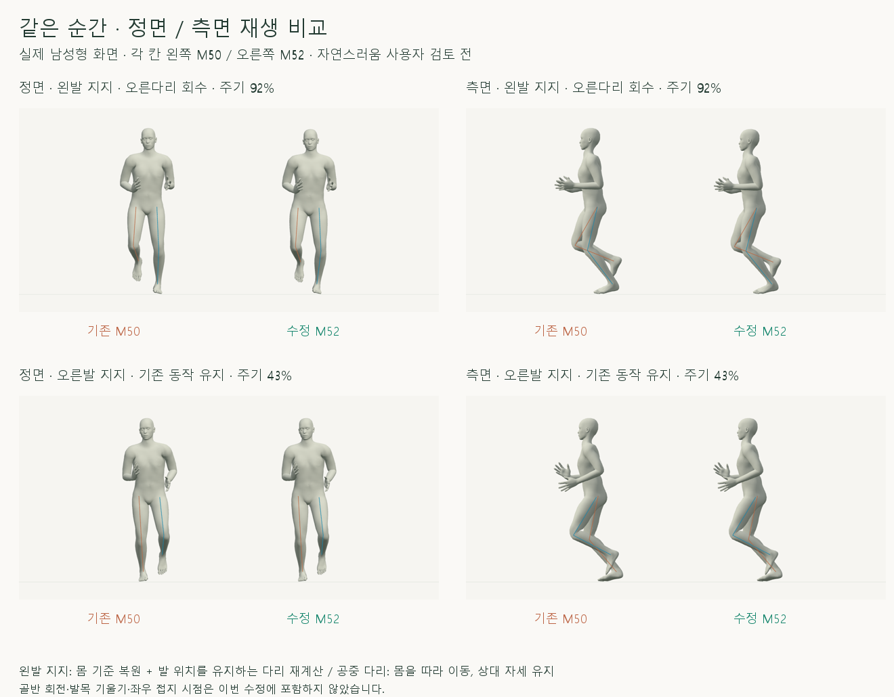

왼쪽 M50 / 오른쪽 M52를 같은 순간 재생하며 남녀·정면/측면·시점 이동을 선택합니다. 한 주기 끝에서 정지하며, 수치 검사 완료 / 자연스러움 사용자 검토 전입니다. [확정 계약](../02-requirements/REQUIREMENTS.md#m52--왼발-지지의-추가-몸-이동-제거) · [코드·검사·영상](../05-validation/CMU_PELVIS_REFERENCE_RESTORE.md).

## M50 왼발 착지 기준 방향 · 로컬 실험

**후속 상태: 사용자 좌우 동작 품질 검토 반려.** [M51 골반·발바닥 단계별 점검](../05-validation/CMU_BILATERAL_CHAIN_AUDIT.md)에서 추가 원인을 확인했습니다.

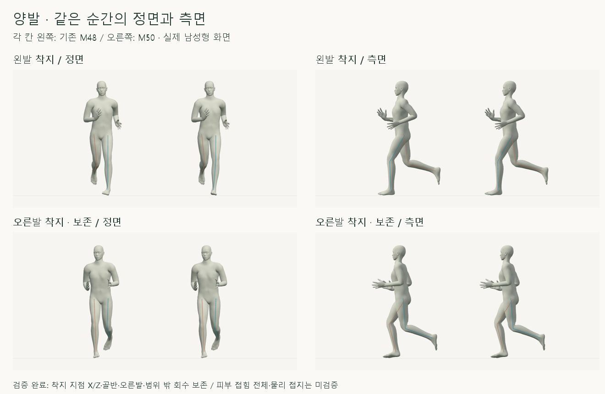

왼쪽 M48 / 오른쪽 왼발 방향 교정. 남녀 선택·정면/측면·재생/시점 이동을 지원하며 한 주기 끝에서 정지합니다. [요구·검수 기준](../02-requirements/REQUIREMENTS.md#m50--왼발-종아리-대비-회전과-착지-기준-방향) · [코드·검사·영상](../05-validation/CMU_LEFT_ANKLE_DIRECTION.md); 자연스러움은 사용자 검토 전입니다.

## M48 양발 회수 후반→착지 접근 · 로컬 실험

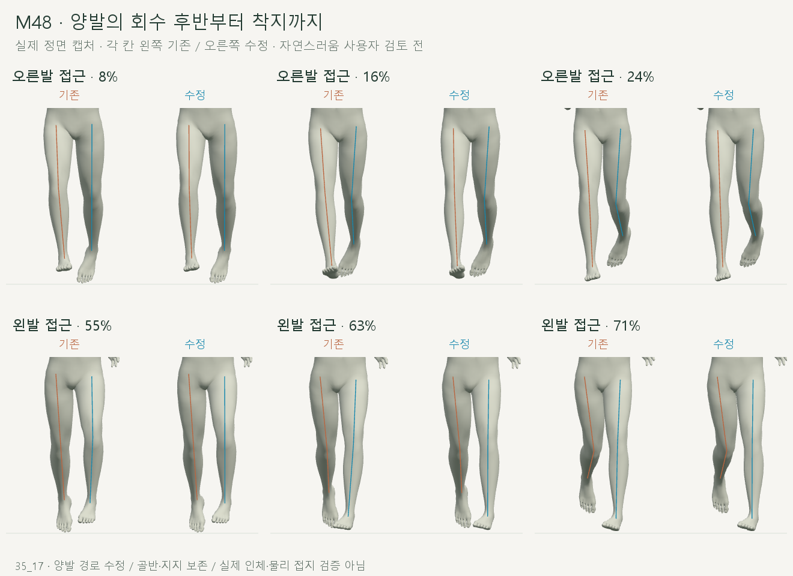

왼쪽 M47 / 오른쪽 접근 경로 수정안. [확정 요청·설계](../02-requirements/REQUIREMENTS.md#m48--양발-회수-후반부터-착지까지-경로) · [검증 기록](../05-validation/CMU_SWING_APPROACH.md); 자연스러움은 사용자 검토 전입니다.

## M47 착지 전 정렬·지지 중 좌우 유지 · 로컬 실험

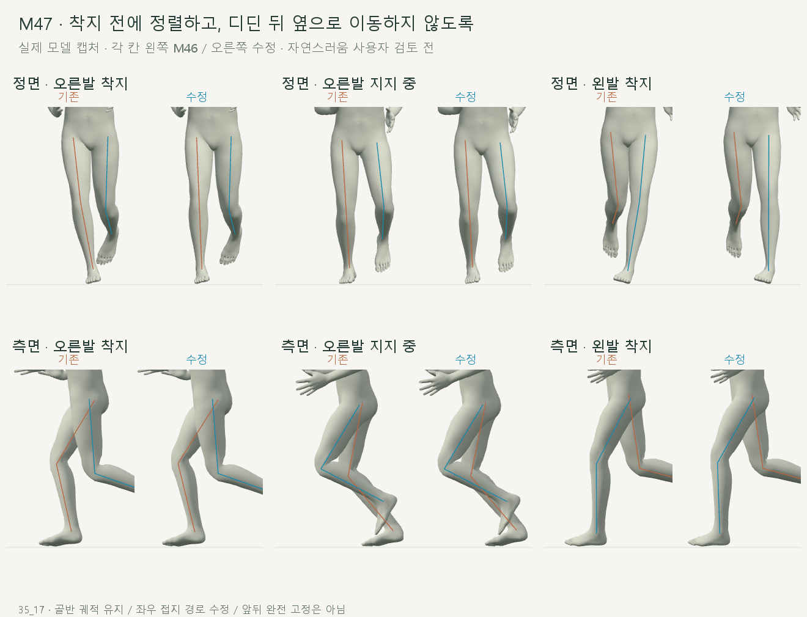

왼쪽 M46 / 오른쪽 수정안. [확정 요청·설계](../02-requirements/REQUIREMENTS.md#m47--착지-전-정렬과-지지-중-좌우-경로) · [검증 결과](../05-validation/CMU_STANCE_CONTACT.md); 자연스러움은 사용자 검토 전입니다.

## M46 오른발 해제 앞뒤 재보정 · 로컬 실험

왼쪽 M45 / 오른쪽 앞뒤 보정을 같은 순간 재생합니다. [M46 계약](../02-requirements/REQUIREMENTS.md#m46--오른발-해제-앞뒤-밀림-재보정) · [감소·유지 검사](../05-validation/CMU_FORE_AFT_RELEASE.md); 자연스러움 검토 전입니다.

## M45 오른발 해제 좌우·발끝 보정 · 로컬 실험

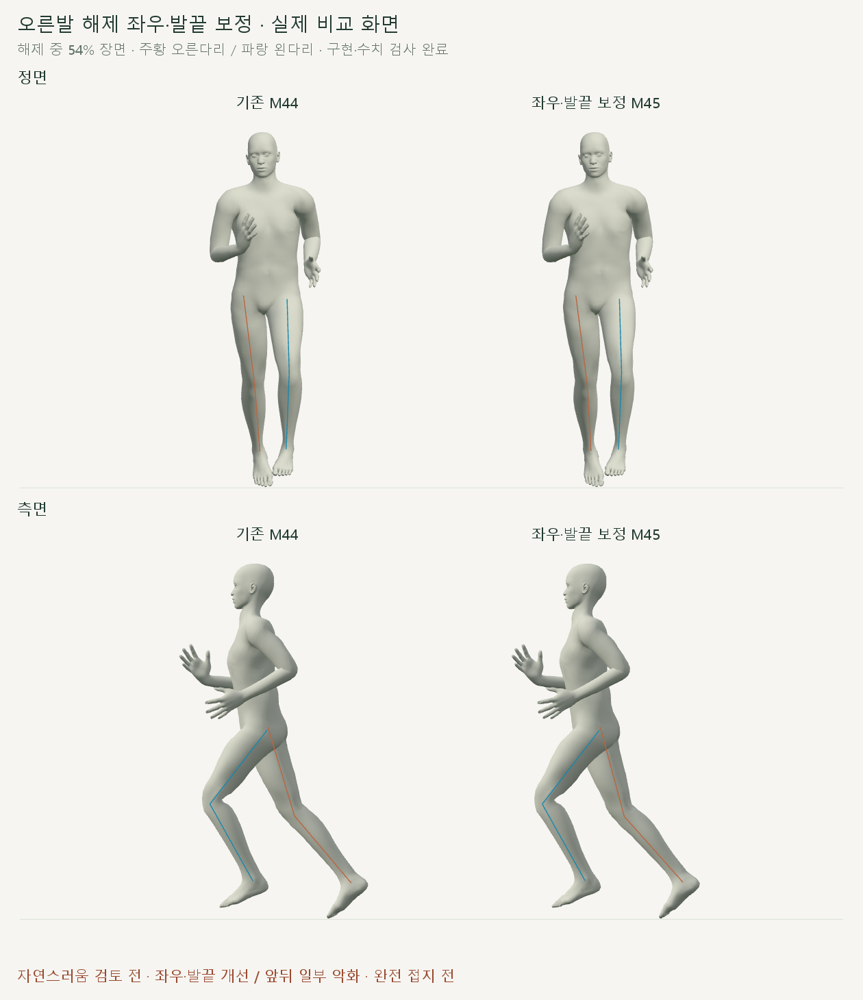

왼쪽 M44 / 오른쪽 보정안을 같은 시점에 재생합니다. [M45 계약](../02-requirements/REQUIREMENTS.md#m45--오른발-해제-좌우-경로발끝-보정) · [검사·앞뒤 손익](../05-validation/CMU_RELEASE_REFINEMENT.md); 자연스러움 검토 전입니다.

## M44 오른발 해제 지지점 연동 · 로컬 실험

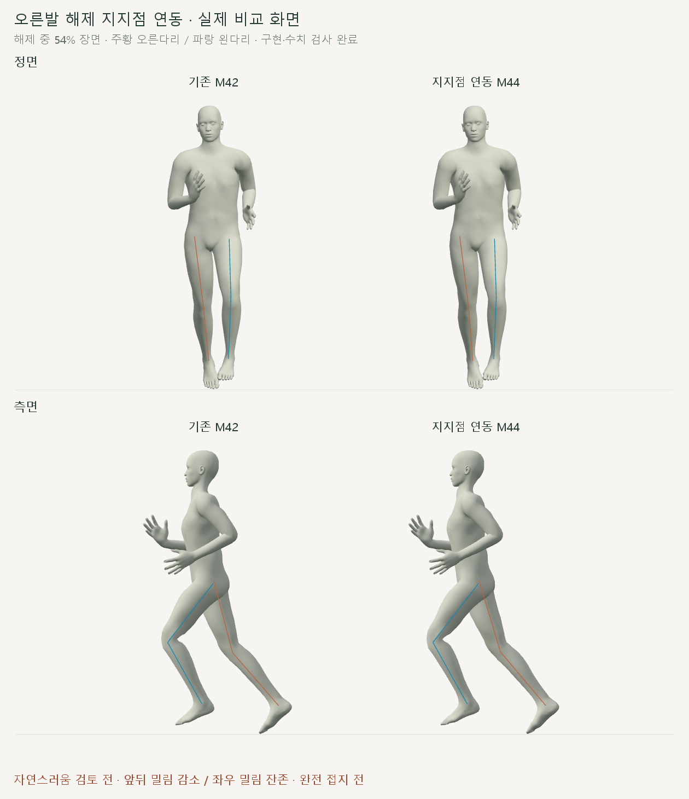

왼쪽 M42 / 오른쪽 지지점 연동을 같은 시점에 비교합니다. [M44 계약](../02-requirements/REQUIREMENTS.md#m44--오른발-해제-지지점-연동) · [검사·잔여 밀림](../05-validation/CMU_PIVOT_RELEASE.md); 구현·수치 검사 완료 / 자연스러움 검토 전입니다.

## M42 오른발 짧은 지면 고정 · 로컬 실험

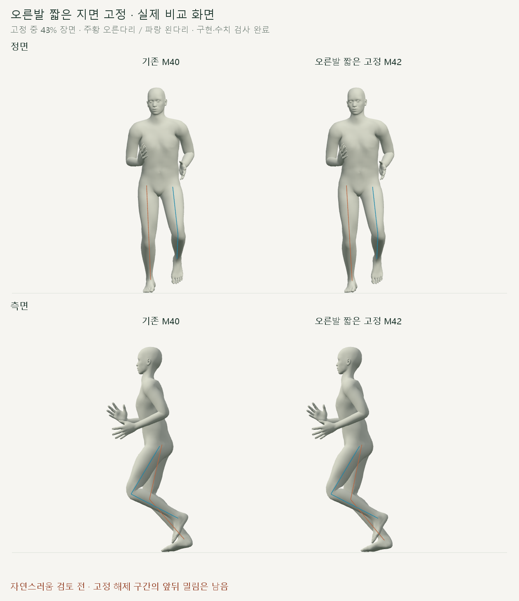

왼쪽 기존 M40 / 오른쪽 짧은 고정을 같은 시간에 재생하며 정면·측면·남녀·시간 막대를 선택합니다. [M42 계약](../02-requirements/REQUIREMENTS.md#m42--오른발-짧은-지지-구간-지면-고정) · [검사·해제 밀림 한계](../05-validation/CMU_FOOT_PLANT.md); 자연스러움 검토 전입니다.

## M40 오른발 고관절 기준 착지 · 로컬 실험

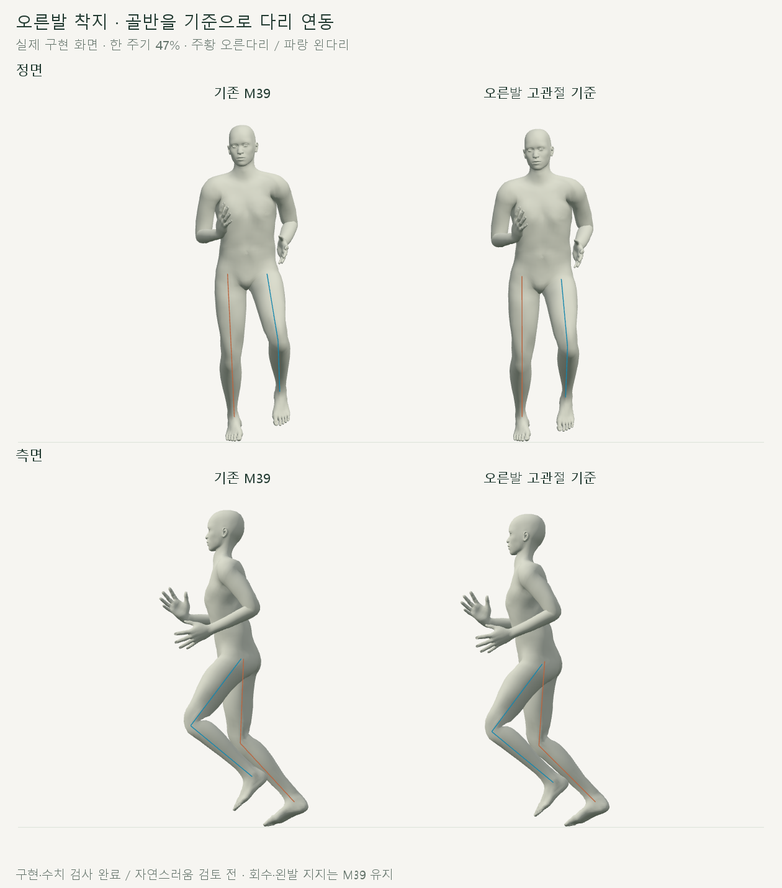

왼쪽 M39 / 오른쪽 새 착지를 같은 순간 비교하며 정면·측면·남녀·시간 막대를 선택합니다. [M40 계약](../02-requirements/REQUIREMENTS.md#m40--골반-기준-오른발-착지-재설정) · [검사·한계](../05-validation/CMU_HIP_REFERENCE.md); 구현·수치 검사 완료 / 자연스러움 검토 전입니다.

## M39 골반 좌우 이동 축소 · 로컬 실험

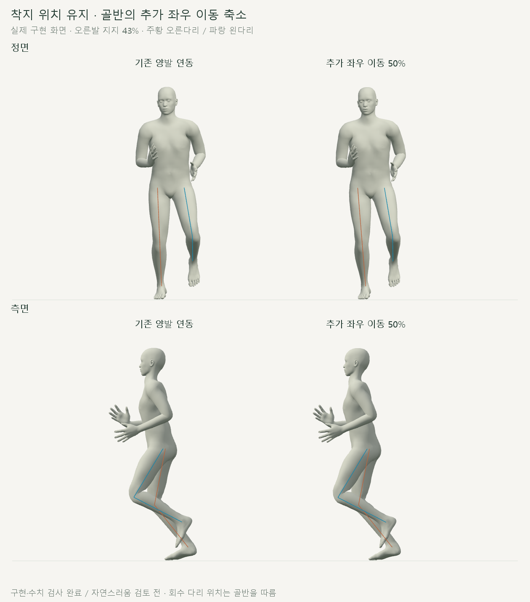

왼쪽 M38 / 오른쪽 축소안을 같은 순간 재생하며 정면·측면·남녀·시간 막대를 선택합니다. [M39 계약](../02-requirements/REQUIREMENTS.md#m39--골반-좌우-추가-이동-축소) · [측정·검사·한계](../05-validation/CMU_PELVIS_SWAY.md); 구현·수치 검사 완료 / 자연스러움 검토 전입니다.

## M38 양발 착지 구간 연동 · 로컬 실험

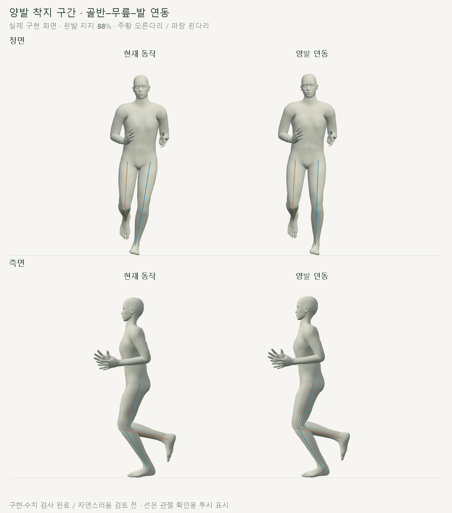

현재/양발 연동을 함께 재생하며 주황·파랑 연결선으로 양다리를 확인합니다. [M38 계약](../02-requirements/REQUIREMENTS.md#m38--양발-착지-구간-연동-재생) · [재생·검사·한계](../05-validation/CMU_STANCE_CHAIN_BILATERAL.md); 구현·수치 검사 완료이며 자연스러움은 사용자 검토 전입니다.

## M37 오른발 착지 구간 연동 · 로컬 실험

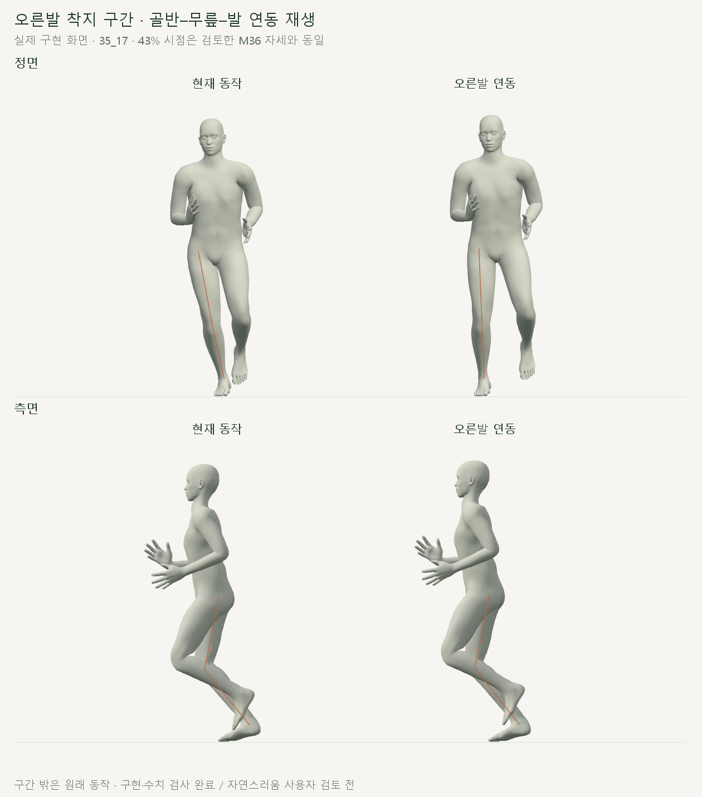

현재/오른발 연동을 함께 재생하며 정면·측면·시간 이동·남녀 선택이 가능합니다. [M37 계약](../02-requirements/REQUIREMENTS.md#m37--오른발-착지-구간-연동-재생) · [검사·한계](../05-validation/CMU_STANCE_CHAIN_MOTION.md); 구간 밖은 원래 동작이며 자연스러움 검토 전입니다.

## M36 착지 한 장면 연동 · 로컬 실험

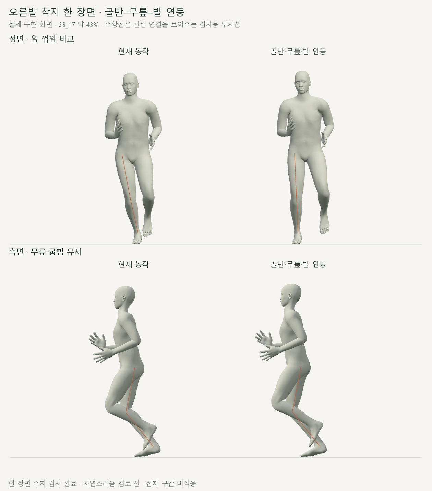

오른발 지지 한 장면만 현재/후보로 비교하며 정면·측면·남녀를 선택합니다. [M36 계약](../02-requirements/REQUIREMENTS.md#m36--오른발-착지-한-장면-연동-비교) · [검사·한계](../05-validation/CMU_STANCE_CHAIN.md); 재생과 전체 구간 연결은 다음 검토 범위입니다.

## M35 고관절 수직선 비교 · 로컬 실험

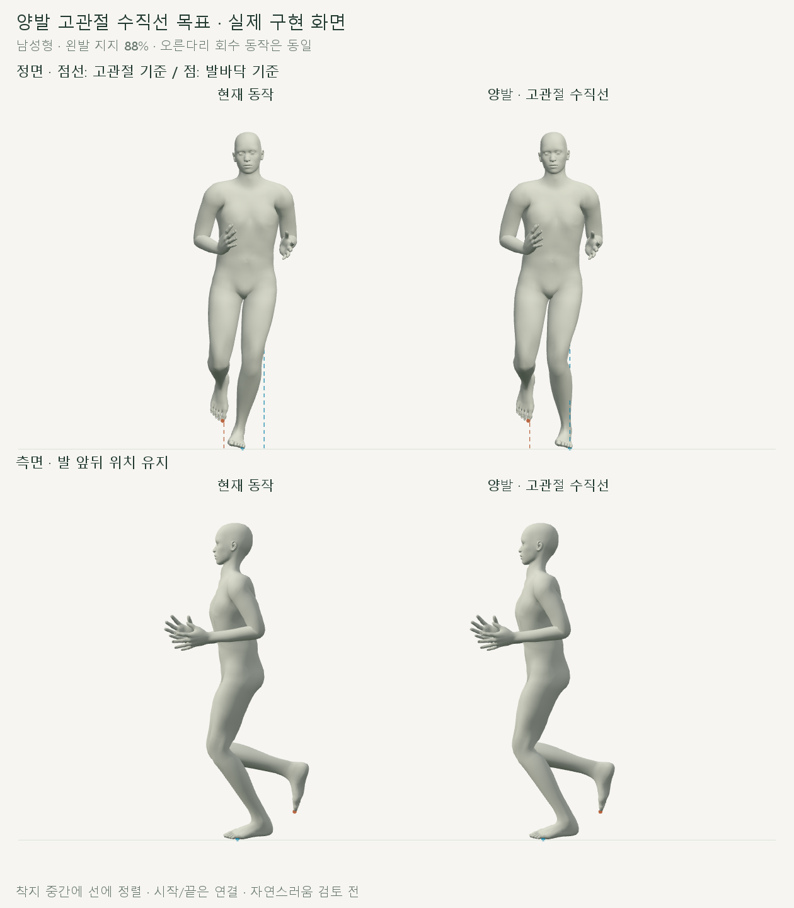

현재/수직선 목표를 동시 재생하며 정면에서는 고관절 기준선과 발 표면점을 표시합니다. [M35 계약](../02-requirements/REQUIREMENTS.md#m35--고관절-수직선-착지-비교) · [조작·검사·한계](../05-validation/CMU_HIP_LANDING_COMPARISON.md); M35는 무릎 꺾임 지적으로 자세 검토에 실패한 실험입니다.

## M34 양발 지지 구간 비교 · 로컬 실험

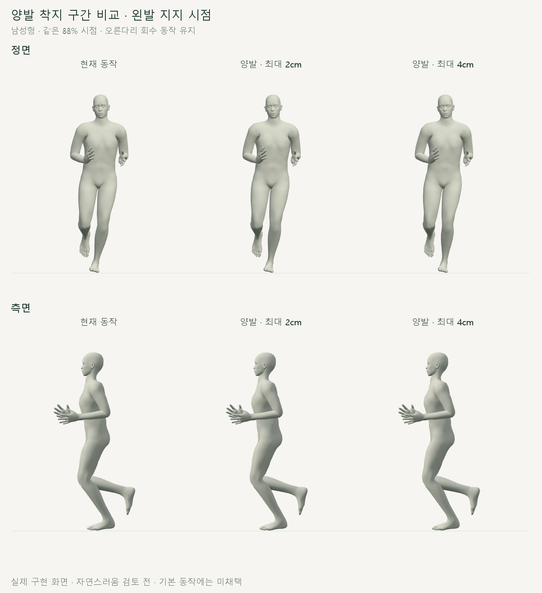

현재/최대 2cm/4cm를 동시에 재생하며 양발은 각각 지지 구간에서만 보정됩니다. [M34 계약](../02-requirements/REQUIREMENTS.md#m34--양발-지지-구간-안쪽-디딤-비교) · [조작·검사·한계](../05-validation/CMU_BILATERAL_COMPARISON.md); 자연스러움 검토 전인 별도 실험입니다.

## M33 오른발 지지 구간 비교 · 로컬 실험

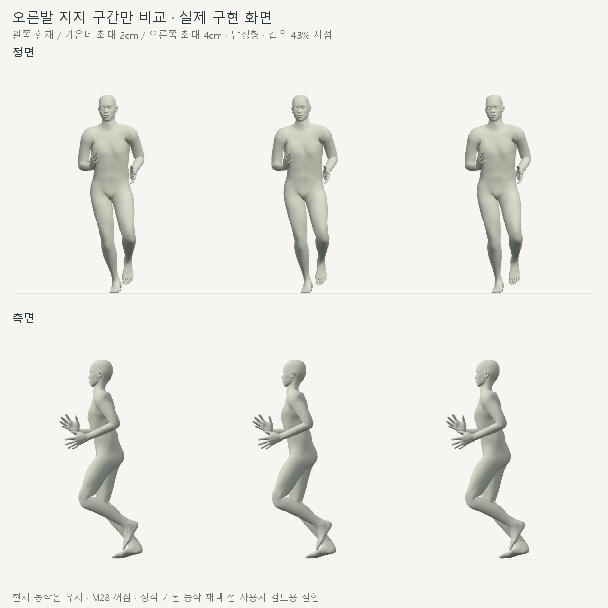

검토 페이지의 ‘오른발 안쪽 디딤 비교’로 진입합니다. 세 동작을 같은 시각에 재생하며 정면/측면·시간 탐색·남녀 선택을 제공합니다.

[M33 계약](../02-requirements/REQUIREMENTS.md#m33--오른발-지지-구간-안쪽-디딤-비교) · [조작·검사·한계](../05-validation/CMU_LANDING_COMPARISON.md). 정식 사용자 기능이나 기본 달리기로 채택한 상태는 아닙니다.

## M28 디딤 폭 교정 · 로컬 실험

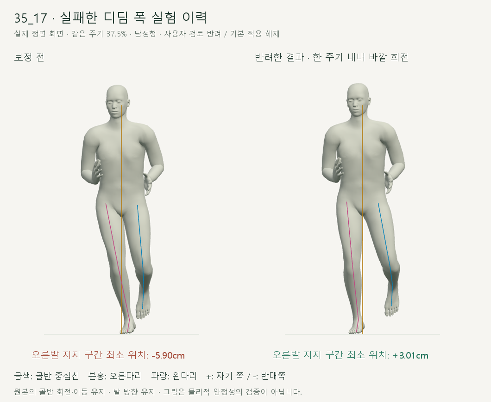

**사용자 검토 반려 / 기본 꺼짐.** 전신·몸 이동·미끄러짐 검토 화면에 실패 결과 재현용 `이전 디딤 폭 실험 · 사용 보류`만 남깁니다. [동작 계약 M28](../02-requirements/REQUIREMENTS.md#m28--35_17-디딤-폭-교정) · [검증과 한계](../05-validation/FULL_BODY_REFERENCE.md#m28--35_17-중앙선-교차-교정).

## M26 오른발 미끄러짐 비교 · 로컬 실험

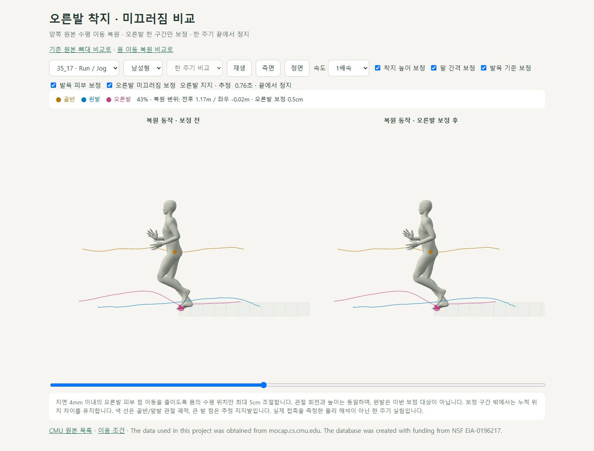

**실제 구현:** 기존 검토 화면의 ‘오른발 착지 미끄러짐 비교’로 진입합니다. 양쪽 모두 몸 이동을 복원하며 오른쪽에만 보정합니다.

| 조작 | 표시 |
| --- | --- |
| 오른발 미끄러짐 보정 | 켜기/끄기 · 현재 보정량 cm · 착지 높이 보정이 꺼지면 비활성 |
| 기존 재생/모델/시점 | 동일하게 사용 · 한 주기 끝 정지 · 궤적 재계산 |

[계약 M26](../02-requirements/REQUIREMENTS.md#m26--오른발-지지-구간의-잔여-미끄러짐) · [결과·검증 한계](../05-validation/FULL_BODY_REFERENCE.md#m26--오른발-한-구간의-미끄러짐만-작게-보정).

## M25 몸 이동 비교 · 로컬 실험

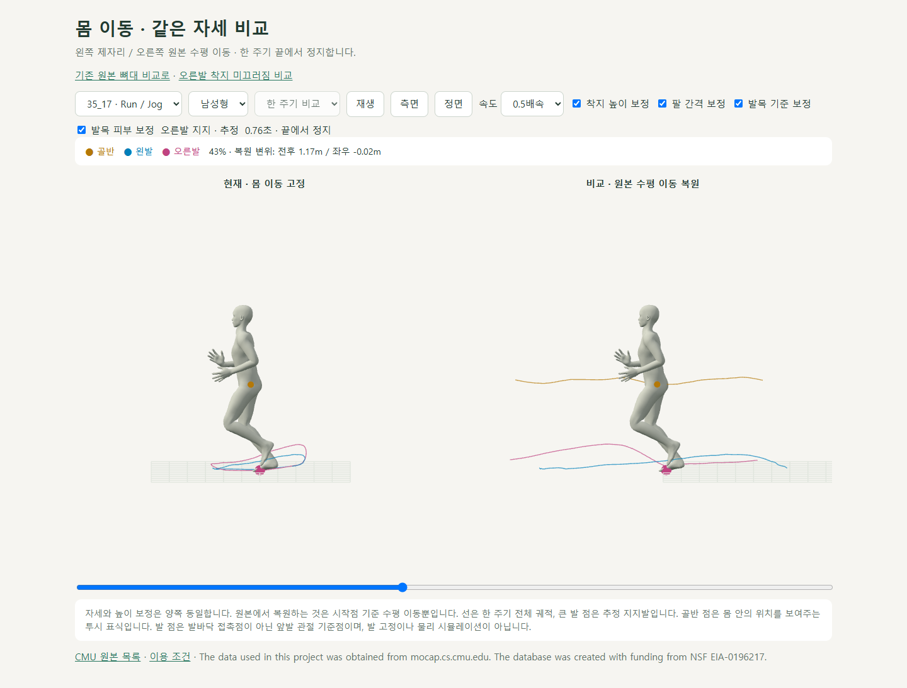

**실제 구현 화면:** 기존 전신 검토 페이지의 ‘몸 이동 고정 ↔ 복원 비교 열기’로 진입합니다. SCR03/SCR08을 위한 제한 실험이며 정식 기능 화면을 대체하지 않습니다.

| 화면 조작 | 표시 |
| --- | --- |
| 재생·진행률 | 양쪽 같은 시각 · 끝 정지 · 다시 재생하면 처음부터 |
| 정면/측면 | 같은 축척의 직교 투영 · 골반/발 궤적 전체 표시 |
| 남녀·동작·보정 | 양쪽에 동일 적용 · 궤적 갱신 |
| 색상 | 금색 골반 투시 표식 / 파랑 왼발 / 분홍 오른발 · 지지발 강조는 추정 |

[계약 M25](../02-requirements/REQUIREMENTS.md#m25--원본-몸-이동-비교-실험) · [실제 비교·검사·한계](../05-validation/FULL_BODY_REFERENCE.md#m25--같은-자세-몸-이동만-복원).

## 메인

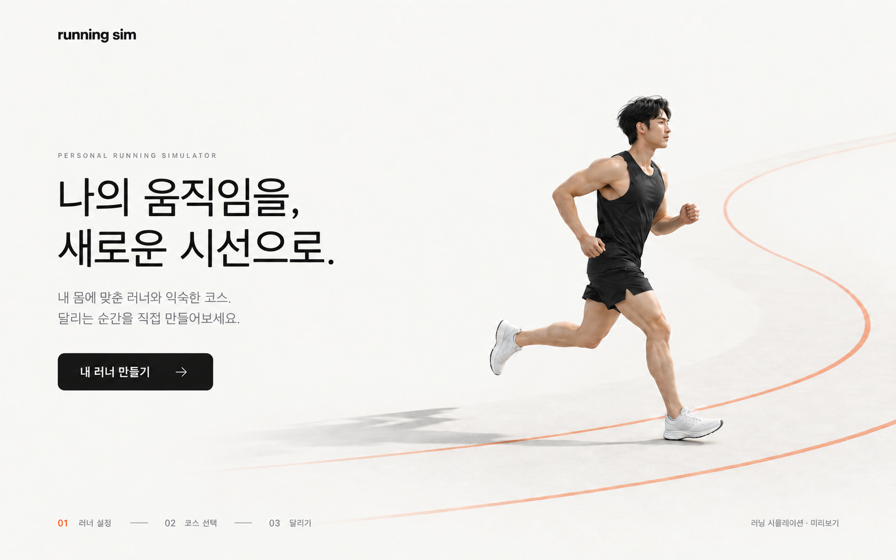

정적 시안 v3. 시작 행동은 ‘내 러너 만들기’입니다.

| 경로 제안 | 화면 | 핵심 행동 |
| --- | --- | --- |
| / | 메인 | 내 러너 만들기 |
| /runner/body | [체형](CUSTOMIZATION_SCREEN.md) | 체형 확인 → 자세 설정 |
| /runner/pose | [자세](MOTION_EDITOR.md) | 관절 직접 조절·수치 입력 → 재생 확인 → 코스 설정 |
| /course | [코스](COURSE_SCREEN.md) | 경로·목표·실행 조건 → 시작 |
| /run | 주행·결과 | 공통 재생 → 기준 A 보관 → B 비교 |
| /admin | [관리자](ADMIN_SCREEN.md) | 모델 시험·변경 · 각도/카테고리 제한 · 이용 통계 |

위 경로는 서비스 설계안입니다. 현재 로컬 `/`는 체형에서 시작해 자세로 전환하는 모델 시험 화면입니다. `/admin`은 기존 관리자 시험이며, 위의 새 URL 경로는 구현하지 않았습니다.

사용자 캐릭터 화면에 남성형·여성형 모델 선택을 제공합니다. 관리자 화면은 로컬 시험만 구현했으며 운영 인증·통계 연결 전입니다.

준비되지 않은 주행 주소로 진입하면 필요한 설정 단계로 안내합니다.

## 현재 단계 구현

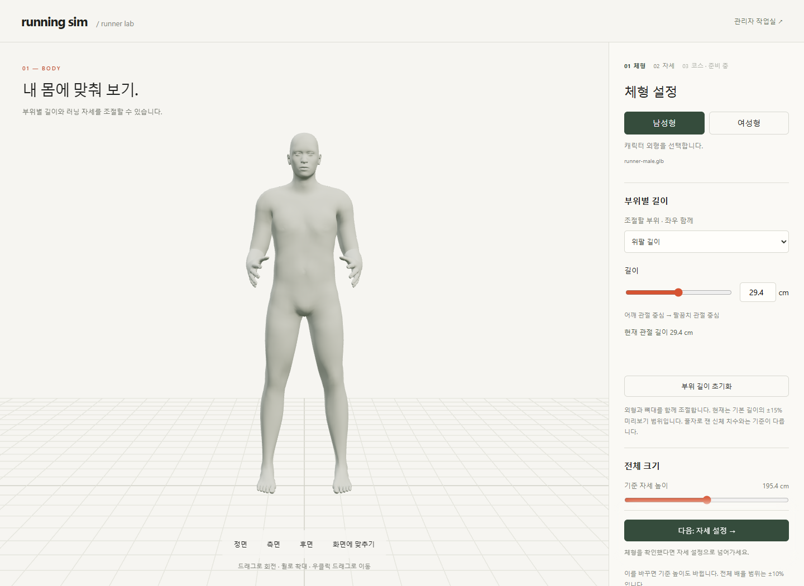

체형·자세를 분리하고 같은 모델과 입력 상태를 유지합니다. [자세 화면·검사 결과](../05-validation/SETUP_STEPS.md)와 [M07 계약](../02-requirements/REQUIREMENTS.md#m07--이번-단계-분리의-구현-계약)을 참고하세요.

## 서비스 전체 단계 이동 · 후속 설계 포함

| 단계 | 이전 / 다음 | 유지·재검사 제안 |
| --- | --- | --- |
| 신체 | 메인 / 자세 세팅 | 선택 모델·체형을 다음 단계로 전달 |
| 자세 | 체형 설정 / 코스 설정 | 체형 유지 · 자세·동작 초안 보관 · 현재 지원 범위 표시 |
| 코스 | 자세 세팅 / 백테스팅 | 코스·목표 유지 · 실행 준비 조건 검사 |
| 백테스팅 | 코스 세팅 / 결과 확인 | SCR05·06 주행·결과와 연결 / 입력·계산·검증 계약 미확정 |

현재 신체↔자세↔코스↔백테스팅 요약 이동은 입력을 유지합니다. [M87 검사](../05-validation/COURSE_SETTINGS.md)로 코스까지 확인했습니다. 체형을 변경하면 자세·접지 호환성을 다시 검사하며, 미지원 상태의 후속 이동 정책은 구현 전에 검토합니다.

## 자세 설정 · 관절 직접 조작 포함

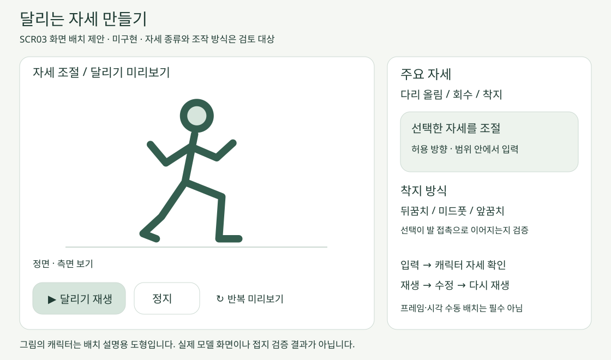

SCR03 자세 설정 단계의 배치 제안입니다. 그림은 관절 잡기 핸들·단계 이동 버튼 반영 전이며, [직접 조작 규칙 제안](MOTION_EDITOR.md)을 함께 검토합니다.

## 근거 기반 자세 비교 · SCR08

**검토안 · 미구현:** SCR03에서 여는 비교 화면으로, 모델 두 개와 한 주기 그래프를 함께 봅니다. 동작·상태·첫 구현 후보는 [상세 화면 정의](EVIDENCE_COMPARISON.md)에 모았으며, 현재 `/gait-compare`의 M13 실험과 구분합니다.

## 주행

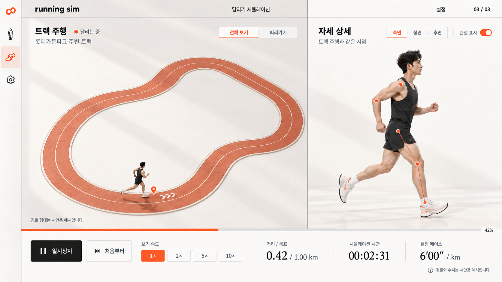

정적 시안 v2. 실제 경로·새 자세 입력·A/B 결과는 반영 전입니다.

| 왼쪽 약 60% | 오른쪽 약 40% | 공통 |
| --- | --- | --- |
| 실제 트랙 · 출발·방향 | 동일 시점 전신 자세 | 시간·거리·페이스·바퀴 |
| 따라가기 / 전체 보기 | 측면 기본 · 정면/후면 | 정지·재개·처음·보기 배속 |
| 주변 풍경 제외 | 검증된 각도만 수치 표시 | 실행 방식·A/B·상태 |

1440×900 데스크톱 기준안입니다. 카메라·보기 배속은 계산 결과에 영향을 주지 않습니다.

## 상태와 비교

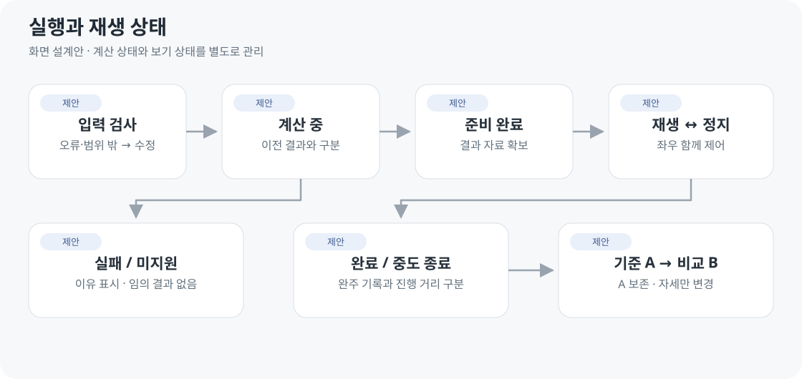

| 상황 | 화면 규칙 |
| --- | --- |
| 로딩·잘못된 입력 | 이유 표시 · 시작 비활성 |
| 계산 중 | 접수/진행 표시 · 이전 결과 재사용 표시 금지 |
| 탭 숨김 | 보기 재생 정지 · 복귀 후 수동 재개 제안 |
| 설정 변경 | 현재 실행 종료 후 새 실행 · A 유지 |
| 미지원·실패 | 이유·수정/재시도 · 0초로 대체하지 않음 |
| 초기 세션 | 새로고침 복구 보장 안 함 · 영구 저장 후속 |

| A/B 결과 영역 | 표시 |
| --- | --- |
| 공통 조건 | 체형·능력·노력·코스·거리·환경·모델/자산 버전 |
| 변경 항목 | 자세 A / B 값·단위 |
| 결과 | 시뮬레이션 예상 기록 · B − A · 적용 범위/검증 오차 |
| 재생 | A/B 선택 → 기존 좌우 화면 · 기준 A 보존 |
| 비교 제한 | 자세 외 조건 불일치 · 계산 미지원 · 미완주 |

추천·최적 자세 배지는 제공하지 않습니다. 화면 완료 기준은 [R01–R16](../02-requirements/REQUIREMENTS.md)를 따르며, R12–R14·R16의 세부 방식은 검토 중입니다.
