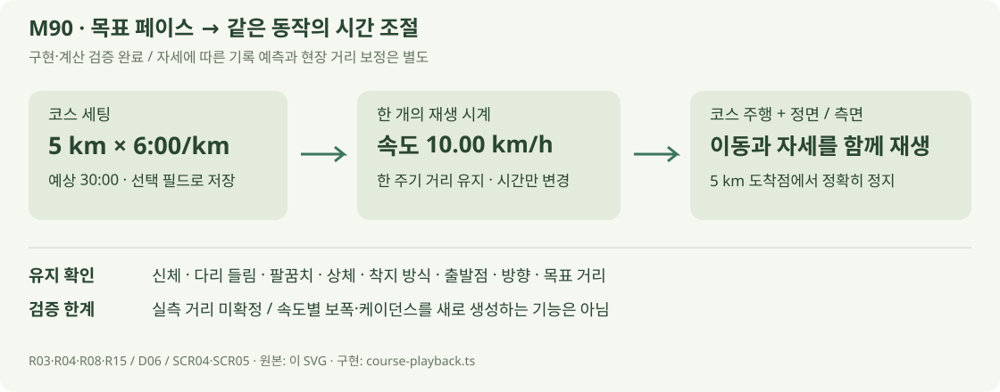
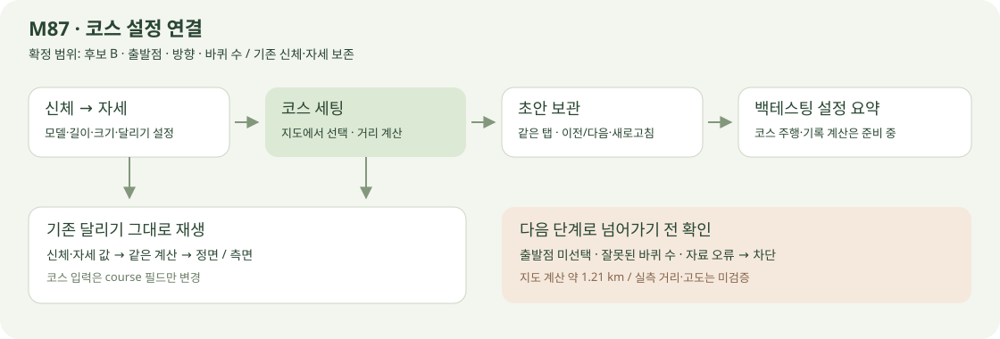
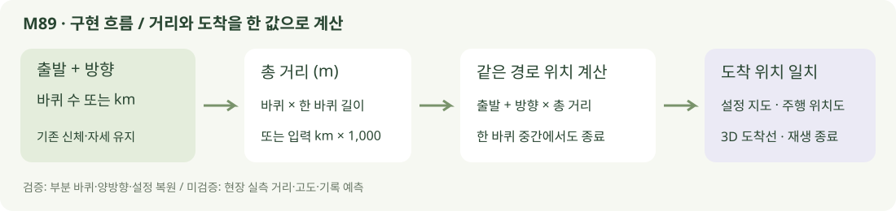

# 데이터 설계 초안

2026-10-26 · **M93 수정 근거·이전 경로 이력 추가 / 사용자 설정 구조 유지**


M92 원본 검사 구조는 유지합니다. M93은 수정 근거와 이전 경로 이력을 추가하고, 출발점을 지리적 위치 기준으로 이전합니다. [정확한 계약](../02-requirements/REQUIREMENTS.md#m93--항공사진-대조와-경로-오류-수정) · [검사](../05-validation/COURSE_IMAGERY.md).



페이스 선택값을 기존 코스 초안에 보관하며 기존 저장값은 그대로 읽습니다. [정확한 계약](../02-requirements/REQUIREMENTS.md#m90--목표-페이스와-소요-시간) · [저장·복원 검사](../05-validation/COURSE_PACE.md).

## 현재 단계 상태와 코스 초안 · M87



현재 신체·자세·코스 초안을 같은 탭의 sessionStorage에 보관합니다. version 1에 course만 추가하며 정확한 필드·범위는 [M87 / 세부 M85 계약](../02-requirements/REQUIREMENTS.md#m87--확인한-코스-설정), 구현·보존 검사는 [M87](../05-validation/COURSE_SETTINGS.md)에 모았습니다.

M88 주행의 시간·배속·재생 상태는 화면 메모리에만 둡니다. 새로고침·단계 재진입은 설정을 유지하고 출발점에서 재준비하며, 기존 저장 구조는 변경하지 않습니다. [주행 계약](../02-requirements/REQUIREMENTS.md#m88--설정한-실제-코스-주행).

## 거리 목표·코스 이전 · M89



기존 바퀴 저장값을 읽고 거리 목표만 선택 필드로 추가합니다. 경로 변경은 이전 출발 좌표를 기준으로 이전하며, 제외된 구간은 재선택합니다. [필드·검사 기준](../02-requirements/REQUIREMENTS.md#m89--목표-거리와-도착점) · [검증](../05-validation/COURSE_GOAL.md).

## 후속 생성·계산 구조 제안


사용자가 편집하는 목표 자세와 시스템이 생성하는 프레임을 분리하는 설계 제안입니다. 아래 형식·이름·단위·API는 미확정이며 [R12](../02-requirements/REQUIREMENTS.md#r12-주요-자세와-달리기)를 기준으로 검토합니다.

| 데이터 | 최소 내용 제안 | 변경 규칙 |
| --- | --- | --- |
| BodyProfile | 모델 해시·유형 · 길이 · 외형값 · 측정/변형 버전 | cm 입력과 내부 m 구분 · 외형값 단위 미정 |
| PoseTarget | 역할(올림/회수/착지 등) · 목표 관절값 · 착지 요청 · 정의 버전 | 사용자 편집 입력 · 역할·단위 미정 · 독립 복사 |
| PoseFrame | 생성 프레임 ID · 시각(s) · 관절값(rad 제안) · 정의 버전 | 시스템 생성 결과 · 수동 입력 필수 아님 · 참조 공유 금지 |
| MotionDraft | 체형 참조 · 목표 자세 목록 · 생성 설정/주기 | 편집용 · 생성 설정 미확정 |
| MotionClip | 입력 목표 복사본 · 생성 동작 · 체형/자산/제한/생성 버전 | 실행에 사용한 버전은 보존 |
| Scenario | 코스·거리·방향 · 실행 방식 · 체형/동작 복사본 | A/B에서 변경 허용 항목 검사 |
| RunResult | 입력 ID · 상태 · 시간/거리 · 동작 참조 · 계산 버전 | 없는 결과는 null + 이유 |

## M01 자세 복사본

> 초기 정적 자세 실험의 계약입니다. 현재 `stages.js`의 상태 저장·버튼과 연결하지 않습니다.

**M01-a/b 구현.** [M01 요구·검수 기준](../02-requirements/REQUIREMENTS.md#r12의-첫-실험-m01)에 사용하는 임시 데이터입니다. 위의 `PoseFrame`과 달리 시각·체형 참조가 없으며, 현재 입력 단위인 도(°)를 그대로 보관합니다.

| 필드 | M01-a 계약 |
| --- | --- |
| `schemaVersion` | `1` · 저장 구조 버전 |
| `modelHash` | 현재 GLB 바이트의 SHA-256 · 표시 이름/남녀 선택값으로 대신하지 않음 |
| `poseDefinitionVersion` | `running-pose-v1` · 관절 의미·축·고정 벌림 변경 시 갱신 |
| `settingsRevision` | 현재 적용한 관리자 설정 변경 번호 · 복원 시 저장본/화면 설정/로컬 최신 설정 일치 검사 |
| `unit` | `deg` · 후속 PoseFrame의 rad 제안과 혼용 금지 |
| `values` | `upperarm_l/r`, `lowerarm_l/r`, `thigh_l/r`, `calf_l/r` 각각의 숫자 · 정확히 8개 키 |

슬롯의 초기값은 `null`이며 값은 불변 복사본으로 다룹니다. 모델 파일·뼈 객체·Quaternion·체형·카메라·시간은 이 구조에 넣지 않습니다.

```ts
// API 사용 예시: getContext는 main.ts의 최신 모델·설정 상태
const store = createPoseSnapshotStore(getContext);
store.save();          // 현재 관절값을 불변 복사본으로 저장
const result = store.restore(); // 전체 검사 후 일괄 복원
// result.ok / result.reason은 pose-snapshot-ui.ts에서 상태 문구로 표시
```

[`running-pose.ts`](../../experiments/model-preview/src/running-pose.ts)의 기존 `set()`은 한 값씩 반올림·범위 보정합니다. 새 `restore()`는 전체를 먼저 검사해 일괄 적용하며, 예외 시 이전 8개 값·뼈 회전·행렬 캐시를 복구합니다. [검사 결과](../05-validation/POSE_SNAPSHOT.md)

| 설계 지점 | 처리와 연결 상태 |
| --- | --- |
| 복사 경계 | 저장 시 새 값 객체 생성 · 복원 때도 새 후보 사용 · 저장본에 UI 참조 연결 금지 |
| 숨긴 관절 | 전체 8개 값을 보관하되 숨긴 항목은 해당 정책의 기본값인지 검사 |
| 설정이 오래된 화면 | 매 검사/클릭마다 최신 설정 읽기 · storage/focus/visibility 이벤트로 상태 갱신 · 읽기 실패도 차단 |
| 모델 교체 경쟁 | 로드 중 적용 차단 · 검사 시작/반영 시 활성 모델·로드 식별자 일치 확인 |
| 원자적 적용 | 유효성 검사 중 변경 없음 → 8개 값 교체 → `apply()` 1회 · 실패하면 이전 값 복구 · 성공 후 숫자/슬라이더 갱신 |
| 후속 동작 생성 | PoseTarget/PoseFrame 연결·단위 변환 별도 설계 · M01을 영구 형식으로 확정하지 않음 |

## 목표 입력·생성 결과 검사 제안

| 검사 | 처리 |
| --- | --- |
| 빈 값·NaN·존재하지 않는 관절 | 저장 거부 · 해당 항목 표시 |
| 각도 제한 | 관리자 게시 버전 기준 검사 |
| 중복 프레임 ID·같은 시각 | 생성 결과의 모호한 순서 거부 · 사용자 시각 입력 요구 아님 |
| 음수 시각·0 이하 주기 | 저장 거부 |
| 반복 경계 | 마지막→처음 연결 구간 별도 검사 |
| 모델·체형·제한 변경 | 호환성 재검사 · 기존 확정 동작 보존 |

중간 동작의 관통·접지는 숫자 범위 검사만으로 통과시키지 않습니다.

## 보관과 통계

| 구분 | 현재 | 제안·남은 결정 |
| --- | --- | --- |
| 모델 파일 | 기본 GLB·동작 JSON · 검사 해시 | 운영 Storage·게시 버전 / 등록 GLB IndexedDB는 이전 시험 |
| 관리자 설정 | 현재 단계 미연결 · 과거 localStorage 코드 보존 | 서버 관리자 권한·게시 버전 |
| 사용자 신체·자세·코스 | `running-sim.stages.v1` · sessionStorage | 계정·영구 저장·소유 권한 |
| 주행 시간·배속 | 화면 메모리 · 재진입/새로고침 시 재시작 | 실행 결과 보관·A/B는 별도 |
| 사용 통계 | 현재 단계 수집 미연결 | 과거 ‘이 설정 적용’ 정적 조합 집계와 동작/주행 이벤트 구분 |

‘많이 사용된 자세’의 과거 로컬 시험은 정적 관절값 조합을 세었습니다. 운영 동작 순위와 프레임별 순위는 집계 단위부터 정해야 합니다.


| 운영 접근 권한 제안 | 사용자 | 관리자 |
| --- | --- | --- |
| 게시 모델·허용 설정 | 읽기 | 검증·게시 |
| 개인 동작·프로필 | 본인 자료만 | 지원 목적 접근 여부 미정 |
| 이용 통계·설정 변경 기록 | 원시 기록 조회 불가 | 권한 확인 후 조회 |

[기존 실행 데이터 계약](ARCHITECTURE.md) · [관리자 통계 기준](../03-screens/ADMIN_SCREEN.md) · [동작 편집](../03-screens/MOTION_EDITOR.md)
