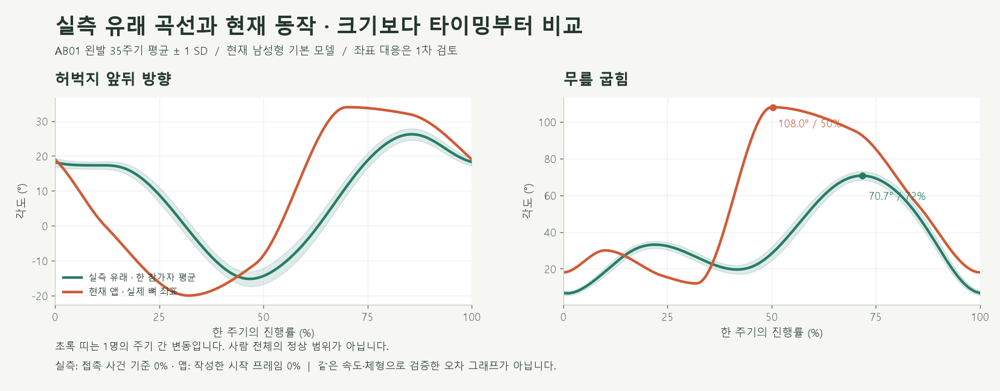
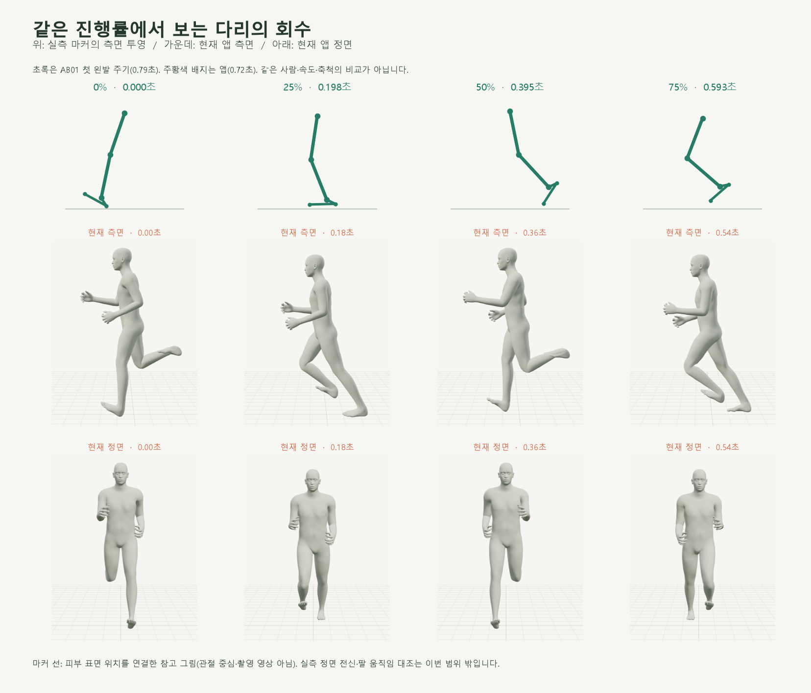
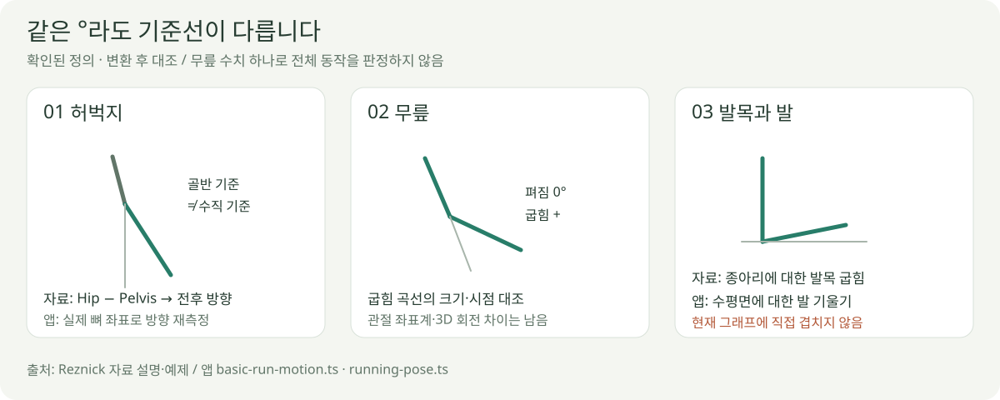
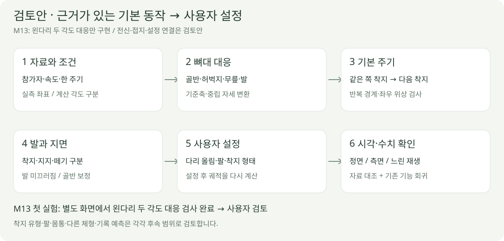

# 실측 자료와 현재 달리기 비교 설계서

> **설계·실험 이력** · 당시 기준과 출처를 보존합니다. 현재 화면·기본 동작의 채택 상태는 [현재 결과물](../01-planning/CURRENT_STATE.md)을 따릅니다.

2026-10-15 · v0.3 · **아래 비교는 M14 수정 전 M10/M12의 이력 · 전신 개선 구조는 검토안**

현재 기본 달리기는 [M14 자료 기반 다리 동작](../05-validation/BASIC_RUN.md)으로 수정했습니다. 아래 ‘현재 앱’ 표·그래프·캡처는 **2026-10-14 당시** 상태입니다. 이력 재생성·해시 검사는 당시 소스가 필요하며 현재 코드로 덮어쓰지 않습니다.

## 먼저 보이는 차이

현재 앱은 이 표본보다 **다리를 일찍 회수하고 무릎을 크게 접습니다.** 속도·체형·좌표계가 완전히 일치하지 않으므로 정상/비정상 판정이나 재현 정확도 점수로 해석하지 않습니다.

| 비교 항목 | 실측 유래 표본 | 현재 앱 |
| --- | --- | --- |
| 무릎 최대 굽힘 / 시점 | 평균 곡선 70.7° / 주기 71.8% | 108.0° / 50.3% |
| 허벅지 최대 전방 방향 / 시점 | 변환 곡선 26.2° / 85.9% | 뼈 좌표 측정 34.0° / 70.5% |
| 같은 쪽 발의 한 주기 | 35주기 중앙값 0.78초 | 고정 0.72초 |
| 조건 | AB01 · 평지 `s2x0` · 명령 속도 2.060804m/s | 기본 남성형 · 대응 속도 미정 |

실측 유래 값은 [공개 파일](https://doi.org/10.6084/m9.figshare.14558184.v1)의 **한 참가자 왼발 35주기**에서 계산했습니다. 속도는 [자료 설명서 9쪽](https://doi.org/10.6084/m9.figshare.14125814.v1)의 다리 길이 정규화 후 명령값이며 실제 순간 속도와 구분합니다.

## 주요 순간을 나란히 보기

초록은 **첫 왼발 주기의 피부 마커 좌표를 연결한 그림**, 회색은 **현재 앱의 실제 캡처**입니다. 같은 진행률끼리 배치했지만 실측 접촉 사건과 앱의 작성된 시작 프레임은 아직 독립적으로 정렬·검증하지 않았습니다.

| 확인된 차이 | 설계에서 다룰 부분 |
| --- | --- |
| 현재 고관절·무릎 곡선의 회수 시점이 이 표본보다 빠름 | 각도 최대값뿐 아니라 한 주기의 시간 배치 대조 |
| 앱은 발 표면 최저점에 맞춰 몸 전체 높이를 보정 | 착지·지지·떼기 사건과 발 궤적을 함께 설계 |
| 앱에는 발의 전후 접지 고정이 없음 | 이동 장면은 지면 기준, 제자리 장면은 가상 진행 속도 기준으로 미끄러짐 검사 |
| 골반·몸통·팔은 작성한 간단한 곡선 | 별도 전신 자료 확보 후 연결 · 이 하체 표본으로 검증 완료 처리하지 않음 |

코드 근거: [기본 달리기](../../experiments/model-preview/src/basic-run-motion.ts) · [관절 방향 적용](../../experiments/model-preview/src/running-pose.ts). M12 간격 보정은 유지하며, 골반 너비를 이상적인 보폭으로 확정한 것은 아닙니다.

## 각도 기준부터 맞추기

연구의 관절 각도는 마커에서 계산한 값이며, 직접 측정된 위치와 구분합니다. 허벅지는 [저자 예제](https://doi.org/10.6084/m9.figshare.13096058.v1)의 `HipAngles − PelvisAngles`를 사용하고, 앱은 상체 기울기 적용 후 실제 뼈 좌표에서 다시 측정했습니다.

| 대응 상태 | 처리 |
| --- | --- |
| 허벅지 · 1차 비교 | 연구의 시상면 변환값 ↔ 앱의 수직 기준 전후 방향 · 완전한 3D 좌표계 교정 전 |
| 무릎 · 1차 비교 | 연구의 굽힘 성분 ↔ 앱의 허벅지·종아리 사이 각 · 해부학적 좌표계 차이 유지 |
| 발목 · 직접 중첩 보류 | 연구의 상대 관절각 ≠ 앱의 절대 발 기울기 · 중립 발 방향부터 대응 |
| 정면·팔·몸통 · 미검증 | 선택한 하체 자료만으로 전신 동작·좌우 동시 자세를 재구성하지 않음 |

## 개선 구조 검토안

**제안:** 기본 동작의 근거를 먼저 마련한 뒤 사용자 설정으로 궤적을 바꾸고 접지를 다시 맞춥니다. ‘미드풋’은 발목 각도 하나로 처리하지 않고 접촉 위치·시점·무릎·골반을 함께 다루는 후속 작업입니다.

| 검토할 순서 | 결과물·통과 근거 |
| --- | --- |
| **첫 실험 M13 · 구현** | 별도 비교 화면에서 AB01 왼다리 한 주기의 허벅지·무릎 대응 · 기존 기본 달리기는 유지 |
| M13 확인 결과 | [실제 화면·7건 검사](../05-validation/REFERENCE_LEG.md) · [허용 오차·범위 계약](../02-requirements/REQUIREMENTS.md#m13--실측-왼다리-한-주기-대응) · 사용자 검토 전 |
| 다음 검토 | 발목 대응·접지 → 양쪽 다리·골반 → 전신 기본 동작 → 사용자 설정 연결 |
| 별도 근거 필요 | 다른 속도·성별·체형으로 일반화 · 착지 유형 분류 · 피로/기록 계산 |

수치 70.7°를 사용자 상한이나 모든 러너의 기본값으로 채택하지 않습니다. 실제 사용자 설정을 반영한 완성 동작은 아직 구현·검증하지 않았습니다.

## 출처와 재현

| 자료·코드 | 확인 범위 |
| --- | --- |
| [Reznick 등, 2021](https://doi.org/10.1038/s41597-021-01057-9) · [Normalized v1](https://doi.org/10.6084/m9.figshare.14558184.v1) | 모션캡처·계산 관절각 · 데이터 CC0 · 본 문서는 AB01 한 조건만 분석 |
| [추출 데이터](../05-validation/reports/gait-reference-ab01.json) | 150점/주기 · 왼발 평균·표본 SD · 첫 주기 마커 · 원본 파일 ID/공개 MD5 기록 |
| [현재 동작 표본](../05-validation/reports/gait-current.json) · [요약](../05-validation/reports/gait-comparison-summary.json) | 앱 한 주기 150점 · 실제 뼈 좌표 · 코드 SHA-256 · 비교 숫자는 반올림 |
| [추출 코드](../assets/diagrams/fetch-gait-reference.py) | 원본 1.53GB의 필요한 구간만 HTTP Range로 읽음 · 전체 파일 MD5 검증은 안 함 |
| [촬영 코드](../assets/diagrams/capture-gait-comparison.cjs) · [그래프·조합](../assets/diagrams/plot-gait-comparison.py) · [설계 그림](../assets/diagrams/gait-comparison.cjs) | 비교 자료 작성 당시 편집 핸들만 숨겨 촬영 · 측면 방향을 맞춰 마커 투영 · M10 재생 로직 유지 |
| [문서 데이터 검사 8건](../05-validation/reports/gait-comparison-checks.json) · [검사 코드](../assets/diagrams/check-gait-comparison.cjs) | 표본 수·유한값·마커 가시성·요약 수치·코드 해시 일치 · 생체역학 검증을 뜻하지 않음 |

출처: 2026-10-14 사용자 ‘실측 자료와 현재 달리기 동작 비교 설계서…그림 위주…검토 후 구현’. 연결: **R02·R05·R12·R14 / D02·D03·D13 / SCR03 / M10·M12**. 확정 요구는 [요구사항 명세서](../02-requirements/REQUIREMENTS.md), 구현 이력은 [기본 달리기 검증](../05-validation/BASIC_RUN.md)에 유지합니다.

[문서 목록](../README.md) · [연구 자료 목록](../07-references/REFERENCES.md)
