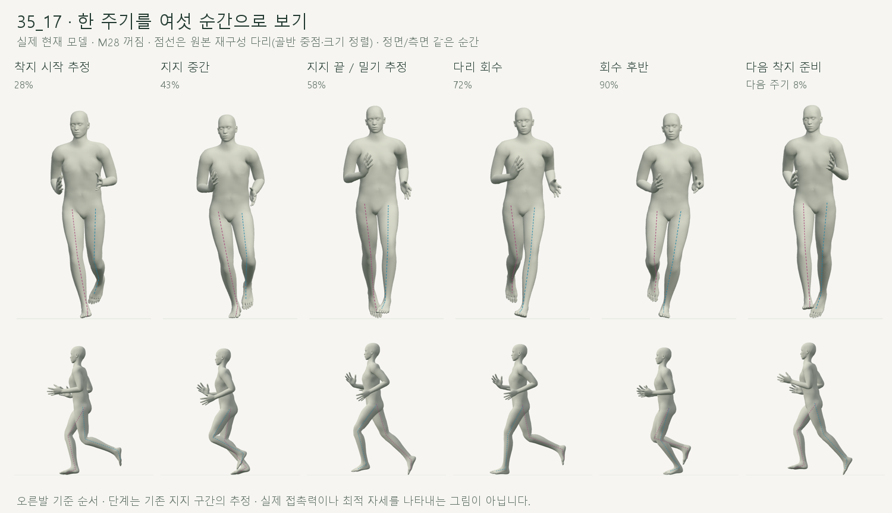
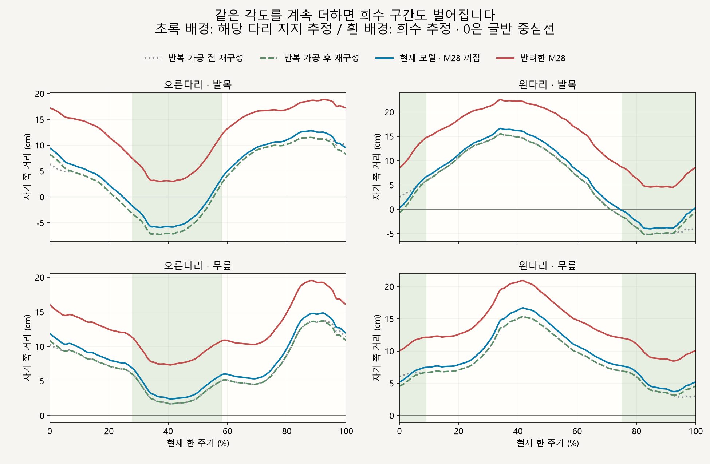
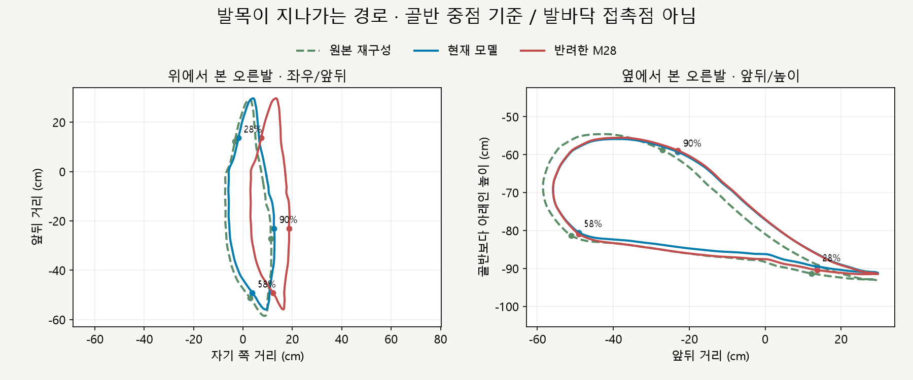
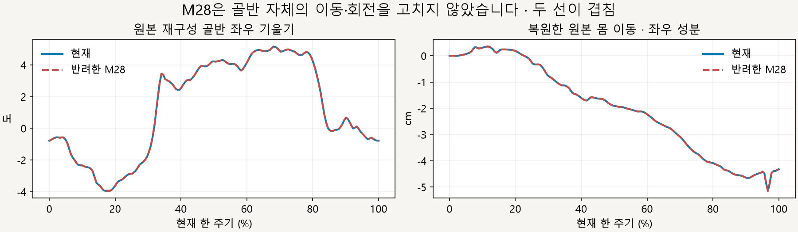
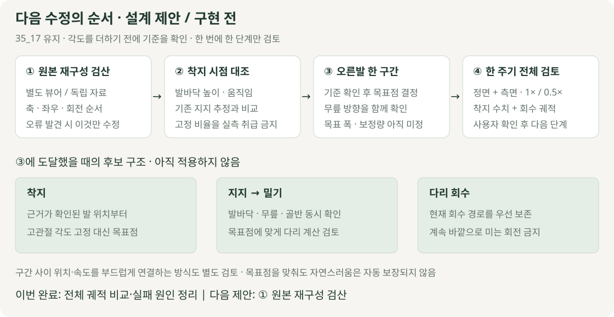

# 35_17 한 주기 비교와 교정 순서

2026-10-15 · M29 · **읽기 전용 비교 완료 / 다음 교정은 설계 제안·구현 전** · R02/R16·D03 연결

후속 결과: [M30 독립 원본 검증](../05-validation/CMU_SOURCE_VALIDATION.md)에서 골반·다리 축·좌우·순서를 확인했습니다. 아래 ‘미확정’은 M29 당시의 상태이며, 보정은 추가하지 않았습니다.

## 착지부터 다리 회수까지

실제 검토 페이지의 남성형 캡처이며, 표면은 현재 모델·점선은 크기와 골반 중점을 맞춘 재구성 뼈대입니다. 단계 이름은 기존 지지 구간으로 나눈 추정이며 ‘밀기’의 힘을 측정한 것은 아닙니다.

## 왜 이전 보정이 실패했나

**측정 확인:** 반려한 M28은 회수 중에도 발목을 평균 6.38～7.63cm 바깥으로 옮겼습니다. 착지 구간의 교차만 줄었고, 전체 동작은 다리를 벌리고 달리는 방향으로 바뀌었습니다.

회수 구간까지 경로가 바깥으로 밀리는 것을 공간 궤적으로 확인합니다. 발목 관절의 경로이며 발바닥 접촉점이나 지면에 남는 발자국은 아닙니다.

| 검사 · 남녀 35_17 | 확인한 결과 | 해석 한계 |
| --- | --- | --- |
| 현재 모델 ↔ 반복 재구성 | 허벅지·종아리 방향 차이 최대 0.000032° | 같은 재구성 결과와의 일치이며 원본 복원 정확도의 독립 검증 아님 |
| 가공 전 ↔ 반복 재구성 | 남성형 오른발 지지 구간 최소 위치 모두 −7.25cm | 중앙선 교차가 반복 연결만으로 생긴 것은 아님 · 원본 재구성 오류 여부는 미확정 |
| 반려 M28의 회수 구간 | 발목 바깥 이동 평균 6.38～7.63cm · 최대 9.28cm | 추정 지지 구간 밖 표본 기준 · 정상 범위 판정 아님 |
| 비교 범위 | 남녀 × 현재/반려 × 183시점 = 732자세 · 정면/측면 12캡처 | 새 보정 구현·자연스러움 검증은 하지 않음 |

## 골반 움직임은 별도로 본다

M28 전후의 골반 입력은 동일합니다. 첫 그래프는 재구성 골반 기울기, 둘째는 M25 방식으로 복원한 원본 수평 이동이며, 위 발 궤적의 ‘골반 기준 거리’와 구분합니다.

## 다음 작은 작업

**설계 제안:** 먼저 별도 해석기·뷰어 또는 독립 원본 자료로 35_17 재구성을 대조합니다. 그 결과와 착지 시점을 확인한 뒤에만 오른발 한 구간의 목표점을 정하며, 현재는 폭·보정각을 새로 지정하지 않습니다.

정확한 범위·검수 기준은 [M29 계약](../02-requirements/REQUIREMENTS.md#m29--35_17-한-주기-비교와-교정-설계)에 둡니다. [M28 실패 이력](../05-validation/FULL_BODY_REFERENCE.md#m28--35_17-중앙선-교차-교정)은 유지합니다.

## 재현과 출처

| 항목 | 원본·조건 |
| --- | --- |
| 자료 | [CMU subject 35 원본 목록](https://mocap.cs.cmu.edu/search.php?subjectnumber=35) · 로컬 35_17 ASF/AMC 재구성 · 원본/생성 코드 SHA-256은 아래 JSON에 보관 |
| 시각 | 현재 선택 구간 시작 54, 길이 91프레임 · 로컬 재생 120fps · 그림의 %는 이 구간 기준 |
| 좌표 | 진행 방향 정렬 · 좌우 고관절 중점 기준 · 좌우 그래프는 자기 쪽 + / 반대쪽 − · 원본은 대상 다리 길이로 배율 적용 |
| 원본 곡선 | 가공 전 비교는 정수 프레임만 사용 · 반복 곡선은 0.5프레임 간격 · 같은 위상 비교 |
| 기능 상태 | 현재 M28 꺼짐 유지 · 반려 M28은 검사 브라우저에서만 켜서 측정 · 앱 동작 코드 변경 없음 |
| 근거 한계 | 접촉력·정상 폭·최적 자세·사용자 기록 향상 미검증 · 원본 재구성 독립 검증 전 |

[읽기·캡처 코드](../../experiments/model-preview/scripts/inspect-cmu-cycle.cjs) · [원본 측정 JSON](../05-validation/reports/cmu-cycle-review.json) · [요약 JSON](../05-validation/reports/cmu-cycle-summary.json) · [그림 생성 코드](../assets/diagrams/cmu-cycle-figures.py).
