# 기본 달리기 · M10 → M17

> **실험 시점 기록** · 본문의 화면·수치·‘현재/다음’은 해당 M 실험 당시 기준입니다. [2026-10-26 현재 결과물](../01-planning/CURRENT_STATE.md)에서 채택된 기능·후속 보정·남은 한계를 확인하세요. 기존 검사 결과를 새로 통과한 것으로 바꾸지 않았습니다.

2026-10-15 · **M17 부분 수치 검사 통과 / 사용자 검토: 기본 달리기 품질 미달 · 전신 기준 재구성 검토안**

## 현재 판정 · 달리기로 느껴지지 않음

**후속 진행:** [CMU 전신 달리기 두 후보와 남녀 모델 전달 시험](FULL_BODY_REFERENCE.md)을 별도 화면에 준비했습니다. 기본 달리기 교체는 아직 하지 않았습니다.

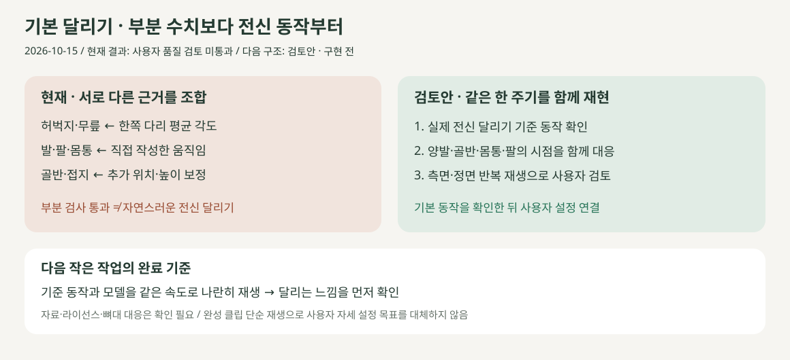

**사용자 확인:** “전혀 뛴다는 느낌이 없는데?” — M16·M17의 접지·높이 보정만으로 기본 동작 요구를 충족하지 못했습니다. 아래 수치 검증은 부분 계산의 회귀 검사이며 자연스러움의 합격 근거가 아닙니다.

| 재확인 | 확인된 사실 / 다음 검토 |
| --- | --- |
| 자료 조건 | [원논문 Running 절](https://pmc.ncbi.nlm.nih.gov/articles/PMC8553836/)과 원본 설명서 확인 · AB01/Run/s2x0/i0은 달리기 실험 조건 · 전체 사람 동작 클립이 아님 |
| 현재 대응 | 허벅지·무릎만 평균 각도에 대응 · 반대쪽 반 주기 가정 · 발·팔·골반은 작성한 보정 · 전신의 동시 대응 검증 없음 |
| 검토안 | 전신 기준 한 주기의 출처·사용 조건 확인 → 같은 시점의 양발/골반/몸통/팔 대응 → 측면·정면의 연속 재생 비교 |
| 완료 판정 | 사용자 시각 검토 + 루프 연결·접지·관절 범위 검사 · 기존 수치 통과만으로 완료 처리하지 않음 |
| 범위 | 이번에는 동작 코드를 추가 변경하지 않음 · 새 기준 동작 확보·재구성은 검토 후 작은 실험으로 진행 |

사용자가 체형·자세를 설정하고 그에 따라 재생하는 목표는 유지합니다. 전신 기준은 기본 동작의 출발점이며 사용자 조절을 없애거나 외부 클립만 재생하는 기능으로 바꾸는 제안이 아닙니다. 연결: **R02·R05·R12 / D02·D03·D13 / SCR03 / M14–M17**.

## M17 · 추락처럼 보이던 높이 변화 축소

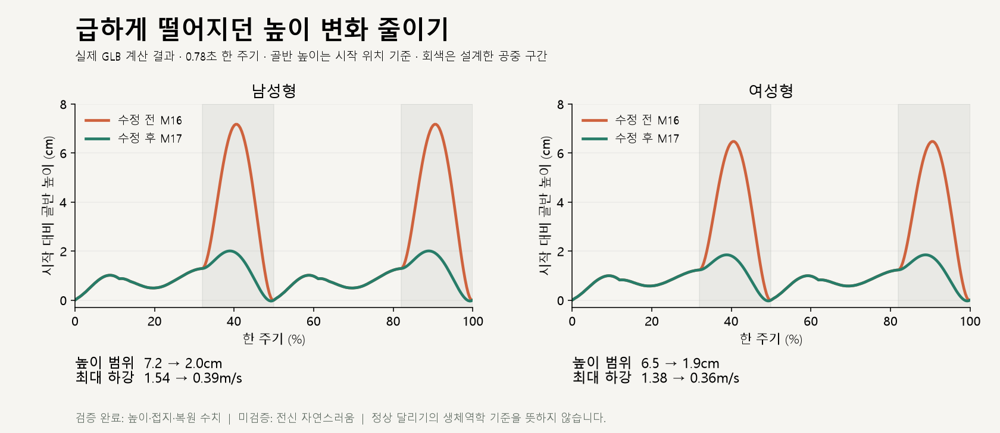

**확인한 원인:** 짧은 공중 구간에 큰 높이 보정이 추가되어 몸이 급하게 올라갔다 내려왔습니다. **변경:** [M17 계약](../02-requirements/REQUIREMENTS.md#m17--과도한-공중-높이-보정-축소)에 따라 추가 높이를 줄였으며, 골반 위치는 신체 무게중심의 실측값이 아닙니다.

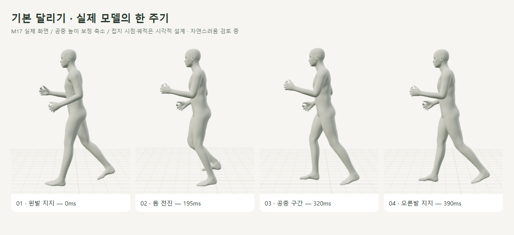

| 검증 | 결과 |
| --- | --- |
| 남성형 / 여성형 높이 범위 | 7.18→2.04cm / 6.48→1.88cm |
| 최대 하강 속도 | 1.54→0.39m/s / 1.38→0.36m/s · 1ms 간격 계산 |
| 접지·공중 | 지지 기준점 X/Z 오차 <0.001mm · 공중 내부 436/436시점 양발 >1mm · 남녀 모두 바닥 침범 없음 |
| 회귀 | 기존 달리기 12건 · 팔·발목 정렬·복원 · 30/144Hz 계산 일치 · 타입 검사·빌드 통과 |

[수정 전 수치](reports/run-height-before.json) · [현재 수치·높이 궤적](reports/run-contact.json) · [회귀 검사 코드](../../experiments/model-preview/tests/run-contact.cjs) · [수정 코드](../../experiments/model-preview/src/basic-run-motion.ts) · [그래프 생성](../assets/diagrams/plot-run-height.py). **수치 검증 완료이며 전신 자연스러움은 사용자 검토 중**입니다. 아래 M16부터는 이전 이력입니다.

## M16 · 문워크처럼 미끄러지던 동작 수정

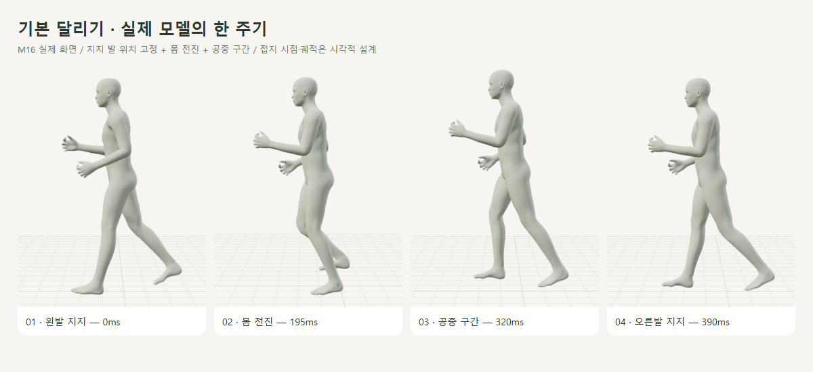

**원인:** 제자리에서 각도·발 높이만 맞추면 바닥에 닿은 발이 앞뒤로 이동합니다. **수정:** 지지하는 발 앞부분의 기준점을 고정하고 몸을 이동시킨 뒤, 다음 착지까지 공중 궤적을 연결했습니다.

| 확인 | 결과 |
| --- | --- |
| 남녀 각 1,561시점 | 지지 기준점의 월드 X/Z 오차 <0.000001m · 몸은 계속 전진 |
| 공중 구간 | 설계한 내부 구간 436/436시점에서 양발 높이 >1mm · 남녀 모두 확인 |
| 전환·복원 | 1ms 이동 <3mm · 30/144Hz 계산 결과 일치 · 원래 자세/위치 복원 |
| 화면 | 카메라가 따라감 · 일시정지 유지 · 시점 전환/처음으로/편집 시 바닥 복원 |
| 기존 기능 | [달리기 12건](reports/basic-run.json) · 다리 각도/길이·정책·체형·저장·복원 유지 |
| 추가 회귀 | [팔·발목 정렬·연속성](reports/motion-stability.json) 남녀 통과 · [별도 비교 화면 7건](reports/reference-leg.json) 통과 · 타입 검사·빌드 통과 |

[접지·이동 검사](reports/run-contact.json) · [검사 코드](../../experiments/model-preview/tests/run-contact.cjs) · [M16 계약](../02-requirements/REQUIREMENTS.md#m16--지지-기준점과-전진-연결). 코드: [동작·이동 계산](../../experiments/model-preview/src/basic-run-motion.ts), [재생과 이동 동기화](../../experiments/model-preview/src/basic-run-ui.ts), [카메라·격자 추적](../../experiments/model-preview/src/main.ts).

**한계:** 기준점의 수평 고정 검사이며 발바닥 전체의 접촉·마찰·접촉력 검증이 아닙니다. 접지 시점·공중 궤적은 시각적 설계값이고, 아래 M15는 수정 전 이력입니다.

## M15 · 팔·발목과 떨림 수정

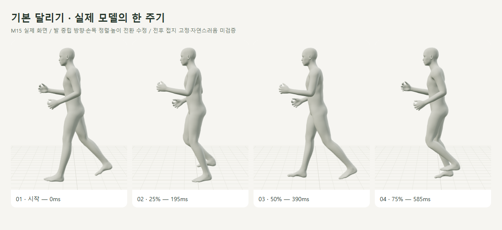

**원인 확인:** 발목→발가락 뼈를 수평으로 맞추는 계산이 원래 발바닥 방향을 무시했습니다. 두 발의 최저점 중 하나를 즉시 선택하는 높이 보정과 짧은 공중 높이 펄스도 몸의 높이 변화에 급격한 꺾임을 만들었습니다.

| 수정 | 확인 |
| --- | --- |
| 발 | 원본 모델의 중립 회전을 저장하고 그 기준으로 발 전체 방향 적용 · 발끝만 맞추던 방식 제거 |
| 팔·손목 | 팔 흔들림·팔꿈치 변화 폭 축소 · 손목은 아래팔과 정렬 · 엄지 쪽 위로 유지 |
| 몸 높이 | 짧은 공중 펄스 제거 · 두 발 높이의 부드러운 하한으로 전환 · 약간의 바닥 여유를 허용하는 시각적 보정 |
| 유지 | 허벅지·무릎 자료, 0.78초 주기, 편집값·체형·저장·복원 유지 |

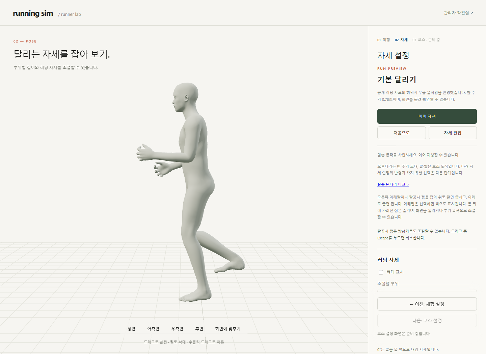

**검증 완료:** 남녀 각 1,561시점(1ms 간격·두 주기)에서 발 회전·손목 정렬·높이 변화·복원을 검사했습니다. 30/144Hz 간격으로 계산해도 같은 시각의 결과가 일치하며, 실제 기기의 FPS 측정이나 자연스러움 검증을 뜻하지 않습니다.

| 검사 | 결과 |
| --- | --- |
| 높이 변화의 꺾임 · 남성형 진단 | 인접 1ms 구간의 높이 변화량 차이 최대 1.278mm → 0.140mm · 약 89% 감소 |
| M15 당시 남녀 연속성 | 1ms 높이 이동 <0.4mm · 변화량 차이 <0.2mm · 뼈 회전 <0.6° |
| 발·손목 | 중립 기준 발 회전 오차 <0.0001° · 손목 방향 오차 <0.0001° |
| 복원·회귀 | 원래 자세 복원 · [달리기 12건](reports/basic-run.json) · [M13 7건](reports/reference-leg.json) 통과 |

[M15 수정 전 진단](reports/motion-stability-before.json) · [최신 재검사 수치](reports/motion-stability.json) · [연속성 검사 코드](../../experiments/model-preview/tests/motion-stability.cjs). M16에서 공중 이동을 추가하여 높이 허용치가 변경되었습니다. 구현 계약은 [M15](../02-requirements/REQUIREMENTS.md#m15--팔발목과-높이-전환-보정), 변경 코드는 [기본 동작](../../experiments/model-preview/src/basic-run-motion.ts)과 [중립 발 방향 보관](../../experiments/model-preview/src/running-pose.ts)입니다.

**남은 한계:** 전후 발 고정·물리 접지·전신 실측 동작은 아직 아닙니다. 아래 M14 화면은 수정 전 이력이며 사용자 피드백에서 자연스러움·떨림 문제가 확인되었습니다.

## M14 · 자료 기반 다리 동작 수정

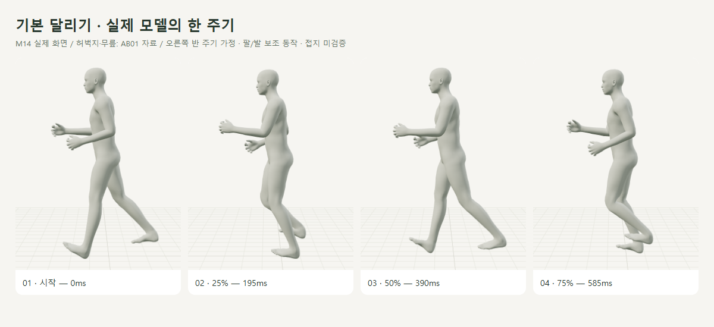

**검증 완료:** 허벅지·무릎은 AB01 왼발 평균 곡선을 사용하고 오른쪽은 반 주기 뒤에 재생합니다. 팔·발·공중 높이는 시각적 보정이며, 전신 실측 재현이나 물리 접지 검증 결과가 아닙니다.

| 변경 | 이전 M10 | 현재 M14 |
| --- | --- | --- |
| 무릎 최대 굽힘 / 시점 | 약 108° / 50% | 약 70.7° / 72% |
| 허벅지 전방 방향 / 시점 | 약 34° / 70% | 약 26.2° / 86% |
| 한 주기 | 0.72초 | 0.78초 |
| 방향 계산 | 상체 기울기 후 허벅지 방향 변화 | 기울기·회전을 미리 보상해 자료의 수직 기준 각도 유지 |

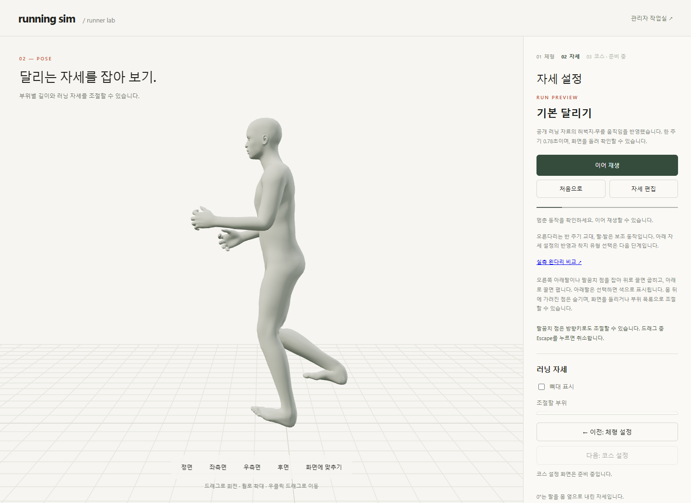

**확인 순서:** 체형 → 자세 설정 → 달리기 재생 → 좌측면/정면. 기존 일시정지·처음으로·자세 편집·저장/복원 조작은 유지합니다.

| 검증 · 2026-10-15 로컬 Edge | 결과 |
| --- | --- |
| 남녀 실제 모델 · 각 131시점 | 자료 대비 실제 허벅지·무릎 각도 최대 오차 <0.0001° |
| 길이·반복 | 뼈 길이 차이 <0.000001m · 반복 경계 위치 차이 <0.001m · 좌우 교차 없음 |
| 발 표면 | 남녀 각 11시점 전체 외형 바닥 침범 <0.001m · 전후 접지 고정 검사는 아님 |
| 제어·정책·체형 | 정지 복원·저장본 보존·탭 숨김·실패 복원·관리자 제한·길이/높이 조합·390px 조작 통과 |
| 회귀·빌드 | [달리기 12건](reports/basic-run.json) · [M13 7건](reports/reference-leg.json) · TypeScript/Vite 통과 |

변경 코드는 [basic-run-motion.ts](../../experiments/model-preview/src/basic-run-motion.ts), 공유 자료 보간은 [reference-leg-motion.ts](../../experiments/model-preview/src/reference-leg-motion.ts)입니다. 구현 계약·보정 범위는 [M14](../02-requirements/REQUIREMENTS.md#m14--기본-달리기-자료-반영), 자료 출처·좌표 한계는 [비교 설계서](../04-technical/RUNNING_COMPARISON.md)에 기록합니다.

**한계:** 한 참가자 자료를 남녀 모델에 적용한 시각적 기본 동작이며 성별·속도별 일반화가 아닙니다. 사용자 자세값 연결·착지 유형·전후 발 고정·전신 충돌·기록 예측·실제 모바일/Mac 검증은 후속입니다.

아래 M10/M12 화면·수치는 당시 이력입니다. `reports/basic-run.json`은 현재 M14 재검사 결과로 갱신했습니다.

## M12 · 기본 다리 간격 보정

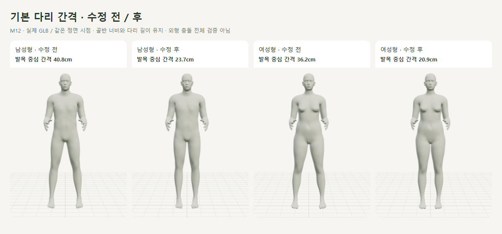

**검증 완료:** 고정 벌림을 제거해 무릎과 발목이 각 고관절 아래로 내려옵니다. 남녀 기본 자세의 발목 중심 간격은 각각 40.8→23.7cm / 36.2→20.9cm이며, 골반 너비·뼈 길이는 유지했습니다([M12 계약](../02-requirements/REQUIREMENTS.md#m12--기본-다리-벌림-보정)).

| 증거 | 결과 |
| --- | --- |
| [전후 측정](reports/leg-stance.json) | 기본 자세 고관절·무릎·발목 중심 간격 오차 <0.001cm |
| [달리기 검사](reports/basic-run.json) | 11건 통과 · 남녀 각 121프레임에서 좌우 무릎·발목 역전 없음 · 길이/각도/복원 유지 |
| 회귀·빌드 | [M06 15건](reports/leg-lift.json) + [저장 로직 39건](reports/pose-snapshot-logic.json) 통과 · TypeScript/Vite 통과 |

변경 코드는 아래 `running-pose.ts`의 다리 방향 계산입니다. **한계:** 관절 중심 검사이며 전체 외형 충돌 검사·사용자 간격 조절은 미구현입니다.

## M10 · 최초 구현 화면

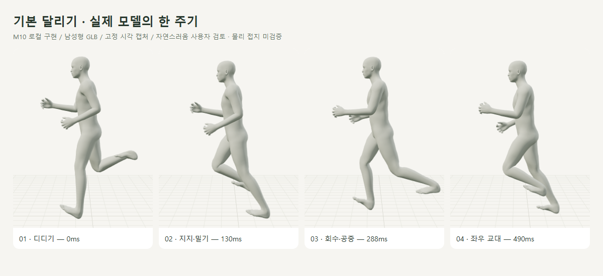

남성형 GLB를 같은 시점에서 캡처한 실제 동작입니다. 수치·보존·전환 기준은 [M10 계약](../02-requirements/REQUIREMENTS.md#m10--기본-제자리-달리기)에만 기록합니다.

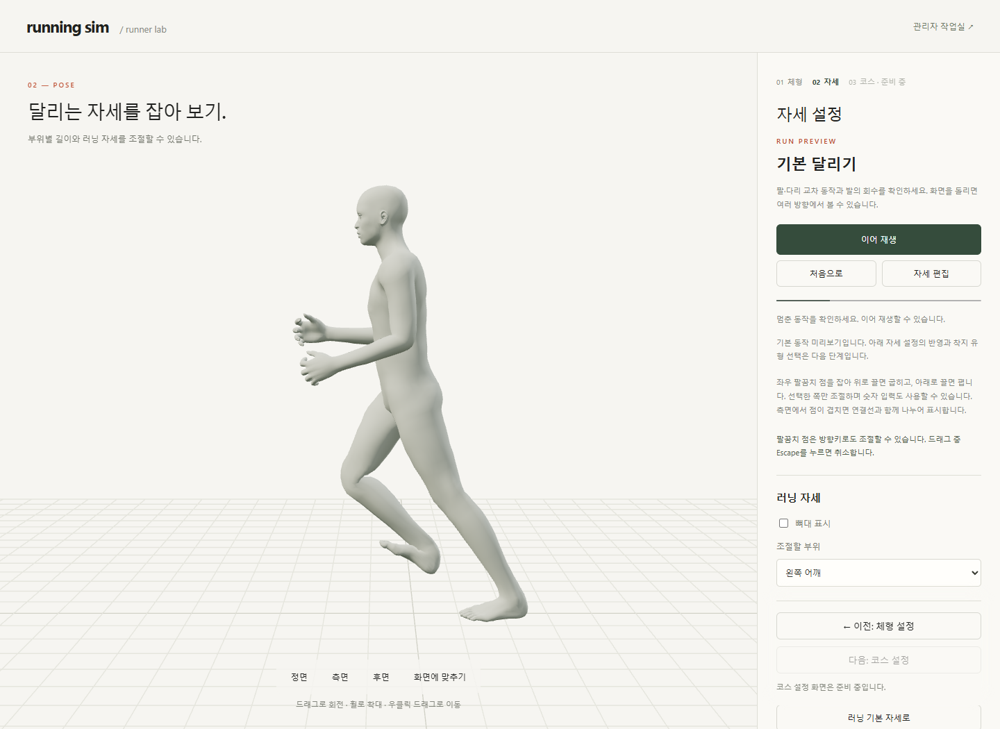

**확인 순서:** 체형 → 자세 → 달리기 재생 → 일시정지/이어 재생. ‘처음으로’는 첫 프레임, ‘자세 편집’은 기존 입력 자세로 돌아갑니다.

## 코드 연결


| 코드 | 역할 |
| --- | --- |
| [basic-run-motion.ts](../../experiments/model-preview/src/basic-run-motion.ts) | M10 당시 직접 작성 곡선 · 현재 M14 자료 기반 다리로 교체 · 발 방향/표면 높이·상체·손 보정 |
| [running-pose.ts](../../experiments/model-preview/src/running-pose.ts) | 기존 범위 검사를 통과한 연속 프레임 적용 · 편집값/뼈 길이는 유지 |
| [basic-run-ui.ts](../../experiments/model-preview/src/basic-run-ui.ts) | 재생/정지 상태 · 기존 편집/저장/M06과 충돌 방지 · 모델/정책 변경 처리 |

기존 다리 올림 실험 M06도 유지합니다. 기본 달리기는 별도 재생이며, 기존 자세 숫자를 달리기에 반영하는 연결은 아직 없습니다.

## M10/M12 당시 검증 · 로컬 Edge

| 확인 | 결과 |
| --- | --- |
| 기본 달리기 | [11건 JSON](reports/basic-run.json) · 남녀 실제 GLB · 6ms 간격 한 주기 각 121프레임 |
| 팔꿈치·무릎 굽힘 | M12 재검사 최대 오차 남성형 0.00002510° / 여성형 0.00001549° |
| 길이·반복 경계 | 부위 길이 오차 <0.000001m · 경계 ±0.01ms 뼈 위치 차이 <0.000054m |
| 발 표면·체형 | 기본 남녀 각 9시점 전체 외형의 바닥 침범 <0.001m · 허벅지 +10%/높이 +5% 조합 추가 확인 |
| 재생 제어 | 일시정지/재개/첫 프레임/편집 복원 · 저장본/카메라/통계 보존 · 숨긴 탭 일시정지 |
| 차단·오류 | 정책 변경/범위 축소/항목 숨김/미지원 GLB · 프레임 실패 시 복원 · 일부 상황은 이벤트/실패 주입 검사 |
| 회귀 | M06 15 + 단계 9 + 저장 화면 17 + 팔꿈치 좌18/우18/연동4 + 저장 로직39 = 120건 통과 |
| 빌드·화면 | TypeScript/Vite 통과 · 측면/정면·390px 화면 확인 |

**M10 당시 한계:** 직접 작성한 시각적 기본 동작으로 실측 모션이나 인체 물리 모델이 아니었습니다. 현재 M14의 부분 자료 반영 범위와 남은 한계는 위에 별도로 기록합니다.

```sh
# 저장소 루트 · Vite 127.0.0.1:5173, Playwright/Edge, 남녀 GLB 필요
node experiments/model-preview/tests/basic-run.cjs
node experiments/model-preview/scripts/capture-basic-run.cjs
```

Playwright 기본 경로가 없으면 `PLAYWRIGHT_PATH`를 지정합니다. 현재 캡처 원본은 `outputs/basic-run-height/`, M16은 `outputs/basic-run-contact/`, M15는 `outputs/basic-run-stable/`, M14는 `outputs/basic-run-reference/`, 이전 M10은 `outputs/basic-run/`입니다. [그림 관리](../assets/README.md)에서 추적합니다. 출처: 사용자 ‘기본 달리기 재생부터 적용해주세요 (실감나는 달리기)’, 2026-10-15 ‘기본 달리기 자세 수정 부탁해요’. 연결: **R02·R05·R12 / SCR03 / M10·M14**.
