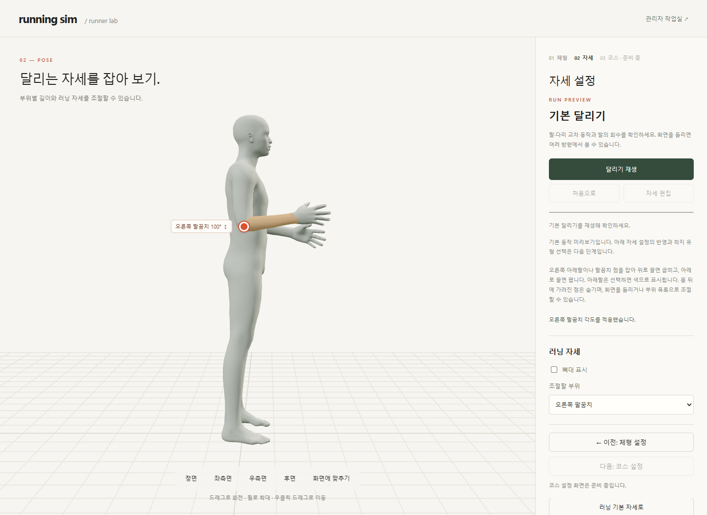
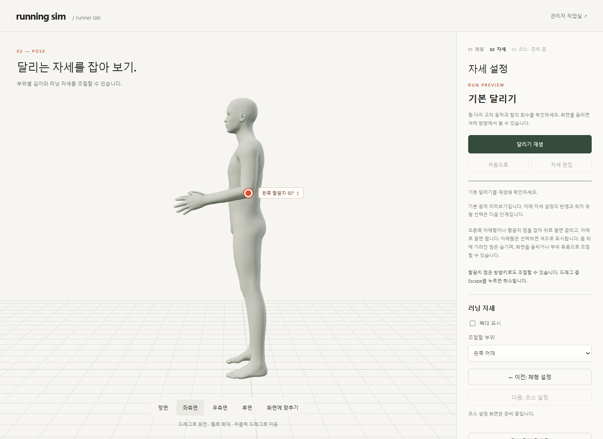
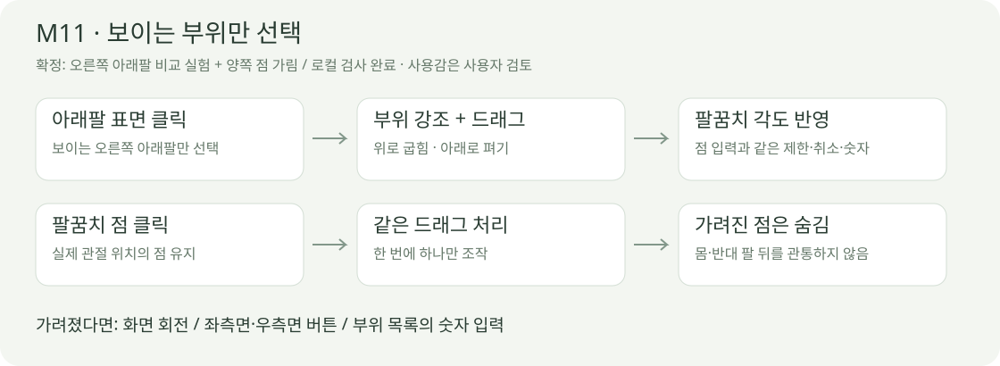

# M11 · 오른쪽 아래팔 선택·가림 처리

> **실험 시점 기록** · 본문의 화면·수치·‘현재/다음’은 해당 M 실험 당시 기준입니다. [2026-10-26 현재 결과물](../01-planning/CURRENT_STATE.md)에서 채택된 기능·후속 보정·남은 한계를 확인하세요. 기존 검사 결과를 새로 통과한 것으로 바꾸지 않았습니다.

2026-10-14 · **로컬 구현 · 새 검사 15건·기존 기능 92건·빌드 통과 · 사용감은 사용자 검토**



**체형 → 자세 → 우측면 → 오른쪽 아래팔을 잡고 위아래로 드래그**합니다. 같은 화면에서 팔꿈치 점을 잡아 비교할 수 있으며, 재생 중이면 ‘자세 편집’으로 돌아옵니다.



왼쪽 팔과 몸 뒤의 오른쪽 점은 숨깁니다. 점을 옆으로 이동시키지 않으며, 화면 회전·좌/우측면·부위 목록으로 접근합니다.



요구·입력·보존 기준은 [M11 계약](../02-requirements/REQUIREMENTS.md#m11--오른쪽-아래팔-선택가림-처리)을 따릅니다. M09의 겹친 점 분리 방식은 종료했습니다.

| 코드 | 처리 |
| --- | --- |
| [body-picking.ts](../../experiments/model-preview/src/body-picking.ts) | 변형된 피부 표면 재사용 → 가장 앞의 교차점 → 스킨 가중치로 부위 판정 · 강조도 깊이 검사 |
| [elbow-drag.ts](../../experiments/model-preview/src/elbow-drag.ts) | 아래팔/점 입력이 같은 드래그 처리 공유 · 포인터 캡처·취소·카메라 잠금 · 가려진 점 숨김 |
| [main.ts](../../experiments/model-preview/src/main.ts) | 우측면 추가 · 시점 전환 때 이전 회전 관성 정리 · 기본 달리기 중 직접 조작 차단 |

| 판정값 · 이번 지원 모델 기준 | 값 |
| --- | --- |
| 아래팔 표면 | 첫 교차점의 `lowerarm_r` 보간 가중치 ≥0.6 |
| 점 위치의 허용 표면 | 같은 쪽 위팔+아래팔 가중치 ≥0.55 · 관절까지 거리 <아래팔 길이×0.45 |
| 선택 표시 | 아래팔 가중치 평균 ≥0.5인 삼각형 · 원본과 같은 뼈대·깊이 검사 |

피부 내부의 뼈 자체와 피부에 가려진 관절을 구분하기 위한 보수적인 판정입니다. 관절 점 주변에서 손이나 같은 팔의 먼 부분이 앞을 막으면 점이 숨을 수 있습니다.

| 검증 완료 | 결과 |
| --- | --- |
| 새 기능 15건 | 남녀 실제 GLB · 표면/점 선택·가림·범위·취소·시점·저장·체형·390px·정책 검사 |
| 표면 vs 점 | 80→100° 결과 동일 · 남성형 100.00000108° / 여성형 100.00001287° |
| 보존·차단 | 반대쪽 7개 관절값·팔 길이·드래그 중 시점 유지 · 몸을 뚫는 선택 차단 |
| 기존 기능 92건 | 팔꿈치 좌18/우18/연동4 + 기본 달리기11 + 단계9 + 저장17 + 다리 올림15 통과 |
| 회귀 계약 변경 | M09의 겹침 분리 검사를 M11 가림 검사로 변경 · 가려진 정면/반대 측면은 가까운 측면으로 회전한 뒤 조절 |

[15건 JSON](reports/body-picking.json) · [검사·캡처 원본 코드](../../experiments/model-preview/tests/body-picking.cjs). 실제 터치 기기·Mac/Safari·전체 체형 조합은 미검증이며 취소·정책 일부는 이벤트 주입 검사입니다.

```sh
# 저장소 루트 · Vite 127.0.0.1:5173 · Playwright/Edge · 남녀 GLB 필요
node experiments/model-preview/tests/body-picking.cjs
```

Playwright가 기본 경로에 없으면 `PLAYWRIGHT_PATH`를 지정합니다. 캡처는 `outputs/body-picking/`에서 생성합니다. 출처: 사용자 ‘오른쪽 아래팔 클릭 비교 테스트’, ‘몸 뒤에 가려진 점 숨기기’ 승인. 연결: **R02·R15 / SCR03 / M11**.
