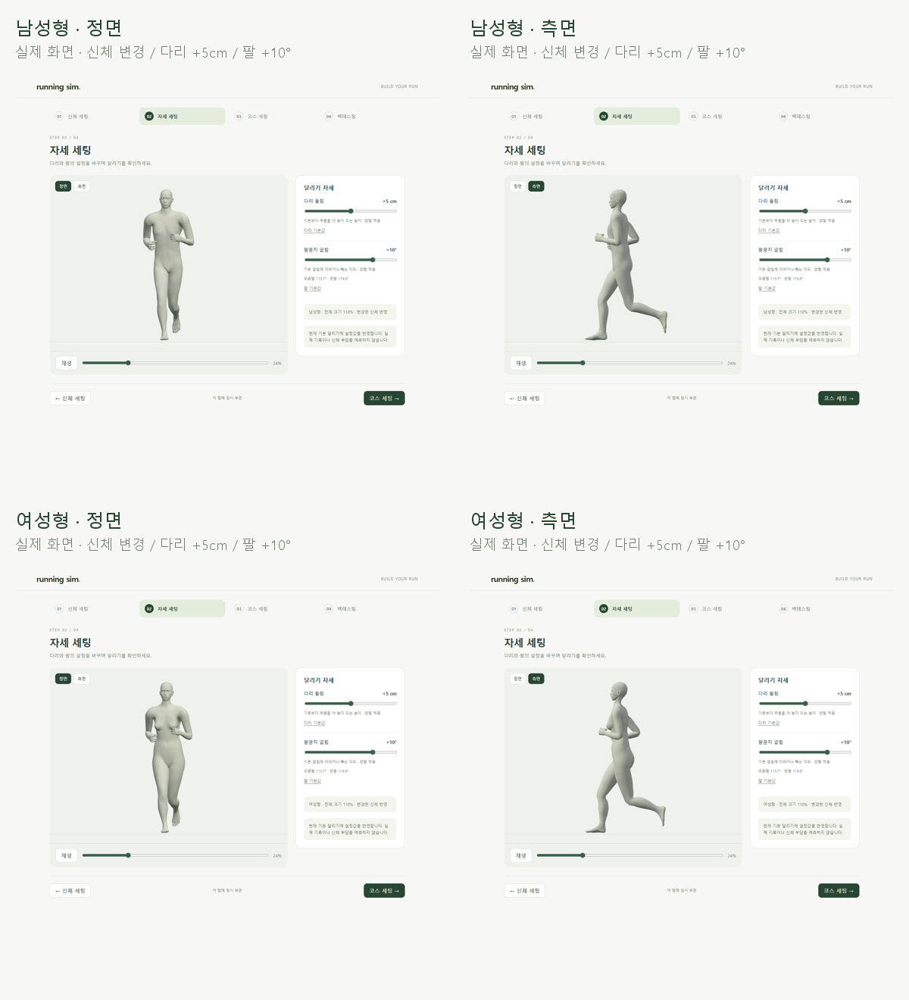
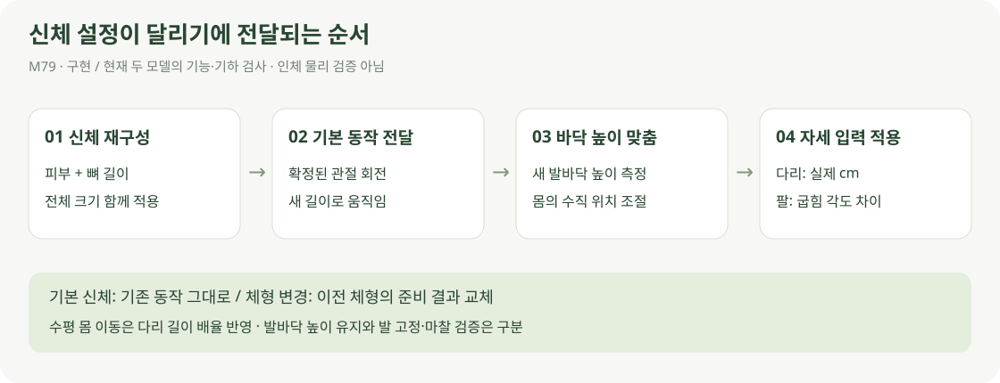

# 신체 설정을 달리기에 연결

> **실험 시점 기록** · 본문의 화면·수치·‘현재/다음’은 해당 M 실험 당시 기준입니다. [2026-10-26 현재 결과물](../01-planning/CURRENT_STATE.md)에서 채택된 기능·후속 보정·남은 한계를 확인하세요. 기존 검사 결과를 새로 통과한 것으로 바꾸지 않았습니다.

2026-10-21 · M79 · **사용자 승인 / 구현·기하·화면·재생 검사 완료** · R01·R02·R12·R15 / D03·D13


신체에서 바꾼 부위 길이와 전체 크기로 달립니다. 다리 들림·팔꿈치 입력은 유지합니다. [입력·단위·범위 기준](../02-requirements/REQUIREMENTS.md#m79--신체-설정을-달리기에-반영).

## 실제 재생



전체 크기 110%, 위팔·허벅지·몸통·어깨너비는 길게, 아래팔·종아리는 짧게 설정한 예입니다. 모든 화면은 **다리 +5cm / 팔 +10°**입니다.

| 현재 단계 화면 · 1배속 | 정면 | 측면 |
| --- | --- | --- |
| 남성형 | [재생](../../outputs/body-running/male-front.webm) | [재생](../../outputs/body-running/male-side.webm) |
| 여성형 | [재생](../../outputs/body-running/female-front.webm) | [재생](../../outputs/body-running/female-side.webm) |

[신체 세팅](http://127.0.0.1:5173/body) → [자세 재생](http://127.0.0.1:5173/pose). 비교 페이지는 새로 만들지 않았습니다.

## 연결 방식



기본 체형의 착지 좌표를 그대로 강제하면 짧아진 다리의 도달 범위를 벗어납니다. 확정된 기본 동작의 **관절 회전**을 바뀐 뼈대에 전달하고, 새 피부의 발바닥 높이를 기준으로 몸 높이를 맞춥니다.

| 핵심 코드 | 역할 |
| --- | --- |
| [body-runtime.js](../../experiments/model-preview/src/body-runtime.js) | 피부·뼈대·역바인드 행렬 독립 복사 / 부위 길이·전체 크기 적용 |
| [body-dimensions.ts](../../experiments/model-preview/src/body-dimensions.ts) | 여러 부위 값을 한 번에 재구성 / 외형과 관절 함께 변경 |
| [body-running.js](../../experiments/model-preview/src/body-running.js) | 기본 회전 전달 → 다리 길이에 따른 몸 이동 배율 → 바닥 높이 → 기존 팔/다리 입력 |
| [stages.js](../../experiments/model-preview/src/stages.js) | 신체 값이 바뀌면 준비 결과 교체 / 기본값 복원 / 단계·재진입 연결 |

```js
base.apply(phase, 0, 0);             // 확정된 기본 동작
to.quaternion.copy(from.quaternion); // 새 길이의 관절에 회전 전달
model.position.y += clearance - sole(lane);
// 그 위에 기존 createLegHeight / createElbowBend 적용
```

전체 배율 90%에서도 다리 +10cm는 실제 10cm입니다. 기본 신체는 기존 계산을 그대로 사용하며, `review/`의 달리기 보정 코드는 바꾸지 않았습니다.

## 검사와 한계

| 확인 항목 | 결과 |
| --- | --- |
| 체형·자세 | 남녀 각 87체형 × 101시점 × 다리/팔 3설정쌍 = **52,722표본** |
| 체형 구성 | 부위별 끝값·전체 크기 끝값·6부위 모서리 64조합·내부 8표본·기본값 |
| 부위 길이·다리 들림 단위 | 오차 **0.001mm 미만** / 전체 크기와 무관한 cm 반영 |
| 팔꿈치 입력·발 방향 | 굽힘 차이 오차 **0.001° 미만** / 발 방향 유지 |
| 지지 구간 발바닥 높이 | 바닥 위 **0.042mm 이내**, 검사한 전 주기 바닥 관통 없음 |
| 기본 신체 회귀 | 이전 84개 설정/시점의 뼈 행렬·표본 피부점 **차이 0** |
| 반복·원본 보존 | 반복 경계 연결 / 원본 뼈·역바인드 행렬·표본 피부점 변화 **0** |
| 화면 | 변경 체형 재생·입력 유지·복원·새로고침·남녀 전환·390px 화면 통과 |
| 빌드·영상 | TypeScript/빌드·빌드 화면 통과 / 남녀 정면·측면 각 3프레임 디코드 확인 |

지지 높이는 각 발 주기 30~53%의 선택한 발바닥 표면에서 측정했습니다. 표본 검사이며 모든 실수 입력·전신 충돌을 보증하는 결과는 아닙니다. [수치 요약](reports/body-running-summary.json).

[전 체형 기하 검사](reports/body-running.json) · [화면·저장 검사](reports/body-running-ui.json) · [빌드 화면 검사](reports/body-running-ui-production.json) · [영상 기록](reports/body-running-media.json) · [영상 디코드](reports/body-running-media-check.json).

**검증 범위:** 현재 남녀 모델의 길이·회전·바닥 높이·재생 연결입니다. 변경한 다리 비율에 따라 수평 발 경로와 몸 높이 변화도 달라지며, 일부 극단 비율에서는 몸 높이 변화가 기본보다 커집니다. 체형별 발 고정·마찰·신체 충돌·인체 부하·기록 예측은 검증 완료로 보지 않습니다.

실제 캡처·영상 원본은 `outputs/body-running/`에 둡니다. [캡처 코드](../../experiments/model-preview/scripts/capture-body-running.cjs) · [그림 생성](../assets/diagrams/body-running.py) · [기하 검사 코드](../../experiments/model-preview/scripts/verify-body-running.cjs).
