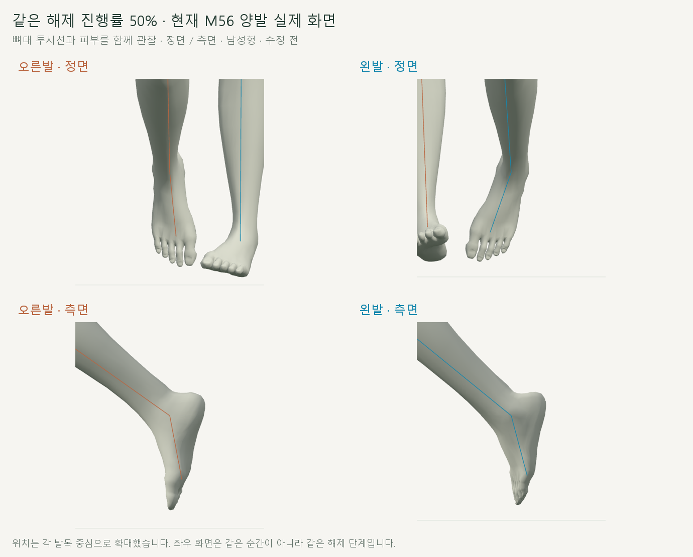
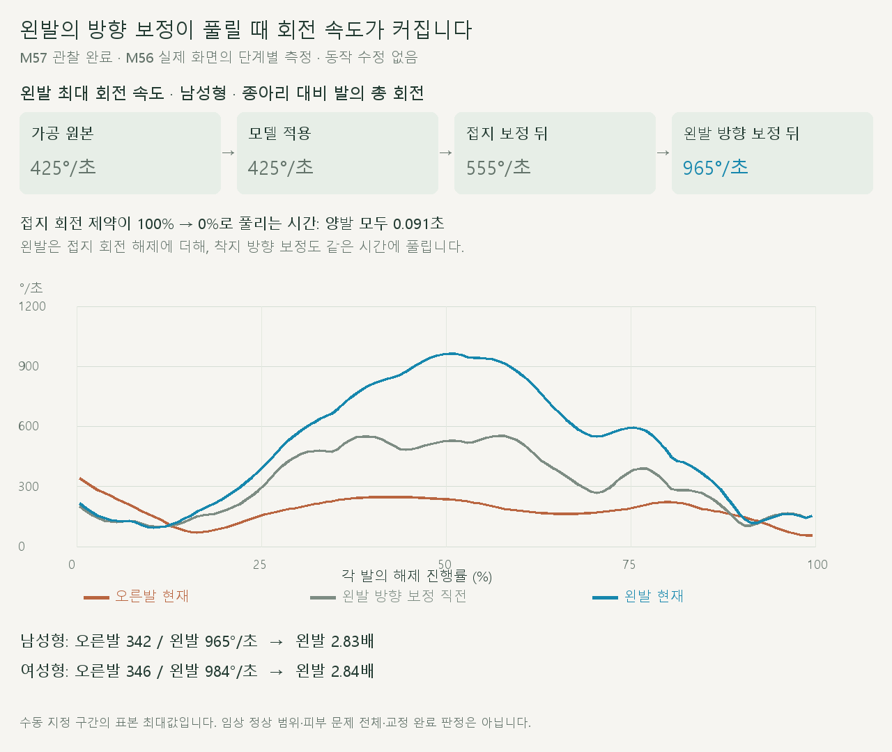

# 왼발목 해제 구간의 과도한 회전

> **실험 시점 기록** · 본문의 화면·수치·‘현재/다음’은 해당 M 실험 당시 기준입니다. [2026-10-26 현재 결과물](../01-planning/CURRENT_STATE.md)에서 채택된 기능·후속 보정·남은 한계를 확인하세요. 기존 검사 결과를 새로 통과한 것으로 바꾸지 않았습니다.

2026-10-20 · M57 · **원인 관찰 완료 / 교정안 검토 전 / 동작 수정 없음** · R02/R16·D03 · M56 후속



왼발이 더 빠르게 돌아가는 현상을 남녀 모두 재현했습니다. 피부뿐 아니라 종아리 대비 발 뼈의 회전에서도 차이가 나타납니다.



접지 회전 제약을 푸는 단계에 **왼발 착지 방향 보정을 푸는 회전**이 겹쳐 차이를 키웁니다. 종아리 기준 상대 회전의 증분으로 계산했으므로 발이 수직에 가까울 때 정면 투영 각도가 커지는 현상과 구분됩니다.

[이전 주소 → 현재 자세 화면](http://127.0.0.1:5173/review/mocap.html?compare=toe-slip-path) · [확인 범위·다음 검토안](../02-requirements/REQUIREMENTS.md#m57--왼발목-해제-구간-점검)

## 코드에서 확인한 경로

| 코드 | 확인한 동작 |
| --- | --- |
| [stance-contact.js](../../experiments/model-preview/review/stance-contact.js) · `contactEnvelope` / `contactRotation` | 양발 접지 회전 제약을 해제 구간에서 원래 회전으로 복귀 |
| [left-ankle-direction.js](../../experiments/model-preview/review/left-ankle-direction.js) · `applyLeftAnkleDirection` | 왼발 착지 방향을 돌린 양에 **같은 해제 가중치**를 곱함 → 추가 방향 회전도 동시에 빠르게 풀림 |
| [late-stance-sole.js](../../experiments/model-preview/review/late-stance-sole.js) / [toe-slip-path.js](../../experiments/model-preview/review/toe-slip-path.js) | 이번 해제 구간에서는 두 보정의 기여가 0 · 앞 단계의 회전이 그대로 남음 |

```js
// 기존 코드의 핵심: 가중치가 풀리는 동안 yawDelta도 되돌아간다.
const weight = contactEnvelope(phase, plan.window).weight;
const yawDelta = plan.targetYaw - plan.anchorYaw;
// 세계 위쪽 축 회전(yawDelta * weight) → 발·발끝 → 다리 위치 재계산
```

## 검증

| 같은 길이의 해제 구간 · 종아리 대비 발의 최대 회전 속도 | 남성형 | 여성형 |
| --- | --- | --- |
| 현재 오른발 | 341.51°/초 | 346.24°/초 |
| 왼발 · 가공 원본 / 모델 적용 직후 | 424.71°/초 | 424.71°/초 |
| 왼발 · 접지 보정 뒤, 방향 보정 직전 | 555.46°/초 | 564.28°/초 |
| 왼발 · 방향 보정 뒤 / 최종 M56 | 964.78°/초 | 983.76°/초 |
| 최종 왼발 / 오른발 | 2.83배 | 2.84배 |

| 검사 | 결과 |
| --- | --- |
| 범위 | 35_17 · 오른발 주기 58–70%, 왼발 109–121%를 주기 안으로 연결 · 각각 0.091초 |
| 표본 | 남녀 전 주기 730자세 + 양발 해제 484자세의 8단계 관찰 + 대응 단계 20자세 |
| 기존 M56 보관 기록과 비교 | 다리·골반 위치 및 피부 구역 <0.01mm / 회전 <0.001° · 관찰로 인한 동작 변경 없음 |
| 가공 원본 → 모델 적용의 상대 회전 속도 | 최대값 차이 <0.001°/초 · 이 구간의 추가 가속은 이후 보정에서 발생 |
| 방향 보정 뒤 → 최종 결과 | 최대값 차이 <0.001°/초 |
| 브라우저 오류 | 없음 · 남녀 정면·측면 캡처 완료 |

**해석 한계:** ‘원본’ 열은 원시 실측 전체가 아닌 기존 35_17 반복 구간 가공 결과입니다. 이 관찰은 추가 회전의 발생 단계를 확인한 것이며 원본 자체의 좌우 차이·피부 접힘 전체·의학적 정상 범위를 판정하지 않습니다.

## 다음 검토

**제안:** 왼발의 접지 회전과 방향 보정이 풀리는 과정을 종아리 기준으로 함께 연결합니다. 기존의 ‘회수 동작 전체 유지’에서 **왼발 회수 중 발 회전**은 수정 대상으로 바뀌므로, 골반·무릎·발목 위치 경로를 보존하는 작은 비교부터 검토합니다.

이번에는 관찰 코드와 문서만 추가했습니다. 교정·속도 감소·피부 개선은 아직 검증하지 않았습니다.

## 재현

[관찰·단계 계측·촬영 코드](../../experiments/model-preview/scripts/inspect-cmu-ankle-release.cjs) · [원시 관찰 JSON](reports/cmu-ankle-release-audit.json) · [요약 JSON](reports/cmu-ankle-release-summary.json) · [그림·요약 생성 원본](../assets/diagrams/cmu-ankle-release-audit.py)

```sh
node experiments/model-preview/scripts/inspect-cmu-ankle-release.cjs
python docs/assets/diagrams/cmu-ankle-release-audit.py
```

저장소 루트·Vite 서버·Playwright/Edge·Python/Pillow·맑은 고딕 필요. 계측은 별도 브라우저의 응답에 관찰 함수만 삽입하며 실행 파일·GLB·가중치를 변경하지 않습니다. 원본 캡처는 `outputs/cmu-ankle-release/`, 출처는 사용자 지적·M56·35_17입니다.

[M58 후속 · 사용자 선택에 따른 양발 공통 기준 구현](CMU_SHARED_GAIT.md) · [M56 후반 경로](CMU_TOE_SLIP_PATH.md) · [문서 목록](../README.md)
