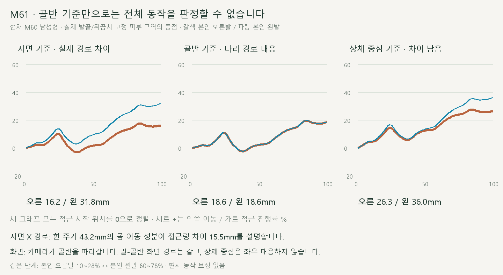
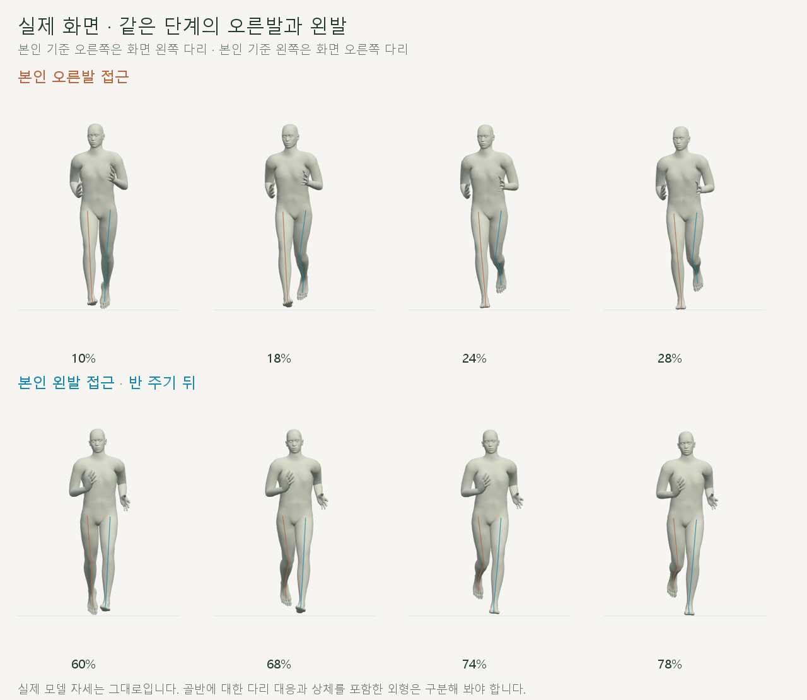
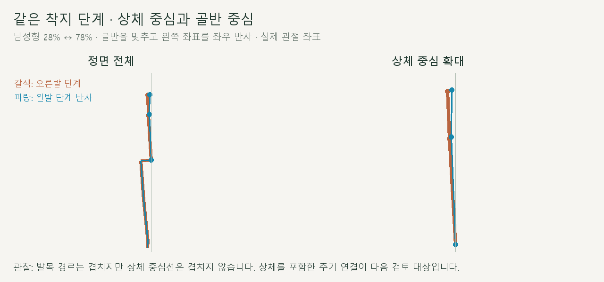

# 양발 착지 접근의 기준별 비교

> **실험 시점 기록** · 본문의 화면·수치·‘현재/다음’은 해당 M 실험 당시 기준입니다. [2026-10-26 현재 결과물](../01-planning/CURRENT_STATE.md)에서 채택된 기능·후속 보정·남은 한계를 확인하세요. 기존 검사 결과를 새로 통과한 것으로 바꾸지 않았습니다.

2026-10-20 · M61 · **관찰·수치 확인 완료 / 관찰 시점 동작 보정 없음 / 후속 M62 구현** · R02·R16 / D03 · M58→M60 후속



골반에 대한 양발 경로는 대응하지만, 상체 중심에 대한 경로는 다릅니다. 이전의 ‘양쪽 동작 동일’ 판정은 골반 기준의 하체 검사로 한정해야 합니다.

[관찰 범위·후속 제안](../02-requirements/REQUIREMENTS.md#m61--양발-착지-접근의-비대칭-관찰) · [이전 주소 → 현재 자세 화면](http://127.0.0.1:5173/review/shared-gait.html?compare=body-height)

## 같은 단계의 실제 화면



본인 오른발 10~28%와 본인 왼발 60~78%를 비교했습니다. 현재 카메라는 골반을 따라가며, **발–골반의 화면 경로는 대응하고 상체 중심은 대응하지 않습니다.**

## 다리와 상체를 분리한 관찰



기존 코드는 하체를 반 주기로 맞추면서 상체의 기존 회전은 보존했습니다. 다리만 맞춘 결과를 전신의 동일한 외형으로 확대해 설명할 수 없습니다.

| 접근 시작→끝의 안쪽 이동량 · mm | 남성형 오른 / 왼 | 여성형 오른 / 왼 |
| --- | --- | --- |
| 고정 지면 X 기준 | 16.2 / 31.8 | 12.3 / 26.2 |
| 골반 기준 | 18.6 / 18.6 | 14.4 / 14.4 |
| 상체 중심 기준 · 양 어깨 중점 | 26.3 / 36.0 | 21.6 / 31.6 |

양발 모두 골반 기준으로 안쪽 접근이 남아 있습니다. 지면 X 차이에는 보존한 몸 이동 성분이 포함되며, 진행 방향을 재정의하거나 상체를 교정할 근거를 이 값 하나로 확정하지 않습니다.

## 코드에서 확인한 원인과 한계

| 위치 | 확인한 내용 |
| --- | --- |
| [shared-gait.js](../../experiments/model-preview/review/shared-gait.js) · `core()` | 다리는 공통 곡선의 반 주기·반사 / `spine_01`은 기존 세계 회전 보존 |
| 같은 파일 · `target` | 주기적 골반 이동은 대칭화하지만 한 주기 이동량의 X 성분도 복원 |
| [shared-gait-view.js](../../experiments/model-preview/review/shared-gait-view.js) · `draw()` | 골반 X를 따라가는 카메라여서 공통 몸 이동은 화면에서 상쇄 |
| [body-height.js](../../experiments/model-preview/review/body-height.js) | M60 변경은 전체 Y만 · 이번 좌우 경로를 새로 만든 수정은 아님 |

**확인:** 지면 X 기준 접근량 차이는 `−2 × 한 주기 X 이동량 × 0.18`과 일치합니다. **미확정:** 이 이동을 제거하면 사용자가 느낀 비대칭까지 해결되는지는 확인되지 않았으며, 현재 추적 카메라의 발–골반 화면 경로는 달라지지 않습니다.

## 검사 결과

| 남녀 모델 · 모델당 접근 181쌍 / 전 주기 365시점 | 결과 |
| --- | --- |
| 접근 구간 발목·고정 발 피부 중점의 골반 기준 좌우 반사 오차 | <0.001mm |
| 같은 구간 발 피부 중점의 골반 기준 화면 반사 오차 | <0.001px |
| 같은 구간 골반의 화면 X 범위 | 0px |
| 상체 중심 기준 좌우 반사 잔차 최대 · 남 / 여 | 18.9mm / 18.5mm |
| 지면 접근량 차이와 한 주기 X 이동량 공식의 차이 | <0.001mm |
| 실행 코드 6개 파일의 검사 전후 해시 / 브라우저 오류 | 동일 / 없음 |

발 피부 위치는 기존 중립 자세에서 선정한 뒤꿈치·발끝 구역을 Three.js 정점 변형으로 직접 계산했습니다. 새 Edge에서 같은 로컬 URL을 검사했으며, 사용자의 기존 탭 상태를 직접 읽은 결과는 아닙니다.

**범위·한계:** 10~28%는 관찰용 접근 구간이며 실측 지면 접촉 사건이 아닙니다. 표의 이동량은 각 구간 시작을 0으로 맞춘 순이동량이며, 누적 이동거리·미끄러짐·신체 중심에서의 절대 거리와 다릅니다.

## 후속 · M62

사용자 승인 후 [상체 중심의 좌우 대응 M62](CMU_UPPER_CENTER.md)를 구현·검사했습니다. 양쪽에 공통으로 남은 안쪽 접근 경로는 별도 검토입니다.

## 재현·출처

[관찰·캡처 코드](../../experiments/model-preview/scripts/inspect-approach-symmetry.cjs) · [원시 수치](reports/cmu-approach-symmetry.json) · [검사 요약](reports/cmu-approach-symmetry-summary.json) · [그림·요약 생성](../assets/diagrams/cmu-approach-symmetry.py)

```sh
node experiments/model-preview/scripts/inspect-approach-symmetry.cjs
python docs/assets/diagrams/cmu-approach-symmetry.py
```

원본 CMU 35_17 → M56 오른다리 기준 → M58 양발 공유 → M60 높이 연결을 관찰했습니다. 피부 구역 정의는 [M59 기록](reports/cmu-whole-body-audit.json), 촬영 원본은 `outputs/cmu-approach-symmetry/`에 있으며 Node·Playwright·Edge·Vite·Python·Pillow·맑은 고딕이 필요합니다.

[M60 높이 수정](CMU_BODY_HEIGHT.md) · [M58 공통 동작](CMU_SHARED_GAIT.md) · [문서 목록](../README.md)
