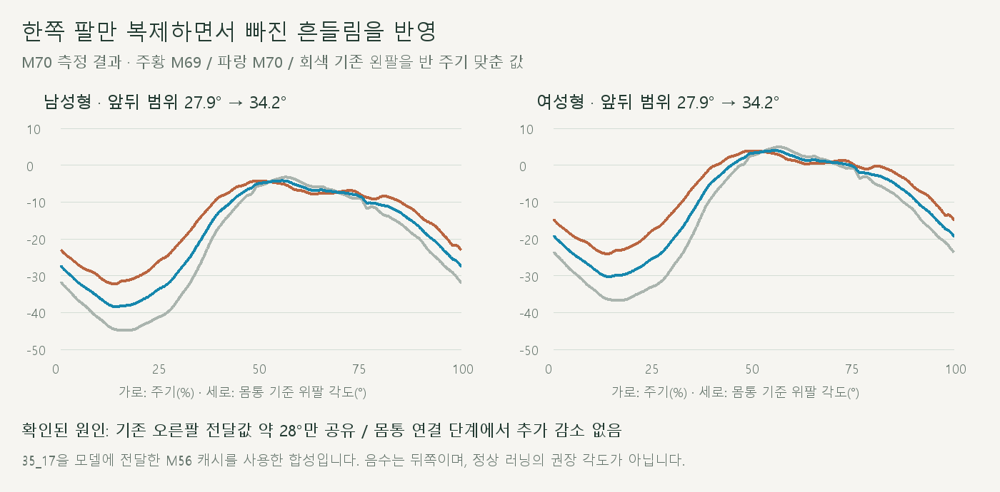
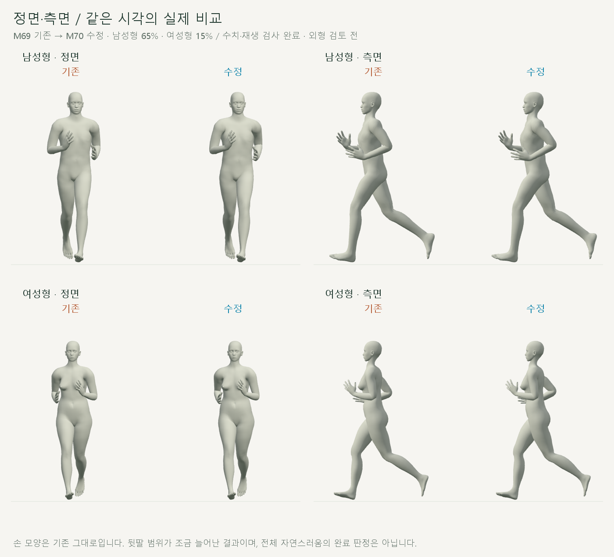
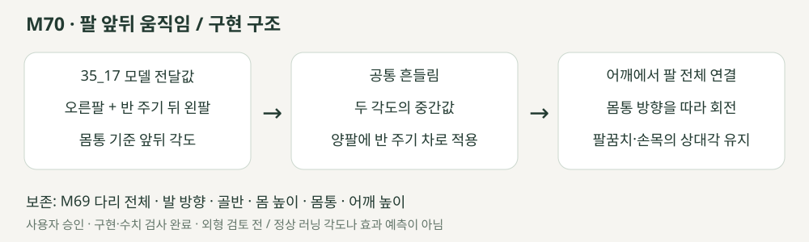

# 팔 앞뒤 움직임과 몸통 연결

2026-10-20 · M70 · **사용자 승인 / 구현·수치·재생 검사 완료 / 외형 검토 전** · R02·R16 / D03 · M69 후속



M63에서 움직임이 작은 오른팔을 양쪽에 복제하며 왼팔의 큰 흔들림이 빠졌습니다. 몸통 연결 단계에서는 흔들림 범위가 추가로 줄어들지 않았습니다.

[이전 주소 → 현재 자세 화면](http://127.0.0.1:5173/review/shared-gait.html?compare=arm-swing) · [요구·보존 계약](../02-requirements/REQUIREMENTS.md#m70--팔-앞뒤-움직임)

## 실제 비교



각 쌍의 왼쪽은 M69, 오른쪽은 M70입니다. 팔꿈치를 뒤로 보내는 범위가 조금 커졌으며 **펼쳐진 손·손목의 어색함은 남아 있습니다.**

## 원인과 코드



35_17을 모델에 전달한 **M56 캐시**의 양팔을 반 주기 맞춰 평균합니다. 현재 몸통의 좌우 축을 따라 위팔을 회전하므로 아래팔·손도 함께 움직이며, 몸통 자체와 팔꿈치·손목 상대각은 유지합니다.

| 진단 단계 · 남성형 | 오른팔 앞뒤 범위 | 왼팔 앞뒤 범위 |
| --- | --- | --- |
| 35_17 연결 주기 / CMU 몸통 좌표 | 27.95° | 41.59° |
| M56 모델 전달 / 모델 몸통 좌표 | 27.93° | 41.62° |
| M62 몸통 대응 | 27.93° | 41.62° |
| M63 양팔 공유 → M69 | 27.93° | 27.93° |
| M70 양팔 전달값 평균 | 34.21° | 34.21° |

앞의 진단은 201시점, 최종 검사는 모델당 1,001시점입니다. 서로 다른 몸통 기준의 원본·모델 절대각을 동일한 해부학적 각도로 취급하지 않습니다.

| 코드 | 역할 |
| --- | --- |
| [arm-swing.js](../../experiments/model-preview/review/arm-swing.js) · `sourceSwing` | 캐시의 쇄골·위팔 회전과 실제 뼈 길이 방향으로 몸통 기준 앞뒤 각도 계산 |
| 같은 파일 · `correction` | 오른팔과 반 주기 뒤 왼팔 각도 차이의 절반 / 임의 증폭 없음 |
| 같은 파일 · `apply` | M69 전체 동작 적용 후 위팔 두 개만 회전 / 어깨 위치·쇄골·팔꿈치·손목 상대각 유지 |
| [shared-gait-view.js](../../experiments/model-preview/review/shared-gait-view.js) | M69 ↔ M70 별도 비교 / 이전 비교 주소 유지 |

## 검사

| 항목 | 결과 |
| --- | --- |
| 남성형·여성형 전 주기 | **2,002시점 통과** |
| 다리 전체·골반·몸 높이·몸통·어깨 위치 | 위치 차이 **0mm** / 보호한 뼈 회전 차이 <0.001° |
| M69 저장 무릎 위치 | 양발 **0mm** 차이 |
| 발바닥 최저 높이 / 새 바닥 침투 | 변화 **0mm** / 없음 |
| 팔꿈치·손목·손가락 상대 회전 / 위팔 옆 벌림 | <0.001° 차이 |
| 앞뒤 범위 · 남녀 각각 | 27.93° → **34.21°** / 한 시점 최대 수정 **7.74° 미만** |
| 좌우 반 주기 대응 / 손의 어깨 기준 대응 | 각도 <0.001° / 위치 <0.01mm |
| 실제 관절 방향 vs 양팔 평균 목표 | <0.001° |
| 반복 경계 / 재탐색 / 화면 이동 | 통과 / 경계 유한차분 속도 차이 <0.055°/s |
| 남녀 전환·반복·단회·정면/측면 | 통과 / 오류 없음 / 이전 M69 주소 유지 |
| 캡처·영상 / 타입·메인 앱 빌드 | 24장·정면/측면 1배속 영상 / 통과 |

검토용 JS는 브라우저에서 별도 검사했습니다. **한계:** 한 촬영의 양팔을 합성한 작은 시각 수정입니다. 어깨·몸통의 새 회전이나 손 모양을 제작하지 않았으며, 전신 자연스러움·인체 충돌·접촉력 검증 완료를 뜻하지 않습니다.

[진단 JSON](reports/cmu-arm-swing-diagnostic.json) · [전체 검사](reports/cmu-arm-swing.json) · [요약](reports/cmu-arm-swing-summary.json) · [UI](reports/cmu-arm-swing-ui.json) · [영상](reports/cmu-arm-swing-media-check.json)

```sh
node experiments/model-preview/scripts/inspect-arm-swing.cjs
node experiments/model-preview/scripts/verify-arm-swing.cjs
node experiments/model-preview/scripts/capture-arm-swing.cjs
node experiments/model-preview/scripts/check-arm-swing-ui.cjs
node experiments/model-preview/scripts/check-arm-swing-media.cjs
python docs/assets/diagrams/cmu-arm-swing.py
```

[그림 생성 원본](../assets/diagrams/cmu-arm-swing.py) · 실제 캡처·영상은 `outputs/cmu-arm-swing/`. Node·Playwright·Edge·Three.js·Vite·Python·Pillow·맑은 고딕으로 재현합니다. [M69 이력](CMU_KNEE_LATERAL.md) · [문서 목록](../README.md).
