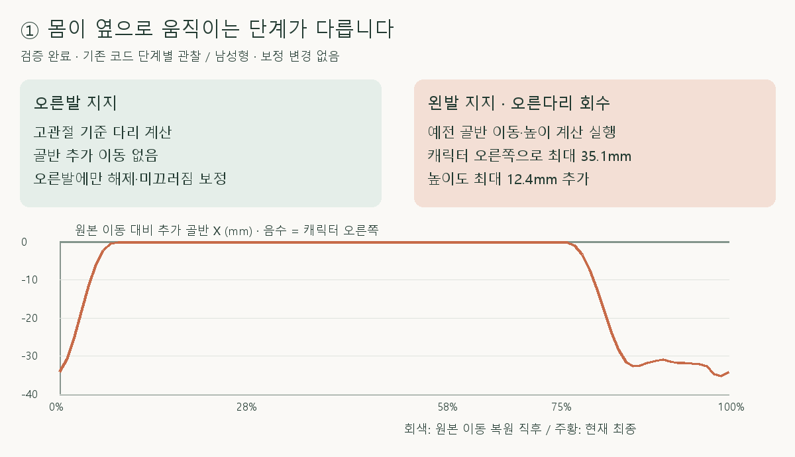
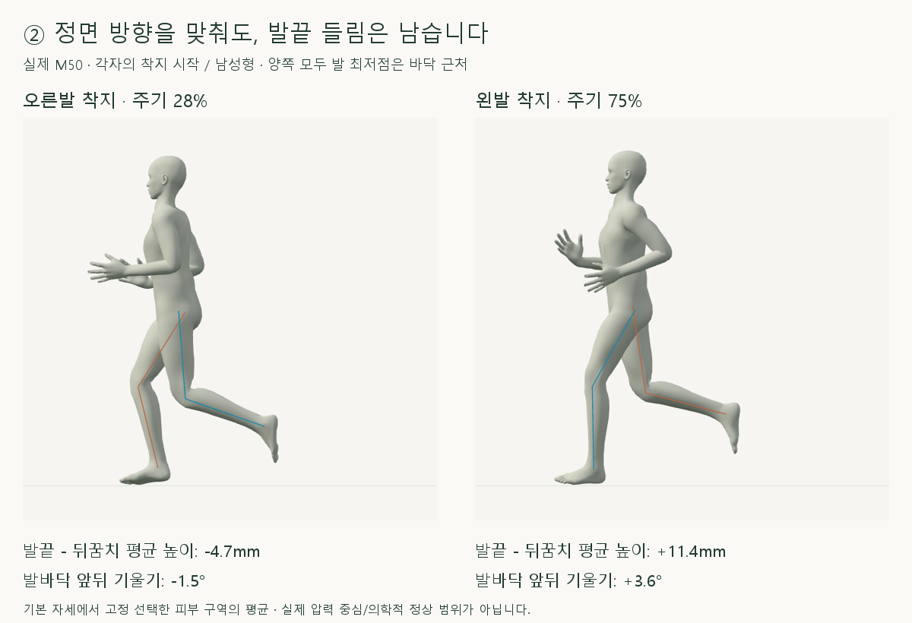
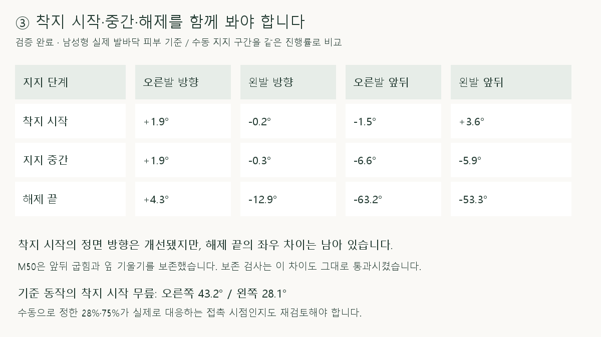

# 좌우 다리·골반·발바닥 단계별 점검

> **실험 시점 기록** · 본문의 화면·수치·‘현재/다음’은 해당 M 실험 당시 기준입니다. [2026-10-26 현재 결과물](../01-planning/CURRENT_STATE.md)에서 채택된 기능·후속 보정·남은 한계를 확인하세요. 기존 검사 결과를 새로 통과한 것으로 바꾸지 않았습니다.

2026-10-16 · M51 · **단계별 분석 완료 / 동작 보정 없음** · R02/R16·D03 · M50 사용자 품질 검토 반려

## 1 · 왼발 지지에만 남은 골반 이동



**직접 확인:** 오른발 지지에는 `applyHipReference`, 왼발 지지에는 `applyStanceChain`이 실행됩니다. 후자만 골반 회전·몸 X/Y 이동을 추가해, 오른다리를 접는 왼발 지지 동안 몸이 캐릭터 오른쪽으로 움직입니다.

| 원본 수평 이동 복원 직후 → 다리 연동 직후 · 표본 최댓값 | 남성형 | 여성형 |
| --- | --- | --- |
| 추가 오른쪽 골반 이동 | 35.1mm | 31.3mm |
| 추가 골반 높이 | 12.4mm | 11.3mm |
| 오른발 지지에서 추가 골반 이동 | 0mm | 0mm |

카메라는 원본 수평 이동을 따라가지만 이 추가 이동은 따라가지 않습니다. ‘기존 골반 보존’ 검사는 이미 포함된 이 비대칭을 보존했을 뿐, 원본 골반 이동과 같다는 검사가 아니었습니다.

## 2 · 정면 방향과 발바닥 기울기는 다른 문제



**직접 확인:** 남성형 착지 시작의 실제 피부 앞쪽 방향은 오른발 +1.9° / 왼발 −0.2°로, M50의 시작 방향 교정은 작동합니다. 그러나 왼발 발끝이 뒤꿈치보다 높은 상태와 양옆 기울기는 그대로 남았습니다.

| 남성형 착지 시작 · 같은 피부 구역 | 오른발 | 왼발 |
| --- | --- | --- |
| 뒤꿈치 평균 높이 | 19.3mm | 11.2mm |
| 발끝 평균 높이 | 14.7mm | 22.6mm |
| 발끝 − 뒤꿈치 평균 높이 | −4.7mm | +11.4mm |
| 발바닥 앞뒤 기울기 | −1.5° | +3.6° |
| 발바닥 좌우 기울기 | +13.2° | −13.7° |

여성형도 발끝−뒤꿈치가 오른발 −1.3mm / 왼발 +10.4mm입니다. 좌우 기울기는 부호가 반대인 것만으로 이상 판정할 수 없지만, 두 발 모두 기울어 있고 M50은 이를 교정하지 않았습니다.

## 3 · 시작뿐 아니라 해제까지 비대칭



**직접 확인:** 오른발에만 M42~M46의 고정·해제·발끝 보정이 남아 있고, 왼발에는 M50 방향 보정만 추가됩니다. 예를 들어 남성형 지지 중간의 오른발 고정 단계는 발바닥 앞뒤 각도를 −9.9°→−6.6°로 바꾸며, 왼발에는 이 단계가 없습니다.

| 차이가 시작·유지되는 지점 | 확인 결과 |
| --- | --- |
| 선택한 기준 동작의 착지 시점 | 전달 전부터 무릎 굽힘 오른쪽 43.2° / 왼쪽 28.1°, 발 뼈 앞뒤 각도 −24.5° / −14.1° |
| 기존 상대 발목 매핑 | 남성형 발 뼈 앞뒤 각도는 오른쪽 −29.8° / 왼쪽 −24.8°로 바뀜 · 다른 높이/방향이 착지 기준에 들어감 |
| M47 접지 | 각 발의 서로 다른 착지 회전을 기준으로 유지 · 가장 낮은 표면 높이 보존 |
| M50 | 왼발 착지 방향 차이만 수평 회전 · 앞뒤 굽힘·옆 기울기 차이도 유지 |

원본 캡처 위치를 별도로 선형 보간해도 해당 시점의 무릎은 43.1° / 28.2°로 차이가 납니다. 다만 현재 28%·75%와 30%·34% 길이의 지지 구간은 수동 추정이며, 실제 접촉 사건이 정확히 대응하는지는 **미검증**입니다.

## 다음 교정 제안 · 미구현

| 순서 | 작은 작업 / 확인할 기준 |
| --- | --- |
| 1 | 왼발 지지에만 남은 추가 골반 이동·높이 분기를 제거한 비교 · 원본 골반 궤적과 양발 착지점 함께 검사 |
| 2 | 양발이 같은 계산 순서를 거치도록 정리 · 오른발 전용 보정의 역할을 하나씩 검증하며 통합 |
| 3 | 실제 피부 발바닥 축·뒤꿈치·발끝을 기준으로 착지/해제 시점과 회전 목표 재검토 · 전체 구간 좌우 비교 |

원본 좌우 움직임을 무조건 복제하거나 완전히 대칭으로 만들자는 제안은 아닙니다. 현재의 서로 다른 보정 경로를 정리한 뒤 남은 차이를 판단해야 합니다.

## 코드·검사·한계

| 코드 | 직접 확인한 책임 |
| --- | --- |
| [landing-width-comparison.js](../../experiments/model-preview/review/landing-width-comparison.js) | 오른쪽 `applyHipReference` / 왼쪽 `applyStanceChain` 분기 · 오른발 전용 단계 누적 |
| [stance-chain.js](../../experiments/model-preview/review/stance-chain.js) | 왼발 경로에서 `model.position.x`, `model.position.y`, 골반 회전 변경 |
| [stance-contact.js](../../experiments/model-preview/review/stance-contact.js) | 각 발의 착지 기준 회전·최저 표면 높이 보존 |
| [left-ankle-direction.js](../../experiments/model-preview/review/left-ankle-direction.js) | 방향 차이만 적용 · 기존 기울기 보존 |

남녀 각 104시점 × 11단계를 관찰했습니다. 관찰 후 최종 관절 위치는 M50 기록과 **0mm 차이**, 실행 파일 8개의 전후 해시 동일, 브라우저 오류 없음입니다. 이는 **측정이 동작을 바꾸지 않았다는 검증**이며 동작 품질 통과가 아닙니다.

피부 구역은 GLB 기본 자세에서 발 최저점+12mm 이내를 고르고, 앞뒤/좌우 20% 구역의 같은 정점을 추적합니다. 측정 단위는 mm·도이며 평균 피부 높이는 접촉 압력이나 발바닥 전체의 부양 높이가 아닙니다. 사용자 첨부 사진의 정확한 프레임은 특정하지 않았고, 수동 구간의 같은 진행률로 비교했습니다.

[단계 관찰 코드](../../experiments/model-preview/scripts/inspect-cmu-bilateral-chain.cjs) · [원시 JSON](reports/cmu-bilateral-chain-audit.json) · [요약·원본 대조 JSON](reports/cmu-bilateral-chain-summary.json) · [그림·요약 생성 코드](../assets/diagrams/cmu-bilateral-chain-audit-figures.py)

```sh
node experiments/model-preview/scripts/inspect-cmu-bilateral-chain.cjs
python docs/assets/diagrams/cmu-bilateral-chain-audit-figures.py
```

재현: 저장소 루트·Vite·Playwright/Edge·Python/Pillow·맑은 고딕. 관찰 훅은 별도 브라우저 응답에만 삽입하며 실행 파일은 변경하지 않습니다. 원본 캡처: `outputs/cmu-bilateral-chain-audit/`; 출처: 사용자 세 가지 지적·현재 M50·CMU 35_17. 127_06 제외.

[M52 후속 · 추가 몸 이동 제거 비교](CMU_PELVIS_REFERENCE_RESTORE.md) · [이전 M50 기록](CMU_LEFT_ANKLE_DIRECTION.md) · [문서 목록](../README.md)
