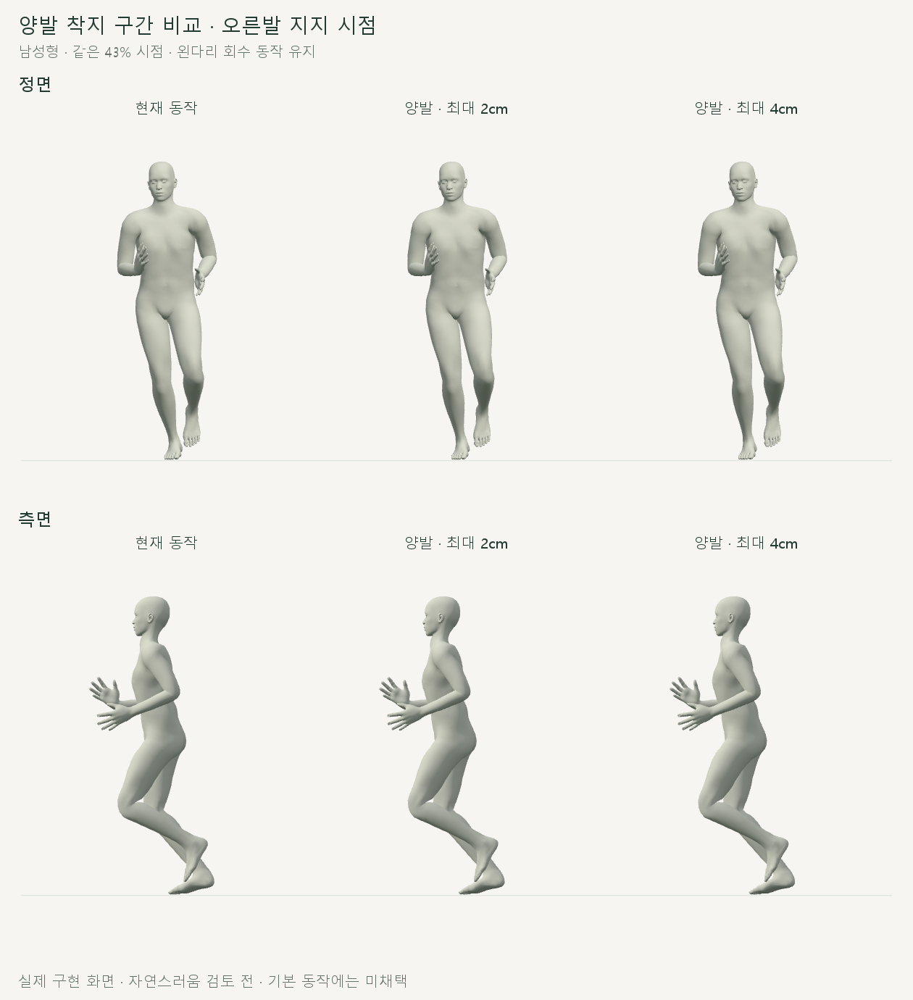
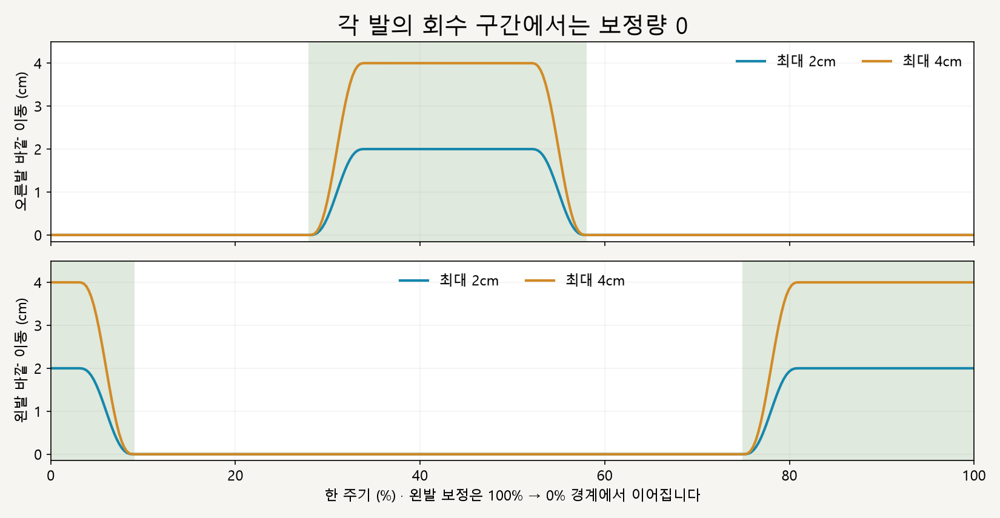
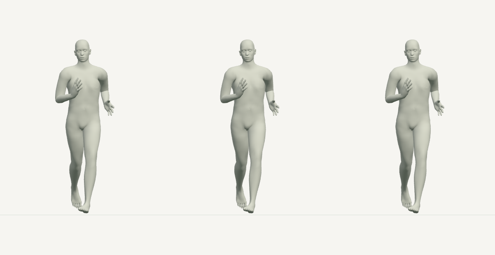

# 양발 착지 구간 · 안쪽 디딤 비교

2026-10-16 · M34 · **로컬 구현·검사 완료 / 자연스러움 사용자 검토 전** · R02/R16·D03

후속: [M35 고관절 수직선 목표 비교](CMU_HIP_LANDING_COMPARISON.md). M34의 최대 4cm 이동 후에도 안쪽 디딤이 남는다는 사용자 검토를 반영했습니다.


왼쪽부터 **현재 / 양발 각각 최대 2cm / 최대 4cm**입니다. 왼발 착지 구간에도 M33과 같은 계산을 적용하며, 오른다리 회수 동작은 유지됩니다.

[이전 주소 → 현재 자세 화면](http://127.0.0.1:5173/review/mocap.html?compare=bilateral) · [이전 주소 → 현재 자세 화면](http://127.0.0.1:5173/review/mocap.html?compare=landing)

| 조작 | 동작 |
| --- | --- |
| 재생·일시정지 | 기본 0.5배속 · 한 주기 끝 정지 · 다시 재생 가능 |
| 정면·측면 | 세 모델의 같은 순간을 함께 전환 |
| 시간 막대·남성형/여성형 | 원하는 시점·모델로 비교 |



오른발 보정은 이전 M33 결과와 같습니다. 골반·몸 이동·상체를 유지하며 왼다리 회수 동작도 원래 자세와 같습니다.

## 각 다리의 회수 동작 유지



각 발의 지지 추정 구간에서만 이동량을 늘렸다가 줄입니다. 왼발 구간은 주기 경계를 넘어 이어지며, 정확한 범위·단위·허용치는 [M34 계약](../02-requirements/REQUIREMENTS.md#m34--양발-지지-구간-안쪽-디딤-비교)에 둡니다.



66% 시점은 양발 보정량이 모두 0입니다. 각 다리의 회수 구간 전체에서도 해당 다리의 위치·회전이 원래 동작과 같은지 검사했습니다.

## 코드·검사

| 코드 | 변경 |
| --- | --- |
| [landing-width.js](../../experiments/model-preview/review/landing-width.js) | 좌우 부위·바깥 방향을 매개변수로 구분 · 기존 지지 구간 재사용 · 주기 경계 처리 · 기존 두 선분 IK 유지 |
| [landing-width-comparison.js](../../experiments/model-preview/review/landing-width-comparison.js) | 원래 자세를 복사한 뒤 좌우를 독립 적용 · 기존 오른발 전용 비교 유지 |
| [mocap.js](../../experiments/model-preview/review/mocap.js) / [mocap.html](../../experiments/model-preview/history/review-mocap.html.txt) | 양발 비교 주소·이름·진입 링크 추가 |

| 기본 남녀 · 0.25프레임 간격 총 730자세 | 결과 |
| --- | --- |
| 양발 목표 오차·방향 | 최대 0.000073mm · 양쪽 모두 바깥 방향 · 도달 범위 제한 0 |
| 각 다리 회수 구간 | 위치 차이 <0.000001mm · 회전 차이 <0.000004° |
| 골반·상체 | 위치 차이 <0.000001mm · 회전 차이 <0.000004° |
| 발 방향 / 높이·전후 위치 | 최대 0.000051° / 0.000040mm 차이 |
| 지지 중 발 표면 | 침범 최대 0.000272mm · 바닥과 간격 최대 0.055mm · 허용치 이내 |
| 경계·반복 탐색·좌우 적용 순서 | 검사 통과 · 주기 경계의 추가 보정량 연속 |
| 기존 오른발 결과 | 이전 M33 수치와 일치 · 오른발 전용 화면 730자세 회귀 검사 통과 |
| 재생·일시정지·시점·시간 이동 | 실제 브라우저 검사 통과 |
| 기존 앱 타입 검사·빌드 | 통과 · 검토 페이지는 배포 빌드 대상 아님 |

**한계:** 지지 구간은 추정이고 수평 발 고정·물리 시뮬레이션은 아닙니다. 자연스러움과 최적 디딤 폭은 미검증이며 기본 달리기에는 채택하지 않았습니다.

[검사·캡처 코드](../../experiments/model-preview/scripts/verify-cmu-bilateral.cjs) · [측정 JSON·해시](reports/cmu-bilateral.json) · [오른발 회귀 결과](reports/cmu-landing-regression.json) · [그림 생성](../assets/diagrams/cmu-bilateral-figures.py) · [실제 재생 영상 녹화](../../experiments/model-preview/scripts/capture-cmu-bilateral.cjs)

```sh
node experiments/model-preview/scripts/verify-cmu-bilateral.cjs
python docs/assets/diagrams/cmu-bilateral-figures.py
node experiments/model-preview/scripts/capture-cmu-bilateral.cjs
```

저장소 루트·실행 중인 Vite·Playwright/Edge·Python Pillow/Matplotlib·맑은 고딕이 필요합니다. 영상은 실제 브라우저 캔버스를 녹화해 `outputs/cmu-bilateral/`에 저장합니다; 배포 빌드에 포함되지 않은 로컬 검토 화면입니다.

출처: [M33 구현·검사](CMU_LANDING_COMPARISON.md) · [기존 지지 구간](../../experiments/model-preview/review/ground-contact.js) · 사용자 양발 확장 승인. 모델·원본 동작 파일은 수정하지 않았습니다.

[문서 목록](../README.md)
