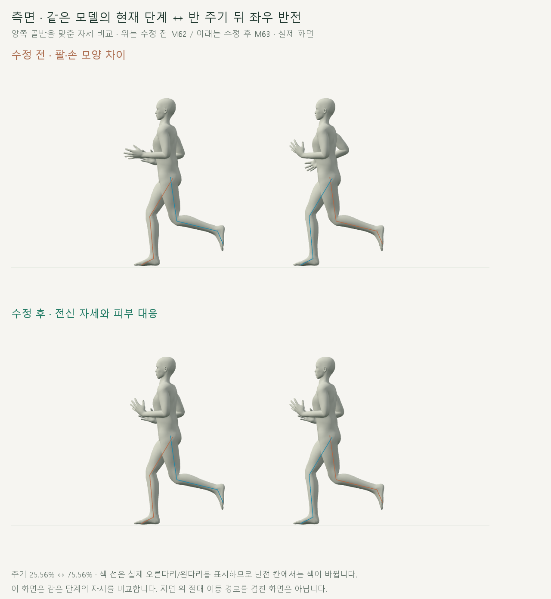
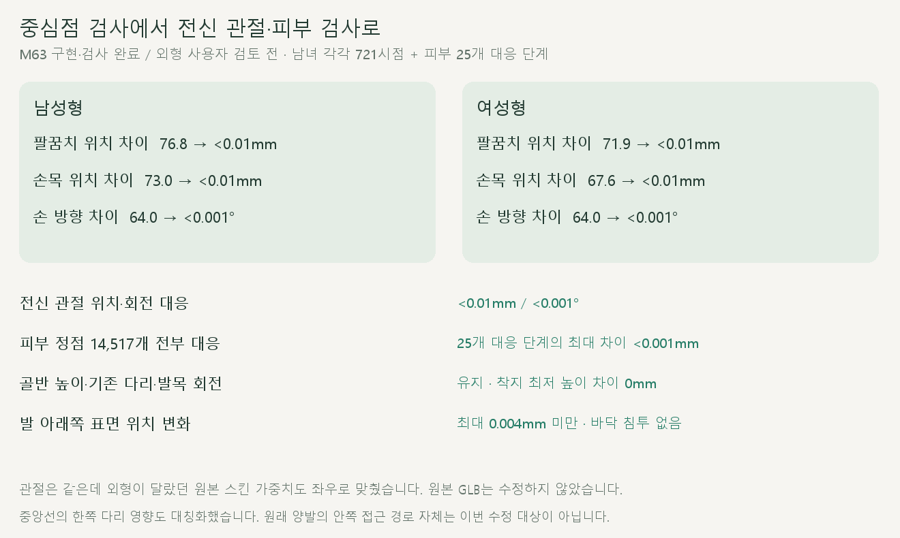

# 전신 좌우 자세 대응

> **실험 시점 기록** · 본문의 화면·수치·‘현재/다음’은 해당 M 실험 당시 기준입니다. [2026-10-26 현재 결과물](../01-planning/CURRENT_STATE.md)에서 채택된 기능·후속 보정·남은 한계를 확인하세요. 기존 검사 결과를 새로 통과한 것으로 바꾸지 않았습니다.

2026-10-20 · M63 · **수정·전신 관절/피부 검사 완료 / 사용자 외형 검토 전** · R02·R16 / D03 · M62 품질 문제 후속


M62는 중심점만 맞았고 팔·손 자세가 달랐습니다. M63은 오른팔 동작을 왼팔·손·손가락까지 공유하고, 좌우 피부 가중치 차이도 교정했습니다.

[이전 주소 → 현재 자세 화면](http://127.0.0.1:5173/review/shared-gait.html?compare=bilateral-pose) · [정면 영상](../../outputs/cmu-bilateral-pose/front.webm) · [측면 영상](../../outputs/cmu-bilateral-pose/side.webm) · [범위·검수 계약](../02-requirements/REQUIREMENTS.md#m63--전신-좌우-자세-대응)

## 같은 단계로 확인하는 화면



두 칸 모두 수정된 같은 모델이며 오른쪽 칸은 반 주기 뒤 자세를 좌우 반전합니다. 골반을 맞춘 자세 비교이고, **수정 전 차이 보기**를 선택하면 M62를 같은 방식으로 확인할 수 있습니다.

## 원인과 변경 코드

| 원인 | 수정 |
| --- | --- |
| 팔 관절과 손 방향은 좌우 개별 동작으로 남음 | [bilateral-pose.js](../../experiments/model-preview/review/bilateral-pose.js): 오른팔 기준을 왼팔에 반 주기 차로 적용 / 좌우 중립 뼈 축을 반영 |
| 원본 팔꿈치·무릎·종아리–발목의 피부 가중치가 비대칭 | [bilateral-skin.js](../../experiments/model-preview/review/bilateral-skin.js): 중립 표면 대응점을 찾아 왼쪽 가중치를 오른쪽 기준으로 반사 |
| 중앙 피부 정점도 한쪽 허벅지 영향을 받음 | 중앙선 좌우 가중치 평균 / 영향 뼈 4개 제한 초과분은 가장 작은 좌우 쌍부터 공통 중앙 부모에 합침 |
| 중심점 위주의 검사가 전체 외형 차이를 놓침 | [verify-bilateral-pose.cjs](../../experiments/model-preview/scripts/verify-bilateral-pose.cjs): 전신 모든 대응 관절 + 실제 표면 정점 전부 검사 |

원본 GLB는 유지하고 검토 화면 메모리에서 가중치를 바꿉니다. 왼쪽 7,125개·중앙선 267개 정점에 대응 규칙을 적용하며 중앙 부모로 합친 비중은 정점당 최대 **3.18% 미만**입니다.

| 원본 남성형 GLB 예시 | 왼쪽 | 오른쪽 |
| --- | --- | --- |
| 팔꿈치 표면 · Human 11455 ↔ 4229 | 아래팔 100% | 아래팔 86.11% + 위팔 13.89% |
| 무릎 표면 · Human 12159 ↔ 5006 | 허벅지 83.13% + 종아리 16.87% | 허벅지 88.86% + 종아리 11.14% |
| 종아리–발목 · Human 12370 ↔ 5217 | 종아리 92.80% + 발 7.20% | 종아리 100% |

이 표는 기존 발목 평활화 전 **원본 가중치**입니다. [추출 코드](../../experiments/model-preview/scripts/inspect-bilateral-skin.cjs) · [남녀 원본 증거](reports/cmu-bilateral-skin-source.json).

## 검사 결과



남녀 각각 관절 721시점과 피부 25개 대응 단계를 검사했습니다. 피부는 중립 위치로 짝을 찾은 **14,517개 정점 전부**를 직접 변형해 비교했습니다.

| 항목 | 결과 |
| --- | --- |
| 팔꿈치 위치 차이 · 남 / 여 | 76.84 / 71.85 → 모두 <0.01mm |
| 손목 위치 차이 · 남 / 여 | 73.00 / 67.61 → 모두 <0.01mm |
| 손 방향 차이 · 남 / 여 | 63.98 / 64.01 → 모두 <0.001° |
| 전신 관절 대응 · 손가락 포함 | 위치 <0.01mm / 회전 <0.001° |
| 전신 피부 표면 대응 · 25개 대응 단계 | 최대 <0.001mm / 미대응 정점 없음 |
| 골반·기존 다리·발목·오른팔 관절 보존 | 위치 <0.01mm / 회전 <0.001° |
| 몸 전체 위치·높이 / 착지 최저 높이 변화 | 0mm / 0mm |
| 발 아래쪽 표면 위치 변화 · 남 / 여 | <0.004mm / <0.0003mm |
| 바닥 침투 | 없음 |
| 실제 정면·측면 화면의 대응 관절 오차 | <0.01px |
| 반복 경계·재탐색·반복 재생·한 주기 종료 | 통과 |
| 정면·측면 저장 영상 재생 검사 | 각각 다른 3시점 해독 완료 / 영상 오류 없음 |
| 기존 양발·몸 높이·상체 중심 코드 해시 | 유지 |
| 기존 수학 검사·타입 검사·앱 빌드 | 통과 |

발 가중치는 발 위 종아리에도 영향을 줍니다. 발바닥 보존 검사는 **중립 발목보다 3cm 아래의 발 가중 정점**과 기존 착지 최저 높이를 별도로 비교했습니다.

**검증 한계:** 기본 남녀 GLB의 같은 단계 자세 대응입니다. 지면 위 절대 이동 경로, 양발에 공통으로 남은 안쪽 접근, 실제 힘·최적 러닝 자세·기록 효과를 검증한 것은 아닙니다.

## 재현

[수정 전 전신 관찰](../../experiments/model-preview/scripts/inspect-bilateral-pose.cjs) · [수정 전 수치](reports/cmu-bilateral-pose-before.json) · [수정 후 검사](../../experiments/model-preview/scripts/verify-bilateral-pose.cjs) · [전체 결과](reports/cmu-bilateral-pose.json) · [요약](reports/cmu-bilateral-pose-summary.json)

[영상 촬영](../../experiments/model-preview/scripts/capture-bilateral-pose.cjs) · [녹화 기록](reports/cmu-bilateral-pose-media.json) · [영상 검사 코드](../../experiments/model-preview/scripts/check-bilateral-pose-media.cjs) · [영상 검사 결과](reports/cmu-bilateral-pose-media-check.json) · [그림 생성](../assets/diagrams/cmu-bilateral-pose.py)

```sh
node experiments/model-preview/scripts/inspect-bilateral-pose.cjs
node experiments/model-preview/scripts/inspect-bilateral-skin.cjs
node experiments/model-preview/scripts/verify-bilateral-pose.cjs
node experiments/model-preview/scripts/capture-bilateral-pose.cjs
node experiments/model-preview/scripts/check-bilateral-pose-media.cjs
python docs/assets/diagrams/cmu-bilateral-pose.py
```

CMU 35_17 → M58 양발 공유 → M60 몸 높이 → M62 상체 중심 → M63 팔·피부 대응 순서입니다. 촬영 원본은 `outputs/cmu-bilateral-pose/`이며 Node·Playwright·Edge·Vite·Python·Pillow·맑은 고딕이 필요합니다.

검토 페이지는 앱 배포 빌드에 포함되지 않아 브라우저에서 별도 검사했습니다. [M62 이력](CMU_UPPER_CENTER.md) · [문서 목록](../README.md)
