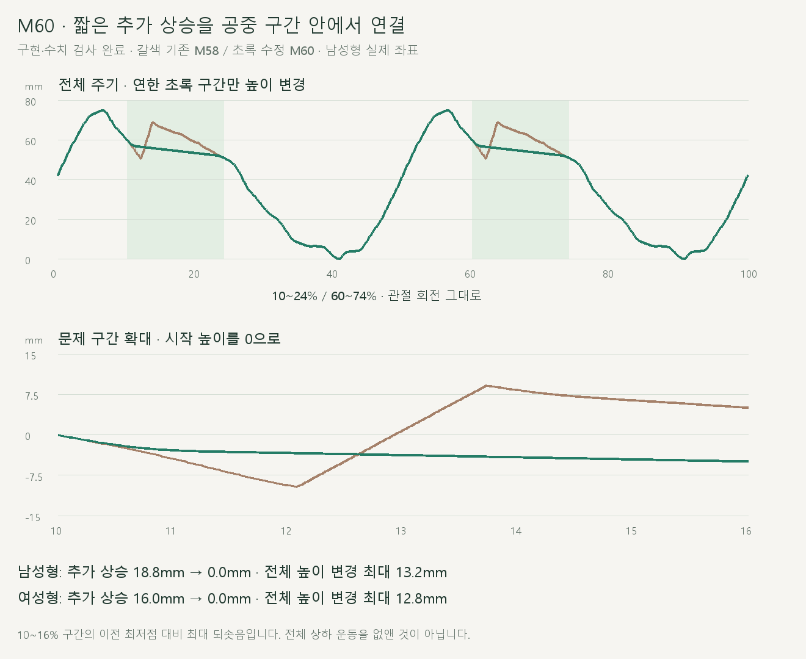
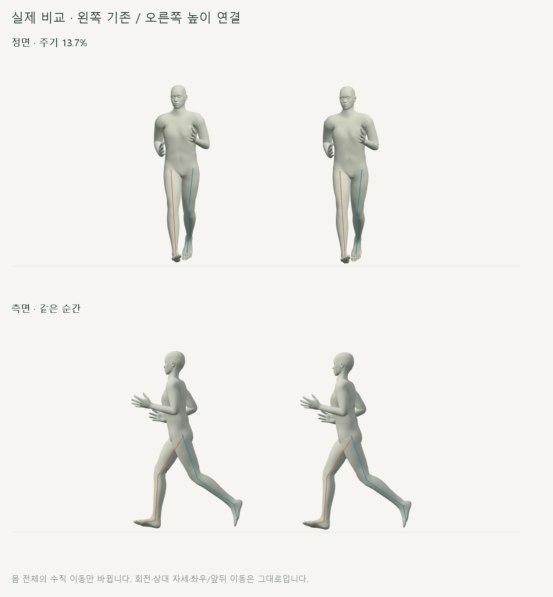
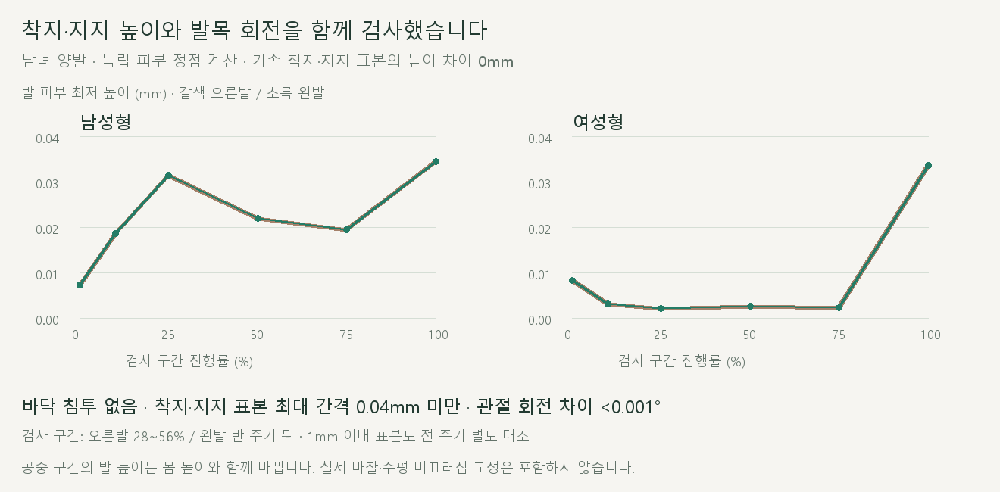

# 짧은 몸 높이 상승 연결

> **실험 시점 기록** · 본문의 화면·수치·‘현재/다음’은 해당 M 실험 당시 기준입니다. [2026-10-26 현재 결과물](../01-planning/CURRENT_STATE.md)에서 채택된 기능·후속 보정·남은 한계를 확인하세요. 기존 검사 결과를 새로 통과한 것으로 바꾸지 않았습니다.

2026-10-20 · M60 · **사용자 범위 승인 / 구현·수치·재생 검사 완료 / 좌우 외형 차이는 M61 후속 관찰** · R02·R16 / D03 · M59 후속



공중 구간의 높이를 연결해 남성형 18.8mm·여성형 16.0mm의 추가 상승이 사라졌습니다. 발목을 포함한 모든 관절 회전과 양발 공통 자세는 유지합니다.

[이전 주소 → 현재 자세 화면](http://127.0.0.1:5173/review/shared-gait.html?compare=body-height) · [정면 영상](../../outputs/cmu-body-height/front.webm) · [측면 영상](../../outputs/cmu-body-height/side.webm) · [범위·검수 계약](../02-requirements/REQUIREMENTS.md#m60--짧은-몸-높이-연결)

## 정면·측면



왼쪽 M58 / 오른쪽 M60입니다. 기존 비교 화면은 유지하며, 이번 화면에서는 두 칸 모두 사용자가 확인한 발목 동작을 사용합니다.

## 착지와 바닥



독립적으로 계산한 발 피부 정점에서 바닥 침투가 없었습니다. 착지·지지 표본의 최대 바닥 간격은 **0.04mm 미만**, 수정 전후 높이 차이는 **0mm**입니다.

공중 구간의 발 높이는 몸 높이와 함께 바뀝니다. 공중에서 떨어져 있는 발과 착지한 발의 뜸을 구분해 검사했습니다.

## 코드

| 파일 | 역할 |
| --- | --- |
| [body-height.js](../../experiments/model-preview/review/body-height.js) · `createHeightBridge` | 양끝의 높이·속도·가속도 측정 → 진입/중간/종료 속도 연결 → 적분해 높이 계산 |
| 같은 파일 · `createBodyHeight.apply` | 기존 M58 평가 후 몸 전체 Y만 이동 / 양발 피부 최저 높이로 바닥 아래 이동 제한 |
| [shared-gait-view.js](../../experiments/model-preview/review/shared-gait-view.js) | `?compare=body-height`에서 M58/M60 비교 / 기존 화면 유지 |
| [shared-gait.js](../../experiments/model-preview/review/shared-gait.js) | 기존 관절·양발·골반 기준 동작 계산 그대로 사용 |

진입과 종료에서는 위치·속도·가속도를 연결하는 4차 위치 곡선을 사용합니다. 지면 제한은 현재 남녀 모델 검사에서 한 번도 개입하지 않았으므로, 제한 때문에 새 꺾임이 생기지 않았습니다.

| 보존 검사 | 남녀 최대 차이 |
| --- | --- |
| 모든 뼈의 기본/세계 회전 | <0.001° |
| 모든 관절의 X/Z와 골반 기준 상대 위치 | <0.01mm |
| 범위 밖 자세 / 기존 지면 1mm 이내 표본 높이 | <0.01mm / 0mm |
| 반 주기 대응 골반 높이 / 재탐색·시점 전환·반복 경계 | <0.01mm |

## 테스트 결과

| 남녀 한 주기 2,002시점 + 확대 482시점 + 접지·경계 | 결과 |
| --- | --- |
| 10~16% 구간 추가 상승 · 남성 / 여성 | 18.8 → 0mm / 16.0 → 0mm |
| 연결 구간 전체 수직 속도 | 양쪽 모델 모두 하강 유지 |
| 전체 높이 변경 최대 · 남성 / 여성 | 13.2mm / 12.8mm |
| 독립 피부 정점 바닥 침투 / 지면 제한 개입 | 없음 / 0회 |
| 착지·지지 표본 최대 바닥 간격 · 남성 / 여성 | 0.0344mm / 0.0336mm |
| 연결점 좌우 속도 / 가속도 차이 · 수치 미분 | <0.001m/s / <0.1m/s² |
| M59 보관 좌표와 기존 비교칸 재현 | <0.01mm |
| 기존 M58 화면 회귀 / 실제 반복·한 주기 종료 | 통과 / 통과 |
| 곡선 수학 검사·기존 수학 검사 / 타입 검사·앱 빌드 | 통과 / 통과 |
| 정상 실행 브라우저 오류 / 실제 정면·측면 녹화 | 없음 / 완료 |

피부 검사는 런타임의 묶음 계산과 별도로 Three.js 정점 변형을 직접 계산했습니다. 연결점의 속도·가속도 차이는 양옆의 유한 차분 오차를 포함하며, 신체의 실제 가속도가 0이라는 뜻은 아닙니다.

**범위·한계:** 기본 남녀 두 모델의 검토 페이지에 적용했습니다. 양끝을 연결하기 위해 주기당 약 106ms씩 두 공중 구간을 수정했으며, 실제 마찰·수평 미끄러짐·상체 비대칭·다른 체형·사용자 설정 연결은 별도 검토입니다.

## 재현

[브라우저 검사](../../experiments/model-preview/scripts/verify-body-height.cjs) · [수학 검사](../../experiments/model-preview/tests/body-height.mjs) · [수치 JSON](reports/cmu-body-height.json) · [요약](reports/cmu-body-height-summary.json) · [기존 화면 회귀 결과](reports/cmu-body-height-default-regression.json).

[영상 촬영](../../experiments/model-preview/scripts/capture-body-height.cjs) · [녹화 기록](reports/cmu-body-height-media.json) · [그림·요약 생성](../assets/diagrams/cmu-body-height.py).

```sh
node experiments/model-preview/tests/body-height.mjs
node experiments/model-preview/scripts/verify-body-height.cjs
node experiments/model-preview/scripts/capture-body-height.cjs
python docs/assets/diagrams/cmu-body-height.py
```

저장소 루트·Vite·Node/Playwright/Edge·Python/Pillow·맑은 고딕이 필요합니다. 영상과 원본 캡처는 `outputs/cmu-body-height/`에 보관합니다. 검토 페이지는 앱 배포 빌드에 포함되지 않아 실제 브라우저에서 별도 검사했습니다.

[M61 양발 접근 비대칭 관찰](CMU_APPROACH_SYMMETRY.md) · [M59 원인 관찰](CMU_WHOLE_BODY_AUDIT.md) · [M58 양발 공통 동작](CMU_SHARED_GAIT.md) · [문서 목록](../README.md)
