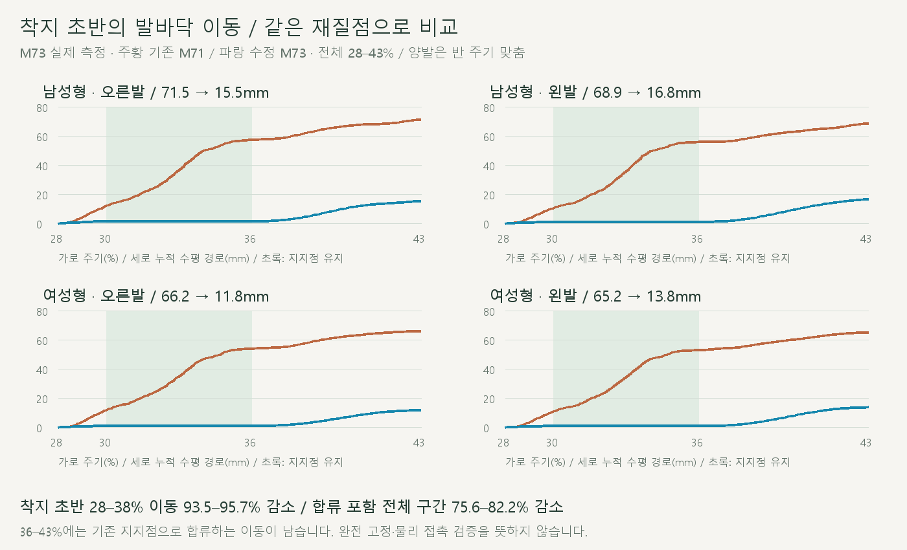
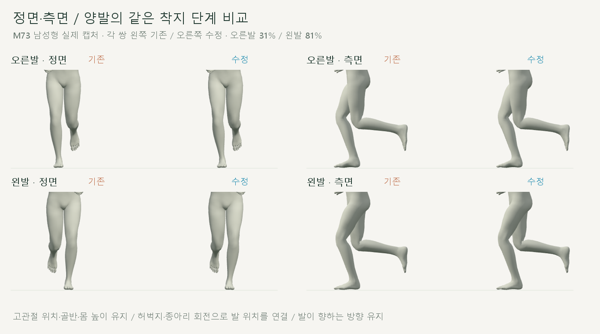
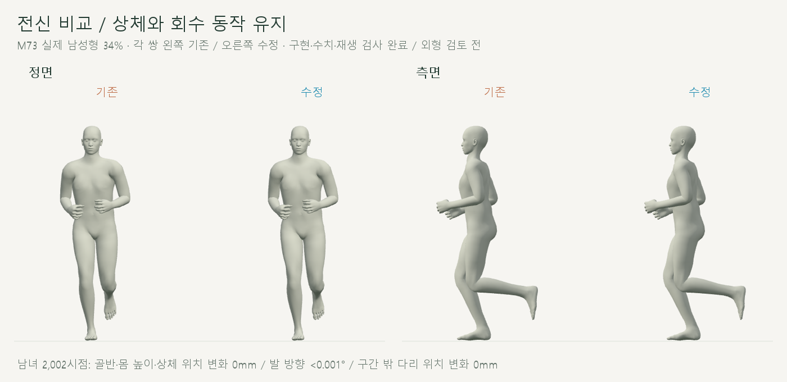
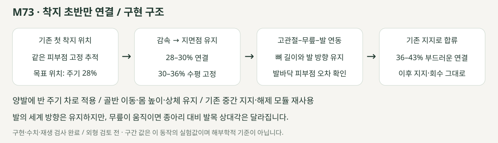

# 착지 초반의 지면 이동 줄이기

> **실험 시점 기록** · 본문의 화면·수치·‘현재/다음’은 해당 M 실험 당시 기준입니다. [2026-10-26 현재 결과물](../01-planning/CURRENT_STATE.md)에서 채택된 기능·후속 보정·남은 한계를 확인하세요. 기존 검사 결과를 새로 통과한 것으로 바꾸지 않았습니다.

2026-10-21 · M73 · **사용자 승인 / 구현·수치·재생 검사 완료 / 외형 검토 전** · R02·R16 / D03 · M72 후속



착지 초반 28–38%의 같은 발바닥 점 이동이 **93.5–95.7% 감소**했습니다. 기존 지지로 합류하는 구간까지 포함하면 **75.6–82.2% 감소**이며, 이동 전체가 없어진 것은 아닙니다.

[이전 주소 → 현재 자세 화면](http://127.0.0.1:5173/review/shared-gait.html?compare=early-support) · [정면 영상](../../outputs/cmu-early-support/front.webm) · [측면 영상](../../outputs/cmu-early-support/side.webm) · [변경 범위·보존 계약](../02-requirements/REQUIREMENTS.md#m73--착지-초반-지지-연결)

## 실제 비교



각 쌍의 왼쪽은 기존 M71, 오른쪽은 수정 M73입니다. 발바닥의 같은 재질점을 계속 추적하고, 고관절·무릎 회전으로 발 위치를 연결합니다.



상체·골반·몸 높이와 회수 동작은 유지합니다. **첫 착지 위치를 그대로 사용하므로 기존 안쪽 디딤 폭을 바깥으로 재설정한 수정은 아닙니다.**

## 코드



감속·합류 곡선의 양 끝 위치·속도·가속도를 연결합니다. 골반을 옮기지 않고 기존 다리 길이에 맞춰 고관절·무릎을 회전시킨 뒤, 발 세계 방향을 보상합니다.

| 코드 | 변경 |
| --- | --- |
| [early-support.js](../../experiments/model-preview/review/early-support.js) · `EARLY_SUPPORT_WINDOW` | 이번 착지 초반의 감속·유지·합류 범위만 정의 / 기존 지지·해제·회수에는 추가 보정 없음 |
| 같은 파일 · `createEarlySupport` | M71 위에 오른발, 왼발 순서로 같은 지지 계산 적용 / 왼발은 반 주기 뒤 |
| [shared-support.js](../../experiments/model-preview/review/shared-support.js) · `anchorAt` | 유지 시작 시점과 목표 지면점 시점을 분리 / 새 비교는 기존 첫 착지 위치 사용 / 기존 호출은 이전 결과 유지 |
| 같은 파일 · `solveSupportLeg` / `supportBridge` | 기존 두 관절 계산·연결 함수 재사용 / 뼈 이동·길이·피부 가중치 수정 없음 |
| [shared-gait-view.js](../../experiments/model-preview/review/shared-gait-view.js) | M71 ↔ M73 별도 비교 / 기존 손 비교 주소 보존 |

## 검사

| 같은 재질점의 전체 수평 경로 · 28–43% | 기존 | 수정 |
| --- | --- | --- |
| 남성형 오른발 / 왼발 | 71.46 / 68.85mm | **15.50 / 16.78mm** |
| 여성형 오른발 / 왼발 | 66.17 / 65.17mm | **11.78 / 13.79mm** |
| 30–36% 유지 구간 · 남녀 양발 | 42.25–45.46mm | **<0.001mm** |
| 전체 구간 피부점 최대 속도 · 남녀 양발 | 1.81–2.08m/s | **0.36–0.56m/s** |

누적 경로는 왕복을 더한 길이이며 한 방향 이동량이 아닙니다. 고정점 주변 피부도 발별 12점을 선정해 같은 구간에서 모두 이동량 감소를 확인했습니다.

| 보존·동작 검사 | 결과 |
| --- | --- |
| 남녀 전 주기 | **2,002시점 통과** |
| M72 저장된 기존 M71 관절 위치 | 차이 **0mm** / 수정 전 기준 재현 |
| 골반·몸 높이·상체·고관절 위치 / 뼈 오프셋 | 변화 **0mm** |
| 구간 밖 지지·회수의 관절 위치 / 회전 | **0mm / <0.001°** |
| 발 세계 방향 / 발목·선정 피부점 높이 | **<0.001° / <0.00001mm** |
| 발 피부 최저 높이 변화 / 새 바닥 침투 | **<0.005mm / 없음** |
| 무릎 굽힘 변경 / 무릎 위치 변경 | 최대 **0.44° / 9.80mm** |
| 종아리 대비 발목 상대각 변경 | 최대 **2.03°** / 발 세계 방향 보존과 구분 |
| 양발 반 주기 무릎 굽힘 차이 | 최대 **0.25° 미만** / 아래 한계 참조 |
| 경계 위치 속도 차이 / 회전 속도 차이 | **<0.00015m/s / <0.29°/s** / 유한차분 검사 |
| 반복·재탐색·화면 이동 | 통과 / 위치 <0.01mm·회전 <0.001° |
| 기존 파일 43개 | 실행 모듈·HTML·기준 자료·GLB 해시 일치 / 수정 2개는 M71 저장값으로 별도 대조 |
| 남녀 전환·반복·단회·정면·측면·기존 손 비교 | 통과 / 브라우저 오류 없음 |
| 실제 화면·영상 | 32장 / 0.5배속 정면·측면 각 약 3.5초 / 영상별 3시점 디코딩 확인 |
| 타입·메인 미리보기 빌드 | 통과 / 검토용 JS는 위 브라우저 검사로 별도 확인 |

이번 로컬 실행의 준비 시간은 남성형 약 1.06초, 여성형 약 0.87초였습니다. 한 번의 측정이며 다른 기기의 성능 보장은 아닙니다.

## 남은 한계

| 남은 부분 | 현재 상태 |
| --- | --- |
| 36–43% 기존 지지로 합류 | 이동 잔여 / 왼발의 이 구간 누적 이동은 남성형 **12.82→15.56mm**, 여성형 **12.09→12.85mm**로 증가 / 전체 이동·최대 속도는 감소 |
| 양발의 완전한 반 주기 자세 일치 | 지면에 고정하면서 기존 몸 이동을 보존하므로 작은 관절 차이가 발생 / 무릎 굽힘 차이 <0.25°를 숨기지 않음 |
| 안쪽 디딤·해제 굽힘 지연 | 기존 동작 유지 / 이번 수정 범위 밖 |
| 정상 달리기·접촉력·마찰 | 기하·화면 검사만 완료 / 물리적 검증 아님 |

[전체 검사](reports/cmu-early-support.json) · [요약](reports/cmu-early-support-summary.json) · [UI](reports/cmu-early-support-ui.json) · [영상 검사](reports/cmu-early-support-media-check.json)

```sh
node experiments/model-preview/scripts/verify-early-support.cjs
node experiments/model-preview/scripts/check-early-support-ui.cjs
node experiments/model-preview/scripts/capture-early-support.cjs
node experiments/model-preview/scripts/check-early-support-media.cjs
python docs/assets/diagrams/cmu-early-support.py
```

[검사 코드](../../experiments/model-preview/scripts/verify-early-support.cjs) · [그림 생성 원본](../assets/diagrams/cmu-early-support.py). 실제 캡처·영상은 `outputs/cmu-early-support/`; Node·Playwright·Edge·Three.js·Vite·Python·Pillow·맑은 고딕으로 재현합니다. 출처는 기존 CMU 35_17→M71 동작입니다. [이전 관찰·출처·한계](CMU_FULL_RUN_REVIEW.md) · [문서 목록](../README.md).
