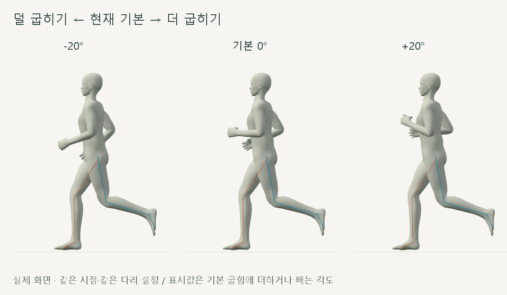
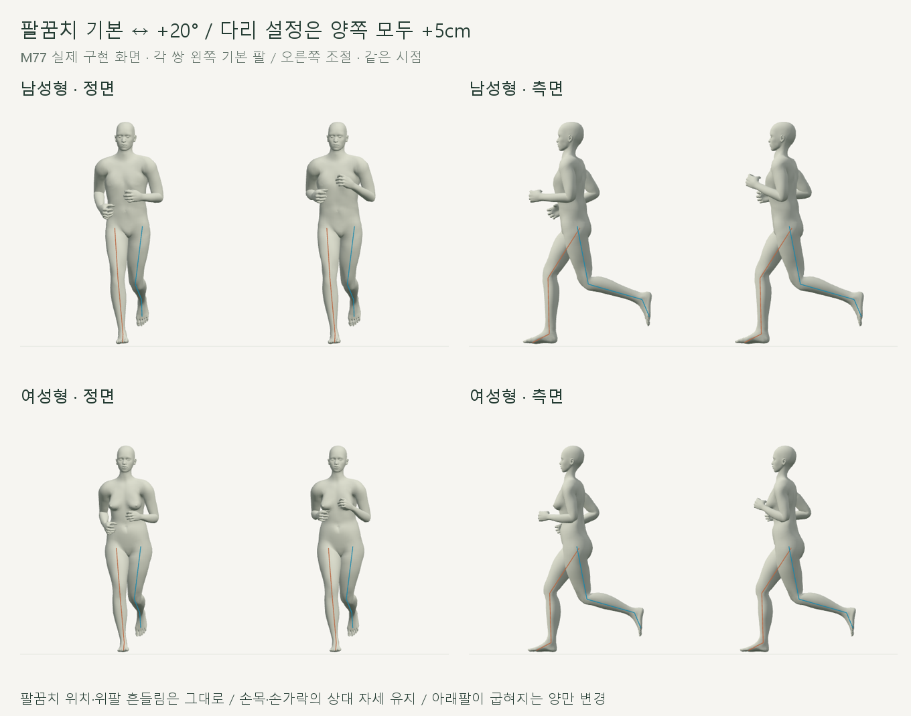
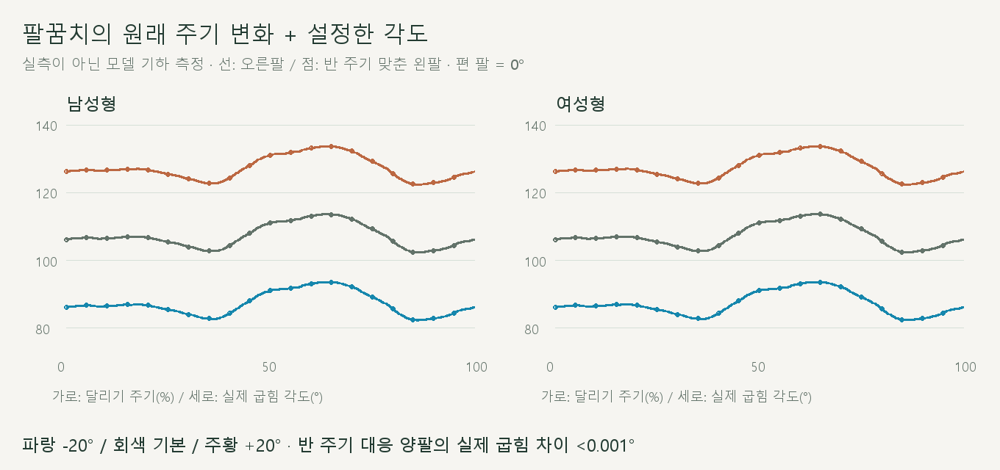
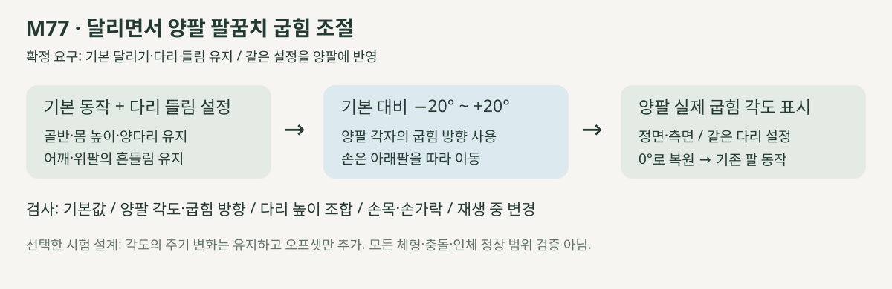

# 기본 달리기 · 팔꿈치 굽힘 조절

2026-10-21 · M77 · **사용자 승인 / 구현·기하·재생 검사 완료** · R02·R12·R15 / D03·D13


**기본 대비 −20~+20°**를 조절하며 현재 실제 굽힘 각도를 양팔별로 표시합니다. [입력·방향·보존 계약](../02-requirements/REQUIREMENTS.md#m77--팔꿈치-굽힘과-다리-들림-함께-조절).

[이전 주소 → 현재 자세 화면](http://127.0.0.1:5173/review/shared-gait.html?compare=elbow-bend) · [기본 다리 설정 M76](CMU_LEG_HEIGHT.md)

## 실제 재생



기존 팔 굽힘의 주기 변화에 각도를 더하거나 뺍니다. **팔 기본값으로**는 다리 설정을 유지하고 팔만 복원합니다.



각 쌍의 다리는 모두 +5cm이며, 왼쪽은 기본 팔·오른쪽은 +20°입니다. 양팔은 반 주기 차로 움직이므로 같은 순간의 실제 각도는 다르지만, 같은 단계끼리 비교하면 일치합니다.

| 1배속 · 팔 기본 ↔ +20° | 정면 | 측면 |
| --- | --- | --- |
| 남성형 | [재생](../../outputs/cmu-elbow-bend/male-front.webm) | [재생](../../outputs/cmu-elbow-bend/male-side.webm) |
| 여성형 | [재생](../../outputs/cmu-elbow-bend/female-front.webm) | [재생](../../outputs/cmu-elbow-bend/female-side.webm) |

## 검증 완료



남녀 × 다리 0·5·10cm × 팔 5설정 × 501시점, **15,030자세**를 검사했습니다. 별도로 −20~+20°의 모든 정수 입력을 **1,722자세**, 재생 중 소수값을 8자세로 확인했습니다.

| 검사 | 결과 |
| --- | --- |
| 0° 복원 / 저장된 M76 다리 동작 대조 | 관절 위치 차이 **0mm** |
| 골반·몸 높이·다리·착지·어깨·위팔 | 위치 **0mm**, 회전 **0.001° 미만** 변화 |
| 비변경 피부 | 모델당 10,151점 × 12조합 검사 / **0mm 변화** |
| 양팔 굽힘 | 요청한 증감량 대비 오차 **0.001° 미만** / 반 주기 실제 각도 차이 **0.001° 미만** |
| 굽힘 방향·팔꿈치 위치·뼈 길이 | 기존 평면 유지 / 위치·길이 **0mm 변화** |
| 손목·손가락 | 아래팔에 대한 상대 자세 **0.001° 미만** 변화 / 손의 세계 방향은 아래팔을 따라 변경 |
| 반복 경계·재탐색·화면 이동 | 통과 / 손 위치 경계 속도 차이 0.0006m/s 미만 |
| UI | 양쪽 입력 동시 변경·독립 복원·남녀 전환·키보드·단회/반복·실제 각도 표시·이전 M76 주소 통과 |
| 기존 자료 / 준비 시간 | 기존 코드·모델·자료 **21개 해시 일치** / 로컬 약 **3.5~3.6초**, 입력 변경 시 재준비 없음 |
| 영상·빌드 | 1배속 정면·측면 4개 디코딩 확인 / 타입·빌드 통과 / 검토 JS 별도 브라우저 검사 |

## 핵심 코드



위팔과 아래팔 방향으로 기존 굽힘 평면을 구하고 그 평면에서 아래팔만 회전합니다. 손목과 손가락은 현재 상대 자세를 유지하며 따라갑니다.

| 코드 | 역할 |
| --- | --- |
| [elbow-bend.js](../../experiments/model-preview/review/elbow-bend.js) · `createElbowBend` | M76에서 시작 / 0° 기본 / 양팔의 실제 굽힘 방향에 증감 적용 |
| 같은 파일 · `readElbowFlex`, `createElbowTransition` | 실제 각도 측정 / 다리 설정과 독립된 재생 중 입력 연결 |
| [shared-gait-view.js](../../experiments/model-preview/review/shared-gait-view.js) | 같은 다리 설정으로 양쪽 비교 / 팔·다리 입력·독립 복원 |
| [검사 코드](../../experiments/model-preview/scripts/verify-elbow-bend.cjs) | 관절·피부 보존 / 양팔 각도·입력 조합·반복 검사 |

## 서비스 흐름


말씀하신 네 단계 순서를 [R15](../02-requirements/REQUIREMENTS.md#r15-설정-단계와-r02-직접-조작)에 반영했습니다. 이번 결과는 자세 세팅의 별도 검토 화면이며, 코스·백테스팅은 연결 전입니다.

범위는 현재 남녀 모델·CMU 35_17의 입력 시험입니다. 모든 체형의 전신 충돌·인체 정상 각도·기록 효과는 검증하지 않았으며, 저장·메인 서비스 화면 연결은 후속입니다.

[검사 요약](reports/cmu-elbow-bend-summary.json) · [전체 수치](reports/cmu-elbow-bend.json) · [기본 자료](reports/cmu-elbow-bend-baseline.json) · [UI](reports/cmu-elbow-bend-ui.json) · [영상](reports/cmu-elbow-bend-media-check.json) · [그림 생성](../assets/diagrams/cmu-elbow-bend.py)

```sh
node experiments/model-preview/scripts/verify-elbow-bend.cjs
node experiments/model-preview/scripts/check-elbow-bend-ui.cjs
node experiments/model-preview/scripts/capture-elbow-bend.cjs
node experiments/model-preview/scripts/check-elbow-bend-media.cjs
python docs/assets/diagrams/cmu-elbow-bend.py
```

출처: [CMU 35_17 원본·검증](CMU_SOURCE_VALIDATION.md) → [M76](CMU_LEG_HEIGHT.md). Three.js·Vite·Playwright·Edge·Python·Pillow 사용; 실제 화면·영상은 `outputs/cmu-elbow-bend/`. [문서 목록](../README.md).
