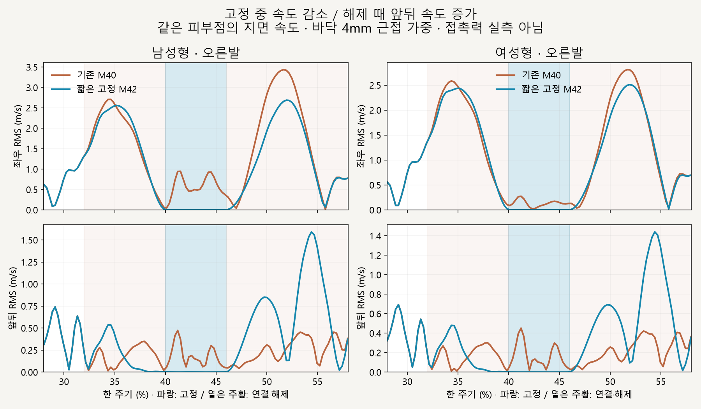
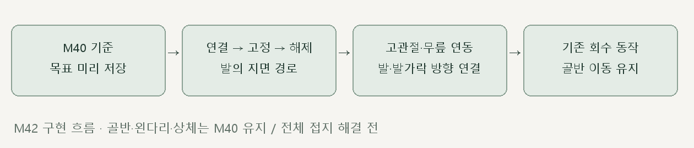

# 오른발 짧은 지면 고정

> **실험 시점 기록** · 본문의 화면·수치·‘현재/다음’은 해당 M 실험 당시 기준입니다. [2026-10-26 현재 결과물](../01-planning/CURRENT_STATE.md)에서 채택된 기능·후속 보정·남은 한계를 확인하세요. 기존 검사 결과를 새로 통과한 것으로 바꾸지 않았습니다.

2026-10-16 · M42 · **구현·수치 검사 완료 / 전체 접지 해결 전 / 자연스러움 사용자 검토 전** · R02/R16·D03


왼쪽은 기존 M40, 오른쪽은 짧은 지지 구간의 발 위치·방향을 고정한 비교안입니다. 골반 기준 이동을 그대로 유지하고 고관절·무릎을 함께 풀며, 회수는 기존 동작으로 돌아갑니다.

[이전 주소 → 현재 자세 화면](http://127.0.0.1:5173/review/mocap.html?compare=foot-plant) · [확정 범위·구간 계약 M42](../02-requirements/REQUIREMENTS.md#m42--오른발-짧은-지지-구간-지면-고정) · [이전 밀림 점검 M41](CMU_HIP_REFERENCE_SLIP.md)

후속 [M43 해제 검토](CMU_FOOT_RELEASE.md)에서 발목 이동과 발 회전의 불일치를 측정했습니다. 아래는 M42 구현 당시 결과이며, M43은 실행 동작을 변경하지 않았습니다.

## 고정 중 개선 / 해제 구간 미해결



고정 중 발 속도는 거의 0으로 줄었지만, 기존 회수 궤적으로 복귀하는 구간에 앞뒤 이동이 남습니다. **전체 지지 구간의 앞뒤 RMS는 오히려 증가했으므로 완성된 접지 보정이나 기본 동작 채택으로 판단하지 않습니다.**

| 바닥 4mm 근접 가중 RMS · m/s | 남성형 M40 → M42 | 여성형 M40 → M42 |
| --- | --- | --- |
| 고정 내부 좌우 | 0.692 → 0.000018 | 0.159 → 0.000007 |
| 고정 내부 앞뒤 | 0.247 → 0.000480 | 0.234 → 0.000202 |
| 지지 전체 좌우 | 1.367 → 1.249 | 1.372 → 1.294 |
| 지지 전체 앞뒤 | **0.286 → 0.438** | **0.296 → 0.425** |

고정 내부 측정은 경계 차분 혼입을 피한 40.5～45.5%, 지지 전체는 28～58%입니다. 같은 정점 ID를 추적하며 지면 근접은 접촉력 실측이 아닙니다; 1/4/8mm 민감도 자료도 [JSON](reports/cmu-foot-plant-slip.json)에 남깁니다.

## 코드 연결



| 코드 | 역할 |
| --- | --- |
| [stance-chain.js](../../experiments/model-preview/review/stance-chain.js) · `createFootPlantPath` | 진입·해제 끝의 기준 위치·속도·가속도를 맞춘 5차 X/Z 경로 |
| 같은 파일 · `applyFootPlant` | 뼈 길이를 유지한 두 뼈 계산 · 발 표면 높이 재검사 · 발/발가락 방향 연결 |
| [landing-width-comparison.js](../../experiments/model-preview/review/landing-width-comparison.js) | 모델별 기준 목표 미리 계산 · 양쪽 M40 위에 오른쪽 후보만 적용 · 시간 탐색 재현 |
| [mocap.js](../../experiments/model-preview/review/mocap.js) | 별도 비교 화면 · 정면/측면·남녀·재생·정지 |

오래 고정하면 이동한 골반에서 발까지 다리가 닿지 않아, 다리를 늘리지 않고 약 46ms만 고정했습니다. 위치 경계 연결은 개선했지만 발 구름·접촉점 전환은 구현하지 않았습니다.

## 검사 결과

| 남녀 730자세 · 기존 M40 대조 | 결과 |
| --- | --- |
| 골반·왼다리·상체 / 보정 구간 밖 회수 | 기존 M40 유지 · 위치 차이 <0.000003mm |
| 고정 중 발목 위치 / 발 방향 | 오차 <0.000086mm / <0.000024° |
| 고정 중 낮은 발 표면 중심 이동 | <0.024mm · 피부 변형 포함 |
| 뼈 길이 / 목표 도달 가능성 | 길이 차이 <0.000184mm · 도달 여유 최소 10.39mm |
| 지지 표면 바닥 간격 / 침범 | <0.049mm / 검사 표본에서 없음 |
| 진입·고정·해제 경계 | 간격을 줄인 위치·회전 연결 검사 통과 |
| 탐색 재현·남녀 변경·재생·시점 | 통과 · 브라우저 오류 없음 |
| 타입 검사·빌드 | 통과 · 검토 페이지는 배포 빌드 제외 |

수치는 기하학적 검사이며 실제 사람의 균형·자연스러움을 검증하지 않습니다. 경계 검사 통과와 별개로 해제 중 속도 증가는 남아 있으며, 왼발 고정은 추가하지 않았습니다.

## 재현·출처

[자세 검사](../../experiments/model-preview/scripts/verify-cmu-foot-plant.cjs) · [밀림 측정](../../experiments/model-preview/scripts/inspect-cmu-foot-plant-slip.cjs) · [자세 결과·코드 해시](reports/cmu-foot-plant.json) · [그림 원본](../assets/diagrams/cmu-foot-plant-figures.py) · [실제 재생 녹화](../../experiments/model-preview/scripts/capture-cmu-foot-plant.cjs)

```sh
node experiments/model-preview/scripts/verify-cmu-foot-plant.cjs
node experiments/model-preview/scripts/inspect-cmu-foot-plant-slip.cjs
python docs/assets/diagrams/cmu-foot-plant-figures.py
node experiments/model-preview/scripts/capture-cmu-foot-plant.cjs
```

저장소 루트·Vite 개발 서버·Playwright/Edge·Python Pillow/Matplotlib·맑은 고딕이 필요합니다. 영상은 `outputs/cmu-foot-plant/`에 생성합니다.

출처: CMU 35_17·기존 남녀 모델·M40/M41·사용자 오른발 한정 지면 고정 승인. 127_06 제외.

[문서 목록](../README.md)
