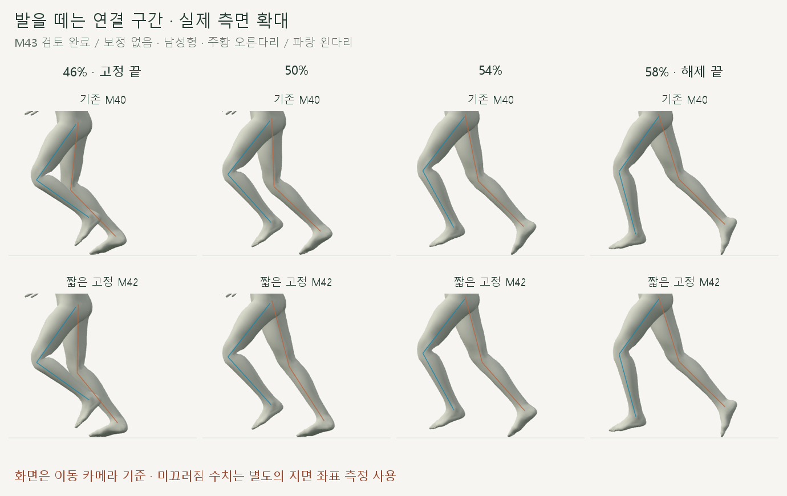
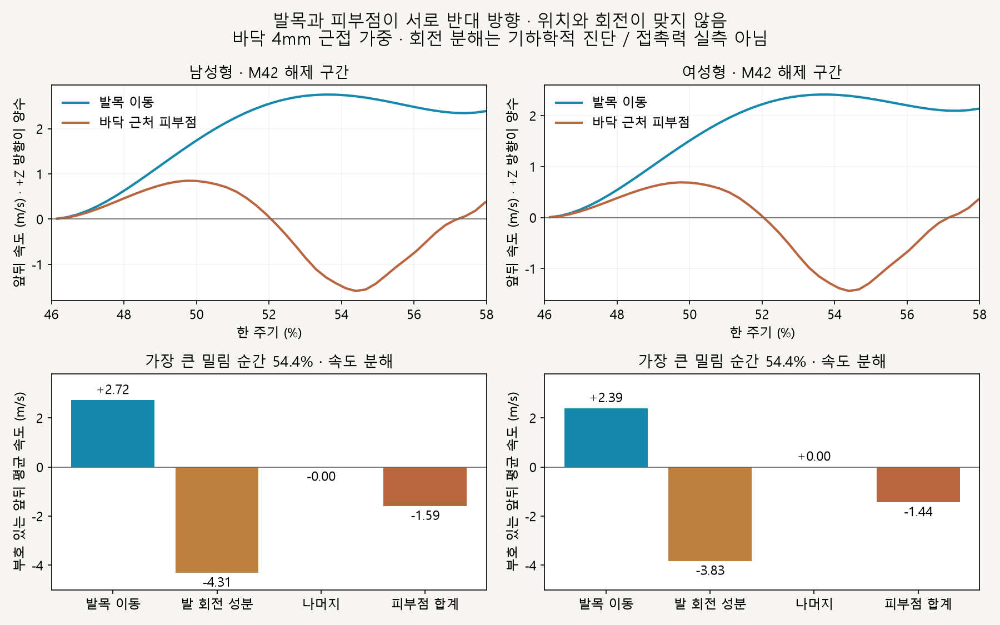

# 오른발 고정 해제 · 밀림 원인 검토

2026-10-16 · M43 · **측정·코드 검토 완료 / 동작 보정 없음 / 다음 수정은 제안** · R02/R16·D03



발목을 올리면서 발 방향도 되돌리지만, 낮은 발 표면은 해제 중 계속 바닥 가까이에 남습니다. 화면은 이동 카메라 기준이므로 밀림 크기는 아래 지면 좌표 측정으로 판단합니다.

## 위치와 회전의 연결이 서로 맞지 않음



밀림이 가장 큰 54.4%에서 발 회전 성분이 발목 이동을 넘어 반대 방향의 피부점 속도를 만듭니다. 분해의 나머지는 이 순간 0.0001m/s 미만으로, 큰 속도 차이는 주로 발의 위치·회전 조합에서 설명됩니다; 모든 구간의 피부 변형이 없다는 뜻은 아닙니다.

| 측정 · 남녀 기본 모델 | 남성형 | 여성형 |
| --- | --- | --- |
| 해제 91ms 동안 발목 앞뒤 순변위 | 17.18cm | 15.08cm |
| 해제 중 낮은 발 표면 높이 최대 | 0.049mm | 0.040mm |
| 해제 구간 피부점 앞뒤 RMS · M40 → M42 | 0.298 → **0.675m/s** | 0.252 → **0.642m/s** |
| 54.4% 발 세계 회전 속도 · M40 → M42 | 675 → **1,234°/s** | 675 → **1,234°/s** |
| 54.4% M42 피부점 앞뒤 RMS | 1.591m/s | 1.440m/s |

앞뒤 순변위는 발목 이동이며 발바닥 미끄러진 거리가 아닙니다. 1/4/8mm 근접 기준 모두 해제 RMS 악화 경향이 같았으며, 표는 4mm 기준입니다.

## 코드에서 확인한 연결

| 확인 위치 | 현재 동작 → 문제 |
| --- | --- |
| [createFootPlantPath](../../experiments/model-preview/review/stance-chain.js) | 고정 위치에서 기존 해제 끝점까지 X/Z 경로를 만듦 |
| 같은 파일 `applyFootPlant` | 발 방향은 현재 기준 자세와 고정 방향 사이에서 별도 혼합 → 위치 경로와 접촉점 속도를 함께 풀지 않음 |
| 같은 파일 높이 반복 계산 | 기존 표면 높이와 고정 표면 높이를 혼합 → 회전 중에도 낮은 표면이 바닥 근처에 남음 |

경계에서 끊기지 않는 곡선이어도 중간의 접지 속도가 맞는 것은 아닙니다. 이번 분해는 순간 속도의 기하학적 설명이며 접촉력·마찰·실제 인체 검증은 아닙니다.

## 다음 작은 수정 제안 · 미구현

**오른발 해제 구간에서 발바닥 지지점을 기준으로 발목 위치와 발 회전을 함께 계산**하는 안을 검토합니다. 골반·구간 밖 회수는 유지하되, 목표가 다리 길이 안에서 가능한지와 지지점 전환·이륙 시점을 먼저 확인해야 합니다; 발목 경로 또는 발 각도만 별도로 늦추는 방식은 채택하지 않습니다.

후속 [M44 지지점 연동](CMU_PIVOT_RELEASE.md)을 사용자 승인 후 구현했습니다. 앞뒤 밀림은 감소했지만 지지점의 높이·좌우 이동과 잔여 밀림은 남습니다.

## 재현·검사

[읽기 전용 측정·캡처 코드](../../experiments/model-preview/scripts/inspect-cmu-foot-release.cjs) · [수치·기준 코드 해시](reports/cmu-foot-release.json) · [그림 생성 원본](../assets/diagrams/cmu-foot-release-figures.py) · [M42 구현·730자세 검사](CMU_FOOT_PLANT.md) · [범위 기록 M43](../02-requirements/REQUIREMENTS.md#m43--오른발-고정-해제-검토)

```sh
node experiments/model-preview/scripts/inspect-cmu-foot-release.cjs
python docs/assets/diagrams/cmu-foot-release-figures.py
```

기존 M42 측정의 코드 해시 일치·동일 시점 속도 분해 등식·기존 피부점 속도와 재측정 일치·남녀 정확한 끝점·정면/측면 캡처·브라우저 오류 없음 검사를 통과했습니다. 실행 동작 파일은 변경하지 않아 빌드를 다시 실행하지 않았습니다.

재현 환경: 저장소 루트·Vite 개발 서버·Playwright/Edge·Python Pillow/Matplotlib·맑은 고딕. 출처: CMU 35_17·M42 측정·사용자 후속 검토 요청; 127_06 제외.

[이전 주소 → 현재 자세 화면](http://127.0.0.1:5173/review/mocap.html?compare=foot-plant) · [문서 목록](../README.md)
