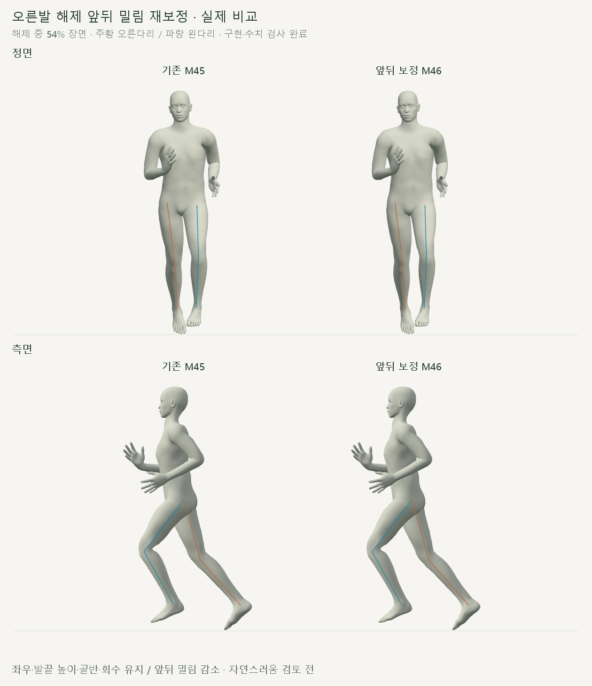
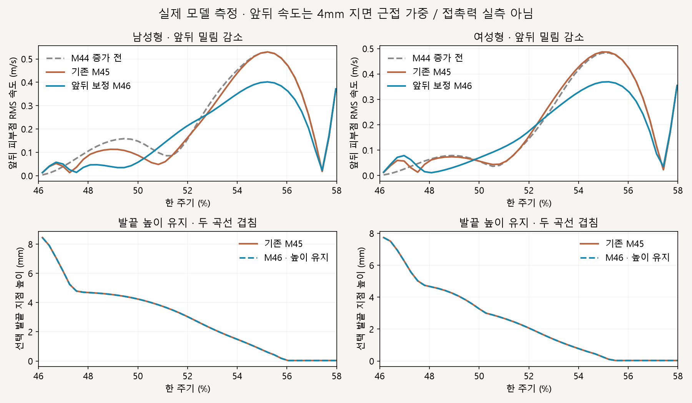
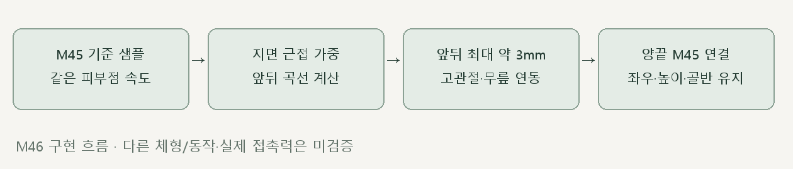

# 오른발 해제 · 앞뒤 밀림 재보정

> **실험 시점 기록** · 본문의 화면·수치·‘현재/다음’은 해당 M 실험 당시 기준입니다. [2026-10-26 현재 결과물](../01-planning/CURRENT_STATE.md)에서 채택된 기능·후속 보정·남은 한계를 확인하세요. 기존 검사 결과를 새로 통과한 것으로 바꾸지 않았습니다.

2026-10-16 · M46 · **구현·수치 검사 완료 / 자연스러움 검토 전 / 완전 접지 전** · R02/R16·D03



왼쪽 기존 M45 / 오른쪽은 오른발 해제의 앞뒤 위치만 작게 조절한 결과입니다. 골반·상체·왼다리·구간 밖 회수와 기존 좌우 경로·발끝 각도는 유지했습니다.

[이전 주소 → 현재 자세 화면](http://127.0.0.1:5173/review/mocap.html?compare=fore-aft-release) · [확정 범위 M46](../02-requirements/REQUIREMENTS.md#m46--오른발-해제-앞뒤-밀림-재보정) · [이전 M45](CMU_RELEASE_REFINEMENT.md)

> 후속 사용자 검토: 중앙 착지 후 바깥으로 밀리는 동작이 남아 품질 검토 반려. 이 문서의 해제 구간 수치는 전체 접지 검증이 아닙니다. [M47 착지 경로 수정](CMU_STANCE_CONTACT.md).

## 앞뒤 감소 / 좌우·발끝 개선 유지



해제 구간 앞뒤 RMS가 M45보다 약 19% 감소했고, 증가가 생기기 전 M44보다도 낮아졌습니다. 아래 발끝 높이 곡선은 거의 겹치며 기존 개선이 유지됩니다.

| 해제 46～58% · 바닥 4mm 근접 가중 | 남성형 | 여성형 |
| --- | --- | --- |
| 앞뒤 RMS · M44 → M45 → M46 | 0.238 → 0.268 → **0.216m/s** | 0.241 → 0.253 → **0.206m/s** |
| 앞뒤 RMS 감소 · M45 대비 | **19.5%** | **18.8%** |
| 좌우 RMS · M45 → M46 | 1.04390 → 1.04388m/s | 1.16850 → 1.16850m/s |
| 중간 47～57% 평균 발끝 높이 | 2.709mm 유지 | 2.167mm 유지 |

1/4/8mm 근접 기준 모두 앞뒤 RMS가 M45·M44보다 낮고 좌우 지표가 유지되는지 검사했습니다. 같은 피부 정점 ID의 지면 속도이며 실제 접촉력·마찰 측정은 아닙니다.

## 코드



| [fore-aft-release.js](../../experiments/model-preview/review/fore-aft-release.js) | 역할 |
| --- | --- |
| `createForeAftReader` | 오른발·발끝에 가중된 같은 피부 정점들을 추적 |
| `createForeAftCurve` | 모델 준비 시 M45를 64개 간격으로 샘플링 · 지면 근접 가중 앞뒤 속도 제곱합을 줄이는 곡선 계산 · 이동 약 3mm 이내 |
| `applyForeAftRelease` | 앞뒤 목표만 추가하고 고관절·무릎으로 연결 · 선택 지점 좌우/높이와 발·발끝 방향 유지 |

양끝에서 추가 위치·속도·가속도가 0인 곡선을 사용해 원래 회수에 연결합니다. [비교 연결](../../experiments/model-preview/review/landing-width-comparison.js)은 양쪽 M45 위에 후보만 적용하며 임의 시간 탐색에 따른 누적 오차가 없습니다.

## 검사 결과

| 남녀 730자세 · 별도 0.25프레임 간격 검증 | 결과 |
| --- | --- |
| 골반·상체·왼다리 / 구간 밖 회수 | M45 유지 · 위치 차이 <0.000003mm |
| 선택 지점의 좌우·높이 변화 | <0.000043mm |
| 발끝 높이의 기존 M45 대비 변화 | <0.000027mm |
| 발·발끝 세계 회전 | M45 유지 · 차이 <0.000024° |
| 실제 앞뒤 추가 이동 | 최대 약 3.00003mm · 수치 오차 포함 |
| 뼈 길이 / 다리 도달 여유 | 길이 차이 <0.000005mm / 여유 최소 12.76mm |
| 낮은 표면 바닥 간격 / 침범 | <0.049mm / 검사 표본에서 없음 |
| 경계·시간 탐색·정면/측면·재생·모델 변경 | 통과 · 브라우저 오류 없음 |
| 기존 M45 재현 / 타입 검사·빌드 | 통과 · 검토 페이지는 배포 빌드 제외 |

**한계:** 기본 남녀 모델·35_17에 맞춰 계산하고 검사한 결과입니다. 잔여 좌우·앞뒤 밀림과 초입 발끝 뜸은 남으며 실제 균형·다른 체형/동작·자연스러움은 검증하지 않았습니다.

## 재현·출처

[자세 검사](../../experiments/model-preview/scripts/verify-cmu-fore-aft-release.cjs) · [밀림 측정](../../experiments/model-preview/scripts/inspect-cmu-fore-aft-release-slip.cjs) · [개선·유지 검사](../../experiments/model-preview/scripts/check-cmu-fore-aft-release-results.cjs) · [자세 JSON](reports/cmu-fore-aft-release.json) · [속도 JSON](reports/cmu-fore-aft-release-slip.json) · [요약 JSON](reports/cmu-fore-aft-release-summary.json) · [그림 원본](../assets/diagrams/cmu-fore-aft-release-figures.py) · [녹화](../../experiments/model-preview/scripts/capture-cmu-fore-aft-release.cjs)

```sh
node experiments/model-preview/scripts/verify-cmu-fore-aft-release.cjs
node experiments/model-preview/scripts/inspect-cmu-fore-aft-release-slip.cjs
node experiments/model-preview/scripts/check-cmu-fore-aft-release-results.cjs
python docs/assets/diagrams/cmu-fore-aft-release-figures.py
node experiments/model-preview/scripts/capture-cmu-fore-aft-release.cjs
```

재현 환경: 저장소 루트·Vite 개발 서버·Playwright/Edge·Python Pillow/Matplotlib·맑은 고딕. 영상은 `outputs/cmu-fore-aft-release/`에 생성합니다. 출처: CMU 35_17·M45 측정·사용자 앞뒤 밀림 감소 승인; 127_06 제외.

[문서 목록](../README.md)
