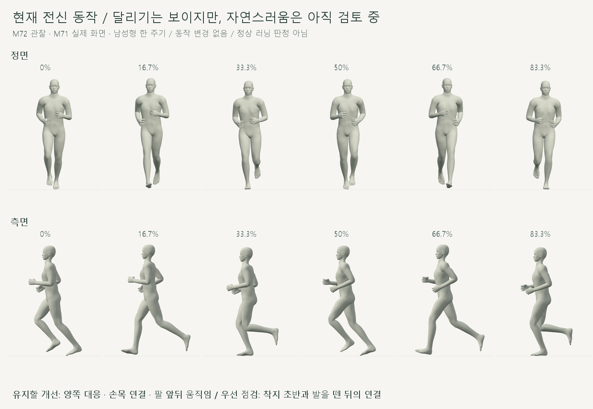
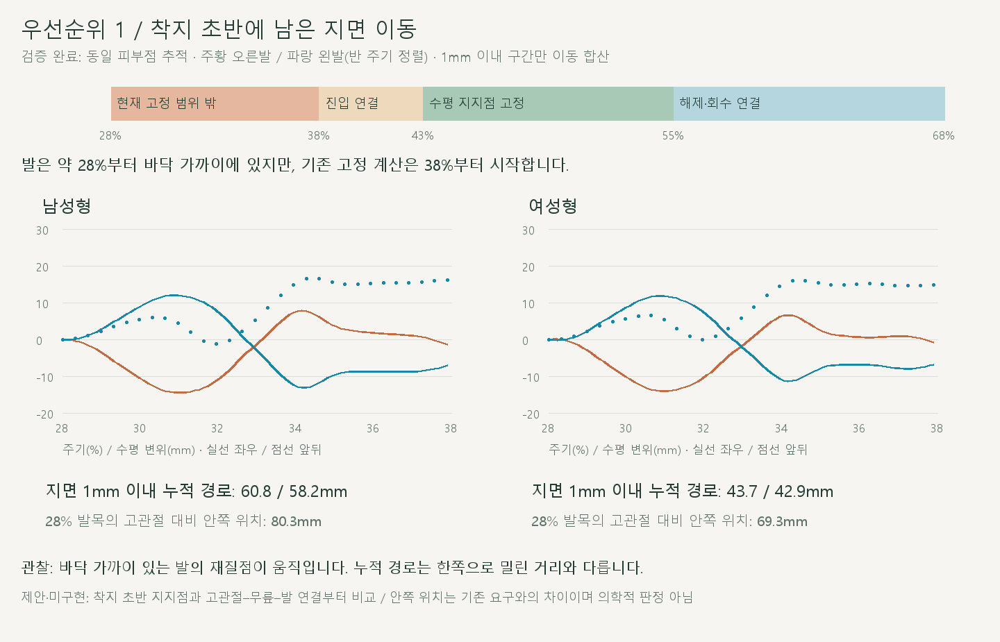
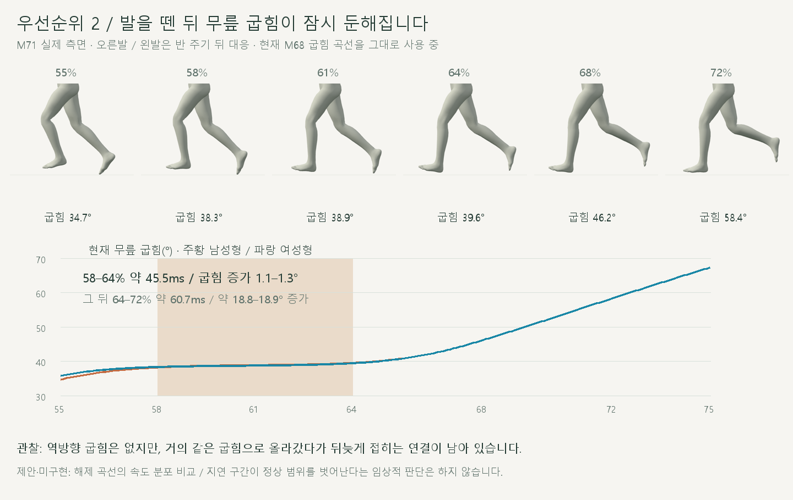
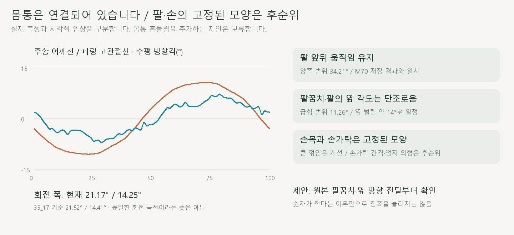

# 손 수정 후 전신 달리기 재검토

> **실험 시점 기록** · 본문의 화면·수치·‘현재/다음’은 해당 M 실험 당시 기준입니다. [2026-10-26 현재 결과물](../01-planning/CURRENT_STATE.md)에서 채택된 기능·후속 보정·남은 한계를 확인하세요. 기존 검사 결과를 새로 통과한 것으로 바꾸지 않았습니다.

2026-10-21 · M72 · **관찰 완료 / 동작 수정 없음 / 후속 수정은 제안·미구현** · R02·R16 / D03 · M71 후속



**달리기로 보이지만, 실제 사람처럼 자연스럽다고 최종 판단하기는 어렵습니다.** 손목·좌우 대응은 개선됐고, 착지 초반 지면 이동과 해제 후 굽힘 타이밍이 남아 있습니다.

[이전 주소 → 현재 자세 화면](http://127.0.0.1:5173/review/shared-gait.html?compare=hand-pose) · [정면 1배속 영상](../../outputs/cmu-full-run-review/front.webm) · [측면 1배속 영상](../../outputs/cmu-full-run-review/side.webm) · [검토 범위](../02-requirements/REQUIREMENTS.md#m72--손-수정-후-전신-검토)

## 1순위 · 착지 초반의 지면 이동



발은 약 28%부터 바닥 가까이에 있지만, 현재 지지점 고정 처리는 38%부터 연결해 43%에 완전히 고정됩니다. **28–38%는 이 고정 처리의 범위 밖**이며, 같은 발바닥 재질점이 바닥 가까이에서 움직입니다.

| 관찰 · 오른발 / 반 주기 뒤 왼발 | 남성형 | 여성형 |
| --- | --- | --- |
| 지면 1mm 이내인 동일 재질점의 누적 수평 경로 | 60.82 / 58.16mm | 43.66 / 42.92mm |
| 해당 재질점의 높이 범위 · 28–37.9% | 0–0.04mm | 0–1.62mm |
| 28% 발목의 같은 쪽 고관절 수직선 대비 안쪽 위치 | 양쪽 80.25mm | 양쪽 69.33mm |

누적 경로는 왕복을 더한 길이로, 한쪽으로 61mm 이동했다는 뜻은 아닙니다. 여성형은 1mm 위로 뜬 구간을 합산에서 제외했으며, 좌우 지면 경로 차이에는 보존된 몸의 이동도 포함됩니다.

안쪽 위치는 **기존 ‘같은 쪽 고관절 아래 디딤’ 요구와의 차이**입니다. 이 거리만으로 정상·비정상 러닝을 판정하거나 다리 전체를 바깥으로 벌리는 수정은 제안하지 않습니다.

## 2순위 · 해제에서 회수로 넘어가는 타이밍



58–64%의 약 45.5ms 동안 무릎 굽힘은 1.1–1.3°만 늘고, 이어지는 약 60.7ms에는 18.8–18.9° 늘어납니다. **한동안 비슷한 굽힘으로 올라갔다가 뒤늦게 접히는 인상**이며, 관절이 역방향으로 튀는 이전 문제와는 구분합니다.

현재 굽힘은 저장된 M68 결과와 <0.000001° 차이로 일치합니다. M68의 왕복 방지 연결 곡선에 남은 속도 분포가 검토 대상이며, 생체역학적 정상 범위를 벗어났다는 판정은 아닙니다.

## 몸통·팔·손의 연결



몸통은 회전하며 팔을 함께 움직입니다. 어깨선·고관절선의 수평 방향각 범위는 35_17 기준과 비슷하므로, **몸통을 더 흔드는 수정은 우선하지 않습니다.**

| 부위 | 현재 판단 | 후속 제안 |
| --- | --- | --- |
| 몸통–팔 | 어깨선 21.17° / 고관절선 14.25° 회전 폭 · 팔 앞뒤 범위 양쪽 34.21° | 유지 / 전체 회전 파형·힘까지 같다는 뜻은 아님 |
| 팔꿈치·옆 방향 | 팔꿈치 변화 폭 11.26° / 옆 벌림 약 14°로 거의 일정 · 다소 고정된 인상 | 원본→모델 전달을 먼저 비교 / 수치가 작다는 이유로 확대하지 않음 |
| 손목·손 | 큰 손목 꺾임 개선 / 손 모양은 주기 내내 동일 | 손가락 간격·엄지 외형은 후순위 / 억지로 쥐었다 펴는 동작을 추가하지 않음 |

## 수정 우선순위 · 사용자 검토 전

| 순서 | 다음 작은 작업 제안 | 판단할 결과 |
| --- | --- | --- |
| 1 | 착지 초반의 지지점 선정·고정 시작과 고관절–무릎–발 연결 비교 | 바닥 가까운 재질점의 왕복 감소 / 착지 위치·몸 이동·관절 연속성 함께 확인 |
| 2 | 해제 곡선의 굽힘 속도 분포 비교 | 굽힘 지연 감소 / 기존 왕복 방지·좌우 대응·발 방향 유지 여부 |
| 3 | 팔꿈치·팔 옆 방향의 원본 전달 비교, 이후 손 모양 | 원본에서 달라진 부분만 작은 외형 비교 / 현재 몸통·다리 보존 |

**이번에는 어느 보정도 적용하지 않았습니다.** 다음에는 1순위부터 하나씩 검토하며, 바꿔야 할 착지 위치와 보존할 이동·회수 범위를 먼저 명시합니다.

## 코드·검사

| 대상 | 확인 |
| --- | --- |
| [shared-support.js](../../experiments/model-preview/review/shared-support.js) · `SUPPORT_WINDOW` | 기존 시작 38% / 고정 43–55% · 착지 초반이 적용 범위 밖인 이유 |
| [shared-release.js](../../experiments/model-preview/review/shared-release.js) · `monotoneRelease` | 역행 없는 굽힘 연결 / 시작·끝 조건 보존 / 중간 속도가 일정하다는 보장은 없음 |
| [hand-pose.js](../../experiments/model-preview/review/hand-pose.js) | 고정된 손목·손가락 상대 회전 / 전신에는 M70을 그대로 적용 |
| 새 [관찰·캡처 코드](../../experiments/model-preview/scripts/inspect-full-run.cjs) | 남녀 전 주기 2,002 + 양발 지지 주변 1,604 = **3,606자세** / 48장 |
| 새 [영상·해제 캡처 코드](../../experiments/model-preview/scripts/capture-full-run.cjs) | 추가 12장 / 정면·측면 1배속 각 3.1초·187프레임 / 영상별 서로 다른 3시점 디코딩 확인 |
| 기존 동작 유지 | 실행 JS·HTML·자료·GLB 45파일 해시 전후 일치 / M70 팔 각도·손목 경로 일치 / M68 굽힘 일치 |
| 기하·재현 | 측정 발 피부의 최저 높이 ≥0 / 동일 시점 재탐색 일치 / 브라우저 오류 없음 |

**검증 한계:** 고정된 피부점을 추적한 기하 관찰이며 접촉력·마찰·무게중심·추진력·기록 향상은 검증하지 않았습니다. ‘최저 높이 ≥0’은 침투가 없다는 확인으로, 지지 중 뜸·미끄러짐까지 해결됐다는 뜻이 아닙니다.

**출처:** 저장소의 CMU 35_17 한 주기와 해당 모델 전달·보정 이력 M56→M71. 어깨선/고관절선은 수평면 방향각이며 임상 관절각이 아닙니다. 127_06은 사용하지 않았습니다. [원본 좌표 검증·출처](CMU_SOURCE_VALIDATION.md).

[전체 관찰](reports/cmu-full-run-review.json) · [요약](reports/cmu-full-run-review-summary.json) · [영상 검사](reports/cmu-full-run-media.json) · [그림 생성 원본](../assets/diagrams/cmu-full-run-review.py)

```sh
node experiments/model-preview/scripts/inspect-full-run.cjs
node experiments/model-preview/scripts/capture-full-run.cjs
python docs/assets/diagrams/cmu-full-run-review.py
```

실제 캡처·영상은 `outputs/cmu-full-run-review/`. Node·Playwright·Edge·Three.js·Vite·Python·Pillow·맑은 고딕으로 재현합니다. [M71 이력](CMU_HAND_POSE.md) · [문서 목록](../README.md).
