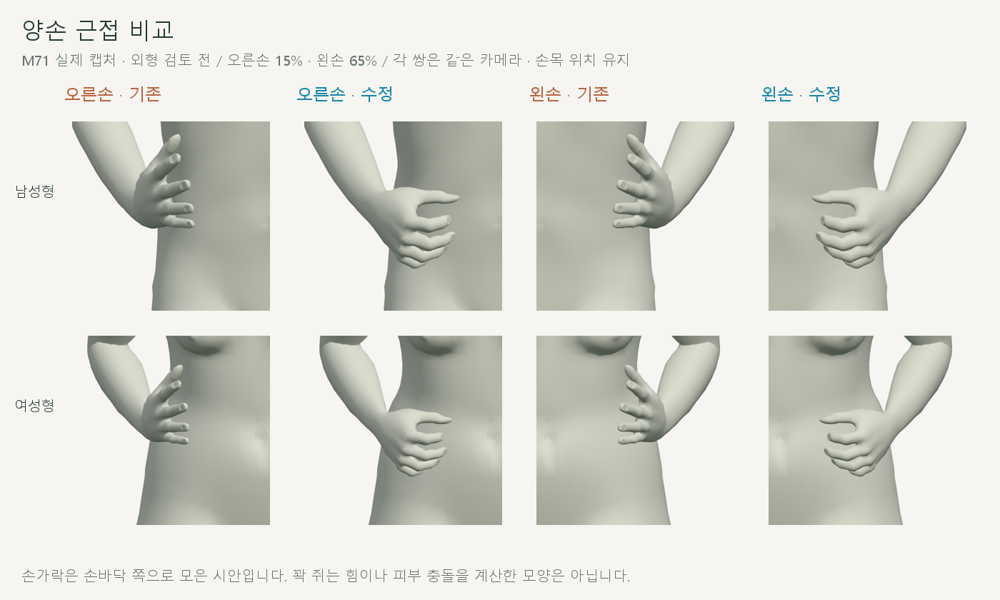
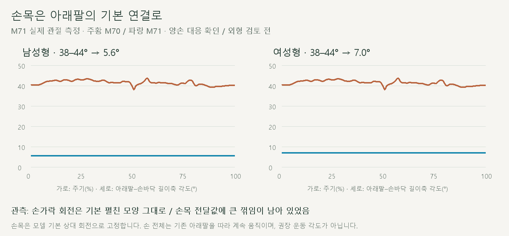
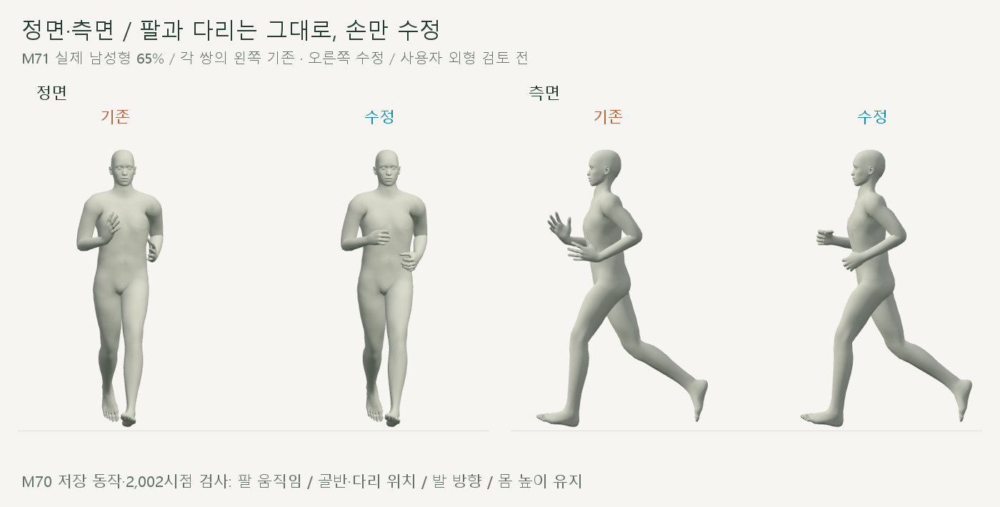
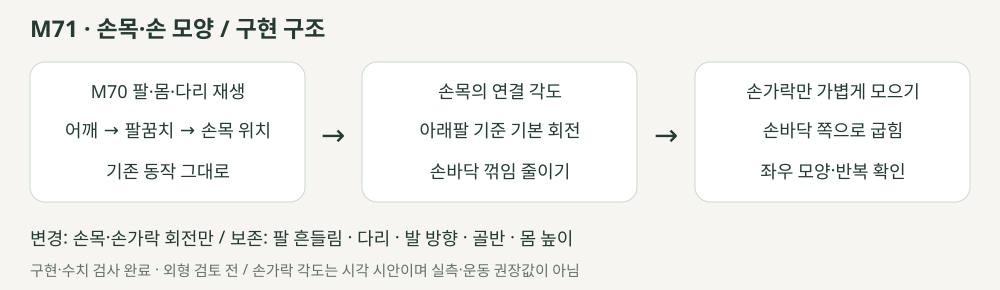

# 손목 연결과 가볍게 모은 손

2026-10-20 · M71 · **사용자 승인 / 구현·수치·재생 검사 완료 / 외형 검토 전** · R02·R16 / D03 · M70 후속



손가락은 펼쳐진 기본 회전 그대로였으며, 손목 전달값에 큰 꺾임이 남아 있었습니다. **손목·손가락 회전만** 바꾸고 손목 위치와 아래팔 동작은 유지합니다.

[이전 주소 → 현재 자세 화면](http://127.0.0.1:5173/review/shared-gait.html?compare=hand-pose) · [요구·값·보존 계약](../02-requirements/REQUIREMENTS.md#m71--손목과-손-모양)

## 확인한 원인



기존 손가락 회전은 GLB 기본값과 사실상 같았습니다. 아래팔과 손바닥의 길이축 사이 각도는 **38.13–43.77° → 남성형 5.56° / 여성형 7.00°**로 줄었습니다.

이 각도는 팔꿈치→손목과 손목→중지 시작점 사이의 기하학적 각도입니다. 의학적 손목 관절각·권장 운동 각도가 아니며, 남녀 차이는 기본 모델의 연결 모양입니다.

## 실제 전신 비교



각 쌍의 왼쪽은 M70, 오른쪽은 M71입니다. 손은 굽힌 모양으로 아래팔을 따라 움직이며, 이번 수정에서는 손가락을 주기마다 다시 펴고 쥐지 않습니다.

## 코드



모델의 기본 손목 상대 회전을 사용하고, 각 손의 손바닥 면과 손가락 방향으로 굽힘 축을 계산합니다. 양쪽에 같은 Euler 각도를 복사하지 않아 좌우의 뼈 축 차이를 처리합니다.

| 코드 | 역할 |
| --- | --- |
| [hand-pose.js](../../experiments/model-preview/review/hand-pose.js) · `RELAXED_HAND` | 기본 모양에 더하는 손가락 굽힘값 / 실측 대신 시각 시안임을 명시 |
| 같은 파일 · `createHandPose` | 기본 손목 회전·각 손가락의 손바닥 방향 굽힘 축을 한 번 계산 |
| 같은 파일 · `apply` | M70 전체 재생 후 손목·손가락 32개 회전만 교체 / 누적 회전 없음 |
| [shared-gait-view.js](../../experiments/model-preview/review/shared-gait-view.js) | M70 ↔ M71 별도 비교 / 이전 팔 흔들림 주소 유지 |

## 검사

| 항목 | 결과 |
| --- | --- |
| 남녀 전 주기 | **2,002시점 통과** |
| M70 저장 팔 앞뒤·옆 각도·팔꿈치 굽힘·손목 경로 | 일치 / 각도 <0.001°·위치 0mm |
| 어깨·팔꿈치·손목 위치 / 다리·골반·몸 높이 | 변화 **0mm** |
| 보호한 뼈의 회전 / 발 방향 | 차이 <0.001° |
| 손 가중치가 없는 피부 | 모델당 10,683점 × 21시점 / 변화 **0mm** |
| 발바닥 최저 높이 / 새 바닥 침투 | 변화 **0mm** / 없음 |
| 끝마디 피부 표본 · 양손 10점 | 모두 손바닥 쪽 이동 / 손목까지 거리 감소 |
| 좌우 반 주기 대응 | 관절·피부 표본 위치 차이 <0.01mm |
| 반복 경계 / 재탐색 / 화면 이동 | 통과 / 손 세계 회전의 경계 유한차분 속도 차이 <0.00068rad/s |
| M70까지 기존 동작 모듈 9개 | 해시 일치 / 수정 없음 |
| 남녀 전환·반복·단회·정면/측면 | 통과 / 브라우저 오류 없음 |
| 실제 캡처·영상 / 타입·메인 앱 빌드 | 전신 24장·근접 8장·1배속 영상 2개 / 통과 |

검토용 JS는 브라우저에서 별도 검사했습니다. **한계:** 손 모양은 고정된 시각 시안입니다. 근접 캡처에서 굽힘 방향을 확인했지만 손 피부 전체의 충돌·쥐는 힘·전신 자연스러움 검증을 대신하지 않습니다.

[진단](reports/cmu-hand-pose-diagnostic.json) · [전체 검사](reports/cmu-hand-pose.json) · [요약](reports/cmu-hand-pose-summary.json) · [UI](reports/cmu-hand-pose-ui.json) · [영상 검사](reports/cmu-hand-pose-media-check.json)

```sh
node experiments/model-preview/scripts/inspect-hand-pose.cjs
node experiments/model-preview/scripts/verify-hand-pose.cjs
node experiments/model-preview/scripts/capture-hand-pose.cjs
node experiments/model-preview/scripts/check-hand-pose-ui.cjs
node experiments/model-preview/scripts/check-hand-pose-media.cjs
python docs/assets/diagrams/cmu-hand-pose.py
```

[그림 생성 원본](../assets/diagrams/cmu-hand-pose.py) · 실제 캡처·영상은 `outputs/cmu-hand-pose/`. Node·Playwright·Edge·Three.js·Vite·Python·Pillow·맑은 고딕으로 재현합니다. [M70 이력](CMU_ARM_SWING.md) · [문서 목록](../README.md).
