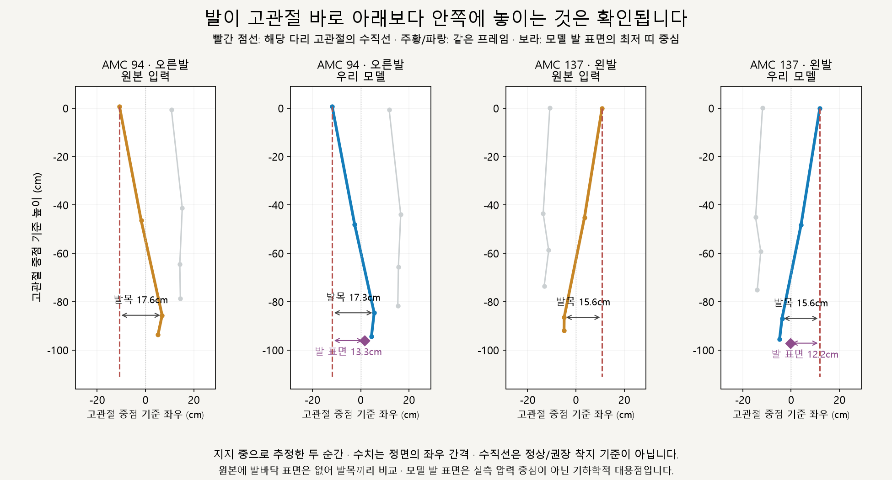
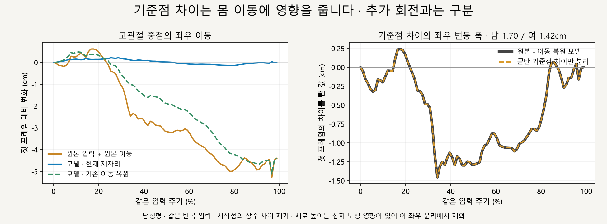
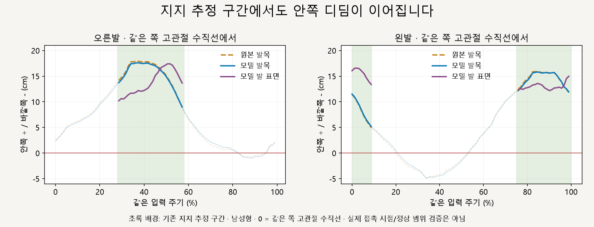

# 골반 기준점과 안쪽 디딤 · 35_17

2026-10-15 · M32 · **기준점의 이동 영향·안쪽 디딤 확인 / 기우뚱함의 직접 원인 미확정 / 보정 없음** · R02/R16·D03

후속 승인 실험: [M33 오른발 지지 구간 비교](CMU_LANDING_COMPARISON.md). 아래는 보정을 적용하기 전 분석 기록이며, M33은 별도 비교 화면에 한정합니다.



**발이 같은 쪽 고관절 수직선보다 안쪽에 놓인다는 관찰은 확인됩니다.** 원본 발목도 같은 순간 안쪽에 있으며, 수직선은 사용자 가설을 확인하는 비교 기준이지 정상·최적 착지 위치로 확정한 선이 아닙니다.

| 남성형 · 지지 중 추정 | 원본 발목 | 모델 발목 | 모델 발 표면 대용점 |
| --- | --- | --- | --- |
| AMC 94 · 오른발 | 안쪽 17.6cm | 안쪽 17.3cm | 안쪽 13.3cm |
| AMC 137 · 왼발 | 안쪽 15.6cm | 안쪽 15.6cm | 안쪽 12.2cm |

거리는 **같은 쪽 고관절에서 발까지의 정면 좌우 간격**입니다. 발 표면은 최저 높이+1mm 이내 점들의 중심이며, 실제 접촉 압력 중심이나 발바닥 전체의 중심은 아닙니다.

## 골반 중점의 이동에는 영향이 있나?



**있습니다.** 원본 root와 모델 pelvis의 위치가 고관절 중점에 대해 서로 달라, 같은 회전·수평 이동을 전달해도 고관절 중점 경로가 달라집니다.

| 같은 입력 주기 · 시작점 차이 제거 | 남성형 | 여성형 |
| --- | --- | --- |
| 기준점 차이의 좌우 변동 폭 · 최대−최소 | 1.70cm | 1.42cm |
| 시작점 대비 기준점 차이의 최대 절댓값 | 1.45cm | 1.20cm |
| 기존 이동 복원 후 남는 좌우 차이와 기준점 차이의 일치 | 오차 <0.000001mm | 오차 <0.000001mm |

오른쪽 두 곡선의 일치는 **수평 중점 이동 차이의 원인 분리**입니다. 기우뚱함을 느끼는 정도의 인과 검증은 아니며, 접지 보정이 섞이는 높이 차이는 이 좌우 판정에서 제외했습니다.

## 기준점만 맞추면 안쪽 디딤이 사라지나?



**몸 전체의 위치만 옮기면 사라지지 않습니다.** 발과 고관절이 함께 이동하므로 `발 위치 − 고관절 위치`가 유지되며, 그림의 안쪽 간격도 그대로입니다.

| 검증한 것 | 판정 |
| --- | --- |
| 원본과 모델의 골반 기준점이 다름 | 고관절 중점 이동 차이에 기여함 · 원본 회전 좌표에서 기준점 차이는 일정한 벡터로 확인 |
| 지지 추정 중 발이 고관절보다 안쪽에 있음 | 원본·모델 모두 확인 · 원본 발바닥 자료가 없어 발목끼리 비교 |
| 모델 전체를 고관절 중점 기준으로 이동시키는 좌표 계산 | 발목·발 표면과 고관절의 상대 거리 유지 · 계산만 검증, 동작에 적용하지 않음 |
| 발을 수직선 위로 옮기면 더 자연스러워지는지 | 미검증 · 요구·보정값으로 확정하지 않음 |

기준점 차이와 안쪽 디딤은 구분해서 다뤄야 합니다. 이번 결과는 다리 벌림·발 위치·몸 이동의 새 보정을 적용할 근거로 자동 전환하지 않습니다.

## 검사·재현

| 범위 | 증거 |
| --- | --- |
| 입력 | [M31 측정](CMU_TRANSFER_VALIDATION.md)의 코드·원본·GLB 해시 일치 확인 후 재분석 · 새 브라우저 측정 아님 |
| 원본 167프레임 × 남녀 | 회전 좌표에서 기준점 차이 벡터 일정 · 최대 잔차 <0.000001mm |
| 반복 91프레임 × 남녀 | 중점 이동 차이 분해·좌표 이동의 상대 거리 불변 검사 통과 |
| 지지 추정 표본 | 남녀 각 오른발 27 / 왼발 31개 · 원본의 실제 접촉 시점은 미검증 |
| 유지 | 35_17만 사용 · M28 꺼짐 · 모델·동작·보정·실행 코드 수정 없음 |

[계산·검사 코드](../../experiments/model-preview/scripts/inspect-cmu-hip-center.py) · [그림 생성](../assets/diagrams/cmu-hip-center-figures.py) · [수치·입력 해시·좌표 계약 JSON](reports/cmu-hip-center.json)

저장소 루트에서 Python NumPy·Matplotlib·맑은 고딕을 사용합니다. 입력 해시가 달라지면 검사를 중단하며, 과거 측정을 현재 결과로 표시하지 않습니다.

```sh
python experiments/model-preview/scripts/inspect-cmu-hip-center.py
python docs/assets/diagrams/cmu-hip-center-figures.py
```

출처: 사용자 ‘발이 너무 안쪽’ 가설 · [M30 독립 원본 검증](CMU_SOURCE_VALIDATION.md) · [M31 동일 프레임 측정](CMU_TRANSFER_VALIDATION.md). 위 그림은 측정 좌표로 생성했으며 교정된 애니메이션·임상적 안정성 검증이 아닙니다.

[M32 범위·판정 기준](../02-requirements/REQUIREMENTS.md#m32--고관절-중점과-안쪽-디딤-검증) · [문서 목록](../README.md)
