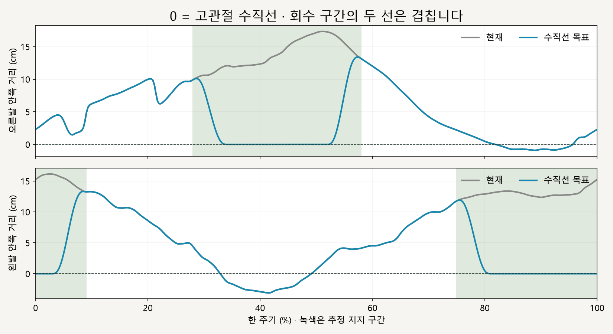
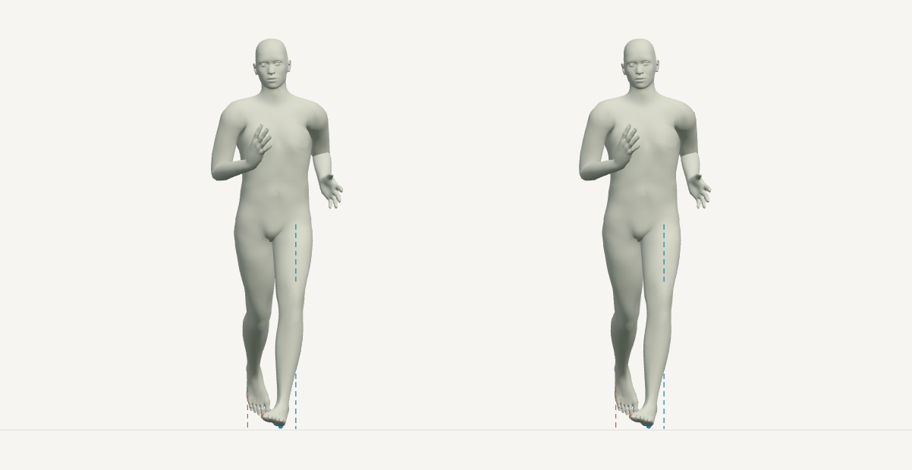

# 양발 착지 · 고관절 수직선 비교

> **실험 시점 기록** · 본문의 화면·수치·‘현재/다음’은 해당 M 실험 당시 기준입니다. [2026-10-26 현재 결과물](../01-planning/CURRENT_STATE.md)에서 채택된 기능·후속 보정·남은 한계를 확인하세요. 기존 검사 결과를 새로 통과한 것으로 바꾸지 않았습니다.

2026-10-16 · M35 · **수치 검사 통과 / 사용자 자세 검토 실패 · 채택 보류** · R02/R16·D03

**사용자 검토:** 발을 선에 맞춰도 무릎이 꺾여 보임. 골반·무릎·발의 연동이 필요하다는 피드백으로 이번 자세를 채택하지 않습니다.


위 그림은 **자세 검토에 실패한 M35 실험**입니다. 왼쪽은 현재 동작, 오른쪽은 발 표면 위치만 목표에 맞춘 결과입니다. 정면 좌우 위치를 맞추며 발의 전후 위치와 각 다리 회수 동작은 유지합니다.

[이전 주소 → 현재 자세 화면](http://127.0.0.1:5173/review/mocap.html?compare=hip-landing) · [이전 최대 2cm/4cm 비교](CMU_BILATERAL_COMPARISON.md)

| 표시·조작 | 의미 |
| --- | --- |
| 점선 / 작은 점 | 고관절 정면 수직선 / 발바닥 낮은 표면의 기준점 · 주황 오른발, 파랑 왼발 |
| 정면·측면 | 같은 순간 비교 · 점선은 정면에서만 표시 |
| 재생·시간 막대·모델 선택 | 기본 0.5배속 · 한 주기 끝 정지 · 남성형/여성형 · 원하는 시점 이동 |

## 착지 중간에는 선에 정렬



착지 구간 중간은 선 위에 맞추고 시작·끝은 원래 위치와 부드럽게 연결합니다. 이번 표면 기준점은 경계에서 점이 갑자기 바뀌지 않도록 낮은 정점에 연속 가중치를 줍니다; 이전의 ‘최저 높이+1mm’ 단순 평균과는 소폭 다릅니다.

| 남성형 대표 지지 시점 | 현재 안쪽 거리 | 완전 적용 후 |
| --- | --- | --- |
| 오른발 · 43% | 13.7cm | 선 위 · 오차 <0.001mm |
| 왼발 · 88% | 12.7cm | 선 위 · 오차 <0.001mm |

정확한 기준점·구간·유지 조건·허용치는 [M35 계약](../02-requirements/REQUIREMENTS.md#m35--고관절-수직선-착지-비교)에 둡니다. 선 위 착지를 최적 자세로 확정한 것은 아닙니다.



66% 시점은 두 모델의 자세가 같습니다. 한쪽이 지지 중일 때도 반대쪽 회수 다리의 원래 위치·회전을 유지했습니다.

후속: [M36 한 장면 연동 비교](CMU_STANCE_CHAIN.md)를 구현했습니다. 아래 M35의 실패 판정과 수치 이력은 유지합니다.

## 검토 실패와 다음 설계

발 목표를 옮기면서 무릎도 IK로 움직였지만, 골반과 기존 무릎 굽힘 방향을 유지했습니다. 표면점 정렬 오차 검사는 통과했어도 골반–무릎–발의 연결 자세를 검증한 것은 아닙니다.

**후속 설계 제안 / 미구현:** 착지발·골반 위치와 회전·무릎 굽힘 방향을 함께 계산하고, 먼저 한쪽 지지 시점에서 정면·측면을 검토합니다. 골반 변경 시 회수 다리의 공간상 위치도 바뀌므로 ‘기존 관절 움직임 유지’와 ‘공간상 위치 고정’을 구분해 다시 정해야 합니다.

## 코드와 검사

| 코드 | 변경 |
| --- | --- |
| [hip-landing.js](../../experiments/model-preview/review/hip-landing.js) | 발바닥 기준점 계산 → 고관절 선까지의 거리 → 구간별 보간 → 기존 IK → 표면 잔차 보완 |
| [landing-width-comparison.js](../../experiments/model-preview/review/landing-width-comparison.js) | 현재/목표 두 모델 동기화 · 정면 점선·발 기준점 표시 · 기존 2cm/4cm 비교 유지 |
| [mocap.js](../../experiments/model-preview/review/mocap.js) / [mocap.html](../../experiments/model-preview/history/review-mocap.html.txt) | 별도 비교 주소·이름·조작 연결 |

| 남녀 · 총 730자세 | 결과 |
| --- | --- |
| 완전 적용 시 표면점-수직선 오차 | 최대 0.000138mm · 검사 코드에서 피부 정점을 별도로 읽어 확인 |
| 전환 구간 포함 보간 목표 오차 | 최대 0.002672mm · 도달 범위 제한 0 |
| 회수 다리·골반·상체 | 위치 차이 <0.000001mm · 회전 차이 <0.000004° |
| 발 방향 / 발목 높이·전후 위치 | 차이 최대 0.000153° / 0.000106mm |
| 지지 발 표면 | 침범 최대 0.000063mm · 바닥과 최대 간격 0.055mm · 허용치 이내 |
| 보정 구간 경계·주기 경계·재탐색 | 검사 통과 · 반복 적용 누적 없음 |
| 기존 기준 동작·재생·정면/측면 | 검사 통과 · 기존 2cm/4cm 화면 730자세 회귀 검사 통과 |
| 기존 앱 타입 검사·빌드 | 통과 · 비교 화면은 개발 서버 전용 |

**한계:** 추정 지지 구간과 기하학적 표면 기준점입니다. 수평 발 고정·지지력·최적 자세를 검증하지 않았으며 기본 달리기에는 채택하지 않았습니다.

[검사·캡처 코드](../../experiments/model-preview/scripts/verify-cmu-hip-landing.cjs) · [수치·코드 해시](reports/cmu-hip-landing.json) · [기존 양발 비교 회귀](reports/cmu-bilateral-regression-m35.json) · [그림 생성](../assets/diagrams/cmu-hip-landing-figures.py) · [실제 재생 영상 녹화](../../experiments/model-preview/scripts/capture-cmu-hip-landing.cjs)

```sh
node experiments/model-preview/scripts/verify-cmu-hip-landing.cjs
python docs/assets/diagrams/cmu-hip-landing-figures.py
node experiments/model-preview/scripts/capture-cmu-hip-landing.cjs
```

저장소 루트·실행 중인 Vite·Playwright/Edge·Python Pillow/Matplotlib·맑은 고딕이 필요합니다. 재생 녹화는 `outputs/cmu-hip-landing/`에 저장합니다.

출처: [M34 양발 비교](CMU_BILATERAL_COMPARISON.md) · [M32 고관절 기준 분석](CMU_HIP_CENTER_VALIDATION.md) · 사용자 수직선 목표 비교 승인. 모델과 원본 동작은 그대로입니다.

[문서 목록](../README.md)
