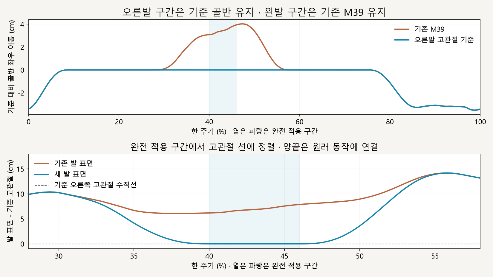

# 오른발 착지 재설정 · 골반 기준 유지

2026-10-16 · M40 · **구현·수치 검사 완료 / 자연스러움 사용자 검토 전** · R02/R16·D03


왼쪽은 기존 M39, 오른쪽은 골반을 발 쪽으로 옮기지 않고 같은 쪽 고관절을 기준으로 오른발 착지를 다시 잡은 결과입니다. 주황·파랑 선은 오른다리·왼다리의 검사용 투시 연결선입니다.

[이전 주소 → 현재 자세 화면](http://127.0.0.1:5173/review/mocap.html?compare=hip-reference) · [M40 계약](../02-requirements/REQUIREMENTS.md#m40--골반-기준-오른발-착지-재설정) · [이전 M39](CMU_PELVIS_SWAY.md)

후속 [M41 발 밀림 점검](CMU_HIP_REFERENCE_SLIP.md)에서 좌우 미끄러짐 증가·앞뒤 미끄러짐 잔존을 확인했습니다. 아래 정렬·연결 검사 통과는 접지 유지 성공을 뜻하지 않습니다.

## 골반을 따라 발을 배치



오른발 구간은 추가 연동 전 골반의 위치·회전을 그대로 사용합니다. 완전 적용 시 발의 낮은 표면이 기준 고관절 선에 맞춰지고, 구간 양끝에서는 원래 동작으로 연결됩니다.

```text
기준 골반 위치·회전 유지
          ↓
같은 쪽 고관절에서 착지 좌우 목표 계산
          ↓
고관절 → 무릎 → 발 동시 연동
          ↓
회수 구간에서 기존 M39로 복귀
```

## 코드

| 파일 | 변경 |
| --- | --- |
| [stance-chain.js](../../experiments/model-preview/review/stance-chain.js) | 별도 `applyHipReference` · 골반/몸 이동을 수정하지 않음 · 발 목표와 무릎 굽힘 평면을 연결하고 두 뼈 길이로 무릎 위치 계산 |
| [landing-width-comparison.js](../../experiments/model-preview/review/landing-width-comparison.js) | 왼쪽 M39 그대로 / 오른쪽 오른발에만 새 방식 · 왼발 지지 구간은 양쪽 모두 M39 |
| [mocap.js](../../experiments/model-preview/review/mocap.js) | 별도 비교 주소·안내 · 정면/측면·남녀·재생/정지·시간 이동 |

골반과 발목 목표를 고정했으므로 무릎 굽힘 크기는 재계산합니다. 오른발 구간의 왼다리는 기준 골반을 따르며, 회수 다리의 관절 상대 회전은 유지합니다.

## 검사 결과

| 남녀 · 후보 730자세 + 독립 기준 730자세 | 결과 |
| --- | --- |
| 오른발 구간 골반 XYZ·회전 | 별도로 연 원래 화면과 동일 · 측정 차이 0 |
| 오른발 구간 왼다리 위치 | 기준 동작과 동일 · <0.000001mm |
| 완전 적용 시 발 표면-기준 고관절 | <0.000073mm · 목표 허용치 0.1mm 이내 |
| 무릎 굽힘 평면 이탈 / 뼈 길이 차이 | <0.000032mm / <0.000035mm |
| 발목 높이·전후 위치 / 발 방향 차이 | <0.000042mm / <0.000024° |
| 원래 동작 대비 무릎 굽힘 변화 | 최대 4.46° · 의도한 재계산 |
| 오른발 지지 표면 | 침범 없음 · 최대 바닥 간격 0.051mm |
| 회수·왼발 지지 구간 / 왼다리 관절 상대 회전 | M39 유지 · <0.000003mm / <0.000001° 차이 |
| 오른발 구간 양끝 | 기존 M39와 위치·회전 연결 · 경계 접근 시 추가 속도 차이 감소 |
| 재탐색·재생·정지·재시작·시점 변경 | 통과 · 브라우저 오류 없음 |
| M39 회귀 730자세 / 타입·빌드 | 통과 · 검토 페이지는 배포 빌드 제외 |

**검증 한계:** 수치는 모델 안의 기하학적 검사이며 실제 사람의 안정성 검증이 아닙니다. 왼발 지지는 기존 방식이고, 오른발도 양끝 연결 구간에는 원래 안쪽 궤적이 일부 남습니다; 회수 자체의 안쪽 이동·수평 미끄러짐·물리 균형은 이번 수정 범위 밖입니다.

## 재현·출처

[검사·캡처](../../experiments/model-preview/scripts/verify-cmu-hip-reference.cjs) · [수치·코드 해시](reports/cmu-hip-reference.json) · [M39 회귀](reports/cmu-pelvis-sway-regression-m40.json) · [그림 원본](../assets/diagrams/cmu-hip-reference-figures.py) · [실제 재생 녹화](../../experiments/model-preview/scripts/capture-cmu-hip-reference.cjs)

```sh
node experiments/model-preview/scripts/verify-cmu-hip-reference.cjs
python docs/assets/diagrams/cmu-hip-reference-figures.py
node experiments/model-preview/scripts/capture-cmu-hip-reference.cjs
```

저장소 루트·Vite 개발 서버·Playwright/Edge·Python Pillow/Matplotlib·맑은 고딕이 필요합니다. 정면/측면 영상은 `outputs/cmu-hip-reference/`에 생성합니다.

출처: [M39 안쪽 착지 유지 문제](CMU_PELVIS_SWAY.md) · 사용자 오른발 고관절 기준 착지 재설정 승인 · CMU 35_17·기존 모델 유지 · 127_06 제외.

[문서 목록](../README.md)
