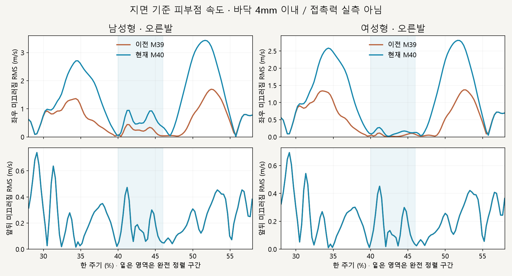
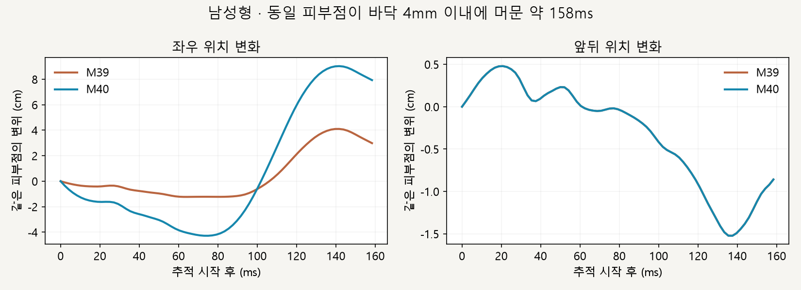

# 오른발 밀림 점검 · 보정 없음

2026-10-16 · M41 · **측정 완료 / 미끄러짐 문제 확인 / 새 보정 미구현** · R02/R16·D03



현재 M40은 고관절 선 정렬을 얻었지만 바닥 가까운 발의 좌우 이동이 더 커졌습니다. 앞뒤 속도는 이전 M39와 거의 같아 두 곡선이 겹칩니다.

| 지지 구간 · 4mm 기준 · RMS 속도 | 이전 M39 → 현재 M40 |
| --- | --- |
| 남성형 좌우 | 0.68 → 1.37m/s |
| 여성형 좌우 | 0.72 → 1.37m/s |
| 남성형 앞뒤 | 0.286 → 0.286m/s |
| 여성형 앞뒤 | 0.296 → 0.296m/s |

## 같은 피부점을 따라가도 이동



남성형의 같은 피부점이 바닥 4mm 이내에 머문 약 158ms 동안, 현재 M40의 시작·끝 좌우 차이는 약 7.93cm였습니다. 이는 해당 점의 한 구간 순변위이며, 전체 발의 실제 접촉 거리나 평균 미끄러짐 거리로 해석하지 않습니다.

## 원인과 다음 검토

```text
현재: 매 프레임 고관절 기준 목표 갱신
                ↓
      바닥 가까이에서도 발을 가로로 이동
                ↓
      정렬은 맞아도 지면 위치는 유지되지 않음

다음 제안: 착지 시 지면 목표 설정 → 짧은 지지 구간 유지 → 이륙 때 해제
```

**코드로 확인:** [applyHipReference](../../experiments/model-preview/review/stance-chain.js)는 매 프레임 목표를 다시 계산하고 원래 앞뒤 위치를 유지합니다. **측정으로 확인:** 좌우 속도는 연결 구간에서 특히 커지고, 앞뒤 미끄러짐도 남습니다; 정렬 가중치만으로 접지를 보장할 수 없습니다.

**다음 작은 작업 제안 / 미구현:** 오른발의 짧은 지지 구간에서 지면 기준 목표를 유지하고 고관절·무릎·발로 풀어봅니다. 골반을 다시 발 쪽으로 옮기지 않으며 발 구름·접촉점 전환은 별도 검토가 필요합니다.

후속 [M42 짧은 오른발 고정](CMU_FOOT_PLANT.md)을 사용자 승인 후 구현했습니다. 고정 중 개선과 해제 밀림 잔존을 구분하며, 위 제안은 당시의 점검 기록입니다.

## 측정 계약·검증 한계

| 항목 | 방법 |
| --- | --- |
| 비교 | CMU 35_17 · 남녀 M39/M40 · 오른발 지지 추정 28～58% |
| 좌표 | 카메라 이동 제외 · 비교 화면의 고정 배치 간격만 제거한 지면 좌표 |
| 피부점 | foot/ball 가중치 합 >0.5 · 같은 정점 ID를 앞뒤 프레임에서 추적 |
| 속도 | 0.25프레임 간격 중앙차분 · 120fps 시간 기준 · 지면 근접 가중 RMS |
| 민감도 | 1/4/8mm 모두 좌우 악화·앞뒤 잔존 경향 동일 |
| 대조 | 몸 수평 이동 + 몸 기준 피부 이동 = 지면 피부 이동 · 분해 등식·샘플·브라우저 오류 검사 통과 |
| 한계 | 지면 근접은 접촉력 측정 아님 · 회전·피부 변형 포함 · 실제 압력 중심/미끄러짐 판정 아님 |
| 변경 범위 | 측정 코드·그림·문서만 추가 · 실행 중 달리기 보정 변경 없음 |

[측정 코드](../../experiments/model-preview/scripts/inspect-cmu-hip-reference-slip.cjs) · [수치·코드 해시](reports/cmu-hip-reference-slip.json) · [그림 생성](../assets/diagrams/cmu-hip-reference-slip-figures.py) · [M40 구현·한계](CMU_HIP_REFERENCE.md)

```sh
node experiments/model-preview/scripts/inspect-cmu-hip-reference-slip.cjs
python docs/assets/diagrams/cmu-hip-reference-slip-figures.py
```

저장소 루트·Vite 개발 서버·Playwright/Edge·Python Pillow/Matplotlib·맑은 고딕이 필요합니다. [이전 주소 → 현재 자세 화면](http://127.0.0.1:5173/review/mocap.html?compare=hip-reference) · 출처: M40/사용자 발 밀림 점검 요청 · 127_06 제외.

[문서 목록](../README.md)
