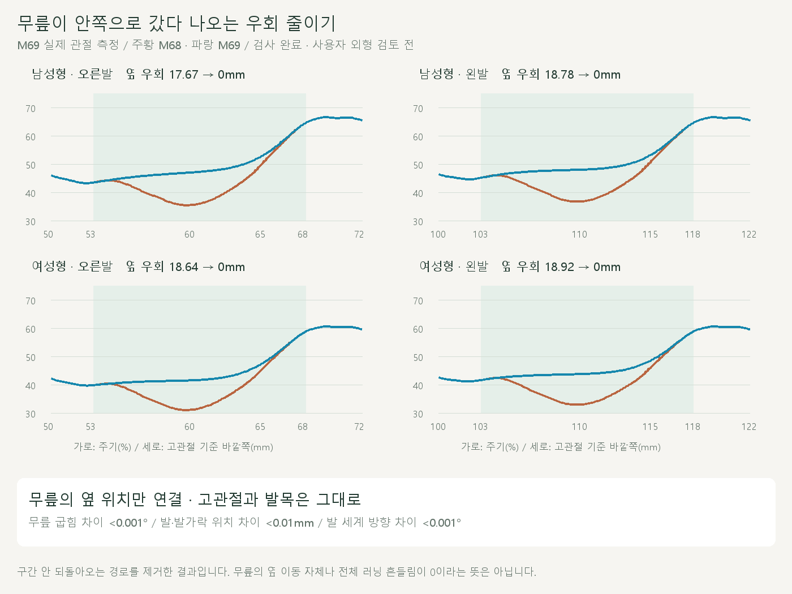
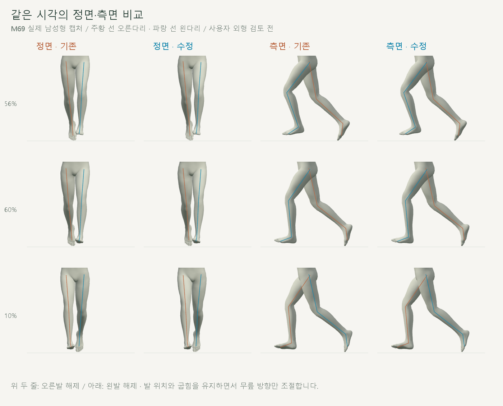
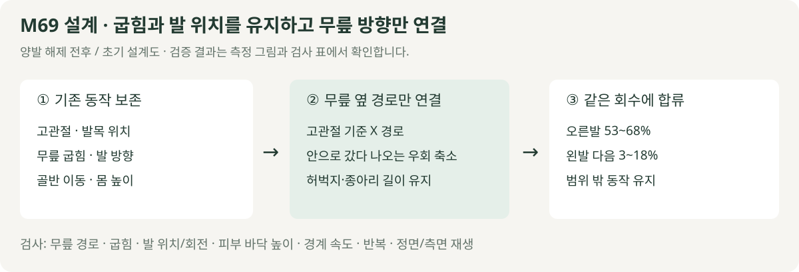

# 발을 뗄 때 무릎 옆 흔들림

> **실험 시점 기록** · 본문의 화면·수치·‘현재/다음’은 해당 M 실험 당시 기준입니다. [2026-10-26 현재 결과물](../01-planning/CURRENT_STATE.md)에서 채택된 기능·후속 보정·남은 한계를 확인하세요. 기존 검사 결과를 새로 통과한 것으로 바꾸지 않았습니다.

2026-10-20 · M69 · **사용자 승인 / 구현·수치·재생 검사 완료 / 외형 검토 전** · R02·R16 / D03 · M68 후속



고관절 기준 무릎이 안쪽으로 들어왔다 되돌아오는 구간을 연결했습니다. M68의 **무릎 굽힘·골반 이동·몸 높이·발 위치와 방향**은 유지합니다.

[이전 주소 → 현재 자세 화면](http://127.0.0.1:5173/review/shared-gait.html?compare=knee-lateral) · [변경 범위·보존 계약](../02-requirements/REQUIREMENTS.md#m69--무릎-옆-흔들림-축소)

## 실제 비교



각 시점에서 왼쪽 M68, 오른쪽 M69입니다. 55%는 이미 안으로 움직이던 시점이므로 **그 직전부터 연결**하며, 연결 끝과 이후 회수는 유지합니다.

## 코드



고관절과 발목을 고정하면 무릎이 움직일 수 있는 원이 정해집니다. 그 원 위에서 목표 옆 위치를 선택하므로 허벅지·종아리 길이와 무릎 굽힘을 유지합니다.

| 코드 | 변경 |
| --- | --- |
| [knee-lateral.js](../../experiments/model-preview/review/knee-lateral.js) · `createKneeLateral` | 고관절 기준 무릎 X를 되돌아오지 않는 곡선으로 연결 / 양 끝 위치·속도·가속도 연결 |
| 같은 파일 · `apply` | 고관절–발목 사이의 무릎 원에서 같은 굽힘 방향의 해 선택 / 도달 불가·방향 불명확 시 오류 |
| [shared-support.js](../../experiments/model-preview/review/shared-support.js) · `solveSupportLeg` | 기존 방향 입력을 재사용 / 이번 변경 없음 |
| [shared-release.js](../../experiments/model-preview/review/shared-release.js) | M68 굽힘 계산 그대로 / 순서가 증가하는 곡선 함수 재사용 |
| [shared-gait-view.js](../../experiments/model-preview/review/shared-gait-view.js) | M68 ↔ M69 비교 추가 / 이전 비교 주소 유지 |

## 검사

| 고관절 기준 옆 우회 길이 | 오른발 | 왼발 |
| --- | --- | --- |
| 남성형 | 17.67 → **0mm** | 18.78 → **0mm** |
| 여성형 | 18.64 → **0mm** | 18.92 → **0mm** |

누적 옆 이동에서 시작–끝의 직선 이동을 뺀 값이며, **옆 이동 자체가 0이라는 뜻은 아닙니다.** 이번 53–68% 구간으로 전후 모두 측정하므로 M68 문서의 55–68% 수치와 측정 범위가 다릅니다.

| 보존·동작 검사 | 결과 |
| --- | --- |
| 남녀 전 주기 / 양발 해제 주변 | 2,002 + 884표본 |
| M68 저장 피부점·무릎 위치·굽힘 | 기존 계산과 일치 |
| 무릎 굽힘 차이 | 최대 <0.000001° / 역행 0° 유지 |
| 골반·몸 높이·상체·뼈 길이 / 범위 밖 회수 | 위치 <0.01mm / 회전 <0.001° |
| 발목·발가락 위치 / 발 세계 방향 | <0.01mm / <0.001° |
| 피부 최저 높이 / 새 바닥 침투 | 변화 <0.01mm / 없음 |
| 경계 위치 속도 / 반복·재탐색·화면 좌표 | <0.00003m/s / 위치 오차 <0.01mm |
| 무릎 옆 최고 속도 | 양발 18–20% 감소 |
| 무릎 위치 변경 / 종아리 대비 발목 상대각 | 최대 11.54mm / 1.48° |
| 재생·모델 전환·반복·단회·정면/측면 | 통과 / 32장·영상 2개 / 브라우저 오류 없음 |

타입 검사와 메인 미리보기 빌드는 통과했습니다. 검토용 JS는 브라우저에서 별도로 검사했습니다.

**한계:** 원 위에서 무릎을 옮기므로 무릎의 높이·앞뒤 위치는 조금 달라집니다. 무릎 전체 3차원 최대 가속도는 약 0.2–0.7% 증가했으며, 이번 옆 우회 개선을 모든 방향의 떨림 제거·정상 러닝 검증으로 확대하지 않습니다.

[전체 JSON](reports/cmu-knee-lateral.json) · [요약](reports/cmu-knee-lateral-summary.json) · [검사 코드](../../experiments/model-preview/scripts/verify-knee-lateral.cjs) · [그림 생성](../assets/diagrams/cmu-knee-lateral.py) · [영상 캡처](../../experiments/model-preview/scripts/capture-knee-lateral.cjs) · [영상 검사](reports/cmu-knee-lateral-media-check.json)

```sh
node experiments/model-preview/scripts/verify-knee-lateral.cjs
node experiments/model-preview/scripts/capture-knee-lateral.cjs
node experiments/model-preview/scripts/check-knee-lateral-media.cjs
python docs/assets/diagrams/cmu-knee-lateral.py
```

실제 장면·영상은 `outputs/cmu-knee-lateral/`에 보관합니다. Node·Playwright·Edge·Three.js·Vite·Python·Pillow·맑은 고딕으로 재현합니다. [M68 이력](CMU_SHARED_RELEASE.md) · [문서 목록](../README.md).
