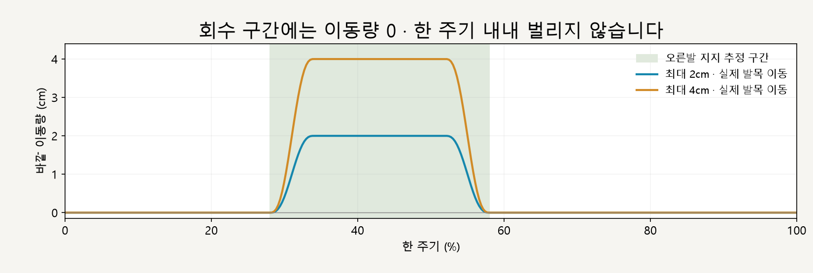
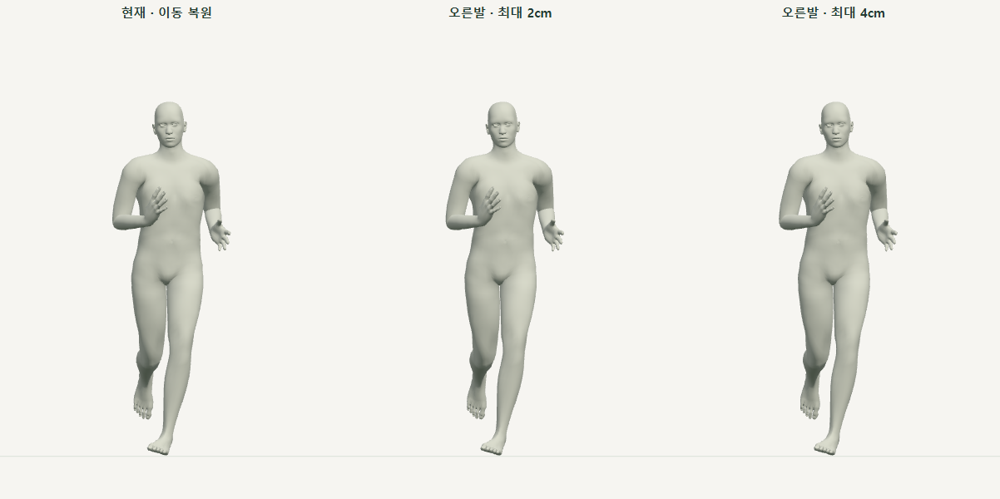

# 오른발 지지 구간 · 안쪽 디딤 비교

> **실험 시점 기록** · 본문의 화면·수치·‘현재/다음’은 해당 M 실험 당시 기준입니다. [2026-10-26 현재 결과물](../01-planning/CURRENT_STATE.md)에서 채택된 기능·후속 보정·남은 한계를 확인하세요. 기존 검사 결과를 새로 통과한 것으로 바꾸지 않았습니다.

2026-10-16 · M33 · **로컬 구현·수치 검사 완료 / 자연스러움 사용자 검토 전** · R02/R16·D03

후속: [M34 양발 비교](CMU_BILATERAL_COMPARISON.md). 아래는 M33 오른발 전용 검사 이력이며, 공용 코드 확장 후 기존 결과는 회귀 검사로 확인했습니다.


왼쪽은 **현재 동작**, 가운데·오른쪽은 오른발 지지 구간에서만 안쪽 디딤을 줄인 실험입니다. 세 모델은 같은 순간·몸 이동·골반 회전·왼다리·상체를 사용합니다.

[이전 주소 → 현재 자세 화면](http://127.0.0.1:5173/review/mocap.html?compare=landing)

| 조작 | 동작 |
| --- | --- |
| 재생 / 일시정지 | 기본 0.5배속 · 한 주기 끝 정지 · 다시 재생 가능 |
| 정면 / 측면 | 세 모델의 같은 순간을 함께 전환 |
| 아래 시간 막대 | 원하는 순간으로 이동 · 반복 탐색해도 보정 누적 없음 |
| 남성형 / 여성형 | 기본 모델별 동일 비교 |

## 회수 구간은 그대로



기존 오른발 지지 추정 구간 안에서 이동량이 부드럽게 늘었다가 0으로 돌아갑니다. 이전 M28처럼 전체 주기에 일정한 바깥 회전을 더하지 않습니다; 정확한 값·범위는 [M33 계약](../02-requirements/REQUIREMENTS.md#m33--오른발-지지-구간-안쪽-디딤-비교)에 둡니다.



77% 시점에서는 세 모델의 오른다리가 동일합니다. 보정 구간 밖의 모든 뼈 위치 차이가 검사 허용치보다 작음을 함께 확인했습니다.

## 코드와 검사

| 변경 코드 | 역할 |
| --- | --- |
| [landing-width.js](../../experiments/model-preview/review/landing-width.js) | 구간별 이동량 → 오른발 목표 → 기존 무릎 굽힘 방향과 다리 길이를 보존하는 두 선분 IK → 발 월드 방향 복원 |
| [landing-width-comparison.js](../../experiments/model-preview/review/landing-width-comparison.js) | 매 순간 현재 자세를 세 모델에 복사한 뒤 실험 적용 · 공통 몸 이동 복원·카메라·정면/측면 |
| [mocap.js](../../experiments/model-preview/review/mocap.js) / [mocap.html](../../experiments/model-preview/history/review-mocap.html.txt) | 별도 비교 주소와 진입 링크 연결 · 기존 기본 동작은 자동 변경하지 않음 |

| 기본 남녀 · 0.25프레임 간격 총 730자세 | 결과 |
| --- | --- |
| 오른발 목표 위치 오차 | 최대 0.000073mm · 도달 범위 제한 발생 0 |
| 골반·상체·왼다리 위치 차이 | <0.000001mm |
| 보정 구간 밖 전체 뼈 위치 차이 | <0.000001mm |
| 발 방향 / 높이·전후 위치 차이 | 최대 0.000024° / 0.000040mm |
| 오른발 지지 시 발 표면 높이 | 바닥 침범 없음 · 최대 간격 0.051mm |
| 시작/종료 경계·반복 탐색 | 경계 주변 추가 위치 차이 <0.001mm · 같은 순간 재탐색 결과 동일 |
| 기존 이동 복원 기준 / UI | 기존 M31 기준 골반 위치 일치 · 재생·일시정지·시간 탐색·시점 전환 통과 |

**한계:** 착지 시점은 추정이고 지지 중 발을 수평으로 고정하는 물리 계산은 아닙니다. 이 실험은 안쪽 디딤 감소의 시각 비교이며, 자연스러움·최적 디딤 폭·달리기 기록 개선을 검증하지 않았습니다.

[검사 코드](../../experiments/model-preview/scripts/verify-cmu-landing.cjs) · [검증 JSON·코드 해시](reports/cmu-landing.json) · [그림 생성](../assets/diagrams/cmu-landing-figures.py) · [실제 재생 영상 녹화 코드](../../experiments/model-preview/scripts/capture-cmu-landing.cjs)

기존 앱의 타입 검사·빌드도 통과했습니다. 이 비교 화면은 개발 서버의 별도 검토 페이지이며 기존 앱 배포 빌드에 포함되지는 않습니다.

```sh
node experiments/model-preview/scripts/verify-cmu-landing.cjs
python docs/assets/diagrams/cmu-landing-figures.py
node experiments/model-preview/scripts/capture-cmu-landing.cjs
```

저장소 루트·실행 중인 Vite·Playwright/Edge·Python Pillow/Matplotlib·맑은 고딕이 필요합니다. 영상은 브라우저 캔버스를 MediaRecorder로 녹화하여 `outputs/cmu-landing/`에 생성합니다.

출처: [M32 기준점·안쪽 디딤 분석](CMU_HIP_CENTER_VALIDATION.md) · [M30 원본 검증](CMU_SOURCE_VALIDATION.md) · 사용자 오른발 지지 구간 비교 승인. 모델·원본 파일은 수정하지 않았습니다.

[문서 목록](../README.md)
