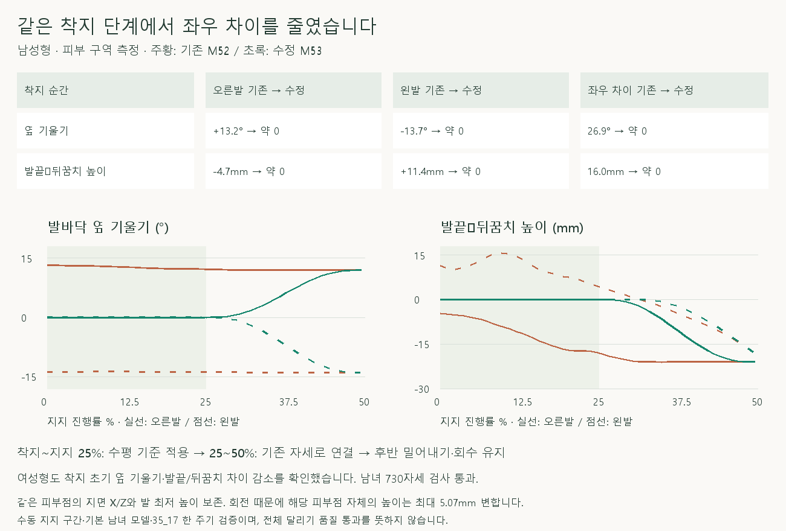
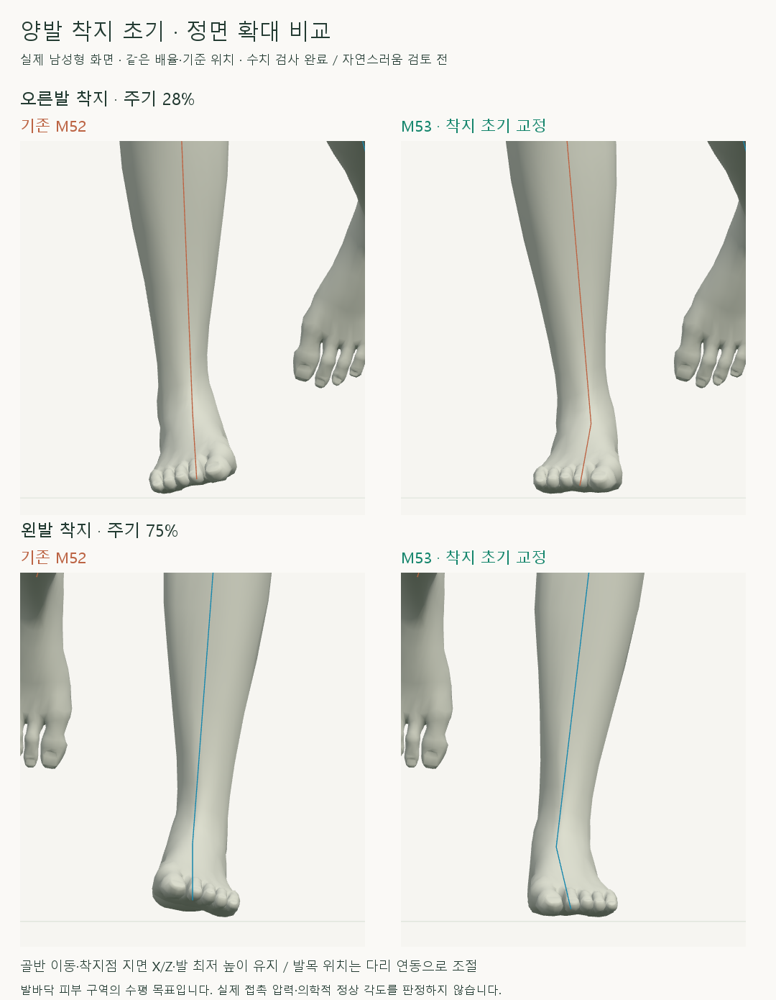
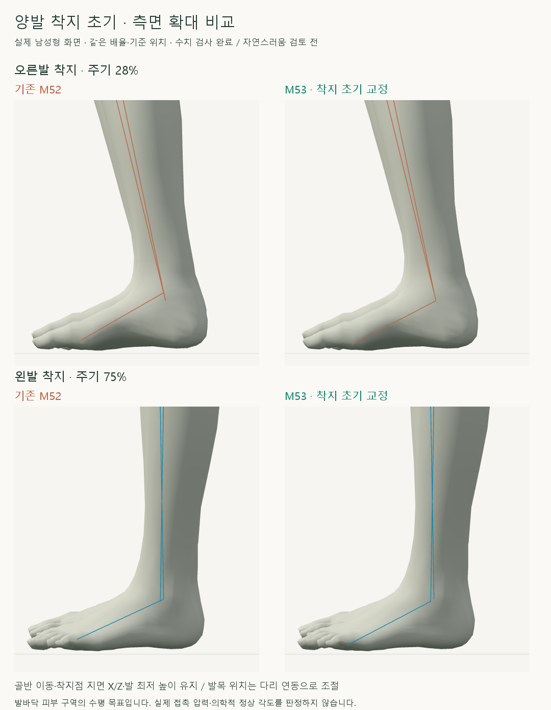

# 양발 착지 초기의 발바닥 기울기 비교

> **실험 시점 기록** · 본문의 화면·수치·‘현재/다음’은 해당 M 실험 당시 기준입니다. [2026-10-26 현재 결과물](../01-planning/CURRENT_STATE.md)에서 채택된 기능·후속 보정·남은 한계를 확인하세요. 기존 검사 결과를 새로 통과한 것으로 바꾸지 않았습니다.

2026-10-16 · M53 · **구현·수치 검사 완료 / 자연스러움 사용자 검토 전** · R02/R16·D03 · M52 후속



기존 보정은 발의 착지 기준 기울기를 유지했기 때문에, M52에서 골반 위치를 복원한 뒤에도 발바닥 옆 기울기와 발끝 높이 차이가 남았습니다. M53은 양발 착지 초기의 피부 기준축을 수평으로 맞추고 지지 중간까지 기존 동작으로 연결합니다.

[이전 주소 → 현재 자세 화면](http://127.0.0.1:5173/review/mocap.html?compare=landing-sole-alignment) · [정면 녹화](../../outputs/cmu-landing-sole-alignment/front.webm) · [측면 녹화](../../outputs/cmu-landing-sole-alignment/side.webm) · [확정 범위·검수 계약](../02-requirements/REQUIREMENTS.md#m53--양발-착지-초기의-발바닥-기울기)

## 실제 양발 확대



기존 모델과 수정 모델을 같은 배율·기준 위치로 촬영했습니다. 발 정면 방향과 무릎의 좌우 위치는 유지하고, 발목 위치는 고관절–무릎 연동으로 조절합니다.



발끝−뒤꿈치의 평균 높이 차이를 착지 초기에 줄였습니다. 수평 목표는 이번 비교의 기하학적 기준이며 최적 착지 방식이나 의학적 정상 각도를 의미하지 않습니다.


왼쪽 M52 / 오른쪽 M53입니다. 골반 궤적·회전은 M52 그대로이며, 지지 후반의 밀어내기와 회수 동작은 기존 동작입니다.

## 코드·결과

| 코드 | 역할 |
| --- | --- |
| [landing-sole-alignment.js](../../experiments/model-preview/review/landing-sole-alignment.js) · `selectSoleRegions` / `bindSoleReader` | 중립 자세의 발 최저점+12mm 피부에서 앞뒤/좌우 20% 구역 선택 → 같은 정점의 평균으로 발바닥 기준축 측정 |
| `soleAlignmentWeight` | 양발 같은 지지 진행률 적용 · 진입/복귀의 5차 연결 |
| `applyLandingSoleAlignment` | 발 방향을 보존한 수평 목표 → 발·발끝 동시 회전 → 피부 지점 X/Z·최저 높이·무릎 X를 유지하도록 다리 IK |
| [landing-width-comparison.js](../../experiments/model-preview/review/landing-width-comparison.js) | 두 칸 모두 M52 적용 → 오른쪽만 양발 초기 기울기 교정 · 목표 준비 중 미적용 |
| [mocap.js](../../experiments/model-preview/review/mocap.js) | 중립 피부 구역 구성·전용 비교 화면·남녀 전환 |

| 착지 순간 · 기존 → 수정 | 남성형 오른발 | 남성형 왼발 | 여성형 오른발 | 여성형 왼발 |
| --- | --- | --- | --- | --- |
| 발바닥 옆 기울기 | +13.16° → 약 0° | −13.75° → 약 0° | +10.99° → 약 0° | −12.08° → 약 0° |
| 발끝−뒤꿈치 평균 높이 | −4.69mm → 약 0mm | +11.35mm → 약 0mm | −1.32mm → 약 0mm | +10.43mm → 약 0mm |

종아리 대비 발의 상대 회전 변화도 함께 측정했습니다. 최대 남성형 **17.41°**, 여성형 **15.04°**이며, 이는 두 쿼터니언 사이의 총 변화각이지 임상적 발목 관절각이 아닙니다.

| 검사 · 남녀 730자세 + 양발 같은 지지 단계 32자세 + 경계/재탐색 표본 | 최댓값 / 결과 |
| --- | --- |
| M52 보관 기록 재현 | 위치 <0.000007mm / 회전 <0.000005° |
| 골반 위치·회전 / 범위 밖 동작 | 위치 <0.000007mm / 회전 <0.000005° |
| 기존 피부 지점 X/Z / 발 최저 높이 차이 | <0.000008mm / <0.000005mm |
| 목표 유지 구간의 옆/앞뒤 기울기 / 발끝−뒤꿈치 높이 차이 | <0.000001° / <0.000001mm |
| 발 방향 변화 / 무릎 X 변화 | <0.000005° / <0.000005mm |
| 뼈 길이 변화 / 다리 도달 여유 최솟값 | <0.000053mm / 14.09mm · 도달 실패·무릎 제약 잘림 없음 |
| 연결 경계 · 0.01% 간격 위치 2차 차분 / 회전 증분 차이 | <0.0041mm / <0.0019° |
| 재탐색·정면/측면 / 브라우저 오류 | 위치 차이 <0.000002mm / 없음 |
| 타입 검사·앱 빌드 | 통과 · 검토 페이지는 배포 빌드 제외, 실제 브라우저 별도 검사 |

**보존의 한계:** 같은 피부점의 지면 X/Z와 발 최저 높이를 보존합니다. 발 회전에 따라 그 피부점 자체의 높이는 남성형 최대 **3.21mm**, 여성형 **5.07mm** 변하며, 모든 발바닥 점의 완전 접지를 뜻하지 않습니다.

**남은 검토:** 기본 남녀·35_17 한 주기의 착지 초기만 검증했습니다. 수동 지지 시점의 정확도·발목 피부 접힘 전체·지지 후반의 좌우 차이·다른 체형·물리적 균형·전체 자연스러움은 검증 전입니다.

## 재현·출처

[수정 전 관찰](../../experiments/model-preview/scripts/inspect-cmu-landing-tilt.cjs) · [수정 전 JSON](reports/cmu-landing-tilt-before.json) · [독립 피부 관찰 함수](../../experiments/model-preview/scripts/measure-landing-sole.cjs) · [검사 코드](../../experiments/model-preview/scripts/verify-cmu-landing-sole-alignment.cjs) · [검증 JSON](reports/cmu-landing-sole-alignment.json) · [확대 촬영](../../experiments/model-preview/scripts/capture-cmu-landing-sole-close.cjs) · [녹화](../../experiments/model-preview/scripts/capture-cmu-landing-sole-alignment.cjs) · [그림 생성 원본](../assets/diagrams/cmu-landing-sole-alignment-figures.py)

```sh
node experiments/model-preview/scripts/inspect-cmu-landing-tilt.cjs
node experiments/model-preview/scripts/verify-cmu-landing-sole-alignment.cjs
node experiments/model-preview/scripts/capture-cmu-landing-sole-close.cjs
node experiments/model-preview/scripts/capture-cmu-landing-sole-alignment.cjs
python docs/assets/diagrams/cmu-landing-sole-alignment-figures.py
```

저장소 루트·Vite 서버·Playwright/Edge·Python/Pillow·맑은 고딕 필요. 원본 캡처·영상: `outputs/cmu-landing-sole-alignment/`; 출처: 사용자 요청·M51 피부 구역 보관 기록·M52 골반 복원·CMU 35_17. 127_06 제외.

[M52 골반 기준 복원](CMU_PELVIS_REFERENCE_RESTORE.md) · [문서 목록](../README.md)
