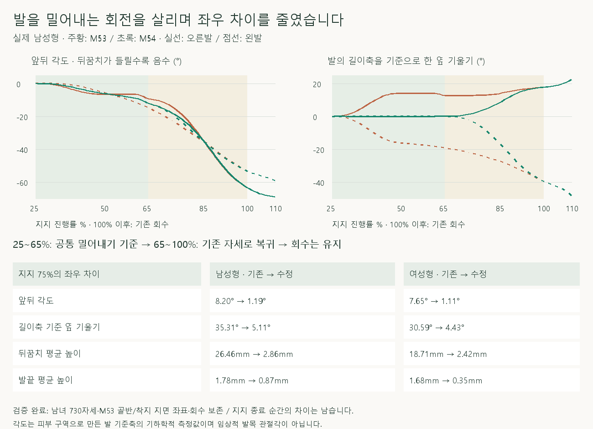
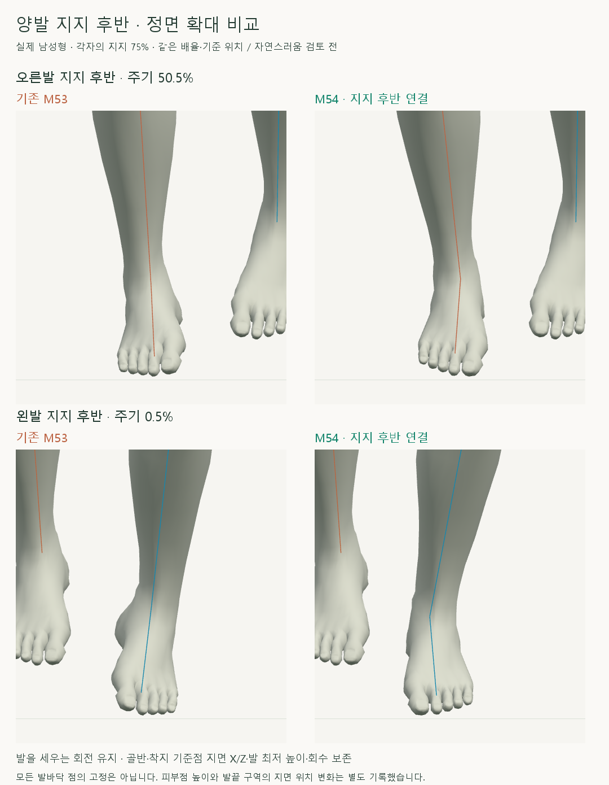
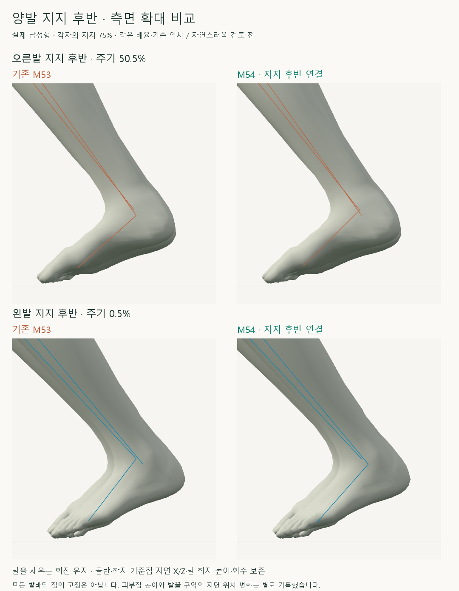

# 양발 지지 후반의 발목·발끝 비교

2026-10-16 · M54 · **구현·수치 검사 완료 / 자연스러움 사용자 검토 전** · R02/R16·D03 · M53 후속



M53의 초기 보정 이후 기존 기울기가 다시 나타나고, 양발의 뒤꿈치가 들리는 회전 속도도 달랐습니다. 같은 지지 진행률의 M53 양발 앞뒤 회전 평균을 사용해 초기 정렬을 후반으로 연결했습니다.

[이전 주소 → 현재 자세 화면](http://127.0.0.1:5173/review/mocap.html?compare=late-stance-sole) · [정면 녹화 · 0.5배속](../../outputs/cmu-late-stance-sole/front.webm) · [측면 녹화 · 0.5배속](../../outputs/cmu-late-stance-sole/side.webm) · [확정 범위·검수 계약](../02-requirements/REQUIREMENTS.md#m54--양발-지지-후반의-발목과-발끝)

## 양발 정면·측면



지지 75%에서 발의 길이축을 기준으로 한 옆 기울기 차이는 남성형 35.31°→5.11°, 여성형 30.59°→4.43°로 줄었습니다. 이 값은 발바닥 피부로 만든 축의 회전이며 종아리 대비 임상적 발목 각도가 아닙니다.



후반의 큰 차이는 발끝보다 뒤꿈치 평균 높이에서 나타났습니다. 같은 지지 75%에서 남성형 26.46→2.86mm, 여성형 18.71→2.42mm로 줄였으며 발을 세워 밀어내는 회전은 유지했습니다.


각 칸 왼쪽 M53 / 오른쪽 M54입니다. 회수 시작 자세를 보존하도록 지지 종료 전 기존 동작으로 복귀하므로 종료 순간의 기존 좌우 차이는 남습니다.

## 코드·결과

| 코드 | 역할 |
| --- | --- |
| [late-stance-sole.js](../../experiments/model-preview/review/late-stance-sole.js) · `createLateStanceReference` | M53 양발을 같은 지지 진행률로 관찰 → 앞뒤 회전 평균 → 96구간의 5차 곡선으로 연결 |
| `soleAngles` / `applyLateStanceSole` | 발을 세운 상태에서도 앞뒤 회전과 길이축 옆 기울기를 분리 → 정면 방향 유지 → 발·발끝 회전 + 착지 기준점/높이/무릎 X를 보존하는 다리 IK |
| `lateStanceWeight` | 초기 정렬을 후반에 연결 → 지지 65%부터 보정 해제 → 100%에서 기존 회수로 복귀 |
| [landing-width-comparison.js](../../experiments/model-preview/review/landing-width-comparison.js) | 두 칸에 M53 재현 → 수정안을 끈 상태로 공통 기준 생성 → 오른쪽 칸에만 M54 적용 |
| [mocap.js](../../experiments/model-preview/review/mocap.js) | 전용 비교 화면·남녀 모델 교체 시 기준 재구성 |

| 같은 지지 75%의 좌우 차이 · 기존 → 수정 | 남성형 | 여성형 |
| --- | --- | --- |
| 앞뒤 회전 | 8.20° → 1.19° | 7.65° → 1.11° |
| 발끝−뒤꿈치 평균 높이 차이 | 24.68mm → 3.73mm | 17.03mm → 2.76mm |
| 발끝 평균 높이 | 1.78mm → 0.87mm | 1.68mm → 0.35mm |

종아리 대비 발의 상대 회전 변화도 측정했습니다. 최대 남성형 **22.50°**, 여성형 **19.50°**로, 두 자세의 총 회전 차이이며 정상 관절 범위 판정은 아닙니다.

| 검사 · 남녀 730자세 + 같은 지지 단계 36자세 + 경계/재탐색 표본 | 결과 |
| --- | --- |
| M53 보관 기록 재현 / 골반·범위 밖 관절·회수 보존 | 위치 <0.01mm / 회전 <0.001° |
| 착지 기준점 지면 X/Z·발 최저 높이 / 무릎 X·뼈 길이 | 차이 <0.01mm · 도달 실패/무릎 제약 잘림 없음 |
| 다리 도달 여유 최솟값 | 남성형 20.54mm / 여성형 18.98mm |
| 정면 방향 변화 / 목표 앞뒤·옆 기울기 오차 | <0.001° |
| 공통 곡선과 독립 피부 관찰 평균 차이 | <0.02° |
| 연결 경계 · 0.01% 간격 위치 2차 차분 / 회전 증분 차이 | <0.009mm / <0.0027° |
| 주기 양끝 추가 보정·재탐색·정면/측면 | 위치 차이 <0.01mm |
| 표본 간 발 최대 회전 속도 · 기존 → 수정 | 남성형 1180→1195°/s / 여성형 1180→1186°/s · 소폭 상승 |
| 브라우저 오류 / 타입 검사·앱 빌드 | 없음 / 통과 · 검토 페이지는 배포 빌드 제외, 실제 브라우저 별도 검사 |

**보존의 한계:** 기존 착지 기준점의 지면 좌표와 발 최저 높이는 유지하지만, 그 피부점 자체의 높이는 남성형 최대 **15.09mm**, 여성형 **12.80mm** 달라집니다. 회전하는 발끝 구역 평균의 지면 위치도 각각 최대 **6.76mm / 3.78mm** 변하므로, 발바닥 전체 고정이나 실제 지지점의 무미끄럼 검증으로 해석하면 안 됩니다.

**남은 검토:** 지지 종료·회수의 기존 좌우 차이, 발바닥 전체 접지와 피부 접힘, 물리적 균형, 다른 체형, 전체 자연스러움은 미검증입니다. 기본 남녀·수동 지지 구간·35_17 한 주기의 로컬 비교입니다.

## 재현·출처

[수정 전 관찰](../../experiments/model-preview/scripts/inspect-cmu-late-stance.cjs) · [수정 전 JSON](reports/cmu-late-stance-before.json) · [독립 피부 관찰](../../experiments/model-preview/scripts/measure-landing-sole.cjs) · [검사 코드](../../experiments/model-preview/scripts/verify-cmu-late-stance-sole.cjs) · [검증 JSON](reports/cmu-late-stance-sole.json) · [확대 촬영](../../experiments/model-preview/scripts/capture-cmu-late-stance-close.cjs) · [녹화](../../experiments/model-preview/scripts/capture-cmu-late-stance-sole.cjs) · [그림 생성 원본](../assets/diagrams/cmu-late-stance-sole-figures.py)

```sh
node experiments/model-preview/scripts/inspect-cmu-late-stance.cjs
node experiments/model-preview/scripts/verify-cmu-late-stance-sole.cjs
node experiments/model-preview/scripts/capture-cmu-late-stance-close.cjs
node experiments/model-preview/scripts/capture-cmu-late-stance-sole.cjs
python docs/assets/diagrams/cmu-late-stance-sole-figures.py
```

저장소 루트·Vite 서버·Playwright/Edge·Python/Pillow·맑은 고딕 필요. 원본 캡처·영상: `outputs/cmu-late-stance-sole/`; 출처: 사용자 요청·M51 피부 구역·M53 결과·CMU 35_17. 127_06 제외.

[M53 착지 초기 교정](CMU_LANDING_SOLE_ALIGNMENT.md) · [문서 목록](../README.md)
