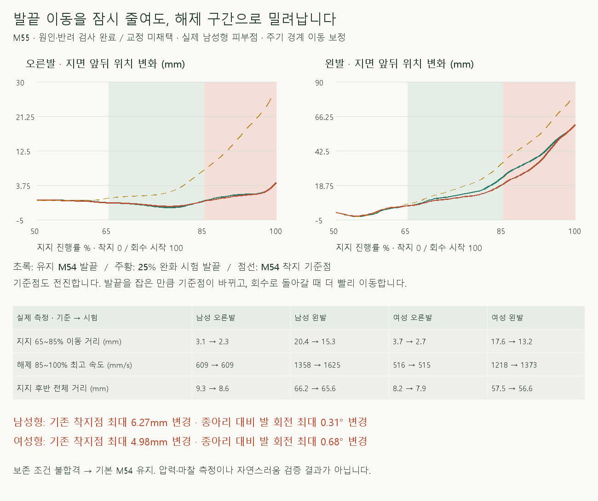
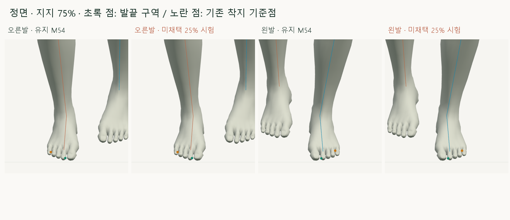
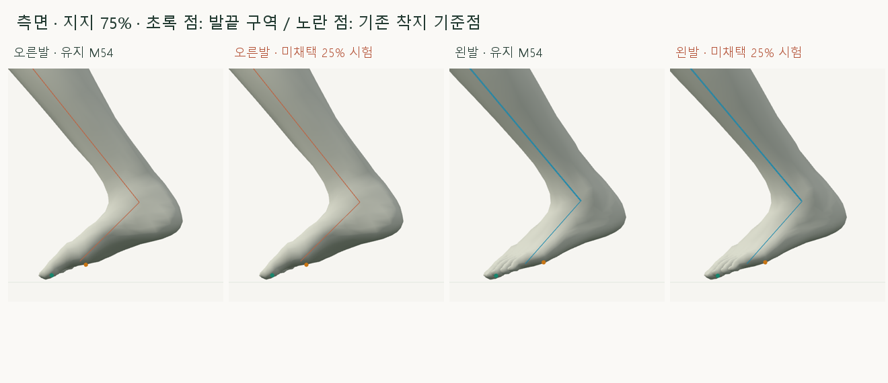
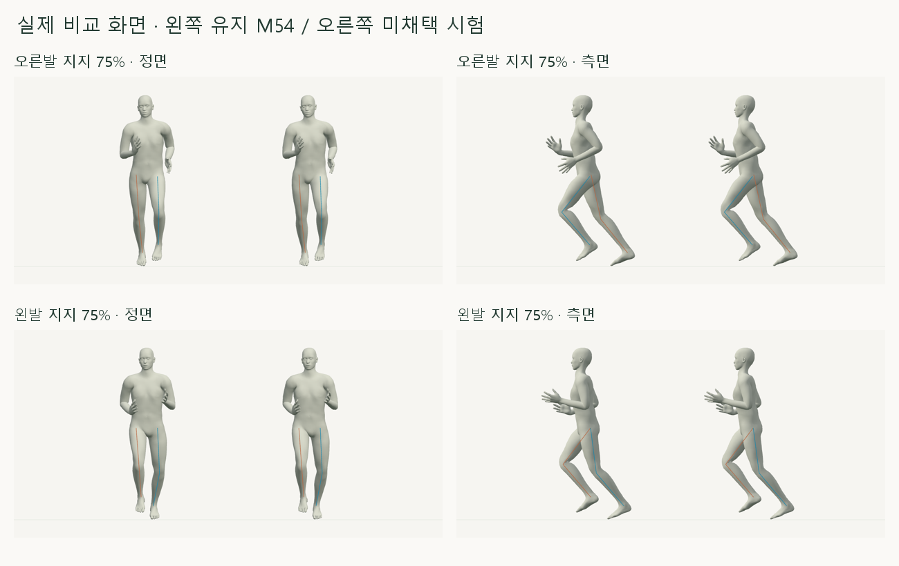

# 지지 후반 발끝 미끄러짐 — 보존 조건 점검

> **실험 시점 기록** · 본문의 화면·수치·‘현재/다음’은 해당 M 실험 당시 기준입니다. [2026-10-26 현재 결과물](../01-planning/CURRENT_STATE.md)에서 채택된 기능·후속 보정·남은 한계를 확인하세요. 기존 검사 결과를 새로 통과한 것으로 바꾸지 않았습니다.

2026-10-20 · M55 · **원인·반려 검사 / 교정 후보 미채택 · M54 유지** · R02/R16·D03



M54에서 고정한 것은 이전 단계의 **매 프레임 착지 기준점 좌표**였으며, 그 기준점 자체는 지지 후반에 전진하고 들립니다. 지난 보고의 6.76mm는 M53↔M54 위치 차이이고, 이번 그래프는 같은 피부점의 시간에 따른 지면 이동입니다.

[이전 주소 → 현재 자세 화면](http://127.0.0.1:5173/review/mocap.html?compare=late-toe-slip-trial) · [정면 녹화](../../outputs/cmu-late-toe-slip/front.webm) · [측면 녹화](../../outputs/cmu-late-toe-slip/side.webm) · [범위·보존 조건](../02-requirements/REQUIREMENTS.md#m55--지지-후반-발끝-미끄러짐)

## 발끝만 붙잡는 후보를 채택하지 않은 이유



초록 점은 중립 자세에서 선택한 발끝 피부 구역의 평균, 노란 점은 기존 착지 피부 구역의 가중 평균입니다. 압력 중심·매 순간 최저점으로 다시 선택하지 않습니다.



25% 완화 시험은 발 기울기와 높이를 유지하려고 다리를 함께 옮깁니다. 그 결과 기존 착지 기준점과 종아리 대비 발 회전이 달라지므로 요청된 보존 조건을 모두 만족하지 않습니다.



왼쪽은 유지 M54, 오른쪽은 **미채택 시험**입니다. 지지 65~85%의 이동은 줄지만, 원래 회수 자세로 돌아가는 85~100%에 이동이 몰립니다.

## 수치 결과

| 지지 후반 50~100% · 기준 → 시험 | 남성형 | 여성형 |
| --- | --- | --- |
| 오른발 발끝 지면 이동 거리 | 9.32 → 8.62mm | 8.19 → 7.89mm |
| 왼발 발끝 지면 이동 거리 | 66.20 → 65.62mm | 57.46 → 56.65mm |
| 왼발 해제 구간 최고 이동 속도 | 1358 → 1625mm/s | 1218 → 1373mm/s |
| 기존 착지 기준점의 최대 위치 변경 | **6.27mm · 보존 불합격** | **4.98mm · 보존 불합격** |
| 종아리 대비 발의 회전 변경 | 최대 0.31° | 최대 0.68° |

양발 모두 지지 65~85% 이동은 25% 줄었지만 왼발 후반 전체 감소는 1% 안팎입니다. 기준·회수 양 끝 위치를 그대로 유지하면 전체 이동 거리의 하한도 그대로여서, 중간 고정만으로 해결되지 않습니다.

## 코드와 검사

| 코드 | 역할 |
| --- | --- |
| [late-toe-slip-trial.js](../../experiments/model-preview/review/late-toe-slip-trial.js) | M54 발끝 위치와 지지 65%의 기준 사이를 25%만 보간 → 발·발끝 세계 회전/높이를 유지하는 다리 IK → 회수 전에 해제 · 진단 전용 |
| [landing-width-comparison.js](../../experiments/model-preview/review/landing-width-comparison.js) | 양쪽 M54 재현 → 독립 비교 모드의 오른쪽에만 시험 · 초기 착지와 회수는 M54 유지 |
| [landing-sole-alignment.js](../../experiments/model-preview/review/landing-sole-alignment.js) | 기존 계산에서 이미 읽던 피부 구역 좌표 공개 · 기존 회전 계산 변경 없음 |
| [검사 코드](../../experiments/model-preview/scripts/verify-cmu-late-toe-slip.cjs) | M54 보관 기록과 독립 피부 관찰 대조 · 전 주기/동일 지지율/경계/정면·측면/재탐색 · 반려 조건 검사 |
| [발끝 관절 단독 검사](../../experiments/model-preview/scripts/inspect-late-toe-joint.cjs) | 다른 뼈 고정 후 발끝 관절의 세 방향 미소 회전 → 기존 기준점 X/Z·발끝 높이·발바닥 앞뒤/옆 기울기 변화 측정 |

검증 JSON의 `status: rejected-trial`은 **진단 검사를 통과했다는 뜻이며, 교정의 합격이 아닙니다**. 남녀 730자세와 지지 후반 404자세를 비교하며, 별도 16표본의 발끝 관절 단독 민감도 검사도 기록합니다.

| 유지 조건 | 판정 |
| --- | --- |
| M54 원본 재현·골반·회수·범위 밖 관절 | 위치 <0.01mm / 회전 <0.001° · [검증 JSON](reports/cmu-late-toe-slip.json) |
| 발·발끝 세계 회전·피부 높이·다리 길이 | 회전 <0.001° / 위치 <0.01mm · 도달 실패 없음 |
| 기존 착지 기준점의 매 프레임 지면 좌표 | **불합격 — 시험 후보 미채택** |
| 종아리 대비 발의 상대 회전 | **변경 발생** · 발바닥 자체의 기울기 보존과 다름 |
| 해제 시 이동 속도·전체 미끄러짐 | 짧은 구간의 감소를 전체 해결로 표시하지 않음 |

타입 검사·앱 빌드 통과, 브라우저 오류 없음. 검토 페이지는 앱 배포 빌드 밖에 있어 실제 브라우저로 별도 검사했습니다.

발끝 관절 단독 검사의 보존 조건 행렬은 16표본 모두 세 회전 방향을 제한합니다. 이는 **현재 리그·현재 자세 주변의 작은 회전 검사**이며, 모든 리깅·스키닝 방법으로 교정이 불가능하다는 증명은 아닙니다.

## 다음 검토

**사용자 확정:** 착지 순간의 위치는 유지하고 이후 이동은 교정합니다. [후속 M56](CMU_TOE_SLIP_PATH.md)에서 적용하며, M55의 해제 속도 증가 때문에 이 시험은 여전히 미채택입니다.

바닥 접촉 여부는 수동 지지 구간에 따른 기하학적 관찰입니다. 실제 압력·마찰·완전 접지·다른 체형의 자연스러움은 미검증이며, 127_06은 사용하지 않습니다.

## 재현·출처

[수치 JSON](reports/cmu-late-toe-slip.json) · [발끝 단독 민감도 JSON](reports/cmu-late-toe-joint.json) · [확대 촬영](../../experiments/model-preview/scripts/capture-cmu-late-toe-slip-close.cjs) · [녹화](../../experiments/model-preview/scripts/capture-cmu-late-toe-slip.cjs) · [그림·민감도 분석 원본](../assets/diagrams/cmu-late-toe-slip-figures.py)

```sh
node experiments/model-preview/scripts/verify-cmu-late-toe-slip.cjs
node experiments/model-preview/scripts/inspect-late-toe-joint.cjs
node experiments/model-preview/scripts/capture-cmu-late-toe-slip-close.cjs
node experiments/model-preview/scripts/capture-cmu-late-toe-slip.cjs
python docs/assets/diagrams/cmu-late-toe-slip-figures.py
```

저장소 루트·Vite 서버·Node 20 이상·Playwright/Edge·Python/Pillow/NumPy·맑은 고딕 필요. 원본 캡처·영상 `outputs/cmu-late-toe-slip/`; 사용자 요청·M51 피부 구역·M54 기록·CMU 35_17을 사용했습니다.

[M54 비교](CMU_LATE_STANCE_SOLE.md) · [문서 목록](../README.md)
