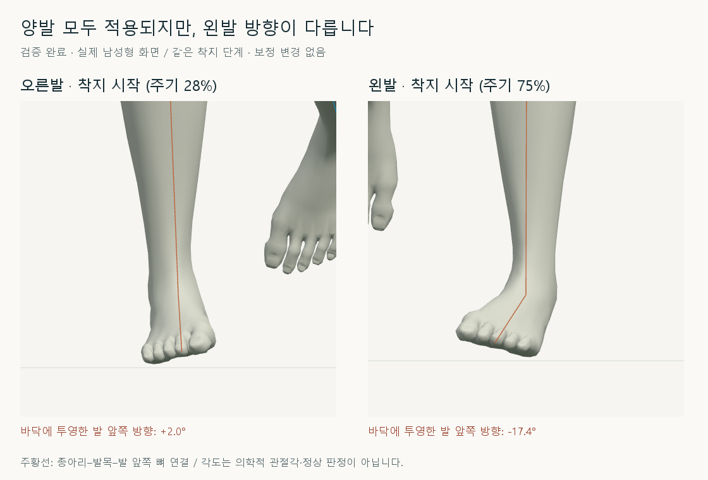
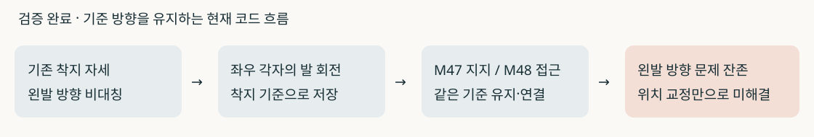
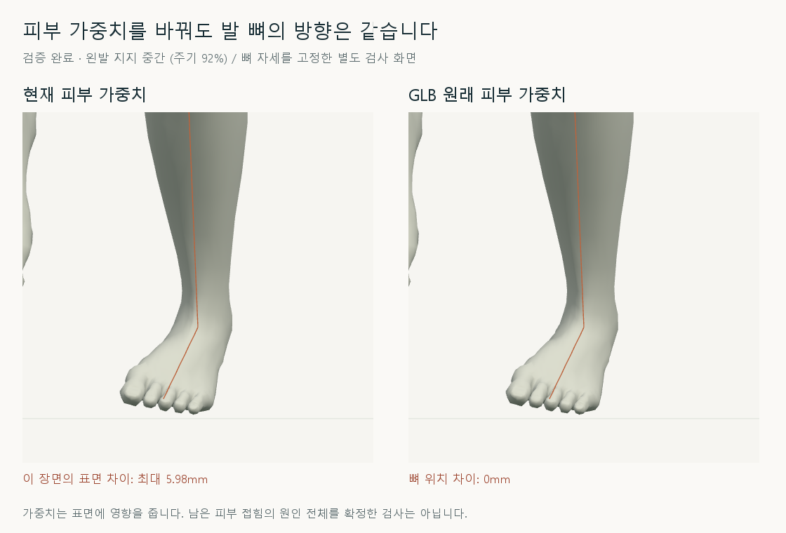

# 왼발 발목 방향 점검

2026-10-16 · M49 · **점검 완료 / 추가 보정 없음** · R02/R16·D03 · M48 후속



양발 모두 M47 접지·M48 접근 처리가 적용됩니다. 왼발은 기존 착지 기준 방향의 비대칭을 유지하며, 접근 경로 수정만으로 이 방향을 바로잡지는 못했습니다.

## 확인한 원인과 범위



**검증 완료:** 기준 방향을 보존하는 코드 경로와 좌우 비대칭을 확인했습니다. **미검증:** 비대칭이 처음 생긴 원본 동작·모델 전달·기본 관절축 중 어느 단계가 근본 원인인지는 아직 분리하지 않았습니다.

| 착지 시작 · 발 앞쪽의 바닥 투영 방향 | 오른발 | 왼발 |
| --- | --- | --- |
| 남성형 | +2.04° | −17.36° |
| 여성형 | +0.11° | −15.52° |

모델 기본 자세의 발목→발 앞쪽 축을 현재 발 회전으로 옮겨 `atan2(x, z)`로 측정했습니다. 정상 범위나 의학적 발목 관절각이 아니며, 오른발이 정상이라고 판정하지 않습니다.

## 피부와 뼈 분리



별도 검사 창에서 뼈를 정지하고 현재/원래 가중치만 전환했습니다. 왼발 방향은 그대로이며, 남성형 왼발 표면은 착지 시작 최대 2.35mm·지지 중간 최대 5.98mm 달라집니다.

| 검사 | 결과 / 한계 |
| --- | --- |
| 양발 적용 | 남녀 모두 좌우 계획·처리 확인; 화면 오른쪽 **모델의 양발**이 M48 |
| 같은 동작 단계 비교 | 남녀 × 양발 × 6단계 × M47/M48 = 48자세 기록 |
| 지지 구간 발 방향 | M47/M48 동일 · 기존 방향 비대칭 잔존 |
| 접근 구간 발 기울기 | M48이 기존 기준 방향으로 연결하며 약 2° 차이도 발생; 전 구간 동일하지 않음 |
| 피부 가중치 분리 | 남녀 × 양발 × 2단계; 뼈 위치 차이 0mm · 피부 접힘 원인 전체는 미확정 |
| 동작 코드 변경 / 브라우저 오류 | 없음 · M48 기록과 5개 실행 파일 해시 일치 / 없음 |

기존 M48의 위치 검사 통과는 발목 방향 검증 완료를 뜻하지 않습니다. 이번에는 기본 남녀·35_17만 검사했으며 사용자 화면의 보정 설정은 변경하지 않았습니다.

## 코드 · 다음 검토안

| 코드 | 확인 내용 |
| --- | --- |
| [stance-contact.js](../../experiments/model-preview/review/stance-contact.js) · `contactRotation` | 착지 기준 대비 world-X 회전만 남김; 기준 자체의 비대칭은 교정하지 않음 |
| [landing-width-comparison.js](../../experiments/model-preview/review/landing-width-comparison.js) | 오른발 28%·왼발 75%의 기존 발 회전을 각각 저장 |
| [swing-approach.js](../../experiments/model-preview/review/swing-approach.js) | 양발 접근을 각자의 기준 발 방향으로 연결 |

**설계 제안 / 미구현:** 왼발의 종아리 대비 발 방향과 발바닥 기준을 먼저 분리해 교정 목표를 정합니다. 다음 작은 교정에서는 착지 위치·미끄러짐·회수 연결을 함께 재검사합니다.

## 재현·출처

[방향 검사 코드](../../experiments/model-preview/scripts/inspect-cmu-left-ankle.cjs) · [방향 JSON](reports/cmu-left-ankle-audit.json) · [피부 검사·촬영 코드](../../experiments/model-preview/scripts/inspect-cmu-left-ankle-skin.cjs) · [피부 JSON](reports/cmu-left-ankle-skin-audit.json) · [그림 생성 원본](../assets/diagrams/cmu-left-ankle-audit-figures.py)

```sh
node experiments/model-preview/scripts/inspect-cmu-left-ankle.cjs
node experiments/model-preview/scripts/inspect-cmu-left-ankle-skin.cjs
python docs/assets/diagrams/cmu-left-ankle-audit-figures.py
```

저장소 루트·Vite 서버·Playwright/Edge·Python/Pillow·맑은 고딕이 필요합니다. 원본 캡처: `outputs/cmu-left-ankle-audit/`; 출처: 사용자 왼발 꺾임 지적·M47/M48·CMU 35_17. 127_06 제외.

[M48 기록](CMU_SWING_APPROACH.md) · [문서 목록](../README.md)
