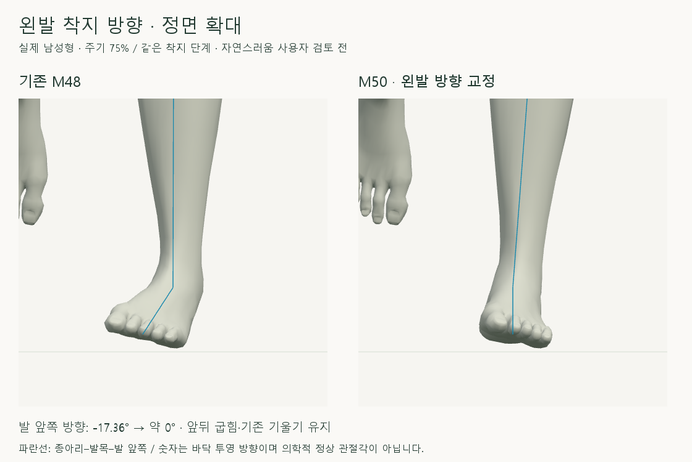
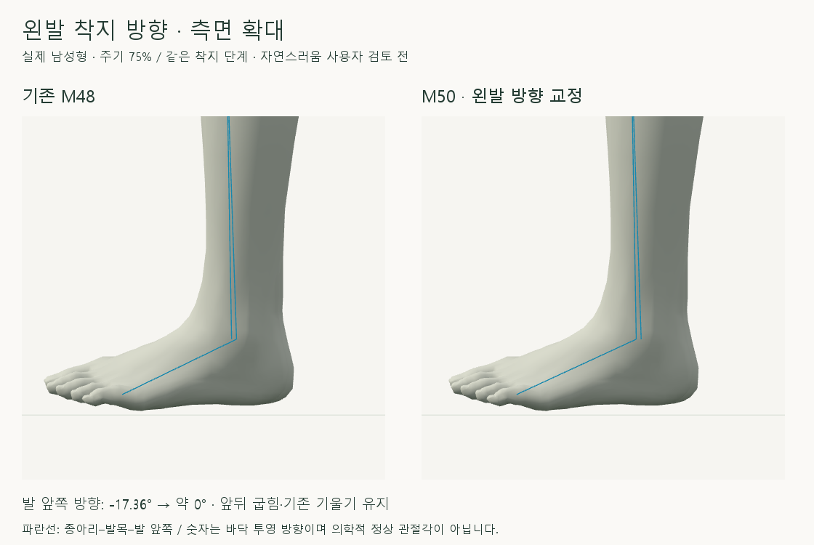

# 왼발 착지 방향 교정

2026-10-16 · M50 · **위치 보존 검사 완료 / 사용자 좌우 동작 품질 검토 반려** · R02/R16·D03 · M49 후속

[M51 후속 분석](CMU_BILATERAL_CHAIN_AUDIT.md): 왼발 지지의 추가 골반 이동·발바닥 기울기·좌우 보정 경로 차이를 확인했습니다. 아래 수치는 당시 보존 검사 결과이며 전체 동작 품질 통과를 뜻하지 않습니다.



왼발 자체의 기본 축에서 착지 방향 차이를 구해 발·발끝에 같은 수평 회전을 적용했습니다. 기존 앞뒤 굽힘·옆 기울기는 유지하고, 종아리 대비 발의 상대 회전은 새 방향에 맞게 계산합니다.

[이전 주소 → 현재 자세 화면](http://127.0.0.1:5173/review/mocap.html?compare=left-ankle-direction) · [정면 녹화](../../outputs/cmu-left-ankle-direction/front.webm) · [측면 녹화](../../outputs/cmu-left-ankle-direction/side.webm) · [확정 범위·검수 기준](../02-requirements/REQUIREMENTS.md#m50--왼발-종아리-대비-회전과-착지-기준-방향)

## 양발·측면 확인


각 칸 왼쪽은 M48, 오른쪽은 M50입니다. 오른발·골반은 기존 동작이며 왼발은 착지 전/해제 연결을 거쳐 기존 회수로 돌아갑니다.



앞뒤 굽힘을 유지하면서 방향을 돌렸습니다. 회전으로 착지점이 움직이지 않도록 같은 피부 지점의 지면 X/Z와 낮은 표면 높이를 목표로 고관절–무릎–발목을 함께 풉니다.

## 코드와 결과

| 코드 | 변경 내용 |
| --- | --- |
| [left-ankle-direction.js](../../experiments/model-preview/review/left-ankle-direction.js) · `neutralFootAxes` / `createLeftAnkleDirection` | 왼발 기본 축 → 착지 기준 방향 차이 계산 · 남녀별 생성 |
| `applyLeftAnkleDirection` | 고정된 방향 차이를 부드럽게 적용 → 기존 접지 지점·높이·무릎 X를 유지하도록 IK → 종아리 부모 회전의 역회전으로 발의 상대 회전 계산 |
| [landing-width-comparison.js](../../experiments/model-preview/review/landing-width-comparison.js) | M48을 두 모델에 재현한 뒤 화면 오른쪽 모델의 왼발에만 M50 추가 |
| [mocap.js](../../experiments/model-preview/review/mocap.js) | `left-ankle-direction` 비교 화면 · 기본 자세 축 저장 · 남녀 전환 시 재계산 |

| 왼발 바닥 투영 방향 · 기존 → 교정 | 남성형 | 여성형 |
| --- | --- | --- |
| 착지 시작 · 75% | −17.36° → 약 0° | −15.52° → 약 0° |
| 지지 중간 · 92% | −19.12° → −1.76° | −17.11° → −1.60° |
| 착지 시작 · 종아리 대비 상대 회전 변화량 | 10.91° | 16.41° |

상대 회전 변화량은 쿼터니언 간 총 회전각이며 정상 범위 판정이 아닙니다. 발을 세우는 해제 구간에는 바닥 투영 방향이 커질 수 있어 이를 매 프레임 0°로 강제하지 않습니다.

| 검사 · 남녀 730자세 + 착지/경계 표본 | 최댓값 / 결과 |
| --- | --- |
| 같은 피부 지점의 X/Z / 낮은 표면 높이 차이 | <0.00001mm / <0.00001mm |
| 골반·상체·오른발·범위 밖 회수 | 위치 <0.000006mm · 회전 <0.000005° |
| 앞뒤 굽힘 / 옆 기울기 변화 | <0.000014° / <0.000037° |
| 무릎 X / 뼈 길이 / 무릎 제약 강제 잘림 | <0.000005mm / <0.000008mm / 없음 |
| 기존 M48 기록 재현 / 재탐색·정면/측면·모델 교체 | 통과 |
| 연결 경계 · 0.01% 간격 위치 2차 차분 / 회전 증분 차이 | <0.0041mm / <0.0017° |
| 브라우저 오류 / 타입 검사·앱 빌드 | 없음 / 통과 · 검토 페이지는 배포 빌드 제외 |

**한계:** 기본 남녀·35_17 한 주기만 검증했습니다. 위치는 선택한 피부 지점의 지면 좌표이며 모든 발바닥 점의 완전 접지·피부 접힘 전체·물리 균형·모든 체형의 자연스러움은 미검증입니다.

## 재현·출처

[검사 코드](../../experiments/model-preview/scripts/verify-cmu-left-ankle-direction.cjs) · [검증 JSON](reports/cmu-left-ankle-direction.json) · [확대 촬영](../../experiments/model-preview/scripts/capture-cmu-left-ankle-close.cjs) · [녹화](../../experiments/model-preview/scripts/capture-cmu-left-ankle-direction.cjs) · [그림 생성 원본](../assets/diagrams/cmu-left-ankle-direction-figures.py)

```sh
node experiments/model-preview/scripts/verify-cmu-left-ankle-direction.cjs
node experiments/model-preview/scripts/capture-cmu-left-ankle-close.cjs
node experiments/model-preview/scripts/capture-cmu-left-ankle-direction.cjs
python docs/assets/diagrams/cmu-left-ankle-direction-figures.py
```

저장소 루트·Vite 서버·Playwright/Edge·Python/Pillow·맑은 고딕 필요. 원본 캡처/영상은 `outputs/cmu-left-ankle-direction/`; 출처: 사용자 교정 요청·M49 방향 점검·CMU 35_17. 127_06 제외.

[M49 원인 점검](CMU_LEFT_ANKLE_AUDIT.md) · [문서 목록](../README.md)
