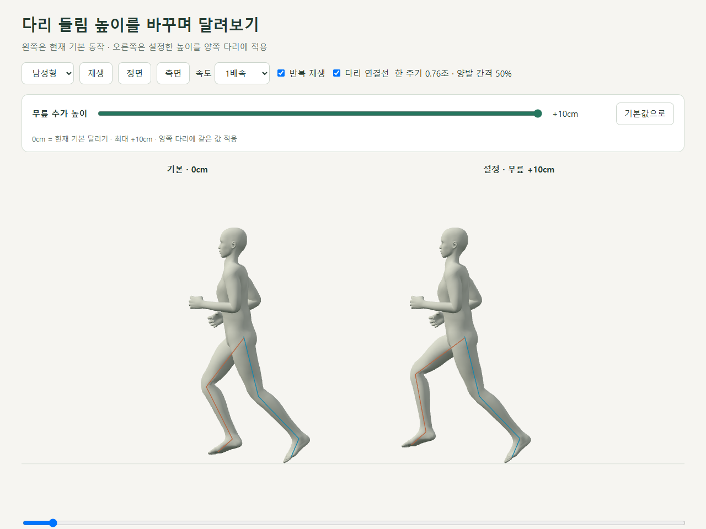
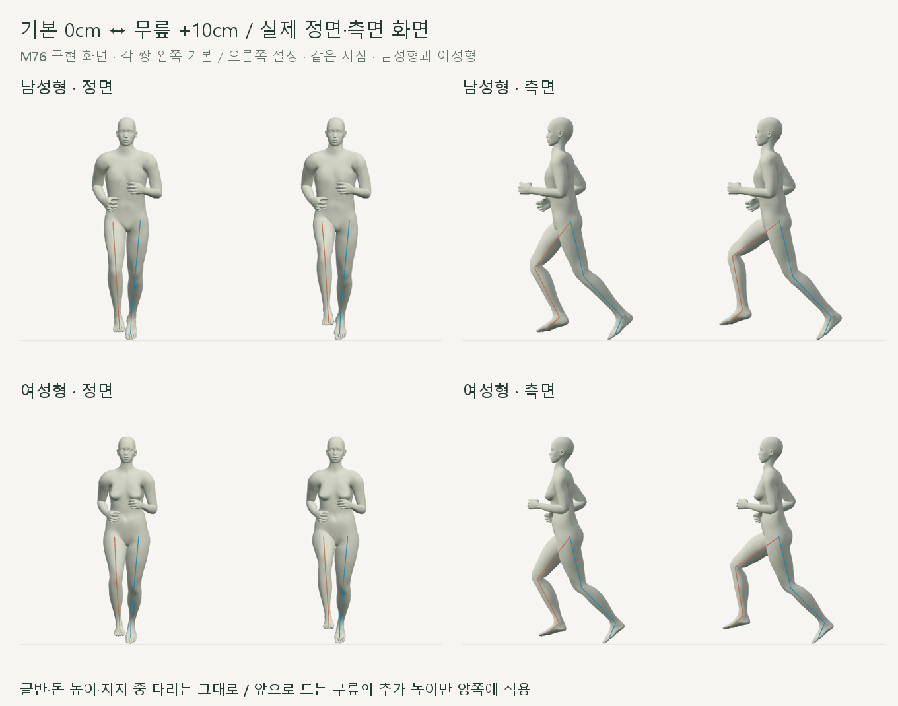
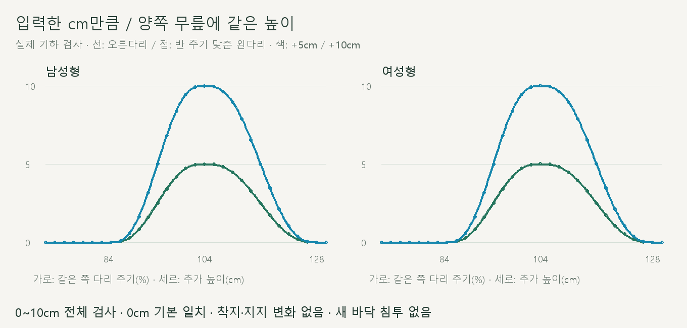
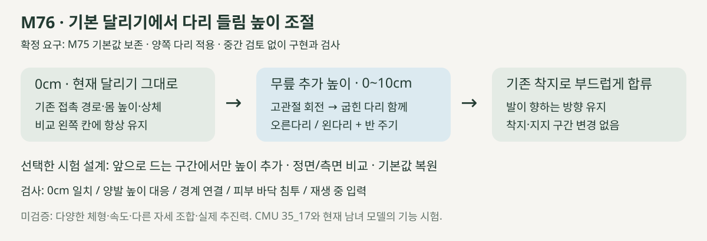

# 기본 달리기 · 다리 들림 높이

2026-10-21 · M76 · **사용자 승인 / 구현·기하·재생 검사 완료** · R02·R15 / D03·D13



**0cm는 현재 기본 동작 그대로**, 슬라이더는 앞으로 드는 무릎의 추가 높이입니다. [입력·적용 구간·보존 계약](../02-requirements/REQUIREMENTS.md#m76--기본-달리기-다리-들림-높이).

[이전 주소 → 현재 자세 화면](http://127.0.0.1:5173/review/shared-gait.html?compare=leg-height) · [기본 동작 M75](CMU_UNIFIED_STANCE.md)

## 실제 재생



각 쌍 왼쪽 기본 / 오른쪽 +10cm이며 같은 시점입니다. 재생 중에도 변경할 수 있고, **기본값으로**를 누르면 0cm로 돌아갑니다.

| 1배속 · 0cm ↔ +10cm | 정면 | 측면 |
| --- | --- | --- |
| 남성형 | [재생](../../outputs/cmu-leg-height/male-front.webm) | [재생](../../outputs/cmu-leg-height/male-side.webm) |
| 여성형 | [재생](../../outputs/cmu-leg-height/female-front.webm) | [재생](../../outputs/cmu-leg-height/female-side.webm) |

## 검증 완료



남녀 × 11설정 × 501시점, **11,022자세**를 검사했습니다. 오른다리와 반 주기 뒤 왼다리의 추가 높이가 같으며, +5cm·+10cm는 각각 최대 5cm·10cm로 반영됩니다.

| 검사 | 결과 |
| --- | --- |
| 보존한 M75 대조 / 0cm | 저장된 관절 위치와 **0mm 차이** / 기본 동작 계산 그대로 통과 |
| 양발 추가 높이 | 입력 대비 최대 오차 **0.00001mm 미만** / 반 주기 대응 통과 |
| 골반·몸 높이·상체·고관절 위치·뼈 길이 | **0mm 변화** |
| 구간 밖 착지·지지 위치 / 발바닥 높이 | **0mm 변화** |
| 무릎 굽힘 / 발 세계 방향 | 변화 **0.001° 미만** / 종아리 대비 발목 상대각은 변경됨 |
| 양발 피부 바닥 침투 | 전체 설정에서 새 침투 없음 / 현재 발바닥 표면 기준 |
| 연결·반복·재탐색·화면 이동 | 통과 / 최대 경계 속도 차이 0.00035m/s 미만 |
| 기본 자료 보존 | 기존 코드·모델·자료 **20개 해시 일치** |
| UI | 남녀·정면/측면·재생 중 변경·반복·복원·키보드·새로고침 기본값 통과 / 브라우저 오류 없음 |
| 로컬 준비 시간 | 남성형 3.77초 / 여성형 3.68초 / 높이 변경 시 재준비 없음 |
| 영상·빌드 | 1배속 4개, 각 약 3.5초 디코딩 확인 / 타입·빌드 통과 / 검토용 JS는 별도 브라우저 검사 |

## 핵심 코드



고관절을 앞뒤 방향으로 회전해 굽힌 다리를 함께 올리고, 발의 방향은 보상합니다. 가중치가 양 끝에서 부드럽게 0으로 돌아가므로 기존 착지에 연결됩니다.

| 코드 | 역할 |
| --- | --- |
| [leg-height.js](../../experiments/model-preview/review/leg-height.js) · `createLegHeight` | M75에서 매번 시작 / cm → 무릎 높이 → 고관절 회전 / 왼다리 반 주기 / 0cm 즉시 우회 |
| 같은 파일 · `legHeightWeight`, `createHeightTransition` | 공중 구간 연결 / 재생 중 슬라이더 값의 급변 완화 |
| [shared-gait-view.js](../../experiments/model-preview/review/shared-gait-view.js) | 기본·설정 비교 / 입력·복원·모델 변경 / 1배속 |
| [검사 코드](../../experiments/model-preview/scripts/verify-leg-height.cjs) | 기존 저장 결과와 대조 / 11설정·양발·접지·반복 검사 |

## 현재 범위

이번에는 **기본보다 높이는 0~10cm**만 지원하며, 낮추기·체형 변경·속도 변경·다른 자세 조합은 미검증입니다. 기존의 옆 미끄러짐·팔/손 경직은 남아 있으며 실제 기록 향상·추진력의 검증 결과가 아닙니다.

현재 검토 화면의 기능이며 사용자 설정 저장·메인 서비스 화면 연결 전입니다. 새로고침하면 0cm로 시작하고, 같은 화면에서 남녀 모델을 바꿀 때는 입력값을 유지합니다.

[검사 요약](reports/cmu-leg-height-summary.json) · [전체 수치](reports/cmu-leg-height.json) · [기본 자료 해시](reports/cmu-leg-height-baseline.json) · [UI](reports/cmu-leg-height-ui.json) · [영상](reports/cmu-leg-height-media-check.json) · [그림 생성](../assets/diagrams/cmu-leg-height.py)

```sh
node experiments/model-preview/scripts/verify-leg-height.cjs
node experiments/model-preview/scripts/check-leg-height-ui.cjs
node experiments/model-preview/scripts/capture-leg-height.cjs
node experiments/model-preview/scripts/check-leg-height-media.cjs
python docs/assets/diagrams/cmu-leg-height.py
```

출처: [CMU 35_17 원본·검증](CMU_SOURCE_VALIDATION.md) → [M75](CMU_UNIFIED_STANCE.md). Three.js·Vite·Playwright·Edge·Python·Pillow 사용; 실제 캡처·영상은 `outputs/cmu-leg-height/`. [문서 목록](../README.md).
