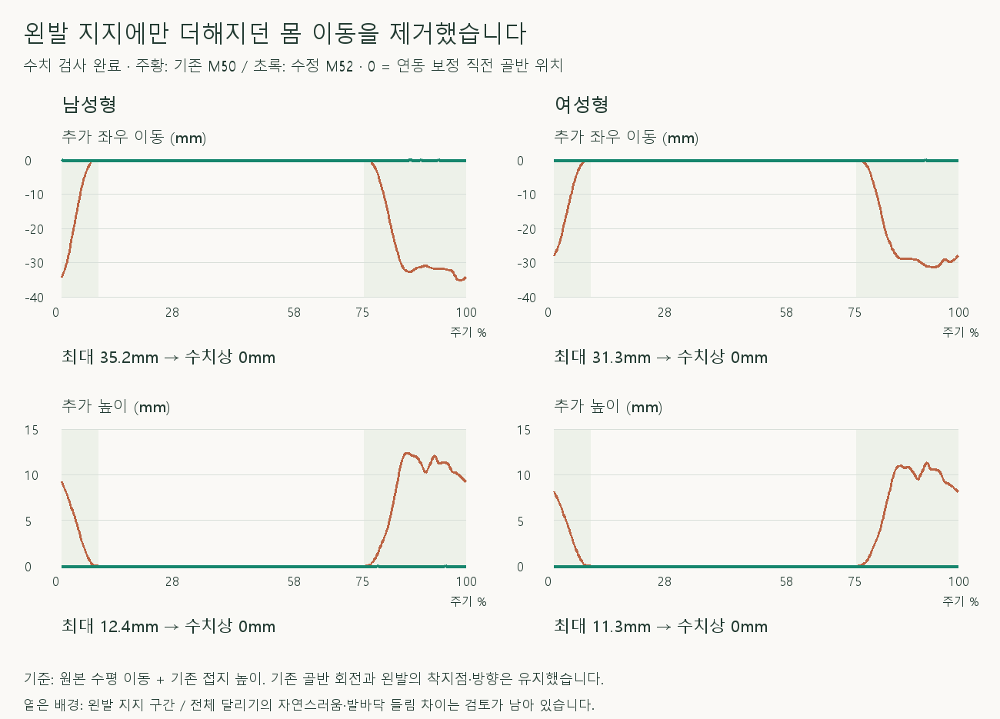

# 왼발 지지의 추가 몸 이동 제거 비교

> **실험 시점 기록** · 본문의 화면·수치·‘현재/다음’은 해당 M 실험 당시 기준입니다. [2026-10-26 현재 결과물](../01-planning/CURRENT_STATE.md)에서 채택된 기능·후속 보정·남은 한계를 확인하세요. 기존 검사 결과를 새로 통과한 것으로 바꾸지 않았습니다.

2026-10-16 · M52 · **구현·수치 검사 완료 / 자연스러움 사용자 검토 전** · R02/R16·D03 · M51 후속



왼발 지지에만 더해지던 몸의 좌우·높이 이동을 제거했습니다. 기준은 원본 수평 이동과 기존 접지 높이이며, 골반 회전은 기존 그대로입니다.

[이전 주소 → 현재 자세 화면](http://127.0.0.1:5173/review/mocap.html?compare=pelvis-reference-restore) · [정면 녹화](../../outputs/cmu-pelvis-reference-restore/front.webm) · [측면 녹화](../../outputs/cmu-pelvis-reference-restore/side.webm) · [확정 범위·검수 계약](../02-requirements/REQUIREMENTS.md#m52--왼발-지지의-추가-몸-이동-제거)

## 정면·측면 비교


왼발 착지점·발 방향을 유지하도록 고관절–무릎을 다시 계산했습니다. 공중의 오른다리는 복원한 몸을 따라 이동하고 골반 기준 상대 자세를 유지합니다.

## 코드와 결과

| 코드 | 역할 |
| --- | --- |
| [pelvis-reference-restore.js](../../experiments/model-preview/review/pelvis-reference-restore.js) · `capturePelvisReference` | 원본 수평 이동·접지 높이 적용 후, 연동 보정 전 골반 위치 저장 |
| `restorePelvisReference` | 추가 몸 이동 제거 → 기존 왼발 피부 지점 X/Z·최저 높이를 목표로 다리 IK → 발·발끝 방향 복원 |
| [landing-width-comparison.js](../../experiments/model-preview/review/landing-width-comparison.js) | 두 칸에 M50 재현 → 오른쪽 칸에만 M52 적용 · 착지 목표 준비 중에는 적용하지 않음 |
| [mocap.js](../../experiments/model-preview/review/mocap.js) | 전용 비교 주소·라벨·남녀/시점 선택 |

기존 M50 계산은 비교 기준과 착지 목표를 얻는 데 유지합니다. 이번 비교는 최종 몸 위치의 추가 이동만 제거하며, 과거 보정 단계 전체를 통합한 구현은 아닙니다.

| 변화 · 기본 모델 / 35_17 한 주기 | 남성형 | 여성형 |
| --- | --- | --- |
| 추가 좌우 이동 최댓값 | 35.16mm → 수치상 0mm | 31.33mm → 수치상 0mm |
| 추가 높이 최댓값 | 12.39mm → 수치상 0mm | 11.30mm → 수치상 0mm |
| 왼무릎 굽힘 변화 최댓값 | 3.23° | 3.59° |
| 왼무릎 굽힘 범위 · 정상 범위 판정 아님 | 26.73~94.20° | 27.13~94.37° |

| 검사 · 남녀 730자세 + 독립 기준 184자세 + 경계/재탐색 표본 | 최댓값 / 결과 |
| --- | --- |
| 골반 위치와 M51 독립 보관 기준 차이 | <0.000001mm |
| 기존 M50 재현 | 위치 <0.000006mm / 회전 <0.000005° |
| 왼발 피부 지점 X/Z / 최저 높이 / 발 방향 차이 | <0.000009mm / <0.000009mm / <0.000049° |
| 오른발 지지·지지 밖 전체 동작 / 공중 다리의 골반 기준 상대 자세 | 위치 <0.000007mm / 회전 <0.000005° |
| 뼈 길이 변화 / 다리 도달 여유 최솟값 | <0.000026mm / 24.55mm · 도달 실패 없음 |
| 연결 경계 · 0.01% 간격 위치 2차 차분 / 회전 증분 차이 | <0.0041mm / <0.0017° |
| 재탐색·정면/측면 / 브라우저 오류 | 위치 차이 <0.000003mm / 없음 |
| 타입 검사·앱 빌드 | 통과 · 검토 페이지는 배포 빌드 제외, 실제 브라우저 별도 검사 |

**남은 한계:** 골반 회전·발바닥 옆 기울기·좌우 발끝 들림 차이는 유지됩니다. 선택한 피부 지점과 최저 높이의 보존 검사이며, 모든 발바닥 점의 완전 접지·물리적 균형·전체 체형·자연스러움은 미검증입니다.

## 재현·출처

[검사 코드](../../experiments/model-preview/scripts/verify-cmu-pelvis-reference-restore.cjs) · [검증 JSON](reports/cmu-pelvis-reference-restore.json) · [녹화 코드](../../experiments/model-preview/scripts/capture-cmu-pelvis-reference-restore.cjs) · [그림 생성 원본](../assets/diagrams/cmu-pelvis-reference-restore-figures.py)

```sh
node experiments/model-preview/scripts/verify-cmu-pelvis-reference-restore.cjs
node experiments/model-preview/scripts/capture-cmu-pelvis-reference-restore.cjs
python docs/assets/diagrams/cmu-pelvis-reference-restore-figures.py
```

저장소 루트·Vite 서버·Playwright/Edge·Python/Pillow·맑은 고딕 필요. 원본 캡처·영상은 `outputs/cmu-pelvis-reference-restore/`; 출처: 사용자 승인·M51 단계별 분석·CMU 35_17. 127_06 제외.

[M51 원인 분석](CMU_BILATERAL_CHAIN_AUDIT.md) · [문서 목록](../README.md)
