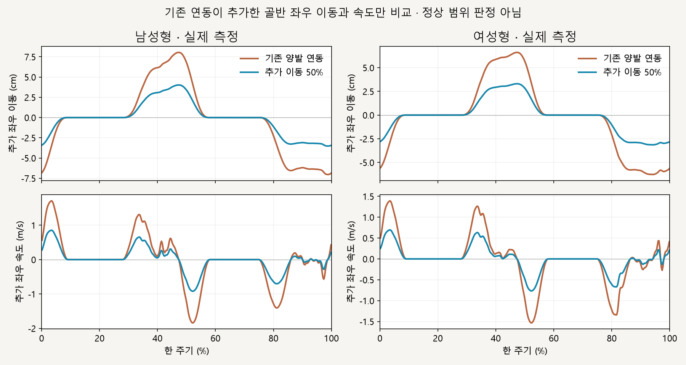

# 골반 좌우 이동 축소 · 착지 유지 비교

> **실험 시점 기록** · 본문의 화면·수치·‘현재/다음’은 해당 M 실험 당시 기준입니다. [2026-10-26 현재 결과물](../01-planning/CURRENT_STATE.md)에서 채택된 기능·후속 보정·남은 한계를 확인하세요. 기존 검사 결과를 새로 통과한 것으로 바꾸지 않았습니다.

2026-10-16 · M39 · **구현·수치 검사 완료 / 자연스러움 사용자 검토 전** · R02/R16·D03


왼쪽은 M38 양발 연동, 오른쪽은 추가 골반 좌우 이동을 절반으로 줄인 결과입니다. 착지 목표를 먼저 고정한 뒤 고관절–무릎–발의 연동을 다시 계산했습니다.

[이전 주소 → 현재 자세 화면](http://127.0.0.1:5173/review/mocap.html?compare=pelvis-sway) · [M39 계약](../02-requirements/REQUIREMENTS.md#m39--골반-좌우-추가-이동-축소) · [이전 M38](CMU_STANCE_CHAIN_BILATERAL.md)

사용자 검토: 안쪽 착지 위치를 유지한 채 골반 이동만 줄여 원인이 남았습니다. 후속 [M40 오른발 고관절 기준 착지](CMU_HIP_REFERENCE.md)에서 목표를 다시 설정합니다.

## 무엇이 흔들렸나



기존 계산은 고관절과 착지 표면의 좌우 차이 절반만큼 몸을 이동시켰습니다. 이 보정이 좌우로 번갈아 적용되며 큰 추가 이동을 만들었고, 이번에는 그 성분만 축소했습니다; 사람의 정상 범위를 판정한 결과는 아닙니다.

| 측정 · 한 주기 | 기존 → 축소 |
| --- | --- |
| 남성형 추가 좌우 이동 폭 | 15.07 → 7.54cm |
| 여성형 추가 좌우 이동 폭 | 12.88 → 6.44cm |
| 남성형 추가 좌우 최대 속도 | 1.84 → 0.92m/s |
| 여성형 추가 좌우 최대 속도 | 1.53 → 0.77m/s |

## 코드와 유지 조건

```text
M38 착지 목표 고정
        ↓
골반 추가 좌우 이동 × 0.5
        ↓
지지 다리 연동 재계산 ── 원래 무릎 굽힘·뼈 길이 유지
        ↓
골반 높이 조절 · 같은 착지 위치로 연결
```

회수 다리의 관절 상대 각도는 유지하며 위치는 달라진 골반 이동을 따릅니다. 골반 회전과 상체 방향은 M38 그대로이고, 고관절과 발의 정면 수직 정렬은 달라질 수 있습니다.

| 코드 | 변경 |
| --- | --- |
| [stance-chain.js](../../experiments/model-preview/review/stance-chain.js) | `pelvisTranslationScale` 추가 · 기존 목표를 원래 이동량으로 계산한 후 실제 이동에만 계수 적용 · 기본값 1 유지 |
| [landing-width-comparison.js](../../experiments/model-preview/review/landing-width-comparison.js) | 같은 원래 자세에서 M38과 축소안을 각각 계산 · 지지 다리·구간·연결 가중치 동일 |
| [mocap.js](../../experiments/model-preview/review/mocap.js) | 별도 비교 주소·양쪽 설명 · 남녀·정면/측면·재생/정지·시간 이동 |

## 검사 결과

| 남녀 730자세 · M38 대비 | 결과 |
| --- | --- |
| 지지 발목 / 낮은 발 표면 위치 차이 | 최대 0.017mm / 0.013mm · 허용치 0.1mm 이내 |
| 발 방향 차이 | <0.000003° |
| 회수 다리 관절 각도 | 동일 · 양쪽 비적용 시 모든 뼈도 원래 동작 |
| 골반 회전 / 상체 방향 | 동일 · 수치 오차 <0.000001° |
| 무릎 굽힘 / 뼈 길이 차이 | <0.000003° / <0.000002mm |
| 완전 적용 시 무릎 굽힘 평면 이탈 | <0.000033mm · 고관절과 발을 잇는 정면 선 기준 |
| 골반 높이 재계산에 따른 차이 | 최대 2.37mm |
| 지지 발 표면과 바닥 | 최대 간격 0.055mm · 침범 <0.000007mm |
| 구간 시작·끝 / 주기 끝·시작 | 위치·회전 연결 검사 통과 · 유한차분 속도 차이 감소 |
| 반복 탐색·재생·정지·재시작·시점 전환 | 통과 · 브라우저 오류 없음 |
| 비교 기준 M38 / 기존 M38 730자세 회귀 | 저장된 결과와 일치 · 별도 검사 통과 |
| 타입 검사·빌드 / 문서 링크·렌더링 | 통과 · 검토 페이지는 배포 빌드 제외 |

**남은 한계:** 50%는 검토용 계수입니다. 이동량 감소를 확인했으며 자연스러운 달리기·물리 균형을 검증한 것은 아닙니다. 기존 수평 발 미끄러짐은 유지되고, 발 표면은 압력 중심 실측이 아닌 기하학적 측정입니다.

## 재현·출처

[검사·캡처](../../experiments/model-preview/scripts/verify-cmu-pelvis-sway.cjs) · [수치·코드 해시](reports/cmu-pelvis-sway.json) · [M38 회귀](reports/cmu-stance-chain-bilateral-regression-m39.json) · [그림 원본](../assets/diagrams/cmu-pelvis-sway-figures.py) · [실제 재생 녹화](../../experiments/model-preview/scripts/capture-cmu-pelvis-sway.cjs)

```sh
node experiments/model-preview/scripts/verify-cmu-pelvis-sway.cjs
python docs/assets/diagrams/cmu-pelvis-sway-figures.py
node experiments/model-preview/scripts/capture-cmu-pelvis-sway.cjs
```

저장소 루트·Vite 개발 서버·Playwright/Edge·Python Pillow/Matplotlib·맑은 고딕이 필요합니다. 정면/측면 실제 영상은 `outputs/cmu-pelvis-sway/`에 생성합니다.

출처: [M38 연동 계산과 검사](CMU_STANCE_CHAIN_BILATERAL.md) · 사용자 골반 흔들림 축소 승인 · CMU 35_17/기존 모델 유지 · 127_06 제외.

[문서 목록](../README.md)
