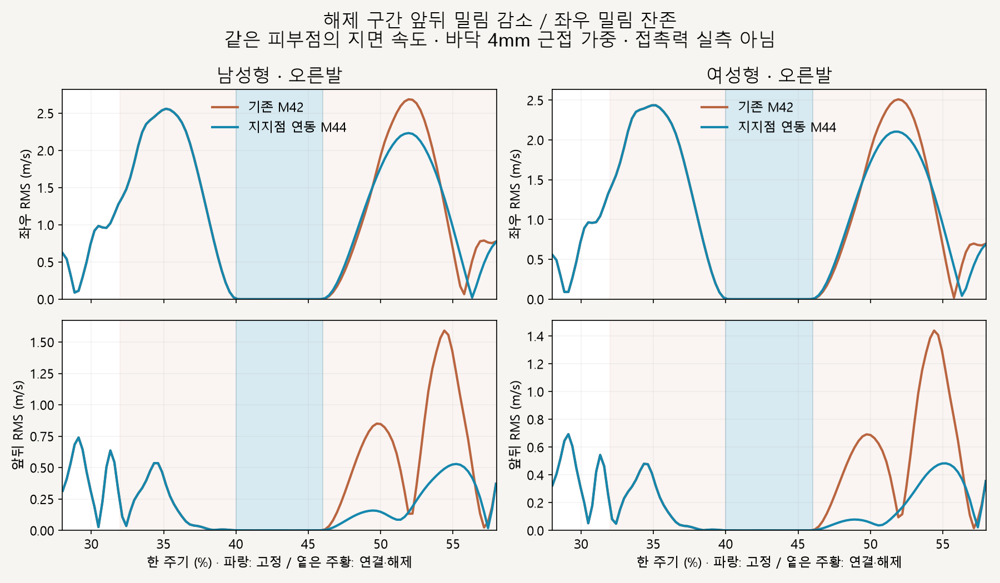
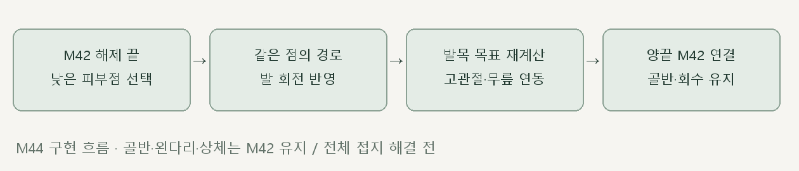

# 오른발 해제 · 지지점 기준 연동

> **실험 시점 기록** · 본문의 화면·수치·‘현재/다음’은 해당 M 실험 당시 기준입니다. [2026-10-26 현재 결과물](../01-planning/CURRENT_STATE.md)에서 채택된 기능·후속 보정·남은 한계를 확인하세요. 기존 검사 결과를 새로 통과한 것으로 바꾸지 않았습니다.

2026-10-16 · M44 · **구현·수치 검사 완료 / 자연스러움 검토 전 / 완전 접지 미해결** · R02/R16·D03


왼쪽은 기존 M42, 오른쪽은 발 회전에 맞춰 발목 위치를 다시 계산한 비교안입니다. 골반·왼다리·상체·구간 밖 회수는 유지하며 오른발 해제에만 적용했습니다.

[이전 주소 → 현재 자세 화면](http://127.0.0.1:5173/review/mocap.html?compare=pivot-release) · [M44 범위 계약](../02-requirements/REQUIREMENTS.md#m44--오른발-해제-지지점-연동) · [M43 원인 검토](CMU_FOOT_RELEASE.md)

후속 [M45 좌우·발끝 보정](CMU_RELEASE_REFINEMENT.md)에서 좌우 속도·중간 높이를 줄였으나 앞뒤 RMS 일부 악화도 확인했습니다.

## 앞뒤 밀림 감소 / 좌우 밀림 잔존



해제 구간의 앞뒤 RMS는 약 63～65% 감소했습니다. 좌우 밀림과 앞뒤 잔여 밀림은 남아 있으며, 고정점 기반의 완전한 구름 동작을 구현한 것은 아닙니다.

| 해제 구간 · 바닥 4mm 근접 가중 | 남성형 M42 → M44 | 여성형 M42 → M44 |
| --- | --- | --- |
| 앞뒤 RMS 속도 | 0.675 → **0.238m/s** | 0.642 → **0.241m/s** |
| 앞뒤 RMS 최대 순간 | 1.591 → 0.529m/s | 1.440 → 0.483m/s |
| 좌우 RMS 속도 | 1.260 → 1.161m/s | 1.382 → 1.248m/s |

같은 정점 ID를 추적한 지면 좌표 속도이며, 접촉력 측정이 아닙니다. [1/4/8mm 측정 JSON](reports/cmu-pivot-release-slip.json)에 전체 구간과 고정 내부 결과도 남깁니다.

## 코드



| [pivot-release.js](../../experiments/model-preview/review/pivot-release.js) | 역할 |
| --- | --- |
| `selectReleasePivot` | 해제 끝에서 낮은 발 피부 정점 하나를 선택 · 같은 정점 ID 유지 |
| `createPivotPath` | M42의 양끝 위치·속도·가속도를 잇는 5차 지지점 경로 |
| `applyPivotRelease` | M42 발 회전을 유지하면서 지지점 경로 오차만큼 발목 목표 수정 → 고관절·무릎 두 뼈 계산 → 낮은 발 표면 재검사 |

[비교 연결](../../experiments/model-preview/review/landing-width-comparison.js)은 양쪽 모두 M42를 재생하고 오른쪽에만 새 연동을 적용합니다. 발 회전 곡선 자체를 늦추지 않았으며, 회전에 대응하는 발목 위치를 함께 계산하도록 변경했습니다.

## 검사·남은 한계

| 남녀 730자세 | 결과 |
| --- | --- |
| 골반·왼다리·상체 / 구간 밖 회수 | M42 유지 · 위치 차이 <0.000003mm |
| 기존 M42 재현 | 저장된 기준 골반·고관절·무릎·발목과 일치 · <0.000002mm |
| 뼈 길이 / 다리 도달 여유 | 길이 차이 <0.000030mm · 여유 최소 4.06mm |
| 무릎 굽힘 | 10.42～39.59° · 검사 구간에서 역꺾임 없음 |
| 발·발가락 세계 회전 | M42 유지 · 차이 <0.000023° |
| 선택 지점의 수평 경로 오차 | <0.000039mm · 경로 자체는 이동함 |
| 낮은 표면 바닥 간격 / 침범 | <0.049mm / 검사 표본에서 없음 |
| 구간 경계·탐색 재현·재생·시점 | 검사 통과 · 브라우저 오류 없음 |
| 타입 검사·빌드 | 통과 · 검토 페이지는 배포 빌드 제외 |

**한계:** 선택한 정점은 해제 끝에 닿는 발끝 지점이며 초반에는 최대 8.49mm 뜹니다. 양끝을 잇는 지지점 경로는 좌우 약 10cm·앞뒤 약 1.5cm의 범위를 움직이므로, 완전히 고정된 접촉점이나 실제 압력 중심으로 해석하지 않습니다; 실제 인체 안정성·마찰·발 구름은 검증하지 않았습니다.

## 재현·출처

[자세 검사](../../experiments/model-preview/scripts/verify-cmu-pivot-release.cjs) · [자세 결과·코드 해시](reports/cmu-pivot-release.json) · [밀림 측정](../../experiments/model-preview/scripts/inspect-cmu-pivot-release-slip.cjs) · [그림 생성](../assets/diagrams/cmu-pivot-release-figures.py) · [재생 녹화](../../experiments/model-preview/scripts/capture-cmu-pivot-release.cjs)

```sh
node experiments/model-preview/scripts/verify-cmu-pivot-release.cjs
node experiments/model-preview/scripts/inspect-cmu-pivot-release-slip.cjs
python docs/assets/diagrams/cmu-pivot-release-figures.py
node experiments/model-preview/scripts/capture-cmu-pivot-release.cjs
```

저장소 루트·Vite 개발 서버·Playwright/Edge·Python Pillow/Matplotlib·맑은 고딕이 필요합니다. 영상은 `outputs/cmu-pivot-release/`에 생성합니다. 출처: CMU 35_17·M42/M43·사용자 오른발 해제 지지점 연동 승인; 127_06 제외.

[문서 목록](../README.md)
