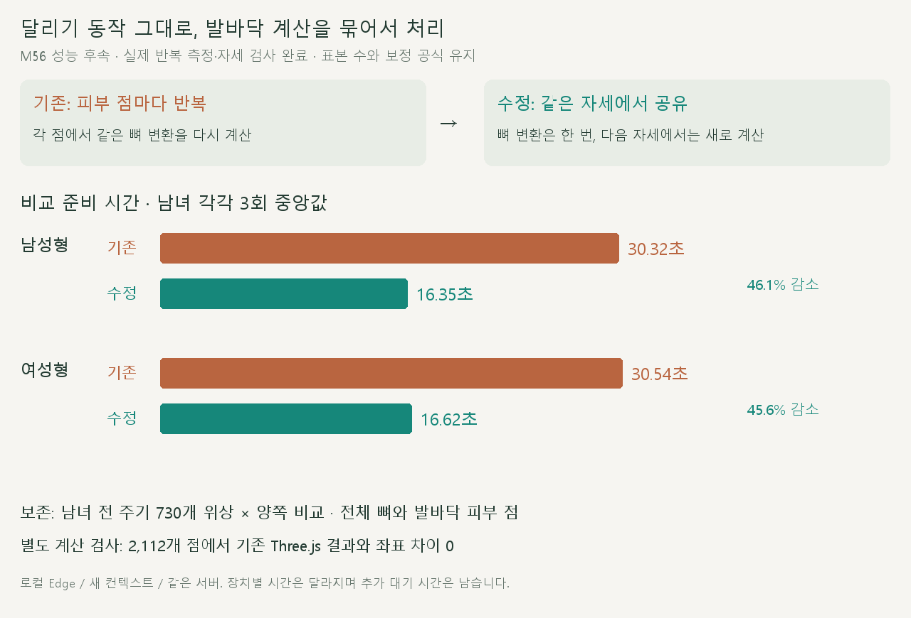
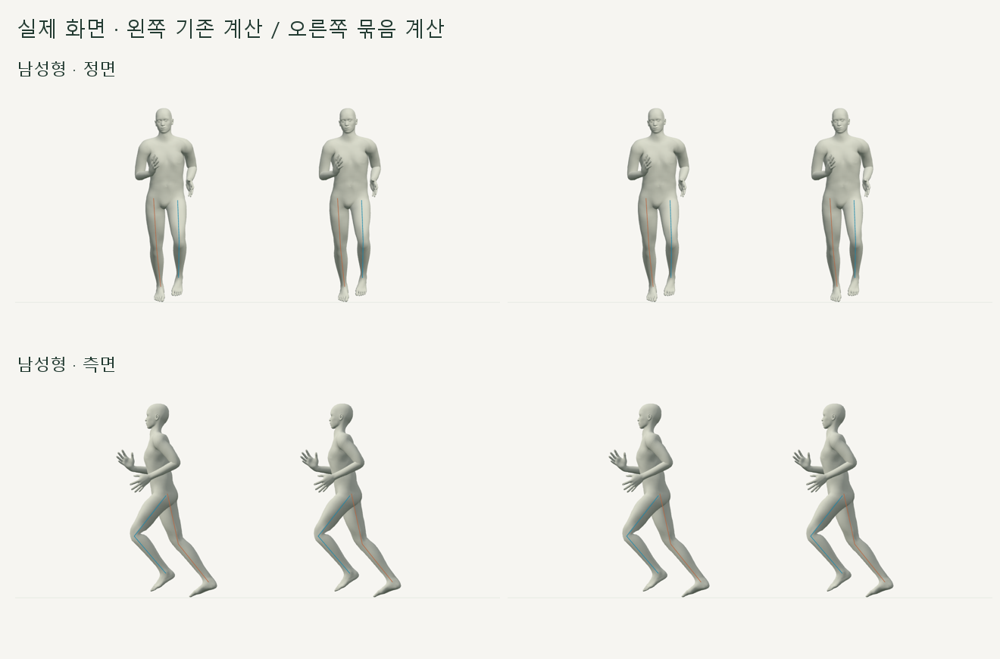

# 달리기 비교 준비 시간 · 발바닥 계산 묶음 처리

> **실험 시점 기록** · 본문의 화면·수치·‘현재/다음’은 해당 M 실험 당시 기준입니다. [2026-10-26 현재 결과물](../01-planning/CURRENT_STATE.md)에서 채택된 기능·후속 보정·남은 한계를 확인하세요. 기존 검사 결과를 새로 통과한 것으로 바꾸지 않았습니다.

2026-10-20 · M56 성능 후속 · R02/R16·D03 · **구현·반복 시간·전 주기 보존 검사 완료**



준비 계산의 CPU 측정에서 `createLandingSurface`가 약 24초를 차지했습니다. 발바닥 점마다 반복하던 뼈 변환을 **한 번의 측정 안에서만** 공유하며, [M56 동작 계약](../02-requirements/REQUIREMENTS.md#m56--착지-순간-유지와-후반-발끝-경로)은 유지합니다.



각 칸 안의 두 모델은 M54/M56이며, 같은 위상 50.5%를 표시합니다. 남녀 정면·측면 캡처 네 쌍의 픽셀도 같았으며, 표본 수·보정량·반복 계산 종료 조건을 줄이지 않았습니다.

| 변경 코드 | 역할 |
| --- | --- |
| [skin-point-batch.js](../../experiments/model-preview/review/skin-point-batch.js) | 같은 자세의 뼈 변환을 한 번 계산 · 정점 변형→바인드→뼈 가중합→역바인드→세계 좌표 순서와 배정밀도 유지 |
| [hip-landing.js](../../experiments/model-preview/review/hip-landing.js) | 발바닥 측정의 점 읽기만 교체 · 최저 높이·중심 계산은 그대로 |

다음 측정에서는 모든 뼈 변환을 새로 계산합니다. 모델 파일·회수 경로·골반 이동·발 회전을 바꾸거나, 미리 저장한 애니메이션으로 대체하지 않습니다.

## 검증

| 검사 | 결과 |
| --- | --- |
| Three.js 기본 함수와 독립 비교 | 2,112개 점의 좌표 차이 0 · 정규화 가중치·체형 변형·뼈/위치/바인드 변경 포함 |
| 실제 남녀 모델·전 주기 365개 위상씩 × 양쪽 53개 뼈 | 뼈 위치·발바닥 피부 좌표 차이 0 / 회전 차이 <0.001° / 발 기울기·보정 진단값 차이 0 |
| 남성형 준비 시간 · 3회 중앙값 | 30.32 → **16.35초** · 46.1% 감소 |
| 여성형 준비 시간 · 3회 중앙값 | 30.54 → **16.62초** · 45.6% 감소 |
| 타입 검사·빌드 | 통과 · 검토 화면은 실제 브라우저 별도 검사 |

성능은 같은 장치의 Edge·Vite 서버·새 브라우저 컨텍스트에서 측정합니다. 기존 방식은 검사 도구가 HTTP 응답의 발바닥 점 읽기 부분만 원래 코드로 돌려 재현하며, 저장소나 동작 설정을 바꾸지 않습니다.

**한계:** 비교 준비는 여전히 동기 계산입니다. 전체 로딩 제거·모든 장치의 같은 속도·달리기 자연스러움 검증을 뜻하지 않습니다.

[A/B 시간·전 주기 검사](../../experiments/model-preview/scripts/verify-mocap-preparation.cjs) · [검증 JSON](reports/cmu-mocap-preparation.json) · [독립 계산 검사](../../experiments/model-preview/tests/skin-point-batch.mjs) · [그림 생성 원본](../assets/diagrams/cmu-preparation-performance.py)

```sh
node experiments/model-preview/tests/skin-point-batch.mjs
node experiments/model-preview/scripts/verify-mocap-preparation.cjs
python docs/assets/diagrams/cmu-preparation-performance.py
```

Node 20 이상·Playwright/Edge·실행 중인 로컬 Vite·Python/Pillow·맑은 고딕 필요. 임시 화면과 CPU 측정은 `outputs/`에 보관하며 [M56 결과](CMU_TOE_SLIP_PATH.md)·[문서 목록](../README.md)으로 연결합니다.
