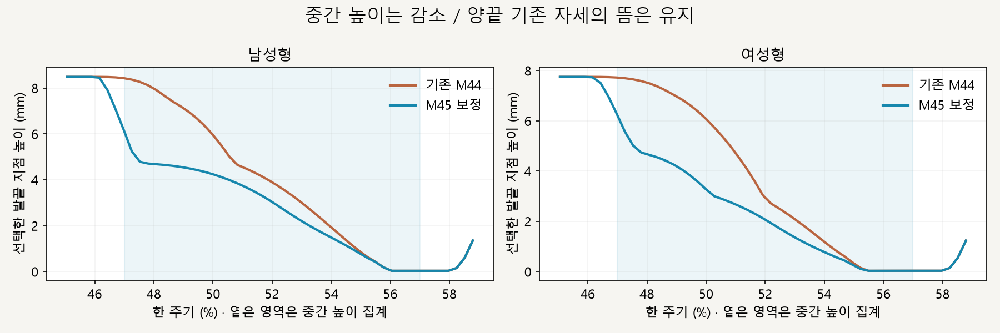
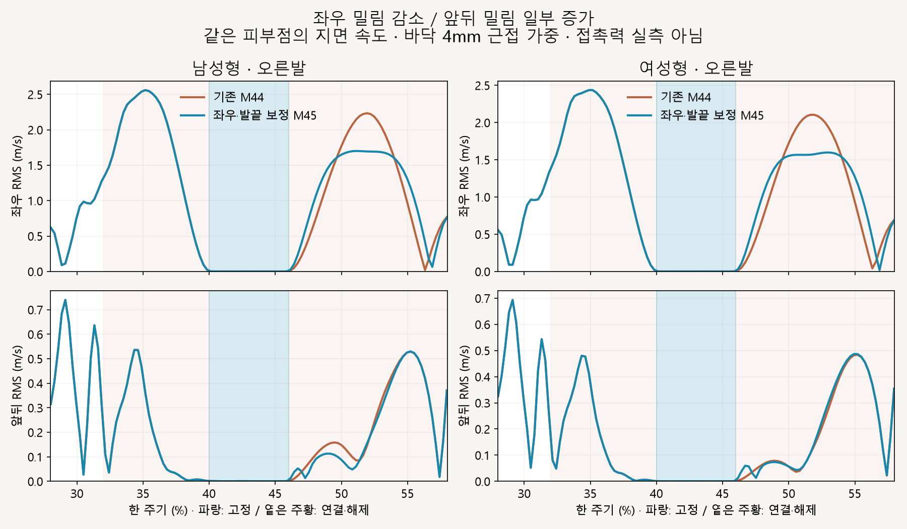
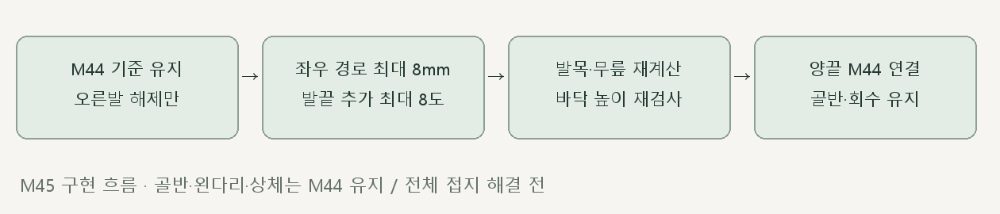

# 오른발 해제 · 좌우 밀림과 발끝 높이

> **실험 시점 기록** · 본문의 화면·수치·‘현재/다음’은 해당 M 실험 당시 기준입니다. [2026-10-26 현재 결과물](../01-planning/CURRENT_STATE.md)에서 채택된 기능·후속 보정·남은 한계를 확인하세요. 기존 검사 결과를 새로 통과한 것으로 바꾸지 않았습니다.

2026-10-16 · M45 · **구현·수치 검사 완료 / 자연스러움 검토 전 / 완전 접지 전** · R02/R16·D03


왼쪽 기존 M44 / 오른쪽은 좌우 경로와 발끝 관절을 작게 조절한 결과입니다. 골반·상체·왼다리·구간 밖 회수는 유지했습니다.

[이전 주소 → 현재 자세 화면](http://127.0.0.1:5173/review/mocap.html?compare=release-refinement) · [확정 범위 M45](../02-requirements/REQUIREMENTS.md#m45--오른발-해제-좌우-경로발끝-보정) · [이전 M44](CMU_PIVOT_RELEASE.md)

후속 [M46 앞뒤 재보정](CMU_FORE_AFT_RELEASE.md)에서 증가한 앞뒤 RMS를 줄이고 기존 좌우·발끝 높이 개선을 유지했습니다. 아래는 M45 당시 결과입니다.

## 발끝 높이 감소 · 경계의 뜸은 유지



발끝 관절을 별도로 조절해 해제 중간의 들뜸을 줄였습니다. 구간 양끝의 기존 자세를 보존하므로 초입 최대 높이는 남으며, 모든 발끝이 바닥에 닿는다고 해석하지 않습니다.

| 선택 정점 높이 · M44 → M45 | 남성형 | 여성형 |
| --- | --- | --- |
| 중간 47～57% 평균 | 3.90 → **2.71mm** | 3.53 → **2.17mm** |
| 중간 47～57% 최대 | 8.37 → **5.24mm** | 7.70 → **5.57mm** |
| 전체 해제 표본 최대 | 8.48 → 8.45mm | 7.75 → 7.74mm |

## 좌우 개선 / 앞뒤 일부 악화



좌우 RMS는 약 6～10%, 좌우 최대 순간은 약 24% 감소했습니다. **앞뒤 RMS는 약 5～12% 증가**했으므로 모든 방향이 개선된 보정으로 판단하지 않습니다.

| 해제 구간 46～58% · 바닥 4mm 근접 가중 | 남성형 M44 → M45 | 여성형 M44 → M45 |
| --- | --- | --- |
| 좌우 RMS | 1.161 → **1.044m/s** | 1.248 → **1.168m/s** |
| 좌우 RMS 최대 순간 | 2.233 → **1.701m/s** | 2.104 → **1.598m/s** |
| 앞뒤 RMS | 0.238 → **0.268m/s** | 0.241 → **0.253m/s** |

1/4/8mm 기준 모두 좌우 감소를 확인했습니다. 같은 피부 정점 ID를 추적한 기하학적 지면 속도이며 접촉력·마찰 측정은 아닙니다.

## 코드와 검사



| [release-refinement.js](../../experiments/model-preview/review/release-refinement.js) | 변경 |
| --- | --- |
| `createRefinedPath` | 양끝 위치·속도·가속도가 0인 추가 곡선 두 개로 좌우 속도 제곱합을 줄임 · 목표 이동 최대 8mm |
| `applyReleaseRefinement` | 발 앞쪽 방향에 수직인 축으로 발끝 관절 최대 8° 회전 · 5차 가중치로 연결·해제 · 고관절/무릎 재계산과 바닥 높이 재검사 |
| [비교 연결](../../experiments/model-preview/review/landing-width-comparison.js) | 양쪽 M44 위에 후보만 보정 · 모델별 지점 선택·시간 탐색 재현 |

발끝 회전은 46～48%에 연결하고 52～56%에 풀어, 58% 회수 복귀 전에 원래 각도로 돌아갑니다. 회전량을 프레임마다 잘라내는 방식 대신 부드러운 가중치를 사용했습니다.

| 남녀 730자세 | 결과 |
| --- | --- |
| 골반·상체·왼다리 / 구간 밖 회수 | M44 유지 · 위치 차이 <0.000003mm |
| 좌우 목표 이동 / 발끝 추가 각도 | 최대 7.99mm / 8.00° |
| 뼈 길이 / 다리 도달 여유 | 길이 차이 <0.000038mm / 최소 13.89mm |
| 무릎 굽힘 | 19.43～39.60° · 표본에서 역꺾임 없음 |
| 낮은 표면 바닥 간격 / 침범 | <0.049mm / 표본에서 없음 |
| 경계 46·48·52·56·58% / 탐색·시점·재생 | 연결 검사 통과 · 브라우저 오류 없음 |
| M44 재현 / 타입 검사·빌드 | 통과 · 검토 페이지는 배포 빌드 제외 |

**한계:** 좌우 순이동 자체는 남고 양끝 높이를 바꾸지 않았습니다. 앞뒤 악화·피부 변형·실제 균형·자연스러움은 추가 검토 대상이며, 수치 통과가 자연스러운 달리기 완성을 뜻하지 않습니다.

## 재현·출처

[자세 검사](../../experiments/model-preview/scripts/verify-cmu-release-refinement.cjs) · [밀림 측정](../../experiments/model-preview/scripts/inspect-cmu-release-refinement-slip.cjs) · [개선·손익 검사](../../experiments/model-preview/scripts/check-cmu-release-refinement-results.cjs) · [자세 JSON](reports/cmu-release-refinement.json) · [속도 JSON](reports/cmu-release-refinement-slip.json) · [요약 JSON](reports/cmu-release-refinement-summary.json) · [그림 원본](../assets/diagrams/cmu-release-refinement-figures.py) · [녹화](../../experiments/model-preview/scripts/capture-cmu-release-refinement.cjs)

```sh
node experiments/model-preview/scripts/verify-cmu-release-refinement.cjs
node experiments/model-preview/scripts/inspect-cmu-release-refinement-slip.cjs
node experiments/model-preview/scripts/check-cmu-release-refinement-results.cjs
python docs/assets/diagrams/cmu-release-refinement-figures.py
node experiments/model-preview/scripts/capture-cmu-release-refinement.cjs
```

저장소 루트·Vite 개발 서버·Playwright/Edge·Python Pillow/Matplotlib·맑은 고딕이 필요합니다. 영상은 `outputs/cmu-release-refinement/`에 생성합니다. 출처: CMU 35_17·M44 측정·사용자 오른발 해제 보정 승인; 127_06 제외.

[문서 목록](../README.md)
