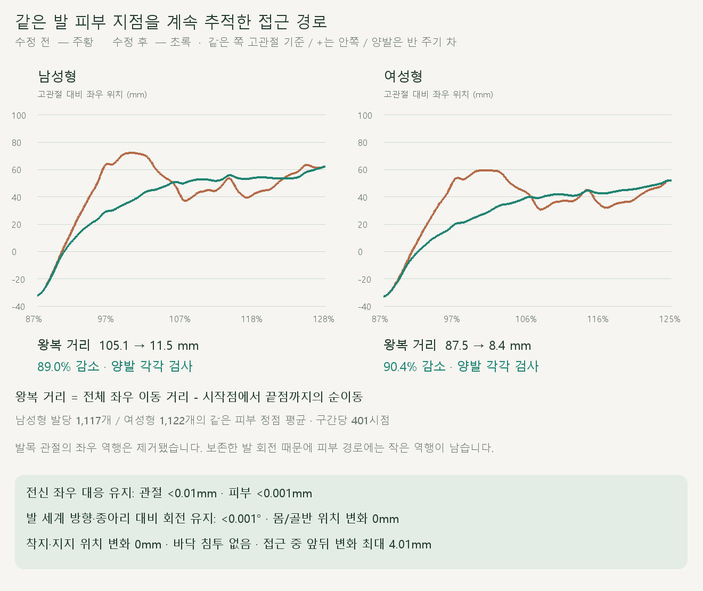
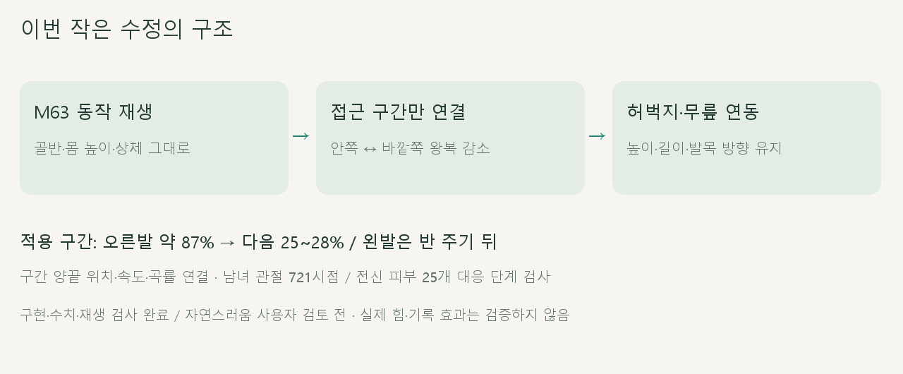

# 양발 착지 접근 경로

2026-10-20 · M64 · **구현·수치·재생 검사 완료 / 자연스러움 M65 검토·기본 동작 채택 보류** · R02·R16 / D03 · M63 후속


같은 시각의 **왼쪽 M63 / 오른쪽 M64**입니다. 공중에서 안쪽으로 들어갔다 나오는 우회를 줄였으며, 착지점과 지지 동작은 유지했습니다.

[이전 주소 → 현재 자세 화면](http://127.0.0.1:5173/review/shared-gait.html?compare=shared-approach) · [정면 영상](../../outputs/cmu-shared-approach/front.webm) · [측면 영상](../../outputs/cmu-shared-approach/side.webm) · [범위·검수 계약](../02-requirements/REQUIREMENTS.md#m64--양발-착지-접근-경로)

## 경로 변화



주기 100%는 다음 주기의 시작입니다. 같은 쪽 고관절을 기준으로 양발을 각각 검사했으며, 표시된 수치는 **지면 위 절대 이동이나 미끄러짐 거리와 다릅니다.**

| 접근 중 불필요한 좌우 왕복 · 발당 | 남성형 | 여성형 |
| --- | --- | --- |
| 발목 관절 | 109.36 → <0.01mm | 94.78 → <0.01mm |
| 고정 피부 정점 평균 | 105.06 → 11.53mm | 87.46 → 8.36mm |
| 피부 경로의 왕복 감소 | 89.03% | 90.44% |
| 추적한 피부 정점 | 1,117개 | 1,122개 |

발 피부는 보존한 발 회전의 영향을 받으므로 작은 왕복이 남습니다. 매 순간 가장 낮은 점을 새로 고르면 추적 대상이 바뀌므로, **중립 발목보다 3cm 아래의 같은 정점들**을 계속 측정했습니다.

## 변경 코드



기존 M63을 먼저 재생한 뒤 접근 구간에만 적용합니다. 골반과 종아리 방향을 유지한 상태에서 허벅지를 회전해 무릎·발의 좌우 위치를 함께 바꿉니다.

| 코드 | 역할 |
| --- | --- |
| [shared-approach.js](../../experiments/model-preview/review/shared-approach.js) · `monotoneBridge` | 기존 곡선의 방향 전환점 사이를 단조 곡선으로 연결 / 끝점 위치·속도·곡률 대응 |
| 같은 파일 · `apply` | 허벅지 길이·무릎 높이를 보존하는 수평 원호 / 종아리 회전 상쇄 → 발의 세계 방향과 발목 상대 회전 함께 유지 |
| [shared-gait-view.js](../../experiments/model-preview/review/shared-gait-view.js) | M63·M64 같은 시각 비교 / 남녀·정면·측면·배속·반복·시점 이동 |

```js
goal.x += targetX - (ankle.x - H.x);
goal.z = Math.sqrt(upper.lengthSq() - goal.x * goal.x - goal.y * goal.y);
```

`goal.y`는 기존 무릎 높이입니다. 길이를 보존하기 위해 접근 중 앞뒤 위치는 남성형 최대 **4.01mm**, 여성형 **2.94mm** 바뀝니다.

## 테스트 결과

| 검사 | 결과 |
| --- | --- |
| 남녀 전 주기 관절 | 각각 721시점 통과 |
| 양발 접근 경로 | 각 발 401시점 / 발목 역행 제거 / 고정 피부 왕복 감소 |
| 전신 좌우 대응 | 관절 위치 <0.01mm / 회전 <0.001° |
| 전신 피부 대응 | 각 모델 14,517개 전부 · 25개 대응 단계 / 최대 <0.001mm |
| 골반·몸 전체 위치 / 상체 | 위치 변화 0mm / 회전 차이 <0.001° |
| 발 세계 회전 / 종아리 대비 발목 회전 | 각각 차이 <0.001° |
| 뼈 로컬 위치·길이 | 변화 0mm |
| 착지·지지 위치 / 범위 밖 자세 | 위치 변화 0mm / 회전 차이 <0.001° |
| 발 높이 / 피부 최저 높이 변화 | <0.001mm / <0.001mm |
| 바닥 침투 | 없음 |
| 진입·종료·반 주기·반복 경계 | 위치·회전 연결 / 속도 차이 <0.001m/s |
| 반복·한 주기 종료·재탐색·재생 중 시점 변경 | 통과 / 브라우저 오류 없음 |
| 저장 영상 | 정면·측면 각각 다른 3시점 해독 완료 |

검증은 기본 남녀 GLB와 현재 기준 동작에 한정합니다. **착지점 자체의 안쪽 위치·지지 중 미끄러짐·전체 자연스러움은 이번 교정으로 해결됐다고 판정하지 않습니다.**

## 재현과 출처

[수정 전 관찰](reports/cmu-shared-approach-before.json) · [검사 코드](../../experiments/model-preview/scripts/verify-shared-approach.cjs) · [전체 결과](reports/cmu-shared-approach.json) · [요약](reports/cmu-shared-approach-summary.json)

[영상 촬영](../../experiments/model-preview/scripts/capture-shared-approach.cjs) · [영상 검사](reports/cmu-shared-approach-media-check.json) · [그림 생성](../assets/diagrams/cmu-shared-approach.py)

```sh
node experiments/model-preview/scripts/inspect-shared-approach.cjs
node experiments/model-preview/scripts/verify-shared-approach.cjs
node experiments/model-preview/scripts/capture-shared-approach.cjs
node experiments/model-preview/scripts/check-shared-approach-media.cjs
python docs/assets/diagrams/cmu-shared-approach.py
```

CMU 35_17 → M58 양발 공유 → M60 몸 높이 → M62 상체 중심 → M63 팔·피부 대응 → M64 접근 경로. 원본 캡처는 `outputs/cmu-shared-approach/`에 두며 Node·Playwright·Edge·Vite·Python·Pillow·맑은 고딕으로 재현합니다.

[M65 후속 관찰: 지지점 이동 증가 단계 확인](CMU_SHARED_STANCE_REVIEW.md) · [M63 이력](CMU_BILATERAL_POSE.md) · [문서 목록](../README.md)
