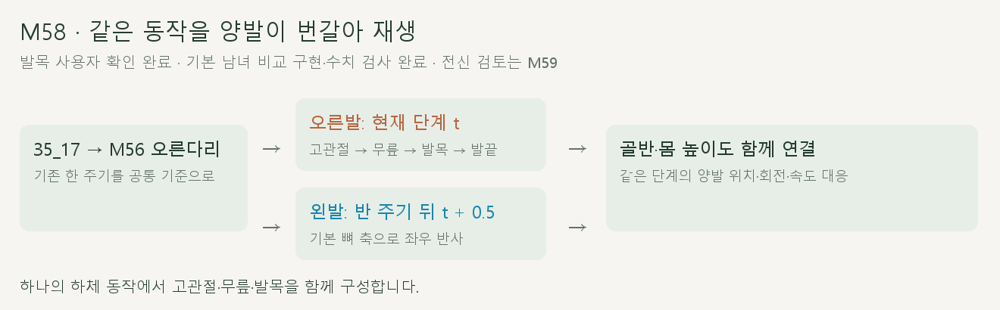
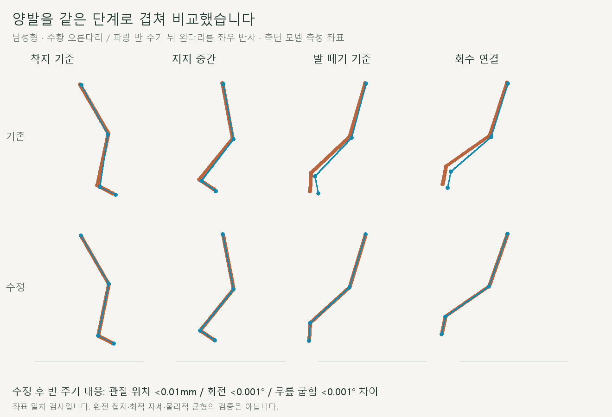
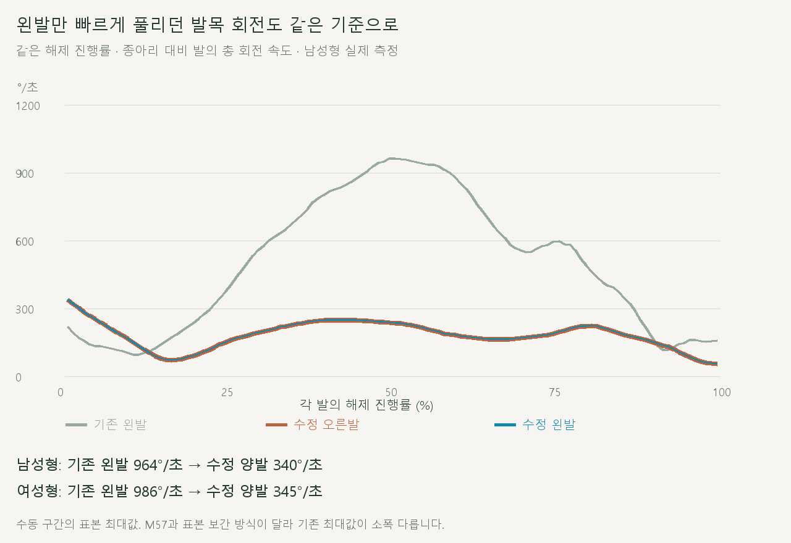

# 양발 공통 기준 동작

> **실험 시점 기록** · 본문의 화면·수치·‘현재/다음’은 해당 M 실험 당시 기준입니다. [2026-10-26 현재 결과물](../01-planning/CURRENT_STATE.md)에서 채택된 기능·후속 보정·남은 한계를 확인하세요. 기존 검사 결과를 새로 통과한 것으로 바꾸지 않았습니다.

2026-10-20 · M58 · **발목 사용자 확인 완료 / 비교 구현·수치·재생 검사 완료 / 전신 검토는 M59** · R02/R16·D03 · M57 후속



사용자가 **양발에 같은 기준 동작을 반 주기 차로 적용**하도록 확정했습니다. 기존 오른다리 동작을 공유하고 골반도 같은 주기로 연결합니다.

[이전 주소 → 현재 자세 화면](http://127.0.0.1:5173/review/shared-gait.html) · [정면 녹화](../../outputs/cmu-shared-gait/front.webm) · [측면 녹화](../../outputs/cmu-shared-gait/side.webm) · [확정 범위·검수 계약](../02-requirements/REQUIREMENTS.md#m58--양발-공통-기준-동작)

## 같은 단계의 양발



오른발이 디디는 때와 반 주기 뒤 왼발이 디디는 때를 대응시켰습니다. 골반을 기준으로 정렬한 관절 위치와 좌우 반사한 회전이 일치합니다.



기존 오른다리의 굽힘·회수 곡선을 양쪽이 공유합니다. 왼발에만 남았던 빠른 방향 보정 해제를 새 동작에 중복 적용하지 않습니다.


왼쪽은 기존 M56, 오른쪽은 M58입니다. 동시에 같은 모양을 만드는 것이 아니라, 양발이 같은 동작을 번갈아 수행합니다.

## 적용 방식

| 적용 | 설명 |
| --- | --- |
| 기준 | 35_17에서 가공한 M56 오른다리의 한 주기 · 원시 실측 그대로라는 뜻은 아님 |
| 양발 | 오른발 `t`, 왼발 `t + 0.5` · 각 뼈의 기본 축을 기준으로 좌우 반사 |
| 골반 | 좌우 이동·회전은 반사 대응 / 높이·앞뒤 흔들림은 반 주기 공통 / 한 주기 전진량 유지 |
| 바닥 | 두 발의 실제 피부 최저 높이를 함께 검사 · 같은 단계에 동일한 몸 높이 보정 · 공중 높이는 공통 기준에서 가져옴 |
| 상체 | 기존 동작 유지 · 골반 위치 변화는 함께 따름 |

## 코드

| 파일 | 역할 |
| --- | --- |
| [shared-gait.js](../../experiments/model-preview/review/shared-gait.js) | 하나의 주기 곡선 → 뼈 기본 축으로 좌우 변환 → 골반 주기·지면 높이 연동 |
| [shared-gait-view.js](../../experiments/model-preview/review/shared-gait-view.js) | 기존/수정 모델 · 정면/측면 · 반복/속도/시점 · 모델 버전 검사 |
| [export-shared-gait.cjs](../../experiments/model-preview/scripts/export-shared-gait.cjs) | 기존 M56의 남녀 동작·기본 뼈 축·모델/실행 코드 해시 추출 |

검토 페이지 전용입니다. 사용자 자세 입력·다른 체형·기록 계산·실제 마찰·접촉 힘과 상체 대칭은 이번 범위가 아닙니다.

## 검사 결과

| 남녀 전 주기 730자세 + 표본 사이·해제·경계·재탐색 | 결과 |
| --- | --- |
| 반 주기 대응 · 골반 기준 관절 위치 / 무릎 굽힘 | 차이 <0.01mm / <0.001° |
| 기본 뼈 축 기준 좌우 반사 회전 / 상대 발목 회전 속도 | 차이 <0.001° / <0.02°/초 |
| 대응 단계 골반 높이 / 뼈 길이 / 주기 양끝 자세 | 위치 차이 <0.01mm · 회전 차이 <0.001° |
| 기존 M56 비교칸의 골반·다리 재현 | 보관 기록과 위치 <0.01mm / 회전 <0.001° |
| 발 표면 최저 높이 | 바닥 아래 침투 없음 · 표본 사이 추가 검사 포함 |
| 다시 같은 시점 선택 / 정면·측면 전환 | 관절 위치 차이 <0.01mm |
| 실제 반복 / 한 주기 종료 / 모델 교체 / 버전 오류·재시도 | 통과 |
| 수학 검사 / 타입 검사·앱 빌드 / 정상 실행 브라우저 오류 | 통과 / 통과 / 없음 |

| 해제 중 종아리 대비 발 최대 회전 속도 | 기존 오른발 | 기존 왼발 | 수정 양발 |
| --- | --- | --- | --- |
| 남성형 | 340.12°/초 | 964.28°/초 | 340.12°/초 |
| 여성형 | 344.81°/초 | 986.04°/초 | 344.81°/초 |

이번 비교칸은 저장한 동작을 주기 보간하므로, M57의 직접 계산 표본과 기존 최대값이 소폭 다릅니다. 새 자료는 기본 GLB 두 개에 대응하며 모델 파일이 바뀌면 재추출해야 합니다.

**표시 시간:** 로컬 Edge 1회 측정에서 남성형 약 **0.50초**, 여성형 교체 약 **0.24초**였습니다. 추출한 기준 동작을 재사용한 새 비교 페이지의 시간이며, 기존 페이지 자체의 준비 시간이 추가로 개선됐다는 뜻은 아닙니다.

**한계:** 하체 대칭과 지면 높이는 확인했지만, 지지 중 발 미끄러짐·실제 힘/균형·전체 자연스러움은 별도 검토가 필요합니다. 상체는 기존 동작이며 정식 서비스 설정 화면에는 아직 연결하지 않았습니다.

## 재현

[수학 검사](../../experiments/model-preview/tests/shared-gait.mjs) · [브라우저 검사](../../experiments/model-preview/scripts/verify-shared-gait.cjs) · [검증 JSON](reports/cmu-shared-gait.json) · [촬영 코드](../../experiments/model-preview/scripts/capture-shared-gait.cjs) · [녹화 기록](reports/cmu-shared-gait-media.json) · [그림 생성 원본](../assets/diagrams/cmu-shared-gait.py)

```sh
node experiments/model-preview/scripts/export-shared-gait.cjs
node experiments/model-preview/tests/shared-gait.mjs
node experiments/model-preview/scripts/verify-shared-gait.cjs
node experiments/model-preview/scripts/capture-shared-gait.cjs
python docs/assets/diagrams/cmu-shared-gait.py
```

저장소 루트·Vite·Node 20 이상·Playwright/Edge·Python/Pillow·맑은 고딕이 필요합니다. 추출 자료는 `experiments/model-preview/public/review-data/`, 영상·원본 캡처는 `outputs/cmu-shared-gait/`에서 관리합니다. 검사 JSON은 용량을 줄여 골반·다리 뼈만 저장합니다. 검토 페이지는 배포 빌드 제외로 실제 브라우저에서 별도 검사했습니다.

[M59 전신 관찰·다음 제안](CMU_WHOLE_BODY_AUDIT.md) · [M57 원인 관찰](CMU_ANKLE_RELEASE_AUDIT.md) · [문서 목록](../README.md)
