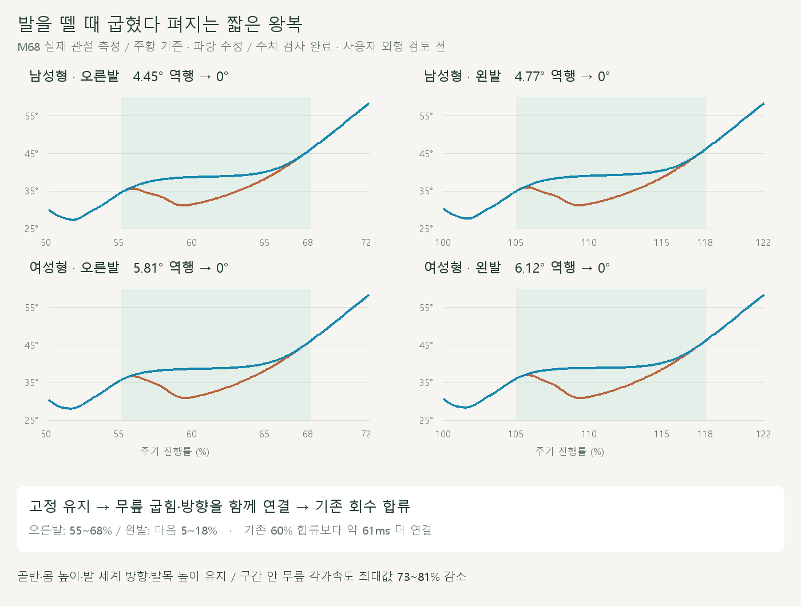
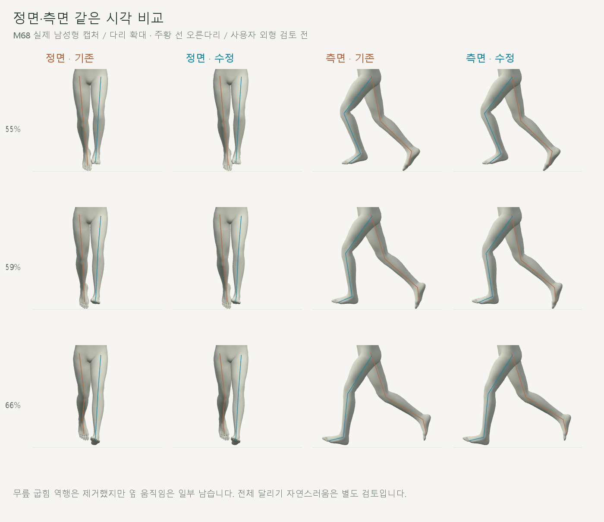

# 발을 뗄 때 무릎 왕복 줄이기

2026-10-20 · M68 · **구현·수치·재생 검사 완료 / 사용자 외형 검토 전** · R02·R16 / D03



기존 해제는 약 **38ms** 안에 더 펴진 무릎 자세로 복귀해 **굽힘→펴짐→굽힘**을 만들었습니다. 연결 끝을 약 61ms 늦추고 무릎 굽힘과 방향을 함께 연결했습니다.

[이전 주소 → 현재 자세 화면](http://127.0.0.1:5173/review/shared-gait.html?compare=shared-release) · [변경 범위·보존 계약](../02-requirements/REQUIREMENTS.md#m68--해제-구간-무릎-왕복-축소)

## 실제 비교



왼쪽 칸 M67, 오른쪽 칸 M68입니다. 양발에 같은 방식을 반 주기 차로 적용하며 **새 연결 범위 밖 회수는 그대로**입니다.

## 코드

```text
기존 양발 동작
    → 해제 중인가?
    → 역행 없는 무릎 굽힘 + 연결된 무릎 방향
    → 기존 발 높이·방향으로 고관절–무릎–발 계산
    → 기존 회수에 합류
```

| 코드 | 역할 |
| --- | --- |
| [shared-release.js](../../experiments/model-preview/review/shared-release.js) · `monotoneRelease` | 순서가 증가하는 제어점으로 굽힘 역행 방지 / 시작·끝 위치·속도·가속도 연결 |
| 같은 파일 · `createSharedRelease` | 무릎 방향도 연결 / 코사인 법칙으로 다리 길이와 발 높이를 보존하는 발목 위치 계산 |
| [shared-support.js](../../experiments/model-preview/review/shared-support.js) · `solveSupportLeg` | 선택적인 무릎 방향 입력 추가 / 이전 호출 결과 유지 |
| [shared-gait-view.js](../../experiments/model-preview/review/shared-gait-view.js) | M67 ↔ M68 비교 / 정면·측면·남녀·반복 |

무릎 굽힘만 연결한 중간 시도에서는 옆 왕복이 증가했습니다. 최종 코드는 무릎 방향까지 함께 연결하며, 단순히 구간을 늘리는 것만으로 해결됐다고 판단하지 않습니다.

## 검사

| 같은 해제 구간 | 남성형 오른발 / 왼발 | 여성형 오른발 / 왼발 |
| --- | --- | --- |
| 무릎이 다시 펴진 누적 각도 | 4.45° / 4.77° → **0° / 0°** | 5.81° / 6.12° → **0° / 0°** |
| 무릎 각가속도 최대값 감소 | 80% / 81% | 73% / 73% |
| 고관절 대비 무릎 옆 우회 길이 | 19.60 / 23.11 → 15.91 / 16.99mm | 17.92 / 22.02 → 16.50 / 16.92mm |
| 최대 수평 발목 위치 변경 | 45.18mm | 41.42mm |
| 종아리 대비 발목 상대각 최대 변경 | 3.39° | 3.58° |

‘옆 우회 길이’는 좌우 누적 이동에서 시작–끝의 직선 이동을 뺀 값입니다. 세계 발 방향 보존과 종아리 대비 발목 상대각 보존은 다릅니다.

| 보존·동작 검사 | 결과 |
| --- | --- |
| 남녀 전 주기 / 양발 해제 주변 | 2,002 + 884표본 |
| M67 저장 발 피부점과 기존 계산 | 차이 0mm |
| 골반·몸 높이·상체·뼈 길이 / 범위 밖 회수 | 위치 <0.01mm / 회전 <0.001° |
| 양발 세계 방향 / 발목·피부점 높이 | <0.001° / <0.01mm |
| 피부 최저 높이 | 변화 <0.01mm / 새 바닥 침투 없음 |
| 경계 속도 / 반복·재탐색·화면 좌표 | <0.0001m/s / 위치 오차 <0.01mm |
| 여성형의 지면 1mm 이내 해제 이동 | 오른발 13.14→5.60mm / 왼발 11.16→5.39mm |
| 재생·모델 전환·반복·단회·정면/측면 | 통과 / 32장·영상 2개 / 브라우저 오류 없음 |

타입 검사와 메인 미리보기 빌드는 통과했습니다. 검토용 JS는 위 브라우저 검사로 별도 확인했으며, 영상 기록은 약 60프레임/초였습니다. 남성형은 해제 구간에 선택한 발끝 피부점이 1mm보다 높으므로 같은 접지 이동 지표를 적용하지 않았습니다.

**남은 한계:** 옆 움직임과 기존 몸·발 회전의 세부 변화는 남습니다. 이번 수치 개선을 전체 떨림 제거·정상 러닝·접촉력 검증으로 확대하지 않습니다.

[전체 JSON](reports/cmu-shared-release.json) · [요약](reports/cmu-shared-release-summary.json) · [검사 코드](../../experiments/model-preview/scripts/verify-shared-release.cjs) · [영상 캡처](../../experiments/model-preview/scripts/capture-shared-release.cjs) · [영상 검사](reports/cmu-shared-release-media-check.json) · [그림 원본·생성](../assets/diagrams/cmu-shared-release.py)

```sh
node experiments/model-preview/scripts/verify-shared-release.cjs
node experiments/model-preview/scripts/capture-shared-release.cjs
node experiments/model-preview/scripts/check-shared-release-media.cjs
python docs/assets/diagrams/cmu-shared-release.py
```

실제 장면·영상은 `outputs/cmu-shared-release/`에 보관합니다. Node·Playwright·Edge·Three.js·Vite·Python·Pillow·맑은 고딕으로 재현합니다. [M67 이력](CMU_SHARED_SUPPORT_BILATERAL.md) · [문서 목록](../README.md).
