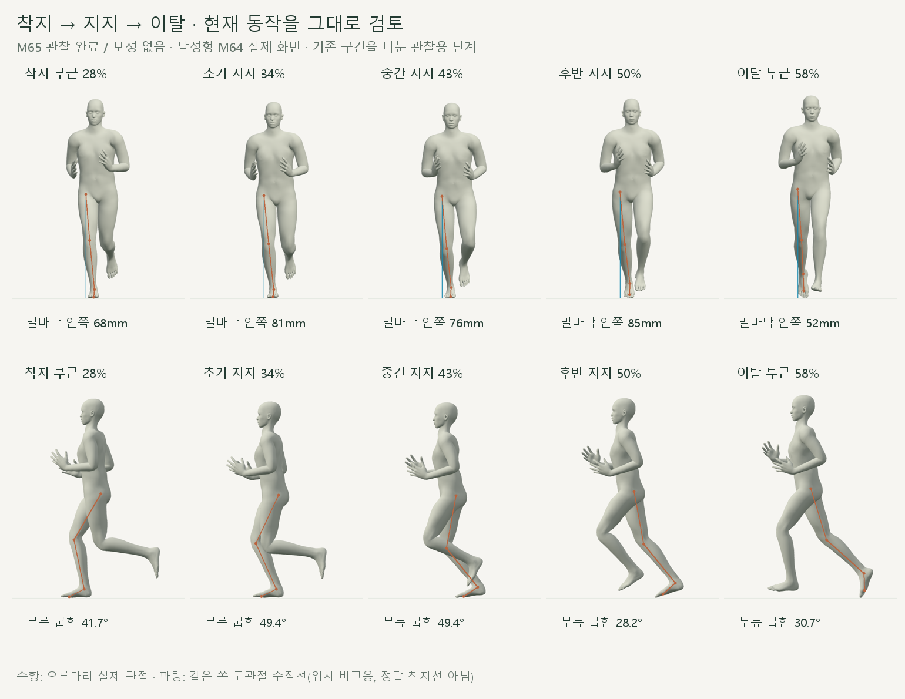
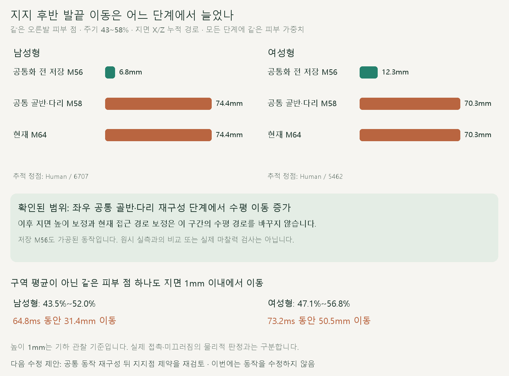
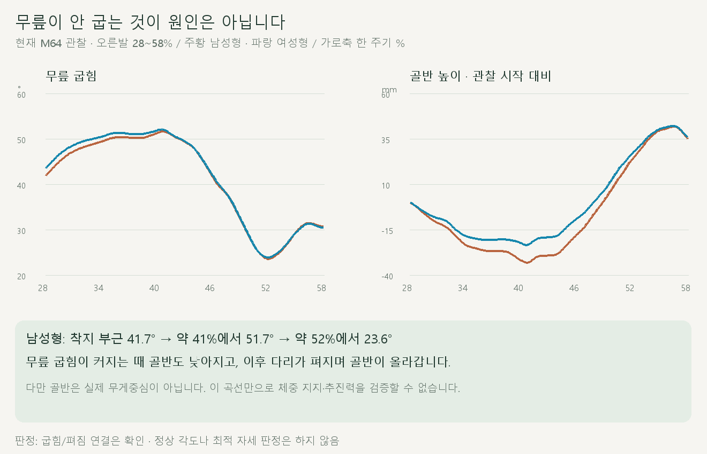

# 착지·지지·밀어내기 검토

2026-10-20 · M65 · **관찰 완료 / 동작 수정 없음 / 기본 달리기 채택 보류** · R02·R16 / D03 · M64 후속



현재 M64를 단계별로 관찰했습니다. **무릎 굽힘·펴짐은 있으나, 지지 후반 발끝의 지면 이동이 공통 동작 재구성 단계에서 커지는 문제**를 확인했습니다.

[이전 주소 → 현재 자세 화면](http://127.0.0.1:5173/review/shared-gait.html?compare=shared-approach) · [관찰 범위](../02-requirements/REQUIREMENTS.md#m65--착지지지밀어내기-관찰)

## 우선 확인된 문제



주기 43~58%의 **같은 오른발 피부 정점**을 같은 가중치로 계산했습니다. 저장된 M56 기준 → 공통 골반·다리 재구성에서 경로가 커지고, 이후 높이 보정과 M64 접근 수정에서는 수평 경로가 같습니다.

| 같은 점의 지면 X/Z 누적 경로 | 남성형 | 여성형 |
| --- | --- | --- |
| 공통화 전 저장 M56 | 6.82mm | 12.28mm |
| 공통 골반·다리 `shared-gait.core` | 74.42mm | 70.31mm |
| 높이 보정 후 / 현재 M64 | 74.42mm / 74.42mm | 70.31mm / 70.31mm |
| 실제 추적 정점 · Human | 6707 | 5462 |

M56은 **가공 후 저장된 기준**이며 원시 CMU 동작이 아닙니다. 어느 개별 골반 이동·회전 항목이 얼마나 기여했는지는 아직 분리하지 않았습니다.

| 지면 높이 1mm 이내인 같은 피부 점 | 남성형 | 여성형 |
| --- | --- | --- |
| 오른발 | 43.45~52.00% / 64.84ms / **31.37mm 이동** | 47.15~56.80% / 73.18ms / **50.52mm 이동** |
| 왼발 | 93.45~102.00% / 64.84ms / **32.22mm 이동** | 97.15~106.80% / 73.18ms / **47.51mm 이동** |

매 순간 가장 낮은 점을 다시 고르지 않았습니다. 이는 **지면 가까이 움직이는 같은 재질점의 관찰**이며, 접촉력·마찰을 이용한 물리적 미끄러짐 판정은 아닙니다.

## 무릎과 골반의 연결



무릎 굽힘이 커질 때 골반이 낮아지고, 이후 다리가 펴지며 골반이 올라갑니다. 앞선 “체중을 받아 밀어내는 흐름이 부족하다”는 시각적 인상만으로 무릎 연결 자체가 없다고 판단하지 않습니다.

| 관찰 · 오른발과 반 주기 뒤 왼발 대응 | 남성형 | 여성형 |
| --- | --- | --- |
| 착지 부근 무릎 굽힘 | 41.7° | 43.4° |
| 지지 중 최대 굽힘 / 시점 | 51.7° / 약 40.6% | 52.1° / 약 40.5% |
| 이후 최소 굽힘 / 시점 | 23.6° / 약 52.0% | 23.9° / 약 52.0% |
| 착지 부근 발바닥 정점 평균의 같은 쪽 고관절 대비 안쪽 위치 | 67.7mm | 54.5mm |

안쪽 착지 위치도 남아 있습니다. 고관절 수직선은 기존 디딤 요구와 대조하는 위치 기준이며, 이 숫자만으로 인체의 정상·비정상 범위를 판정하지 않습니다.

## 코드에서 확인한 범위와 다음 제안

| 단계 | 확인 |
| --- | --- |
| [shared-gait.js](../../experiments/model-preview/review/shared-gait.js) · `core` | 골반 회전·이동을 반 주기 대응으로 재구성하고 오른다리 기준을 양발에 적용 / 이번 추적점의 수평 경로가 달라지는 단계 |
| 같은 파일 · `apply` | 피부 최저점에 따라 몸의 Y만 보정 / X/Z 지지점 고정을 다시 푸는 계산 없음 |
| [shared-approach.js](../../experiments/model-preview/review/shared-approach.js) | 공중 접근 구간만 조절 / 이번 지지 후반의 발·골반 경로는 보존 |
| **후속 M66 사용자 승인·작은 비교 구현** | [오른발 지지 후반 연결](CMU_SHARED_SUPPORT.md) / 골반·몸 높이·발 세계 방향 보존 / 무릎 변경에 따른 발목 상대각과 오른발만 적용한 차이를 별도 기록 |

이전 발목·좌우 대칭 수치 검사는 유지됩니다. **지지점 안정성을 다시 확인하기 전에는 자연스러운 기본 달리기로 채택하지 않습니다.**

## 검증과 재현

| 관찰 확인 | 결과 |
| --- | --- |
| 남녀 각 전 주기 721 + 양발 지지 각 361시점 | 2,886자세 |
| 정면·측면 실제 캡처 | 총 48장 |
| 현재·M63 지지 다리 / 골반 위치 | 차이 0mm |
| 양발 같은 단계 관절 대응 | <0.01mm |
| 동일 시점 재탐색 / 브라우저 오류 | 일치 / 없음 |
| 실행 파일 10개·기준 JSON·남녀 GLB 해시 | 전후 동일 |

[관찰·캡처 코드](../../experiments/model-preview/scripts/inspect-shared-stance.cjs) · [같은 피부 점 추적](../../experiments/model-preview/scripts/inspect-shared-support-point.cjs) · [계산 단계 분리](../../experiments/model-preview/scripts/inspect-shared-stance-layers.cjs) · [그림 생성](../assets/diagrams/cmu-shared-stance-review.py)

[전체 관찰 JSON](reports/cmu-shared-stance-review.json) · [고정 피부점 JSON](reports/cmu-shared-support-point.json) · [계산 단계 JSON](reports/cmu-shared-stance-layers.json) · [수치 요약](reports/cmu-shared-stance-review-summary.json)

```sh
node experiments/model-preview/scripts/inspect-shared-stance.cjs
node experiments/model-preview/scripts/inspect-shared-support-point.cjs
node experiments/model-preview/scripts/inspect-shared-stance-layers.cjs
python docs/assets/diagrams/cmu-shared-stance-review.py
```

실제 캡처는 `outputs/cmu-shared-stance-review/`에 보관합니다. Node·Playwright·Edge·Vite·Python·Pillow·맑은 고딕으로 재현하며 기존 실행 동작은 바꾸지 않습니다.

**출처·한계:** CMU 35_17에서 가공된 M56→M58→M64 모델 동작입니다. 단계 이름은 기존 기하 구간이며 실측 접촉 시점이 아닙니다. 골반은 실제 무게중심이 아니며 체중 지지·추진력·기록 효과·개인별 정상 자세는 미검증입니다. [M64 변경 이력](CMU_SHARED_APPROACH.md) · [문서 목록](../README.md).
